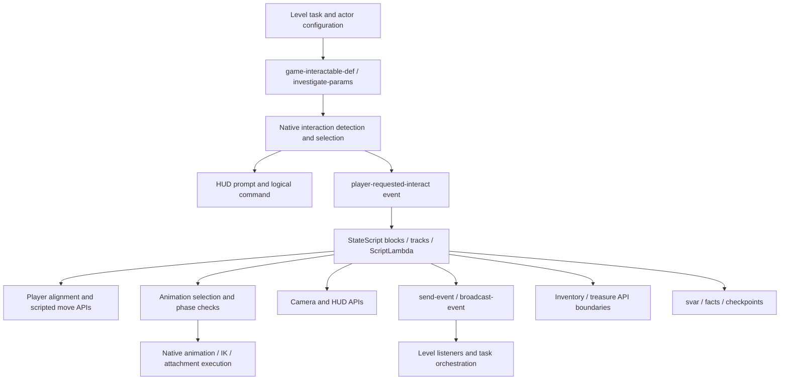

# Interaction architecture reconstructed from the 1.6 corpus

**HIGH CONFIDENCE:** interactions are composed from object configuration, gameplay interaction definitions, state-script orchestration, native player/animation APIs, camera/HUD systems and gameplay bookkeeping. There is no evidence for one script layer that owns all of these responsibilities. Each link below has its own evidence boundary.

The diagram is a responsibility map. It does not assert that every interaction traverses every node or uses that precise order.

## Detection and prompt ownership

**CONFIRMED:** `interactable.bin` exports 273 `game-interactable-def` records. `gui2-game.bin` contains exactly 111 readable `interact-*` names in a referenced name array. They are separate layers: the latter count does not describe all gameplay definitions. All 273 records and HUD-only names are indexed in `databases/interaction_definitions.json` and CSV.

**CONFIRMED:** scripts call `get-closest-enabled-interactable`, `get-best-nearby-interactable`, `override-interact-def`, `disable-interactable-system`, `interactable-disable`, and pickup-scan exclusion APIs. None has a recovered DC lambda definition. Calls use `CallFf`; the selection implementation is therefore a **HIGH CONFIDENCE native boundary**. Distance/orientation scoring, tie-breaking, reservations, eligibility and prompt activation are **UNKNOWN / NEEDS NATIVE RESEARCH**. Runtime enabled/disabled state, exclusion and override controls are script-accessible interfaces.

**CONFIRMED:** drawer and cabinet definition records reference `handle`, `gen:interact`, `interact`, highlight settings and accessibility prompt sounds. Hold/mash records additionally reference a PC hybrid prompt widget and `interact-hold`. Their raw member offsets are indexed. Interpreting the repeated logical-command slot is **HIGH CONFIDENCE**; assigning undocumented numeric fields to specific distance/angle/hold meanings is **UNKNOWN**. Triangle-related accessibility SIDs do not prove that a current PC binding is E, Triangle or any fixed physical key.

## Drawer: end-to-end evidence

Source: `dc1/ss-t2/ss-openable-drawer.bin`. Exact state table and branch graph: [drawer evidence](interactions/drawers/evidence.md).

| Player-visible question | Recovered answer | Confidence and evidence |
| --- | --- | --- |
| How is the drawer detected? | Native interactable APIs expose selection; the underlying scan and ranking are absent from DC. | HIGH CONFIDENCE boundary; UNKNOWN scoring. |
| Why does a prompt appear? | Gameplay definition provides prompt/command references; scripts enable/disable interactions. | CONFIRMED records and calls; native display conditions UNKNOWN. |
| What begins the state machine? | `wait-interact` listens for `player-requested-interact`, stores event arg 0 as `current-interactable-scav`, then calls `go(interact, 1)`. | CONFIRMED at 0x16798, 0x167C0 and 0x151B0. |
| How is drawer height considered? | Script queries the object's `handle` joint, calculates/stores object height, selects named animation variants and timing constants. | CONFIRMED `get-joint-position(..., handle)` at 0x13A90; arithmetic needs private bytecode review for exact thresholds. |
| Where does the player stand? | An animation alignment reference and goal produce a path goal; scripted movement is requested. | CONFIRMED `get-align-from-ap-ref` at 0x1A348 and `wait-player-scripted-move-new` at 0xAD18/0xAE08/0xAEA8. |
| How does the player face it? | Locator-angle comparisons and aligned goals are script-visible; native scripted movement executes the request. | CONFIRMED `angle-in-between-locators` at 0x1ADA8; solver UNKNOWN. |
| Which animation is chosen? | Branches use crouch/tension state and handle height; literal animation names include relaxed/crouched/tense height variants. | CONFIRMED symbols and calls; exact complete threshold table remains untyped. |
| How are the hands adjusted? | Script creates IK proxy objects, calls `joint-ik-characters`, tracks on/off and blend frames, and applies root adjustment. | CONFIRMED 0xEE88/0xEFA8 and `player-ik-root-adjust` at 0x1CC48. Native solver equations UNKNOWN. |
| How is the drawer prop synchronized? | `drawer-atachments` uses player/prop animation phase and AP references; animation names are paired with `--drawer`. | CONFIRMED helper lambda at 0x610; `symbol-concat-string` at 0x1B9F0. |
| When does sound play? | Pickup start/done sound APIs are called at hand/wrist stages. Furniture material packages exist separately. | CONFIRMED pickup calls at 0x19460 and 0x1900/0x1960; exact wood/metal animation event routing UNKNOWN. |
| When does loot become available? | Tagged pre-placed, IGC and spawned pickups are separately resolved; existing pickups are initially disabled, then enabled or handled by scripted pickup paths. | CONFIRMED 0x8FE8, 0xA1F0, 0x1B5D8. |
| How does the object meet the hand? | Attachment targets are explicitly `player/rightHand` or `player/leftHand`, with grip/scale and IK support. | CONFIRMED `attach` at 0x19E80/0x19F00. |
| Where is inventory ownership handed off? | Drawer helper and melee abort call `player-apply-pickup`. Later pickup may use `player-pickup`. | CONFIRMED 0x1A00, 0x12E78, 0xB7A8. Native inventory internals UNKNOWN. |
| How is UI informed? | Generic pickup/notification interfaces and event consumers exist; not all are direct drawer calls. | CONFIRMED corpus references; exact native pickup notification chain UNKNOWN. |
| How does the game remember it? | Drawer reads `has-been-opened?`, `has-item?`, `item-has-been-picked?`; these are script variables, not proven save writes. | CONFIRMED 0x1B2A8/0x1B318; their writer/native serialization is UNKNOWN. |
| How is control restored? | Exit/abort paths stop IK, cancel movement, clear state, manage interaction availability and terminate/retry. | CONFIRMED cleanup calls; native automatic restoration timing UNKNOWN. |

**CONFIRMED:** states are `wait-interact`, `interact`, `scavenge-move-to`, `scavenge-enter`, `scavenge-pickup`, `scavenge-exit`, `scavenge-early-exit`, `spawned-open`, `wait-pickup`, `melee-abort`, `complete`. The common path is supported by explicit `go` calls, but several states can skip pickup, return to waiting or react to attack. Cleanup is part of the interaction design.

**CONFIRMED:** height-related names are richer than the earlier 30/60/90/120 cm outline: crouch names include 30/80/120 cm; tense include 70/120 cm; relaxed include 35/50/70/90/120 cm, plus a 70 cm high-pickup variant. These labels describe animation variants, not proven numerical bin boundaries. A transform-aware combination of alignment references, phase-dependent IK proxies, grip choice and animation selection explains the script-side adaptation; actual pose solving is native.

**CONFIRMED:** `fact-set-bool-safe(player, scav-anim-active, ...)` is a runtime animation-related fact. Treating it as the save flag for an opened drawer would be unsupported.

## Cabinet comparison

**CONFIRMED:** cabinet uses the same scavenge states with `scavenge-init` rather than drawer `interact`; no separate `spawned-open` or `wait-pickup` state appears in its nine-state table. Shared APIs include animation phase/frame, AP references, scripted movement, joint IK, grip handling, item-full checks, `player-apply-pickup`, attachment and abort cleanup. Cabinet-specific helper names include `let-cabinet-door-go-wide-open`. Its prop motion and timing constants must be retained separately. See [cabinet evidence](interactions/cabinets/evidence.md).

## Held investigation and world examination

**CONFIRMED:** `ss-investigate-object` has setup, waiting, quick grab, enter/investigate, attack, early cancel, exit and complete paths. It calls `setup-and-investigate-object`, `player-investigate-object`, attachment, animated/stick-pan camera APIs, read-HUD helpers, treasure collection, item quantity addition, notification APIs and logging. `investigate-begin-flip`, `investigate-begin-exit` and `hard-end-early` are event hooks. On normal exit, `used` is resolved through `ss-svar` and written at 0x15AA0; setup reads it at 0xCA80. Attack/quick-grab paths have their own collection behavior.

**CONFIRMED:** `anim-player/player-investigate.bin` supplies actor-state data including `investigate-idle-front`, `investigate-idle-back`, `front-to-back`, `back-to-front` and swap-related symbols. These references support a front/back animation contract. Arbitrary object rotation/tilt/zoom input and native mapping curves remain **UNKNOWN**. Do not confuse a data state definition with a DC StateScript.

**CONFIRMED:** `ss-examine` separately listens for `player-requested-interact`; has cut/blend entry/exit, idle, read, fridge, done and complete states; calls `hud2-show-read-page` at 0x66E0, `hud2-hide-read-page` at 0x7920, stick-camera APIs, animation channels and `used` persistence. It emits `player-entering-examine`, `in-examine-idle`, `exiting-examine` and `examine-done`.

**UNKNOWN:** the proposed universal `investigate -> ss-examine` chain is not established by this corpus. Held investigation requests native player investigation; `ss-examine` has an independent world interaction entry. Both use HUD concepts, but shared HUD names are not proof of a fixed handoff. This distinction is important when designing a new book interaction. See [investigate](interactions/investigate/README.md) and [examine](interactions/examine/README.md).

## Inventory, notes and persistence

**CONFIRMED:** three useful boundaries exist: `player-apply-pickup` for scripted pickup application, `inventory-item-add-quantity` / `inventory-item-consume` for explicit item counts, and `collect-treasure` / `mark-treasure-examined-by-id` for collectible bookkeeping. Each is absent as a recovered DC implementation. Script controls when it calls them; internal clamping, ammo merging, destruction, notification and save serialization remain **UNKNOWN**.

**CONFIRMED:** `ss-crafting-recipe-from-pickup` listens for `player-pickup` and `upgrade-manual-found`, controls discovery/tutorial svars, and includes item conversion helpers. `ss-grounded-pickup-despawn` can send `disable-weapon-ammo-pickup-spawn` and `clear-checkpoint-record` then kill spawned entities. This is separate from ordinary collection and should not be generalized into every pickup's lifecycle.

**CONFIRMED:** journal, collectible menu, investigate, HUD read page, treasure database and level note activation are separate structures/interfaces. A note's display, collection, examination status and task progression need not be the same flag. The named `journal-interests` file was not present verbatim; the actual manifest contains `journal-interesurgeonguild.bin`. Use real paths rather than silently correcting them.

## Locks and power

**CONFIRMED:** the safe world script and HUD lock minigame are separate. Safe calls `hud2-set-lock-minigame-data` with `dial`, shows the HUD, submits input and branches to open/fail, then explicitly signals HUD win/fail. This is not proof that the HUD alone owns correctness. Safe open writes object-scoped `opened`, updates safe counters/bitfields and broadcasts `opened-safe`.

**CONFIRMED:** arrival keypad passes data to the same HUD lock API, includes note knowledge checks, numeric key ranges, its own button/selection logic, and broadcasts `keypad-success` and `keypad-exited`. Shared UI does not mean identical world scripts or combination validation. See lock and keypad evidence.

**CONFIRMED:** generator minigame emits `generator-press`, `generator-fail`, `generator-complete` and branches complete. Door-generator world script separately handles movement, animation, camera, speech/task signals and light intensity. The global event index lists actual producers/listeners and candidate event matches. **UNKNOWN:** a universal event named “power on” and all downstream AI/door/light effects are not established; receiver/tag resolution must be checked for each level puzzle.

## Doors, traversal, ropes and pushables

**CONFIRMED:** `ss-openable-door` is only a two-state wait/complete script with eight call sites. It does not reconstruct the systemic door controller. The four directional definitions and `player-door` actor-state list exist, but exact side/hinge/push/pull selection is **UNKNOWN / NEEDS NATIVE RESEARCH**. Level scripts can expose `door-enable-systemic`.

**CONFIRMED:** `ss-basic-ladder` covers a portable ladder's initial/ground/pickup/hold/drop cycle, raycast queries, locators, movement mode, collision and HUD/input control. This is not the full player climbing state machine. Player/character ladder and climb modules are separate animation/controller data.

**CONFIRMED:** rope physics definitions, player animation/controller data and level rope puzzles are separate. The corpus supports attachment/puzzle/interaction interfaces; rope integration, constraint solving, tension and collision are **UNKNOWN**. Likewise `push-object` is data, `player-push-object` is actor-state data and `ss-push-follow-cam` is camera orchestration; native motion/contact/nav update mechanics are not revealed by a zero-lambda data module.

## Workbench as a reusable design reference

**CONFIRMED:** world workbench coordinates entering, waiting, weapon-on-table/bag states, disassembly, upgrade application, assembly, inspection and exit. It drives temporary weapon processes, backpack state, mesh visibility, animation phase waits, camera/render settings, pickup-scan suppression and upgrade bundle application. Menu and upgrade pages are separate StateScripts. `workbench-script-funcs-impl` and Ellie/Abby settings supply reusable data/helper layers.

**HIGH CONFIDENCE:** this is an application-like interaction contract: UI requests become world-state events; world choreography coordinates existing models/assets with native inventory and upgrade interfaces. The generated evidence gives the exact callable surface. It is the best complex reference, but reusing the whole workbench does not create arbitrary new animations or upgrade storage for free.

## Level composition and native boundaries

**CONFIRMED:** Patrol globe and heater scripts gate on task state, listen for interaction, call camera/alignment/animation or caption APIs, signal completion and disable/enable prompts. The joke-book script has only six call sites: task checks, state transitions, disabling interaction and `wait-script-caption`. **UNKNOWN:** it does not prove the complete held-book/VO/animation sequence described by its caption. All three are indexed without claiming that shipped development scaffolding runs in the final level.

**CONFIRMED:** module registry contains 7,096 module records with declared imports/exports. AI parameter/archetype/action-pack data, perception controllers, level sets, actors, animation/resource references and native resource APIs are discoverable. Runtime residency and final AI decision logic are not in that registry. Streaming and gameplay persistence are documented separately in `ENGINE_BOUNDARIES.md`.
