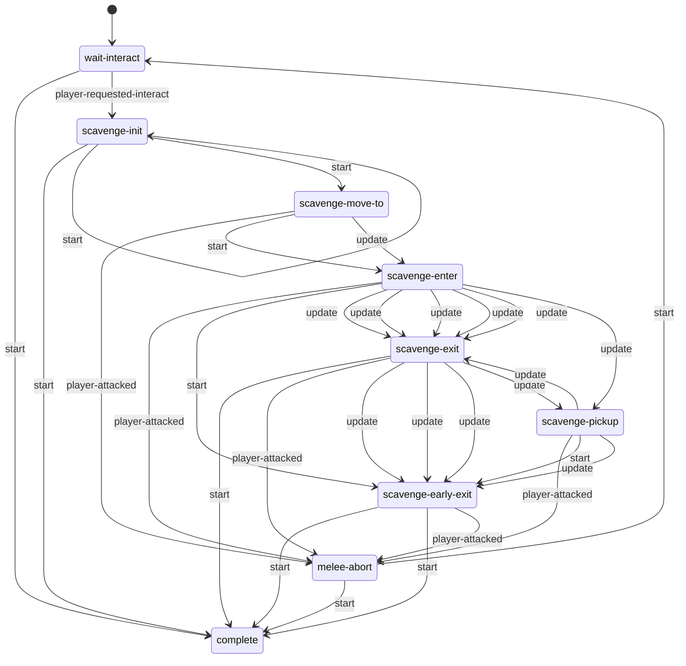

# Cabinets: static evidence

CONFIRMED means a structure or call instruction is present. Branch reachability, native implementation and object configuration remain separate questions. Call offset is a hexadecimal byte offset in the original module; source SHA-256 is in `databases/file_manifest.json`. `result(...)` references another call in the same lambda, not its presumed return value.

## `dc1/ss-t2/ss-openable-cabinet.bin`

1201 call sites; 1 state scripts; 5 exported entries.

### `ss-openable-cabinet`

Initial state field: `wait-interact`. A zero SID does not prove that the first table state starts automatically.

Edges represent explicit `go` call sites, including conditional alternatives. Same-target edges can occur in different tracks; this is not a guaranteed linear execution trace.

#### `wait-interact`

64 call sites. Event listeners: `player-requested-interact`.

| Call target | Example offset | Argument evidence |
| --- | --- | --- |
| `wait-animate_` | `0x9398` | result(4D70:9), open, result(4D70:20) |
| `go` | `0x93E8` | complete, 1 |
| `event-arg-symbol` | `0x9CF0` | 0 |
| `get-joint-position` | `0xD2F0` | result(5B30:8), handle |
| `interactable-disable` | `0x10B48` | result(6478:13) |

#### `scavenge-init`

482 call sites. Event listeners: none.

| Call target | Example offset | Argument evidence |
| --- | --- | --- |
| `rotate-locator-lookat-object` | `0x75C8` | result(49A8:15), player, 1.0, 0 |
| `angle-in-between-locators-plus` | `0x7600` | result(49A8:8), result(49A8:23), 2, 1 |
| `transform-locator-world-to-local` | `0x7C48` | result(4B08:15), result(4B08:21) |
| `get-locator-position` | `0x7CD8` | result(4B08:40) |
| `get-locator-rotation` | `0x7E48` | result(4B08:86) |
| `transform-locator-local-to-world` | `0x8018` | result(4B08:137), result(4B08:143) |
| `accessibility-suppress-control-sounds/f` | `0x9880` |  |
| `tension-mode-is?` | `0xA180` | 3 |
| `parent` | `0xA550` | result(5348:6), result(5348:12), door |
| `get-joint-position` | `0xA680` | result(53F8:10), handle |
| `is-point-on-nav-mesh?` | `0xEC78` | result(5EA0:9), 0.4, 1.0, 0 |
| `is-locator-on-left-side?` | `0xED08` | result(5EA0:26), result(5EA0:32) |
| `vector-set-magnitude` | `0xEDC0` | 0.4, result(5EA0:55) |
| `offset-locator-world-space` | `0xEDD8` | result(5EA0:44), result(5EA0:58) |
| `debug-draw-locator` | `0xF030` | result(5EA0:124), 1.0, 1.0, 1, 1.0, 0 |
| `go` | `0xF160` | scavenge-init, 1 |
| `get-joint-locator` | `0xF4A0` | result(5EF8:11), handle |
| `animate_` | `0x10080` | result(6108:6), open, result(6108:17) |
| `player-is-crouched?` | `0x106A0` |  |
| `get-align-from-ap-ref` | `0x12080` | player, result(6B58:9), result(6B58:15), 0.1, apReference-straight |

#### `scavenge-move-to`

61 call sites. Event listeners: `player-attacked`.

| Call target | Example offset | Argument evidence |
| --- | --- | --- |
| `go` | `0x8108` | melee-abort, 1 |
| `ss-cabinet-attachment` | `0x96C8` | result(4E20:16) |
| `accessibility-suppress-control-sounds/f` | `0x9880` |  |
| `wait-player-scripted-move-new` | `0xC3B0` | result(5870:13), 1, 0, 2, 0, 1 |
| `tension-mode-is?` | `0xC3D8` | 3 |
| `get-object-locator` | `0xC5B8` | player |
| `get-locator-distance-xz` | `0xC600` | result(58C8:4), result(58C8:10) |
| `angle-in-between-locators` | `0xC6D8` | result(58C8:29), result(58C8:35), 2 |
| `get-locator-position` | `0xDF20` | result(5D40:20) |
| `holster-player-weapon` | `0xE5D8` | 0, ? |

#### `scavenge-enter`

125 call sites. Event listeners: `player-attacked`.

| Call target | Example offset | Argument evidence |
| --- | --- | --- |
| `go` | `0x8108` | melee-abort, 1 |
| `object-anim-playing?` | `0x94C8` | player, result(4DC8:7), 1 |
| `ss-cabinet-attachment` | `0x96C8` | result(4E20:16) |
| `accessibility-suppress-control-sounds/f` | `0x9880` |  |
| `get-animation-frame` | `0x98F8` | player, 2, result(5030:8) |
| `joint-ik-characters` | `0x9A68` | player, result(5030:45), 1, root, 0, 0.333, 1 |
| `get-animation-phase` | `0xCA80` | player, 2, result(5978:8) |
| `broadcast-event` | `0xCAE0` | scav-obj-been-opened |
| `send-event` | `0xCB70` | scavenge-obj-is-empty, result(5978:39) |
| `item-pickup-get-item-id` | `0xCCB0` | result(5978:80) |
| `player-pickup-is-full` | `0xCCC0` | result(5978:82) |
| `tension-mode-is?` | `0xCD98` | 3 |
| `alloc-vector` | `0xF878` | ?, 0.0, ?, 1.0, 0 |
| `offset-locator` | `0xF890` | result(5F50:30), result(5F50:90) |
| `player-ik-root-adjust` | `0xF938` | ?, ? |
| `debug-draw-locator` | `0xF9D0` | result(5F50:121), 1.2, 3.0, 1, 6.0, 0 |
| `animate_` | `0x13628` | player, result(6CB8:7), result(6CB8:17) |
| `get-openable-spawned-pickup` | `0x147A8` | result(6D68:59) |
| `get-object-locator` | `0x14948` | result(6D68:111) |
| `get-ap-ref-from-align` | `0x14998` | result(6D68:88), result(6D68:104), result(6D68:113), 0.0, apReference-pickup-point, 0 |
| `get-locator-position` | `0x149A8` | result(6D68:123) |

#### `scavenge-pickup`

120 call sites. Event listeners: `player-attacked`.

| Call target | Example offset | Argument evidence |
| --- | --- | --- |
| `go` | `0x8108` | melee-abort, 1 |
| `object-anim-playing?` | `0x94C8` | player, result(4DC8:7), 1 |
| `get-animation-phase` | `0xB120` | player, 2, result(5660:8) |
| `get-animation-duration` | `0xB228` | player, result(5660:42) |
| `stop-joint-ik` | `0xB320` | result(5660:34), ? |
| `joint-ik-characters` | `0x125D8` | player, result(6C60:61), 0, root, 0, ?, 0 |
| `detach-without-physicalizing` | `0x138A0` | result(6D10:56), 0.0 |
| `set-show-in-flashlight-flag` | `0x13938` | result(6D10:75), 0 |
| `item-pickup-play-pickup-sound` | `0x139C8` | result(6D10:93), l_wrist |
| `animate_` | `0x14130` | player, result(6D10:170), result(6D10:180) |
| `has-anim?` | `0x14240` | result(6D10:359), result(6D10:365) |
| `attach` | `0x143F0` | result(6D10:414), player, leftHand, 0.0 |
| `tension-mode-is?` | `0x15998` | 3 |
| `ss-cabinet-attachment` | `0x1B938` | result(7290:16) |

#### `scavenge-exit`

125 call sites. Event listeners: `player-attacked`.

| Call target | Example offset | Argument evidence |
| --- | --- | --- |
| `go` | `0x7448` | scavenge-early-exit, 1 |
| `get-animation-frame` | `0x77A0` | player, 2, result(4A58:12) |
| `stop-joint-ik` | `0x9F08` | result(5190:16), 0.2 |
| `stop-animating` | `0xA5E8` | player, 1, 0.2, 0, 0 |
| `animate_` | `0xBF08` | player, result(56B8:7), result(56B8:17) |
| `ss-cabinet-attachment` | `0xD408` | result(5B88:16) |
| `get-animation-phase` | `0xD5D8` | player, 2, result(5C38:31) |
| `item-pickup-get-item-id` | `0xD640` | result(5C38:46) |
| `player-pickup-is-full` | `0xD650` | result(5C38:48) |
| `tension-mode-is?` | `0xD770` | 3 |
| `player-pickup` | `0xDB98` | result(5C38:204), 0, result(5C38:211), 0, 0 |
| `fact-set-bool-safe` | `0xDE48` | player, scav-anim-active, 1 |
| `stop-player-script-ik` | `0x11A40` | 0.5 |
| `get-object-anim` | `0x11C58` | player, 1 |
| `object-anim-playing?` | `0x14E78` | player, result(6E18:11), 0 |

#### `scavenge-early-exit`

73 call sites. Event listeners: `player-attacked`.

| Call target | Example offset | Argument evidence |
| --- | --- | --- |
| `stop-player-script-ik` | `0x7350` | 0.8 |
| `get-object-anim` | `0x7928` | player, 1 |
| `go` | `0x7B20` | complete, 1 |
| `object-anim-playing?` | `0x8550` | player, result(4CC0:10), 0 |
| `get-animation-frame` | `0x85E0` | player, 2, ? |
| `stop-animating` | `0x8640` | player, 2, 0.8, 0, 0 |
| `animate_` | `0x8DC8` | player, result(4CC0:74), result(4CC0:84) |
| `stop-joint-ik` | `0xAB30` | result(54A8:53), 0.4 |
| `ss-cabinet-attachment` | `0xD408` | result(5B88:16) |
| `disable-interactable-interaction` | `0x10110` |  |

#### `melee-abort`

35 call sites. Event listeners: none.

| Call target | Example offset | Argument evidence |
| --- | --- | --- |
| `stop-joint-ik` | `0xA018` | result(5240:16), 0.0 |
| `send-event` | `0xC048` | suppress-pickup-sound, result(5710:21) |
| `player-apply-pickup` | `0xC090` | result(5710:31) |
| `stop-animating` | `0x101E8` | player, 2, 0.0, 0, 0 |
| `stop-player-script-ik` | `0x10AB0` | 0.0 |
| `cancel-player-move-to` | `0x10BD8` |  |
| `interactable-enable` | `0x10C20` | result(64D0:16) |
| `animate_` | `0x10DB0` | result(64D0:25), idle, result(64D0:36) |
| `go` | `0x10E18` | wait-interact, 1 |

#### `complete`

5 call sites. Event listeners: none.

| Call target | Example offset | Argument evidence |
| --- | --- | --- |
| `fact-set-bool-safe` | `0xB098` | player, scav-anim-active, 0 |

Named/global/embedded helpers: `let-cabinet-door-go-wide-open`, `ss-cabinet-attachment`, `camera-adjustment-cabinet`, `cabinet-abort-if-evade`, `lambda@3B88`.
