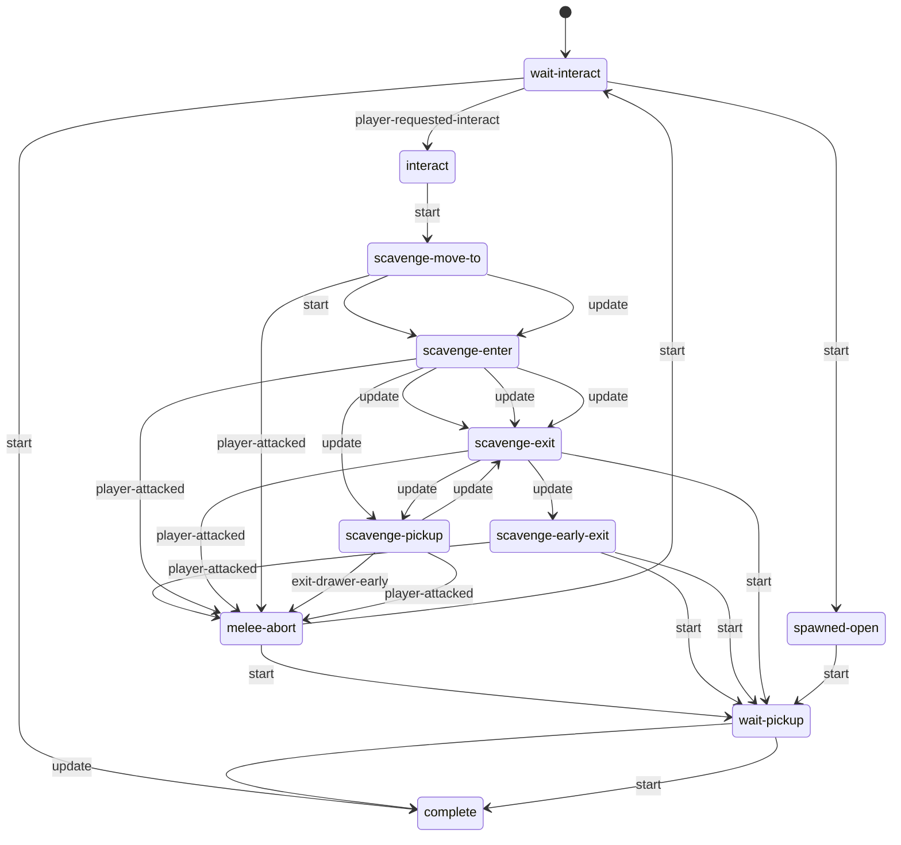

# Drawers: static evidence

CONFIRMED means a structure or call instruction is present. Branch reachability, native implementation and object configuration remain separate questions. Call offset is a hexadecimal byte offset in the original module; source SHA-256 is in `databases/file_manifest.json`. `result(...)` references another call in the same lambda, not its presumed return value.

## `dc1/ss-t2/ss-openable-drawer.bin`

1159 call sites; 1 state scripts; 6 exported entries.

### `ss-openable-drawer`

Initial state field: `wait-interact`. A zero SID does not prove that the first table state starts automatically.

Edges represent explicit `go` call sites, including conditional alternatives. Same-target edges can occur in different tracks; this is not a guaranteed linear execution trace.

#### `wait-interact`

76 call sites. Event listeners: `player-requested-interact`.

| Call target | Example offset | Argument evidence |
| --- | --- | --- |
| `interactable-disable` | `0x8FE8` | result(5D18:30) |
| `get-joint-position` | `0x13A90` | result(71B8:8), handle |
| `go` | `0x151B0` | interact, 1 |
| `event-arg-symbol` | `0x16798` | 0 |
| `get-openable-spawned-pickup` | `0x1B4F0` | result(8868:76) |
| `interactable-enable` | `0x1B5D8` | result(8868:105) |
| `animate_` | `0x1B790` | result(8868:119), motor-ajar, result(8868:130) |

#### `interact`

309 call sites. Event listeners: none.

| Call target | Example offset | Argument evidence |
| --- | --- | --- |
| `parent` | `0x94B8` | result(5ED0:6), result(5ED0:12), drawer |
| `animate_` | `0xB5A0` | result(64A8:6), idle, result(64A8:17) |
| `accessibility-suppress-control-sounds/f` | `0xCFD0` |  |
| `tension-mode-is?` | `0xD250` | 1 |
| `rotate-locator-lookat-object` | `0xD798` | result(6920:15), player, 1.0, 0 |
| `angle-in-between-locators-plus` | `0xD7D0` | result(6920:8), result(6920:23), 2, 1 |
| `get-object-locator` | `0xF868` | result(6C38:14) |
| `rotate-locator-angle` | `0xF8C0` | result(6C38:16), 1, result(6C38:23) |
| `set-object-locator` | `0xF8D8` | result(6C38:6), result(6C38:27) |
| `alloc-vector` | `0x10358` | 0.0, 0.0, 0.0, 1.0, 0 |
| `set-vector` | `0x10380` | player-handle-pos-max-offset, result(6CE8:121), self |
| `get-joint-position` | `0x14710` | result(7580:10), handle |
| `get-joint-locator` | `0x14F78` | result(7738:11), handle |
| `get-vector` | `0x16988` | player-handle-pos-max-offset, self |
| `vector-lerp-scale` | `0x16A98` | result(79A0:21), result(79A0:33), result(79A0:45), result(79A0:51), result(79A0:79) |
| `offset-locator` | `0x16AB0` | result(79A0:8), result(79A0:85) |
| `go` | `0x18500` | scavenge-move-to, 1 |
| `player-is-crouched?` | `0x18F70` |  |

#### `scavenge-move-to`

62 call sites. Event listeners: `player-attacked`.

| Call target | Example offset | Argument evidence |
| --- | --- | --- |
| `go` | `0x9C28` | melee-abort, 1 |
| `wait-player-scripted-move-new` | `0xAD18` | result(62F0:13), 1, 0, 2, 0, 1 |
| `tension-mode-is?` | `0xAD40` | 3 |
| `accessibility-suppress-control-sounds/f` | `0xCFD0` |  |
| `get-align-from-ap-ref` | `0x1A348` | player, result(8398:9), result(8398:15), 0.15, apReference |
| `get-object-locator` | `0x1AC88` | player |
| `get-locator-distance-xz` | `0x1ACD0` | result(87B8:4), result(87B8:10) |
| `angle-in-between-locators` | `0x1ADA8` | result(87B8:29), result(87B8:35), 2 |
| `get-locator-position` | `0x1C1F8` | result(8AD0:20) |
| `holster-player-weapon` | `0x1C8B0` | 0, ? |

#### `scavenge-enter`

151 call sites. Event listeners: `player-attacked`, `exiting-investigate-cut`.

| Call target | Example offset | Argument evidence |
| --- | --- | --- |
| `get-animation-frame` | `0x9648` | player, 2, result(5FD8:8) |
| `send-event` | `0x97B8` | contact-completed, result(5FD8:55) |
| `go` | `0x9C28` | melee-abort, 1 |
| `get-openable-spawned-pickup` | `0xA1F0` | result(6190:59) |
| `get-object-locator` | `0xA368` | result(6190:106) |
| `get-ap-ref-from-align` | `0xA3B8` | result(6190:88), result(6190:99), result(6190:108), 0.0, apReference-pickup-point, 0 |
| `get-locator-position` | `0xA3C8` | result(6190:118) |
| `item-pickup-get-item-id` | `0xA6D8` | result(6190:216) |
| `player-pickup-is-full` | `0xA6E8` | result(6190:218) |
| `object-anim-playing?` | `0xAAE0` | player, result(6298:7), 1 |
| `get-animation-phase` | `0xBB98` | player, 2, result(65B0:8) |
| `broadcast-event` | `0xBBF8` | scav-obj-been-opened |
| `accessibility-suppress-control-sounds/f` | `0xCFD0` |  |
| `joint-ik-characters` | `0xEE88` | player, result(6A80:61), 0, root, 0, ?, 1 |
| `event-arg-symbol` | `0x141D0` | 0 |
| `tension-mode-is?` | `0x17420` | 1 |
| `animate_` | `0x181C8` | player, result(7D68:7), result(7D68:17) |
| `player-ik-root-adjust` | `0x1CC48` | ?, 0.7 |

#### `scavenge-pickup`

154 call sites. Event listeners: `player-attacked`, `exit-drawer-early`, `exiting-investigate-cut`.

| Call target | Example offset | Argument evidence |
| --- | --- | --- |
| `get-animation-phase` | `0x9380` | player, 2, result(5E78:8) |
| `stop-joint-ik` | `0x9A78` | result(6030:50), ? |
| `go` | `0x9C28` | melee-abort, 1 |
| `object-anim-playing?` | `0xAAE0` | player, result(6298:7), 1 |
| `tension-mode-is?` | `0xC240` | 1 |
| `animate_` | `0xCF18` | player, result(6660:7), result(6660:17) |
| `accessibility-suppress-control-sounds/f` | `0xCFD0` |  |
| `joint-ik-characters` | `0x13488` | player, result(6FA8:31), 1, root, 0, 0.4, 0 |
| `event-arg-symbol` | `0x141D0` | 0 |
| `detach-without-physicalizing` | `0x19338` | result(8238:56), 0.0 |
| `set-show-in-flashlight-flag` | `0x193D0` | result(8238:75), 0 |
| `item-pickup-play-pickup-sound` | `0x19460` | result(8238:93), r_wrist |
| `has-anim?` | `0x19CD0` | result(8238:358), result(8238:364) |
| `attach` | `0x19E80` | result(8238:413), player, rightHand, 0.0 |

#### `scavenge-exit`

132 call sites. Event listeners: `player-attacked`, `done-with-investigate`, `exiting-investigate-cut`.

| Call target | Example offset | Argument evidence |
| --- | --- | --- |
| `stop-animating` | `0x95C0` | player, 1, 0.2, 0, 0 |
| `go` | `0x9C28` | melee-abort, 1 |
| `get-animation-frame` | `0x9CC8` | player, 2, result(6138:8) |
| `stop-joint-ik` | `0x9D98` | result(6138:34), 0.4 |
| `player-pickup` | `0xB7A8` | result(6500:46), 1, -1, 0, 0 |
| `accessibility-suppress-control-sounds/f` | `0xCFD0` |  |
| `animate_` | `0xF700` | result(6B88:6), result(6B88:17), result(6B88:27) |
| `get-animation-phase` | `0xFA30` | player, 2, result(6C90:29) |
| `event-arg-symbol` | `0x141D0` | 0 |
| `fact-set-bool-safe` | `0x143E8` | player, scav-anim-active, 1 |
| `object-anim-playing?` | `0x14B48` | player, result(7630:11), 1 |
| `stop-player-script-ik` | `0x1D5F8` | 0.4 |

#### `scavenge-early-exit`

85 call sites. Event listeners: `player-requested-interact`, `done-with-investigate`, `exiting-investigate-cut`, `player-attacked`.

| Call target | Example offset | Argument evidence |
| --- | --- | --- |
| `go` | `0x9C28` | melee-abort, 1 |
| `accessibility-suppress-control-sounds/f` | `0xCFD0` |  |
| `event-arg-symbol` | `0xD598` | 0 |
| `object-anim-playing?` | `0xD9A0` | player, result(69D0:10), 0 |
| `get-animation-frame` | `0xDA30` | player, 2, ? |
| `get-object-anim` | `0xDAB0` | player, 1 |
| `stop-animating` | `0xDD18` | player, 2, 0.6, 0, 0 |
| `animate_` | `0xE4A0` | player, ?, result(69D0:165) |
| `disable-interactable-interaction` | `0x145A8` |  |
| `stop-joint-ik` | `0x16530` | result(78F0:23), 0.4 |
| `stop-player-script-ik` | `0x1D588` | 0.3 |

#### `spawned-open`

4 call sites. Event listeners: none.

| Call target | Example offset | Argument evidence |
| --- | --- | --- |
| `animate_` | `0xEBC0` | result(6A28:2), opened, result(6A28:13) |
| `go` | `0x16C08` | wait-pickup, 1 |

#### `wait-pickup`

32 call sites. Event listeners: `player-requested-interact`, `done-with-investigate`, `delay-pickup-timer`, `exiting-investigate-cut`.

| Call target | Example offset | Argument evidence |
| --- | --- | --- |
| `event-arg-symbol` | `0x9190` | 0 |
| `interactable-enable` | `0x185B0` | result(7FD0:16) |
| `go` | `0x1A108` | complete, 1 |

#### `melee-abort`

38 call sites. Event listeners: none.

| Call target | Example offset | Argument evidence |
| --- | --- | --- |
| `stop-joint-ik` | `0xD500` | result(6870:16), 0.0 |
| `send-event` | `0x12E30` | suppress-pickup-sound, result(6D40:21) |
| `player-apply-pickup` | `0x12E78` | result(6D40:31) |
| `stop-animating` | `0x16BB8` | player, 2, 0.0, 0, 0 |
| `stop-player-script-ik` | `0x16E68` | 0.0 |
| `cancel-player-move-to` | `0x1CEB0` |  |
| `interactable-enable` | `0x1CEF8` | result(8CE0:16) |
| `animate_` | `0x1D088` | result(8CE0:25), reset, result(8CE0:36) |
| `go` | `0x1D0F0` | wait-interact, 1 |

#### `complete`

25 call sites. Event listeners: `drawer-closing-timer`, `done-with-investigate`, `delay-pickup-timer`, `exiting-investigate-cut`.

| Call target | Example offset | Argument evidence |
| --- | --- | --- |
| `event-arg-symbol` | `0x141D0` | 0 |
| `fact-set-bool-safe` | `0x1AC40` | player, scav-anim-active, 0 |

Named/global/embedded helpers: `let-drawer-close`, `drawer-atachments`, `drawer-stick-early-abort`, `camera-adjustment-drawer`, `abort-if-evade`, `lambda@4AB0`.
