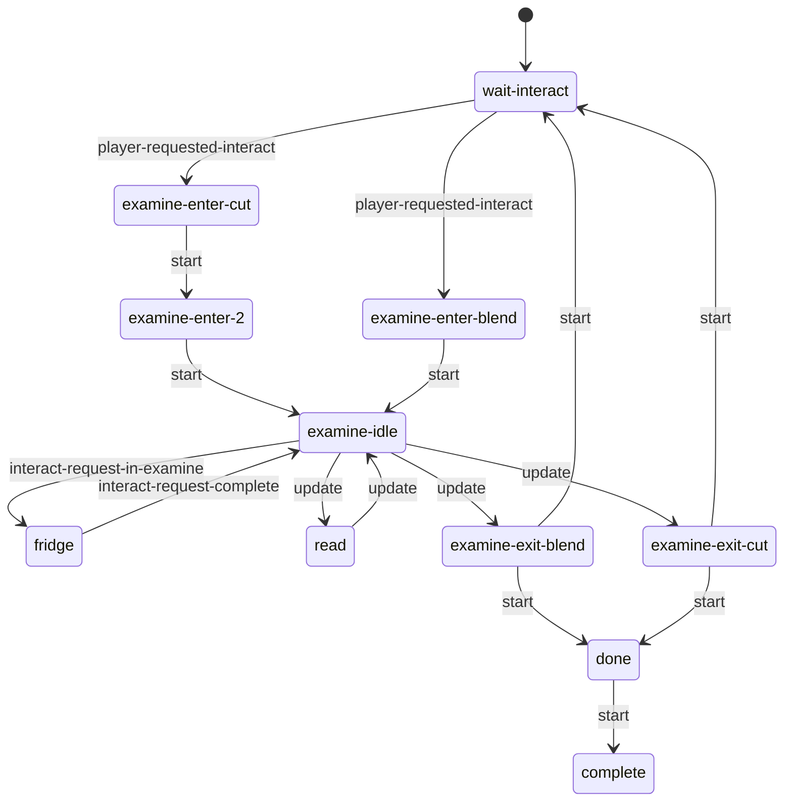

# Examine: static evidence

CONFIRMED means a structure or call instruction is present. Branch reachability, native implementation and object configuration remain separate questions. Call offset is a hexadecimal byte offset in the original module; source SHA-256 is in `databases/file_manifest.json`. `result(...)` references another call in the same lambda, not its presumed return value.

## `dc1/ss/ss-examine.bin`

426 call sites; 1 state scripts; 5 exported entries.

### `ss-examine`

Initial state field: `wait-interact`. A zero SID does not prove that the first table state starts automatically.

Edges represent explicit `go` call sites, including conditional alternatives. Same-target edges can occur in different tracks; this is not a guaranteed linear execution trace.

#### `wait-interact`

73 call sites. Event listeners: `player-requested-interact`, `tension-changed`.

| Call target | Example offset | Argument evidence |
| --- | --- | --- |
| `animate-start` | `0x4180` | result(24E0:23), result(24E0:29), result(24E0:35), 0 |
| `get-spawner-locator` | `0x4D00` | result(2698:8), 1 |
| `ss-svar` | `0x80A0` | used, self |
| `get-svar-as-boolean` | `0x80B0` | result(2DD0:6) |
| `interactable-set-accessibility-used` | `0x80E0` | result(2DD0:12) |
| `go` | `0x8190` | examine-enter-cut, 1 |
| `set-spawner-locator` | `0x82D0` | result(2E80:16), result(2E80:22) |
| `rotate-locator-lookat-object` | `0x8930` | result(30E8:18), player, 1.0, 0 |
| `broadcast-event` | `0x9EC0` | player-entering-examine, result(33A8:8) |
| `tension-mode-is?` | `0xAB00` | 3 |
| `interactable-disable` | `0xAB58` | result(3560:37) |
| `interactable-enable` | `0xAB88` | result(3560:43) |
| `flatten-locator` | `0xC898` | result(3980:75) |
| `set-svar-as-boolean` | `0xCC50` | result(3B38:9), 0 |

#### `examine-enter-cut`

29 call sites. Event listeners: none.

| Call target | Example offset | Argument evidence |
| --- | --- | --- |
| `go` | `0x3C60` | examine-enter-2, 1 |
| `animate_` | `0xB318` | result(3610:22), result(3610:28), result(3610:38) |
| `get-channel-locator-from-ap-ref` | `0xB450` | player, result(3668:8), result(3668:14), 0.0, apReference-camera1, apReference |
| `get-object-locator` | `0xB520` | result(3668:48) |
| `camera-enable-animated-stick` | `0xB588` | result(3668:24), result(3668:35), 0.0, 0.0, result(3668:43), 1000, 0, result(3668:50), 0.0, 1 |
| `wait-animate_` | `0xBB68` | player, result(3718:7), result(3718:17) |
| `hud2-hide-health-ammo/f` | `0xC478` | 0, 0 |
| `wait-player-move-to-entry` | `0xCDE0` | result(3B90:6), result(3B90:12), 1, 0, 0.4, apReference-camera1, apReference, 0.0, 0, 1, 0, 1, 0.0, 0, 1 |

#### `examine-enter-2`

36 call sites. Event listeners: none.

| Call target | Example offset | Argument evidence |
| --- | --- | --- |
| `send-event` | `0x5CB8` | flashlight-set-target-object, player, result(27F8:15) |
| `get-animation-phase` | `0x6C68` | player, 2, result(2AB8:45) |
| `get-channel-locator-from-ap-ref` | `0x6CB0` | player, result(2AB8:30), result(2AB8:36), result(2AB8:49), apReference-flashlight, apReference |
| `set-object-locator` | `0x6CC8` | obj-examine-flashlight-dir-1, result(2AB8:58) |
| `camera-locator` | `0x6D08` | 0 |
| `alloc-vector` | `0x6D98` | 0.0, 0.0, result(2AB8:78), ?, 0 |
| `offset-locator` | `0x6DB0` | result(2AB8:69), result(2AB8:87) |
| `animate_` | `0x7858` | result(2C18:22), result(2C18:28), result(2C18:38) |
| `go` | `0x8050` | examine-idle, 1 |
| `wait-animate_` | `0xC0A0` | player, result(3770:7), result(3770:17) |
| `hud2-hide-health-ammo/f` | `0xC478` | 0, 0 |

#### `examine-enter-blend`

87 call sites. Event listeners: none.

| Call target | Example offset | Argument evidence |
| --- | --- | --- |
| `wait-animate_` | `0x5258` | player, result(26F0:14), result(26F0:24) |
| `send-event` | `0x5CB8` | flashlight-set-target-object, player, result(27F8:15) |
| `go` | `0x8050` | examine-idle, 1 |
| `get-channel-locator-from-ap-ref` | `0x93E0` | player, result(32F8:15), result(32F8:21), 0.0, apReference-camera1, apReference |
| `get-spawner-locator` | `0x9580` | result(32F8:79), 1 |
| `get-object-locator` | `0x95B0` | result(32F8:87) |
| `camera-enable-animated-stick` | `0x9618` | result(32F8:31), result(32F8:42), result(32F8:48), result(32F8:54), result(32F8:60), 1000, 0, ?, 0.0, 1 |
| `alloc-vector` | `0xA058` | 0.0, 0.0, ?, 1.0, 0 |
| `offset-locator` | `0xA070` | result(3400:26), result(3400:45) |
| `get-animation-phase` | `0xADB8` | player, 2, result(35B8:45) |
| `set-object-locator` | `0xAE80` | obj-examine-flashlight-dir-1, result(35B8:71) |
| `camera-locator` | `0xAEC0` | 0 |
| `animate_` | `0xB318` | result(3610:22), result(3610:28), result(3610:38) |
| `hud2-hide-health-ammo/f` | `0xC478` | 0, 0 |
| `wait-player-move-to-entry` | `0xCDE0` | result(3B90:6), result(3B90:12), 1, 0, 0.4, apReference-camera1, apReference, 0.0, 0, 1, 0, 1, 0.0, 0, 1 |

#### `examine-idle`

102 call sites. Event listeners: `interact-request-in-examine`.

| Call target | Example offset | Argument evidence |
| --- | --- | --- |
| `go` | `0x3FC0` | read, 1 |
| `player-flashlight-on?` | `0x43A0` |  |
| `turn-off-flashlight` | `0x43D8` | player, 0 |
| `turn-on-flashlight` | `0x4410` | player, 0 |
| `get-animation-phase` | `0x6090` | player, 2, result(28A8:83) |
| `get-channel-locator-from-ap-ref` | `0x60D8` | player, result(28A8:68), result(28A8:74), result(28A8:87), apReference-flashlight, apReference |
| `lerp-locator` | `0x6130` | result(28A8:96), result(28A8:102), result(28A8:55) |
| `set-object-locator` | `0x6148` | obj-examine-flashlight-dir-1, result(28A8:107) |
| `camera-locator` | `0x69B8` | 0 |
| `alloc-vector` | `0x6A40` | 0.0, 0.0, result(2A60:15), 1.0, 0 |
| `offset-locator` | `0x6A58` | result(2A60:6), result(2A60:23) |
| `animate_` | `0x7588` | result(2BC0:22), result(2BC0:28), result(2BC0:38) |
| `camera-override-near-clip/f` | `0x86D8` | result(3038:16) |
| `debug-draw-locator` | `0xA918` | result(34B0:47), 0.4, 0.0, 0, 2.0, 0 |
| `broadcast-event` | `0xB680` | in-examine-idle, result(36C0:8) |
| `hud2-show-investigate` | `0xC2F0` | 50304, 0, 0 |
| `hud2-hide-health-ammo/f` | `0xC478` | 0, 0 |
| `get-locator-position` | `0xCAF0` | result(3A30:7) |
| `player-ik-look-at` | `0xCB40` | result(3A30:9), 2, 0.0, 0.33, 1 |
| `interactable-disable` | `0xCBA8` | result(3A88:2) |

#### `fridge`

9 call sites. Event listeners: `entering-investigate-cut`, `interact-request-complete`.

| Call target | Example offset | Argument evidence |
| --- | --- | --- |
| `get-channel-locator-from-ap-ref` | `0x6818` | player, result(2A08:8), result(2A08:14), 0.0, apReference-camera1, apReference |
| `camera-enable-animated-stick` | `0x6908` | result(2A08:24), result(2A08:35), 0.0, 0.0, 1, 1000, 0, 0, 0.0, 1 |
| `go` | `0x8050` | examine-idle, 1 |
| `camera-disable-animated-stick` | `0x8370` |  |
| `hud2-hide-health-ammo/f` | `0xC478` | 0, 0 |

#### `read`

12 call sites. Event listeners: none.

| Call target | Example offset | Argument evidence |
| --- | --- | --- |
| `hud2-show-read-page` | `0x66E0` | ?, 0, 0, 0, 1 |
| `hud2-hide-read-page` | `0x7920` | 0 |
| `go` | `0x7950` | examine-idle, 1 |
| `hud2-hide-health-ammo/f` | `0xC478` | 0, 0 |

#### `examine-exit-cut`

74 call sites. Event listeners: none.

| Call target | Example offset | Argument evidence |
| --- | --- | --- |
| `send-event` | `0x3CA8` | flashlight-clear-target-object, player |
| `hud2-hide-investigate` | `0x4020` |  |
| `wait-animate_` | `0x4BF0` | player, result(2640:17), result(2640:27) |
| `animate_` | `0x5A38` | result(27A0:32), result(27A0:38), result(27A0:48) |
| `animate-done` | `0x5B78` | result(27A0:103), result(27A0:109), result(27A0:115), 0, 0, 2 |
| `go` | `0x7110` | done, 1 |
| `interactable-enable` | `0x7140` | result(2B68:16) |
| `interactable-set-accessibility-used` | `0x7168` | result(2B68:21) |
| `ss-svar` | `0x71A0` | used, self |
| `set-svar-as-boolean` | `0x71C0` | result(2B68:30), 1 |
| `broadcast-event` | `0x7FF8` | examine-done, result(2D20:8) |
| `camera-override-near-clip/f` | `0x86D8` | result(3038:16) |
| `camera-fade-out-auto-gen-animated-stick` | `0xC1E0` | result(37C8:13), result(37C8:19), 0 |
| `camera-fade-out-animated-stick` | `0xC230` | result(37C8:32) |
| `hud2-hide-health-ammo/f` | `0xC478` | 0, 0 |

#### `examine-exit-blend`

83 call sites. Event listeners: none.

| Call target | Example offset | Argument evidence |
| --- | --- | --- |
| `send-event` | `0x3CA8` | flashlight-clear-target-object, player |
| `go` | `0x3D30` | done, 1 |
| `interactable-enable` | `0x3D60` | result(23D8:16) |
| `interactable-set-accessibility-used` | `0x3D88` | result(23D8:21) |
| `ss-svar` | `0x3E50` | used, self |
| `set-svar-as-boolean` | `0x3E70` | result(23D8:48), 1 |
| `hud2-hide-investigate` | `0x4020` |  |
| `camera-fade-out-animated-stick` | `0x42A8` | result(2538:21) |
| `wait-animate_` | `0x4BF0` | player, result(2640:17), result(2640:27) |
| `animate_` | `0x5A38` | result(27A0:32), result(27A0:38), result(27A0:48) |
| `animate-done` | `0x5B78` | result(27A0:103), result(27A0:109), result(27A0:115), 0, 0, 2 |
| `broadcast-event` | `0x7FF8` | examine-done, result(2D20:8) |
| `camera-override-near-clip/f` | `0x86D8` | result(3038:16) |
| `camera-fade-out-auto-gen-animated-stick` | `0x8C88` | result(31F0:13), result(31F0:19), 0 |
| `hud2-hide-health-ammo/f` | `0xC478` | 0, 0 |

#### `done`

3 call sites. Event listeners: none.

| Call target | Example offset | Argument evidence |
| --- | --- | --- |
| `go` | `0x8628` | complete, 1 |
| `interactable-disable` | `0xCBA8` | result(3A88:2) |

#### `complete`

0 call sites. Event listeners: none.

| Call target | Example offset | Argument evidence |
| --- | --- | --- |

Named/global/embedded helpers: `lambda@1858`.
