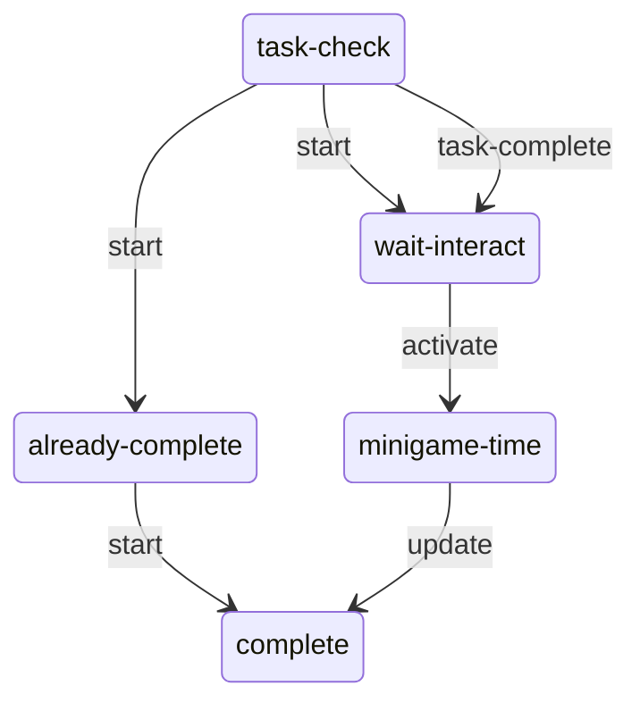
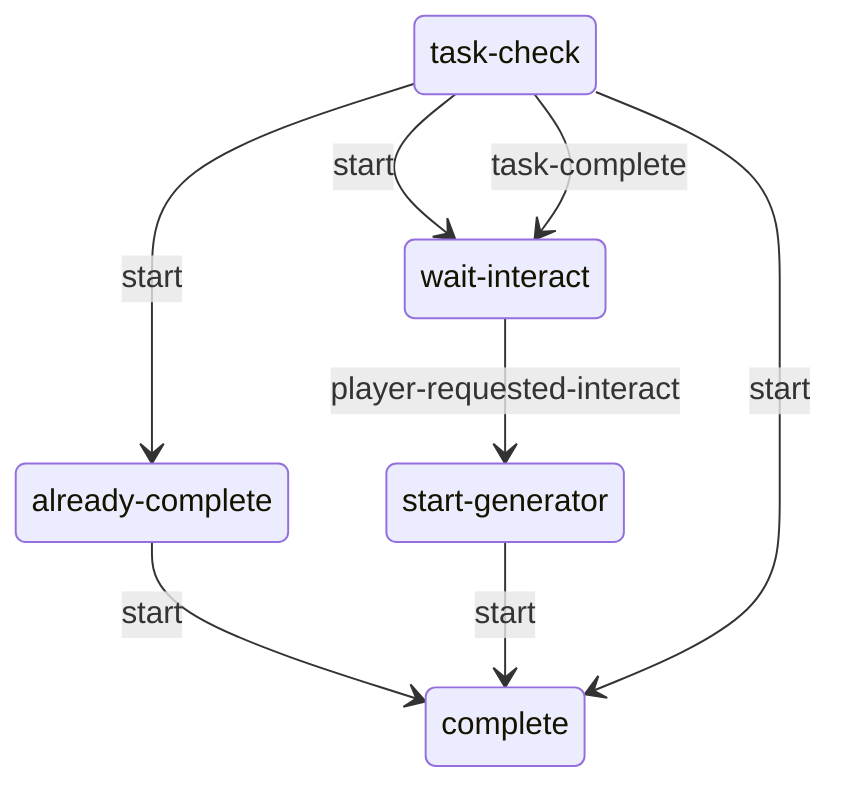
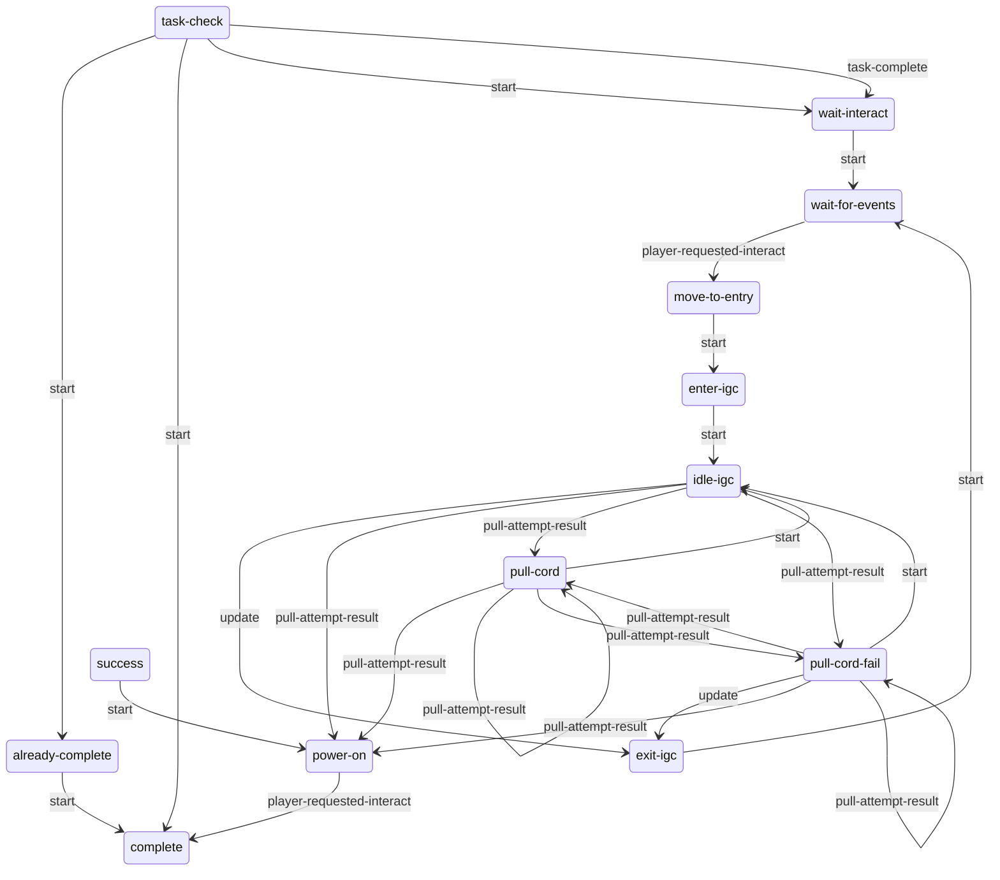

# Generators: static evidence

CONFIRMED means a structure or call instruction is present. Branch reachability, native implementation and object configuration remain separate questions. Call offset is a hexadecimal byte offset in the original module; source SHA-256 is in `databases/file_manifest.json`. `result(...)` references another call in the same lambda, not its presumed return value.

## `dc1/ss-seattlearrival/ss-sea-qz-generator-minigame.bin`

226 call sites; 1 state scripts; 1 exported entries.

### `ss-sea-qz-generator-minigame`

Initial state field: `#0000000000000000`. A zero SID does not prove that the first table state starts automatically.

Edges represent explicit `go` call sites, including conditional alternatives. Same-target edges can occur in different tracks; this is not a guaranteed linear execution trace.

#### `task-check`

8 call sites. Event listeners: `task-complete`.

| Call target | Example offset | Argument evidence |
| --- | --- | --- |
| `go` | `0x3F08` | wait-interact, 1 |

#### `wait-interact`

4 call sites. Event listeners: `activate`.

| Call target | Example offset | Argument evidence |
| --- | --- | --- |
| `animate_` | `0x3658` | result(C98:6), needle-a, result(C98:17) |
| `go` | `0x3818` | minigame-time, 1 |

#### `minigame-time`

213 call sites. Event listeners: `flood-timer`.

| Call target | Example offset | Argument evidence |
| --- | --- | --- |
| `set-animation-phase` | `0x1208` | result(B90:6), ?, 1, needle-a |
| `send-event` | `0x1788` | generator-press, result(BE8:163) |
| `get-spawner-locator` | `0x3908` | result(DA0:22), 1 |
| `draw-interactable-hud` | `0x3930` | interact-attack, result(DA0:26), 0 |
| `go` | `0x3A40` | complete, 1 |

#### `already-complete`

1 call sites. Event listeners: none.

| Call target | Example offset | Argument evidence |
| --- | --- | --- |
| `go` | `0x5920` | complete, 1 |

#### `complete`

0 call sites. Event listeners: none.

| Call target | Example offset | Argument evidence |
| --- | --- | --- |

## `dc1/ss-seattlearrival/ss-sea-qz-puz-door-generator.bin`

73 call sites; 1 state scripts; 1 exported entries.

### `ss-sea-qz-puz-door-generator`

Initial state field: `#0000000000000000`. A zero SID does not prove that the first table state starts automatically.

Edges represent explicit `go` call sites, including conditional alternatives. Same-target edges can occur in different tracks; this is not a guaranteed linear execution trace.

#### `task-check`

6 call sites. Event listeners: `task-complete`.

| Call target | Example offset | Argument evidence |
| --- | --- | --- |
| `go` | `0x1A08` | complete, 1 |

#### `wait-interact`

6 call sites. Event listeners: `player-requested-interact`.

| Call target | Example offset | Argument evidence |
| --- | --- | --- |
| `go` | `0x1918` | start-generator, 1 |
| `interactable-disable` | `0x1950` | carry-object-sea-rope-6 |
| `animate-start` | `0x2770` | obj-sea-generator-1, sea-qz-door-start-generator-enter--generator, ap-sea-qz-generator-1, 0 |
| `set-light-process-intensity` | `0x4A60` | light-base-292, 0.0 |

#### `start-generator`

58 call sites. Event listeners: none.

| Call target | Example offset | Argument evidence |
| --- | --- | --- |
| `camera-enable-animated` | `0x18C8` | 2.0, -1.0, 1, 1000, 0, 0, 0 |
| `get-spawner-locator` | `0x1BA0` | ap-sea-qz-generator-1, 1 |
| `wait-animate_` | `0x1E48` | player, sea-qz-door-start-generator-enter--ellie, result(BA0:12) |
| `animate_` | `0x2290` | player, sea-qz-door-start-generator-idle--ellie, result(BF8:12) |
| `camera-fade-out-auto-gen-animated` | `0x2C68` | 2.0, 3.0, 0 |
| `wait-player-move-to-entry` | `0x2DB0` | sea-qz-door-start-generator-enter--ellie, result(E08:7), 1, 0, 0.4, apReference-camera1, apReference, 0.0, 0, 1, 0, 1, 0.0, 0, 1 |
| `draw-interactable-hud` | `0x3830` | interact-default, result(1018:14), 0 |
| `set-light-process-intensity` | `0x46E0` | light-base-292, 1.0 |
| `interactable-enable` | `0x4798` | carry-object-sea-rope-6 |
| `send-event` | `0x48C0` | start-with-rope, player, result(13E0:8) |
| `go` | `0x5498` | complete, 1 |

#### `already-complete`

4 call sites. Event listeners: none.

| Call target | Example offset | Argument evidence |
| --- | --- | --- |
| `interactable-disable` | `0x3778` | int-sea-qz-puz-generator-1 |
| `animate-done` | `0x4628` | obj-sea-generator-1, sea-qz-door-start-generator-success--generator, ap-sea-qz-generator-1, 0, 0, 2 |
| `go` | `0x5498` | complete, 1 |

#### `complete`

0 call sites. Event listeners: none.

| Call target | Example offset | Argument evidence |
| --- | --- | --- |

Named/global/embedded helpers: `lambda@4E8`.

## `dc1/ss-patrol/ss-pat-generator-start.bin`

182 call sites; 1 state scripts; 1 exported entries.

### `ss-pat-generator-start`

Initial state field: `#0000000000000000`. A zero SID does not prove that the first table state starts automatically.

Edges represent explicit `go` call sites, including conditional alternatives. Same-target edges can occur in different tracks; this is not a guaranteed linear execution trace.

#### `task-check`

7 call sites. Event listeners: `task-complete`.

| Call target | Example offset | Argument evidence |
| --- | --- | --- |
| `go` | `0x5468` | complete, 1 |
| `pat-library-turn-off-generator-related-lights` | `0x8B08` |  |

#### `wait-interact`

12 call sites. Event listeners: none.

| Call target | Example offset | Argument evidence |
| --- | --- | --- |
| `turn-off-light` | `0x3BB8` | rt-lower-uplight-a-1, 0 |
| `fact-get-dictionary` | `0x4E10` | player |
| `fact-set-bool-in-dict` | `0x4E40` | result(2068:4), pat-library-cold?, 1 |
| `turn-on-light` | `0x53E8` | rt-workbench-b-1, 0 |
| `set-light-process-intensity` | `0x6F78` | rt-workbench-b-1, 0.0 |
| `go` | `0x8A28` | wait-for-events, 1 |
| `interactable-enable` | `0xA0A8` | int-pat-generator-1 |

#### `wait-for-events`

12 call sites. Event listeners: `player-requested-interact`.

| Call target | Example offset | Argument evidence |
| --- | --- | --- |
| `go` | `0x40D0` | move-to-entry, 1 |
| `animate-done-boundframe` | `0x8578` | result(2DD0:6), ellie-workbench-enter-overhead-lamp-pistol--tools, result(2DD0:13), 0, 0 |
| `interactable-enable` | `0xA0A8` | int-pat-generator-1 |

#### `move-to-entry`

7 call sites. Event listeners: none.

| Call target | Example offset | Argument evidence |
| --- | --- | --- |
| `go` | `0x4ED0` | enter-igc, 1 |
| `interactable-disable` | `0x7028` | int-pat-generator-1 |
| `send-event` | `0x8D40` | interacted-with-generator, ss-pat-library-bed-area-dina-1 |
| `get-object-locator` | `0x9498` | obj-pat-library-generator-1 |
| `wait-player-move-to-entry` | `0x9580` | start-generator-enter--ellie, result(3350:5), 0, 0, 0.3, apReference-camera1, apReference, 0.0, 0, 1, 0, 1, 1.5, 0, 1 |
| `fade-flashlight-using-render-settings/f` | `0xA068` | 1.5, 1.0 |

#### `enter-igc`

11 call sites. Event listeners: none.

| Call target | Example offset | Argument evidence |
| --- | --- | --- |
| `get-object-locator` | `0x3DB0` | obj-pat-library-generator-1 |
| `animate_` | `0x4058` | obj-pat-library-generator-1, start-generator-enter--generator, result(1CA0:12) |
| `go` | `0x4F68` | idle-igc, 1 |
| `camera-enable-animated` | `0x81F0` | 2.5, -1.0, 1, 1000, 0, 0, 0 |
| `wait-animate_` | `0x89A8` | player, start-generator-enter--ellie, result(2E28:12) |
| `fade-flashlight-using-render-settings/f` | `0xA068` | 1.5, 1.0 |
| `send-event` | `0xA248` | start-motor-minigame, obj-pat-library-generator-1 |

#### `idle-igc`

18 call sites. Event listeners: `pull-attempt-result`.

| Call target | Example offset | Argument evidence |
| --- | --- | --- |
| `send-event` | `0x4928` | pull-attempt, obj-pat-library-generator-1 |
| `get-object-locator` | `0x6AD8` | obj-pat-library-generator-1 |
| `animate_` | `0x6D80` | obj-pat-library-generator-1, start-generator-idle--generator, result(2640:12) |
| `go` | `0x83D0` | exit-igc, 1 |
| `turn-off-flashlight` | `0x84B0` | player, 0 |
| `event-arg-int32` | `0x8DB8` | 0 |

#### `pull-cord-fail`

19 call sites. Event listeners: `pull-attempt-result`.

| Call target | Example offset | Argument evidence |
| --- | --- | --- |
| `send-event` | `0x3C48` | vox-pat-generator-fail, ss-vox-pat-library-generator-1 |
| `go` | `0x4F68` | idle-igc, 1 |
| `get-object-locator` | `0x50C8` | obj-pat-library-generator-1 |
| `wait-animate_` | `0x5370` | player, start-generator-fail--ellie, result(2220:12) |
| `event-arg-int32` | `0x8DB8` | 0 |
| `animate_` | `0x9F50` | obj-pat-library-generator-1, start-generator-fail--generator, result(3668:12) |

#### `pull-cord`

23 call sites. Event listeners: `pull-attempt-result`.

| Call target | Example offset | Argument evidence |
| --- | --- | --- |
| `send-event` | `0x4928` | pull-attempt, obj-pat-library-generator-1 |
| `go` | `0x4F68` | idle-igc, 1 |
| `turn-off-light` | `0x65C0` | rt-workbench-b-1, 0 |
| `get-object-locator` | `0x7228` | obj-pat-library-generator-1 |
| `animate_` | `0x74D0` | obj-pat-library-generator-1, start-generator-pull--generator, result(2900:12) |
| `event-arg-int32` | `0x8DB8` | 0 |
| `wait-animate_` | `0x9420` | player, start-generator-pull--ellie, result(32F8:12) |
| `wait-until-anim-frame` | `0x9778` | player, start-generator-pull--ellie, 17.0, 2 |
| `turn-on-light` | `0x97A8` | rt-workbench-b-1, 0 |
| `wait-pat-light-flicker` | `0x9858` | *workbench-pat-library*, rt-workbench-b-1, 5, 12, 0.0, 1.0, 0.01, 0.05, 0.0, 0 |

#### `success`

7 call sites. Event listeners: none.

| Call target | Example offset | Argument evidence |
| --- | --- | --- |
| `get-object-locator` | `0x6238` | obj-pat-library-generator-1 |
| `animate_` | `0x64E0` | obj-pat-library-generator-1, start-generator-pull-3-success--generator, result(23D8:12) |
| `wait-animate_` | `0x7F80` | player, start-generator-pull-3-success--ellie, result(2AB8:12) |
| `go` | `0x8468` | power-on, 1 |

#### `power-on`

64 call sites. Event listeners: `player-requested-interact`.

| Call target | Example offset | Argument evidence |
| --- | --- | --- |
| `turn-on-light` | `0x3C00` | rt-workbench-a-1, 0 |
| `get-spawner-locator` | `0x4720` | ap-pat-generator-1, 1 |
| `wait-animate_` | `0x4828` | obj-pat-library-generator-1, pat-library-generator-interact--generator, result(1E58:12) |
| `camera-fade-out-animated` | `0x4D00` | 2.0, 0 |
| `get-animation-playing?` | `0x59C0` | player, pat-library-generator-interact--ellie, 2 |
| `get-animation-frame` | `0x5A18` | player, 2, pat-library-generator-interact--ellie |
| `get-animation-duration` | `0x5A48` | player, pat-library-generator-interact--ellie |
| `animate_` | `0x5F68` | player, pat-library-generator-interact--ellie, result(2328:200) |
| `pat-library-turn-on-generator-related-lights` | `0x6630` |  |
| `camera-enable-animated` | `0x70C0` | 1.5, -1.0, 1, 1000, 0, 0, 0 |
| `interactable-enable` | `0x7530` | workbench-68 |
| `wait-pat-light-flicker` | `0x8128` | *workbench-pat-library*, rt-workbench-b-1, 1, 1, 0.02, 1.0, 0.01, 0.05, 0.5, 1 |
| `go` | `0x8BD8` | complete, 1 |
| `fact-get-dictionary` | `0x8C18` | player |
| `fact-set-bool-in-dict` | `0x8C48` | result(30E8:4), pat-library-cold?, 0 |
| `send-event` | `0x8F40` | vox-first-workbench, ss-vox-pat-library-generator-1 |

#### `exit-igc`

10 call sites. Event listeners: none.

| Call target | Example offset | Argument evidence |
| --- | --- | --- |
| `get-object-locator` | `0x4230` | obj-pat-library-generator-1 |
| `wait-animate_` | `0x4408` | player, start-generator-exit--ellie, result(1D50:12) |
| `camera-fade-out-animated` | `0x45B0` | 1.5, 0 |
| `animate_` | `0x4C88` | obj-pat-library-generator-1, start-generator-exit--generator, result(1F60:12) |
| `go` | `0x8A28` | wait-for-events, 1 |
| `send-event` | `0xA348` | player-exited-generator, ss-pat-library-bed-area-dina-1 |

#### `already-complete`

30 call sites. Event listeners: none.

| Call target | Example offset | Argument evidence |
| --- | --- | --- |
| `pat-library-turn-on-generator-related-lights` | `0x6630` |  |
| `animate-done-boundframe` | `0x68C0` | result(25E8:55), ellie-workbench-enter-overhead-lamp-pistol--tools, result(25E8:62), 0, 0 |
| `interactable-enable` | `0x7530` | workbench-68 |
| `go` | `0x8BD8` | complete, 1 |
| `fact-get-dictionary` | `0x8C18` | player |
| `fact-set-bool-in-dict` | `0x8C48` | result(30E8:4), pat-library-cold?, 0 |
| `turn-on-light` | `0x9B18` | rt-workbench-c-1, 0 |

#### `complete`

0 call sites. Event listeners: none.

| Call target | Example offset | Argument evidence |
| --- | --- | --- |

Named/global/embedded helpers: `lambda@DC8`, `lambda@1038`.
