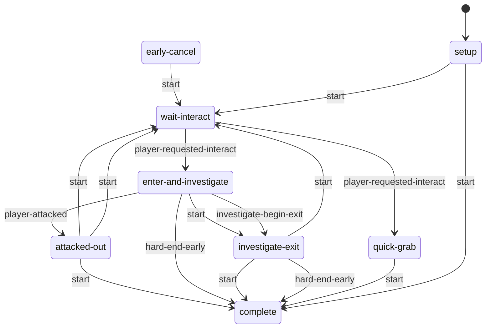

# Investigate: static evidence

CONFIRMED means a structure or call instruction is present. Branch reachability, native implementation and object configuration remain separate questions. Call offset is a hexadecimal byte offset in the original module; source SHA-256 is in `databases/file_manifest.json`. `result(...)` references another call in the same lambda, not its presumed return value.

## `dc1/ss/ss-investigate-object.bin`

1151 call sites; 1 state scripts; 4 exported entries.

### `ss-investigate-object`

Initial state field: `setup`. A zero SID does not prove that the first table state starts automatically.

Edges represent explicit `go` call sites, including conditional alternatives. Same-target edges can occur in different tracks; this is not a guaranteed linear execution trace.

#### `setup`

43 call sites. Event listeners: none.

| Call target | Example offset | Argument evidence |
| --- | --- | --- |
| `ss-svar` | `0xCA70` | used, self |
| `get-svar-as-boolean` | `0xCA80` | result(5A08:6) |
| `interactable-set-accessibility-used` | `0xCAB0` | result(5A08:12) |
| `has-collected-treasure?` | `0xEF40` | result(6668:26), 0 |
| `go` | `0xEFA0` | complete, 1 |
| `is-collectible-tracking-hud-enabled?` | `0x14458` |  |
| `is-treasure-progression-important?` | `0x14508` | result(73D0:33) |
| `interactable-get-def-id` | `0x14530` | result(73D0:38) |
| `get-collected-interactable-def-id` | `0x14560` | result(73D0:40), result(73D0:35) |
| `override-interact-def` | `0x145B8` | result(73D0:53), result(73D0:46) |
| `set-svar-as-boolean` | `0x18930` | result(8558:9), 0 |
| `weapon-upgrade-apply-all-active-bundles-to-weapon-instance` | `0x18CE0` | result(8660:29), result(8660:35), ?, regular |

#### `wait-interact`

79 call sites. Event listeners: `npc-died`, `tension-changed`, `player-requested-interact`.

| Call target | Example offset | Argument evidence |
| --- | --- | --- |
| `send-event-box-result` | `0xD9A8` | should-fast-pickup?, result(5E80:3) |
| `go` | `0xDCD0` | enter-and-investigate, 1 |
| `interactable-disable` | `0xF430` | result(68D0:39) |
| `broadcast-event` | `0xF490` | disabling-investigate-object, result(68D0:50) |
| `get-spawner-locator` | `0x11660` | result(6B38:92), 1 |
| `get-object-locator` | `0x11688` | self |
| `animate_` | `0x116C0` | result(6B38:12), result(6B38:18), result(6B38:28) |
| `tension-mode-is?` | `0x11FB0` | 3 |
| `send-event` | `0x12088` | enable-fast-pickup, result(6C40:44) |
| `interactable-enabled?` | `0x12CA8` | result(6EA8:4) |
| `interactable-disabled?` | `0x12DF8` | result(6EA8:46) |
| `set-animation-phase` | `0x18720` | result(83F8:26), result(83F8:46), 2, 0 |

#### `quick-grab`

76 call sites. Event listeners: none.

| Call target | Example offset | Argument evidence |
| --- | --- | --- |
| `broadcast-event` | `0xE6C0` | done-with-investigate, result(6400:8) |
| `get-treasure-by-id` | `0x11980` | result(6BE8:18), 0 |
| `get-object-locator` | `0x11A50` | result(6BE8:46) |
| `log-event` | `0x11A88` | quick-investigate-object, 1, result(6BE8:43), result(6BE8:48), 0 |
| `collect-treasure` | `0x11AD0` | result(6BE8:62) |
| `hud2-request-pick-up-notification` | `0x11B28` | result(6BE8:71), 0 |
| `tension-mode-is?` | `0x11C90` | 3 |
| `hud2-request-new-item-notification` | `0x11D28` | result(6BE8:133), 0.0, 1 |
| `send-event` | `0x18550` | no-map-hint, ss-seattle-map-materials-1 |
| `player-set-quick-inspect-treasure/f` | `0x1AB00` | result(8D40:44) |
| `go` | `0x1AD28` | complete, 1 |

#### `enter-and-investigate`

532 call sites. Event listeners: `investigate-begin-exit`, `hard-end-early`, `investigate-begin-flip`, `re-investigate`, `player-attacked`.

| Call target | Example offset | Argument evidence |
| --- | --- | --- |
| `player-flashlight-set-particle-fade` | `0x97E8` | 0.0, ? |
| `play-sound-at-joint` | `0x9970` | result(5488:25), result(5488:27), 0, 0, 0 |
| `get-treasure-by-id` | `0xA318` | result(56F0:36), 0 |
| `get-animation-duration` | `0xAF10` | player, result(5748:17) |
| `get-best-entry-phase` | `0xB198` | player, result(5748:47), result(5748:53), ?, ?, 0 |
| `player-is-crouched?` | `0xB1C8` |  |
| `wait-player-move-to-entry` | `0xB588` | result(5748:126), result(5748:132), 1, ?, 0.4, apReference-camera1, ?, ?, 0, 1, -1, ?, 0.0, 0, 1 |
| `broadcast-event` | `0xB5F8` | entering-investigate, result(5748:238) |
| `get-spawner-locator` | `0xB700` | result(5748:270), 1 |
| `get-object-locator` | `0xB878` | result(5748:319) |
| `rotate-locator-lookat` | `0xB8D0` | result(5748:321), result(5748:325), 1.0, 0 |
| `rotate-locator-angle` | `0xB900` | result(5748:332), 1, 180.0 |
| `get-locator-rotation` | `0xB910` | result(5748:338) |
| `flatten-locator` | `0xBA10` | result(5748:370) |
| `camera-enable-animated` | `0xBBF8` | ?, result(5748:415), result(5748:421), 1000, 0, 0, 0 |
| `wait-animate_` | `0xC550` | player, ?, result(5748:474) |
| `camera-override-near-clip/f` | `0xCB18` | 0.01 |
| `attach` | `0xCC40` | result(5AB8:2), player, ?, ? |
| `send-event` | `0xD720` | suppress-flashlight, jesse |
| `player-flashlight-on?` | `0xE130` |  |
| `player-flashlight-force-facing-camera` | `0xE220` |  |
| `player-flashlight-force-facing` | `0xE250` |  |
| `holster-player-weapon` | `0xE2E8` | 2, 1.0 |
| `camera-fade-out-animated` | `0xEE20` | result(6610:6), 0 |
| `object-anim-playing?` | `0xF060` | result(66C0:2), paper-startpose-04, 0 |
| `get-animation-playing?` | `0x12818` | player, result(6E50:21), 2 |
| `get-animation-frame` | `0x12888` | player, 2, result(6E50:36) |
| `enable-player-flashlight-shadows/f` | `0x128D8` |  |
| `player-flashlight-force-investigate-offsets/f` | `0x12920` | result(6E50:57) |
| `alloc-vector` | `0x13168` | 0.0, result(6F58:38), 0.0, 1.0, 0 |
| `offset-locator` | `0x13180` | result(6F58:30), result(6F58:47) |
| `get-locator-position` | `0x13190` | result(6F58:50) |
| `player-ik-point-at` | `0x13208` | result(6F58:52), result(6F58:58), *player-point-at-investigate-ik*, 0, 0.4 |
| `camera-animation-enable` | `0x13370` | investigate-camera-additive, camera-shake-steadycam-tense-idle, 0.5, 0.5, 0.1, 1, 0.2 |
| `check-lighting-estimate-over-threshold` | `0x13C68` | result(7218:19) |
| `turn-on-flashlight` | `0x13CA0` | player, 0 |
| `set-animation-phase` | `0x15160` | self, 0.0, 2, 0 |
| `go` | `0x16190` | attacked-out, 1 |
| `camera-set-overlay` | `0x16E00` | *camera-remap-medium-shot-crouch*, 1, 2.0, 6, 1000, 2, 0.7 |
| `event-arg-symbol` | `0x19648` | 0 |
| `camera-enable-animated-stick-pan` | `0x19DE8` | ?, result(8A80:100), result(8A80:106), result(8A80:112), 1000, 0 |
| `signal-camera-cut` | `0x19E58` | 0 |
| `collect-investigate-object` | `0x1A598` | ? |
| `set-character-ik-mode-override` | `0x1A650` | player, 5, 0.3 |
| `stop-player-script-ik` | `0x1A6B8` | 0.0 |
| `log-event` | `0x1A948` | found-investigate-object, 1, result(8CE8:9), result(8CE8:14), 0 |
| `event-arg-boolean` | `0x1BA70` | 1 |
| `interactable-disable` | `0x1BAE8` | result(94D0:2) |

#### `attacked-out`

48 call sites. Event listeners: none.

| Call target | Example offset | Argument evidence |
| --- | --- | --- |
| `camera-fade-out-animated` | `0x99F8` | 0.0, 0 |
| `broadcast-event` | `0x9B18` | exiting-investigate-cut, result(55E8:8) |
| `player-flashlight-set-particle-fade` | `0xC848` | 1.0, 0.0 |
| `interactable-enable` | `0xF890` | result(6A88:21) |
| `go` | `0xF8C0` | wait-interact, 1 |
| `get-treasure-by-id` | `0xF980` | result(6A88:49), 0 |
| `collect-treasure` | `0xFA10` | result(6A88:69) |
| `hud2-request-pick-up-notification` | `0xFA68` | result(6A88:78), 1 |
| `mark-treasure-examined-by-id` | `0xFB38` | result(6A88:104), 1 |
| `send-event` | `0xFC20` | detach, result(6A88:134) |
| `set-object-locator` | `0xFCE8` | result(6A88:153), result(6A88:159) |
| `stop-animating` | `0x16FD0` | player, 2, 0.0, 0, 0 |

#### `early-cancel`

19 call sites. Event listeners: none.

| Call target | Example offset | Argument evidence |
| --- | --- | --- |
| `camera-fade-out-animated` | `0x99F8` | 0.0, 0 |
| `broadcast-event` | `0x9B18` | exiting-investigate-cut, result(55E8:8) |
| `player-flashlight-set-particle-fade` | `0xC848` | 1.0, 0.0 |
| `disable-camera-look-at` | `0xDE18` |  |
| `go` | `0x12138` | wait-interact, 1 |
| `stop-animating` | `0x14E38` | player, 2, 0.4, 0, 0 |
| `interactable-enable` | `0x160A0` | result(7C10:2) |
| `send-event` | `0x18318` | pop-flashlight, player |

#### `investigate-exit`

313 call sites. Event listeners: `hard-end-early`.

| Call target | Example offset | Argument evidence |
| --- | --- | --- |
| `broadcast-event` | `0x9B18` | exiting-investigate-cut, result(55E8:8) |
| `get-treasure-by-id` | `0x9F20` | result(5698:18), 0 |
| `collect-treasure` | `0x9FB0` | result(5698:38) |
| `hud2-request-pick-up-notification` | `0xA008` | result(5698:47), 1 |
| `mark-treasure-examined-by-id` | `0xA0D8` | result(5698:73), 1 |
| `hud2-request-new-item-notification` | `0xC918` | result(58A8:6), 0.0, 0 |
| `camera-override-near-clip/f` | `0xCB18` | 0.01 |
| `send-event` | `0xCD00` | suppress-flashlight-off, mel |
| `inventory-item-add-quantity` | `0xCF78` | result(5BC0:42), 1 |
| `get-spawner-locator` | `0xD0D0` | self, 1 |
| `log-event` | `0xD108` | upgrade-manual-found, 1, ?, result(5BC0:89), 0 |
| `go` | `0xD1B8` | complete, 1 |
| `enable-player-flashlight-shadows/f` | `0xE0C8` |  |
| `camera-animation-disable` | `0xE620` | investigate-camera-additive, ? |
| `camera-disable-animated` | `0xFED8` |  |
| `camera-enable-animated` | `0x10040` | ?, -1.0, result(6AE0:51), 2000, 0, 0, 0 |
| `signal-camera-cut` | `0x10070` | 0 |
| `wait-animate_` | `0x10B70` | player, ?, result(6AE0:124) |
| `interactable-disable` | `0x10B98` | result(6AE0:424) |
| `object-anim-reached-fadeout?` | `0x10C50` | player, result(6AE0:442), 0.5, 2 |
| `get-animation-frame` | `0x110B8` | player, 2, result(6AE0:586) |
| `animate_` | `0x111C0` | player, result(6AE0:460), result(6AE0:470) |
| `alloc-vector` | `0x12428` | 0.0, ?, ?, 1.0, 0 |
| `offset-locator` | `0x12440` | result(6DA0:34), result(6DA0:48) |
| `get-locator-position` | `0x12450` | result(6DA0:51) |
| `player-ik-point-at` | `0x124C8` | result(6DA0:53), result(6DA0:59), *player-point-at-investigate-ik*, 0, 0.5 |
| `get-object-locator` | `0x13860` | self |
| `play-sound-at-joint` | `0x14D10` | result(74D8:25), result(74D8:27), 0, 0, 0 |
| `camera-fade-out-animated` | `0x15450` | result(7848:13), 0 |
| `interactable-set-accessibility-used` | `0x159E8` | result(79A8:2) |
| `ss-svar` | `0x15A80` | used, self |
| `set-svar-as-boolean` | `0x15AA0` | result(7A58:6), 1 |
| `player-flashlight-force-investigate-offsets/f` | `0x15BE0` | result(7B08:14) |
| `wait-camera-fade-out-animated-to-remap` | `0x16A28` | result(7E20:74), result(7E20:80), result(7E20:86), 12, result(7E20:93) |
| `get-animation-duration` | `0x171D0` | player, result(8030:18) |
| `wait-stub-object-lerp-locator` | `0x17CA0` | result(8088:53), result(8088:59), result(8088:65), 10, 1.0 |
| `player-flashlight-set-particle-fade` | `0x18228` | 1.0, ? |
| `player-flashlight-on?` | `0x18348` |  |
| `player-flashlight-force-facing-camera` | `0x183D0` |  |
| `player-flashlight-force-facing` | `0x18400` |  |
| `set-character-ik-mode-override` | `0x1A650` | player, 5, 0.3 |
| `stop-player-script-ik` | `0x1A6B8` | 0.0 |
| `interactable-enable` | `0x1ABD8` | result(8D98:10) |
| `turn-off-flashlight` | `0x1B2C8` | player, 0 |

#### `complete`

0 call sites. Event listeners: none.

| Call target | Example offset | Argument evidence |
| --- | --- | --- |

Named/global/embedded helpers: `setup-and-investigate-object`, `investigate-object-show-readable-hud`, `inv-obj-show-activate-hud`, `lambda@3F10`.
