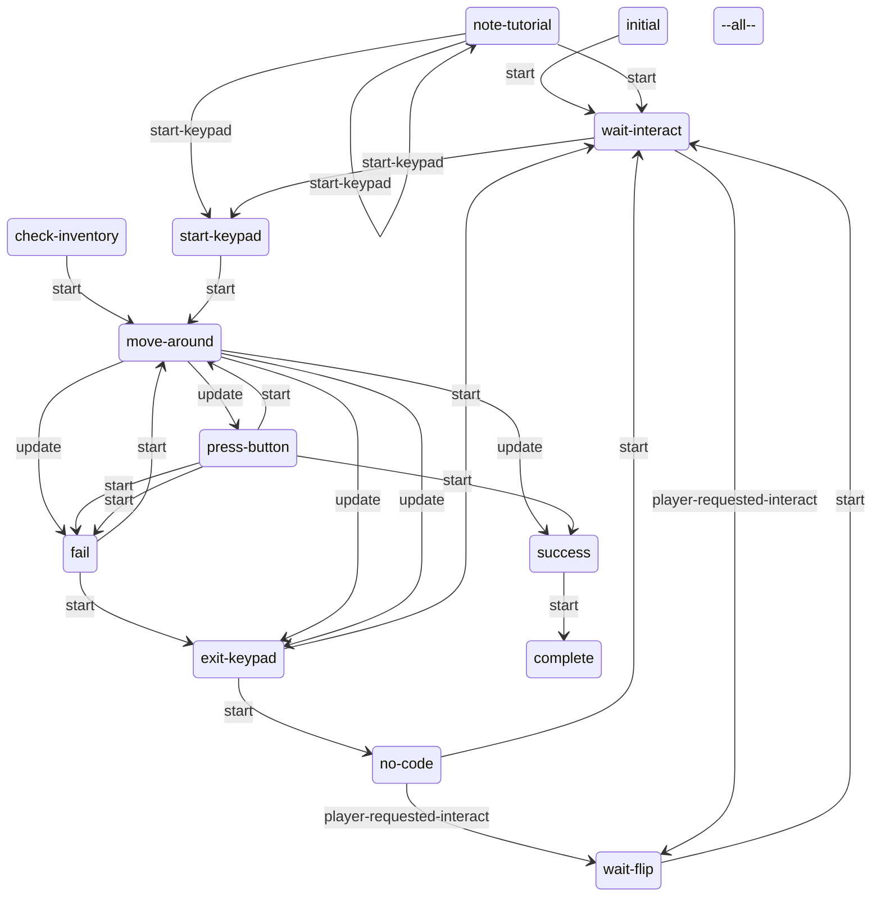
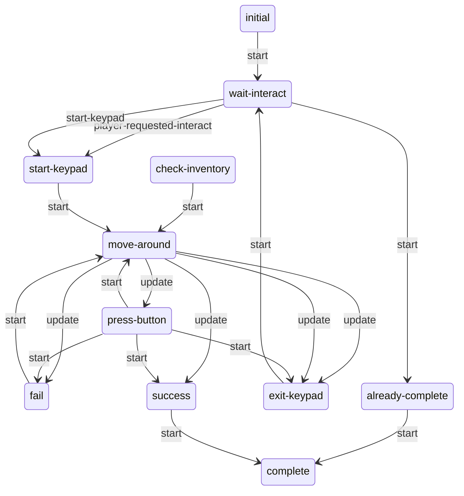

# Keypads: static evidence

CONFIRMED means a structure or call instruction is present. Branch reachability, native implementation and object configuration remain separate questions. Call offset is a hexadecimal byte offset in the original module; source SHA-256 is in `databases/file_manifest.json`. `result(...)` references another call in the same lambda, not its presumed return value.

## `dc1/ss-seattlearrival/ss-sea-arrival-keypad.bin`

654 call sites; 1 state scripts; 3 exported entries.

### `ss-sea-arrival-keypad`

Initial state field: `#0000000000000000`. A zero SID does not prove that the first table state starts automatically.

Edges represent explicit `go` call sites, including conditional alternatives. Same-target edges can occur in different tracks; this is not a guaranteed linear execution trace.

#### `initial`

65 call sites. Event listeners: `investigate-begin-flip`, `player-requested-interact`, `start-keypad`.

| Call target | Example offset | Argument evidence |
| --- | --- | --- |
| `go` | `0xBE98` | wait-interact, 1 |
| `hud2-set-investigate-flip-prompt-flashing` | `0xE058` | 0 |
| `hud2-set-investigate-prompts-disabled` | `0xE770` | 4096, 1 |

#### `wait-interact`

33 call sites. Event listeners: `start-keypad`, `player-requested-interact`, `player-requested-interact`, `player-requested-interact`, `done-with-investigate`, `toggle-hint4`, `hint-displayed`, `show-awhile`, `player-requested-interact`, `spawned-investigate-treasure`.

| Call target | Example offset | Argument evidence |
| --- | --- | --- |
| `send-event` | `0x8680` | turn-off, hint-wp-sea-qz-drawer-1 |
| `go` | `0x14720` | wait-flip, 1 |
| `interactable-enable` | `0x164E8` | int-sea-lever-gate-2 |

#### `wait-flip`

22 call sites. Event listeners: `investigate-begin-flip`.

| Call target | Example offset | Argument evidence |
| --- | --- | --- |
| `hud2-set-investigate-prompts-disabled` | `0xAD18` | 1024, 1 |
| `go` | `0xBE98` | wait-interact, 1 |

#### `no-code`

21 call sites. Event listeners: `player-requested-interact`, `player-requested-interact`, `hint-displayed`.

| Call target | Example offset | Argument evidence |
| --- | --- | --- |
| `send-event` | `0x8680` | turn-off, hint-wp-sea-qz-drawer-1 |
| `go` | `0xBE98` | wait-interact, 1 |
| `has-collected-treasure?` | `0x15308` | collectible-seattle-map, 0 |
| `interactable-disable` | `0x159C0` | int-sea-lever-gate-2 |
| `interactable-enable` | `0x164E8` | int-sea-lever-gate-2 |

#### `note-tutorial`

21 call sites. Event listeners: `investigate-begin-flip`, `spawned-investigate-treasure`, `start-keypad`.

| Call target | Example offset | Argument evidence |
| --- | --- | --- |
| `go` | `0xBE98` | wait-interact, 1 |
| `interactable-enable` | `0xCD60` | int-sea-lever-gate-2 |
| `interactable-disable` | `0x159C0` | int-sea-lever-gate-2 |

#### `start-keypad`

27 call sites. Event listeners: none.

| Call target | Example offset | Argument evidence |
| --- | --- | --- |
| `hud2-set-lock-minigame-data` | `0x7EF0` | result(3F50:6), result(3F50:8), 0, 1, 0, collect-sea-hub-generator-note-1, 0, 1 |
| `go` | `0x86D0` | move-around, 1 |
| `get-spawner-locator` | `0x8F80` | self, 1 |
| `animate_` | `0x9228` | obj-12916, sea-qz-keypad-idle--console, result(4318:12) |
| `wait-player-move-to-entry` | `0xCC18` | sea-qz-keypad-enter--ellie, result(5238:7), 1, 0, 0.4, apReference-camera1, apReference, 0.0, 0, 1, 0, 1, 0.0, 0, 1 |
| `camera-enable-animated` | `0xD558` | 2.0, -1.0, 1, 1000, 0, 0, 0 |
| `hud2-show-lock-minigame` | `0x14D28` |  |
| `wait-animate_` | `0x16428` | player, sea-qz-keypad-enter--ellie, result(77B0:12) |

#### `check-inventory`

29 call sites. Event listeners: none.

| Call target | Example offset | Argument evidence |
| --- | --- | --- |
| `go` | `0x86D0` | move-around, 1 |
| `get-spawner-locator` | `0x88A8` | self, 1 |
| `wait-animate_` | `0x8A80` | player, sea-qz-keypad-paper-return--ellie, result(4108:12) |
| `animate_` | `0x9228` | obj-12916, sea-qz-keypad-idle--console, result(4318:12) |
| `player-set-quick-inspect-treasure/f` | `0xCC80` | collectible-sea-qz-generator-note |
| `object-anim-playing?` | `0xE7C0` | player, ellie-inspect-paper-pocket-exit, 0 |
| `stop-animating` | `0x13D28` | player, 1, 0.5, 0, 0 |
| `get-animation-duration` | `0x13FA0` | player, sea-qz-keypad-paper-reach--ellie |
| `camera-enable-animated` | `0x156C0` | 0.0, -1.0, 1, 1000, 0, 0, 0 |
| `camera-fade-out-animated` | `0x17010` | 0.5, 0 |

#### `move-around`

297 call sites. Event listeners: `options-menu-changed`.

| Call target | Example offset | Argument evidence |
| --- | --- | --- |
| `spawn-particles-at-joint` | `0xC700` | key-outline, obj-12916, ?, 0, 0, root, 2, 0, 2, 0 |
| `lookup-hud-color-vector` | `0xC780` | t2-white |
| `get-spawner-locator` | `0xD838` | pos-sea-qz-maingate-prompt-1, 1 |
| `go` | `0xE3E8` | exit-keypad, 1 |

#### `press-button`

50 call sites. Event listeners: none.

| Call target | Example offset | Argument evidence |
| --- | --- | --- |
| `get-spawner-locator` | `0x8F80` | self, 1 |
| `animate_` | `0x9228` | obj-12916, sea-qz-keypad-idle--console, result(4318:12) |
| `has-collected-treasure?` | `0xAE18` | collectible-sea-qz-generator-note, 0 |
| `go` | `0xAEA0` | fail, 1 |
| `wait-animate_` | `0xDD50` | player, result(5AD0:7), result(5AD0:17) |

#### `fail`

59 call sites. Event listeners: none.

| Call target | Example offset | Argument evidence |
| --- | --- | --- |
| `go` | `0x86D0` | move-around, 1 |
| `get-spawner-locator` | `0x8F80` | self, 1 |
| `animate_` | `0x9228` | obj-12916, sea-qz-keypad-idle--console, result(4318:12) |
| `wait-animate_` | `0x9910` | player, sea-qz-keypad-keypress-03--ellie, result(4370:122) |
| `has-collected-treasure?` | `0xC1E8` | collectible-sea-qz-generator-note, 0 |
| `fact-set-bool-safe` | `0xE580` | player, collectibles-tutorial-active?, 1 |
| `wait-until-anim-frame` | `0x16018` | player, sea-qz-keypad-fail--ellie, 35.0, 2 |

#### `success`

47 call sites. Event listeners: none.

| Call target | Example offset | Argument evidence |
| --- | --- | --- |
| `get-spawner-locator` | `0x80C0` | self, 1 |
| `animate_` | `0x8298` | obj-12916, sea-qz-keypad-keypress-03--console, result(3FA8:20) |
| `wait-animate_` | `0x85C8` | player, sea-qz-keypad-keypress-03--ellie, result(3FA8:122) |
| `go` | `0xB190` | complete, 1 |
| `set-light-process-intensity` | `0xD280` | superPoint-RT-switchShape5, 0.0 |
| `camera-fade-out-animated` | `0x112C0` | 2.0, 0 |
| `interactable-disable` | `0x15628` | int-sea-journal-gate-1 |
| `hud2-hide-lock-minigame` | `0x15CB8` | result(7498:16), 1 |
| `broadcast-event` | `0x169E0` | keypad-success, result(79C0:8) |
| `wait-until-anim-frame` | `0x170A0` | player, sea-qz-keypad-succeed--ellie, 59.0, 2 |

#### `exit-keypad`

26 call sites. Event listeners: none.

| Call target | Example offset | Argument evidence |
| --- | --- | --- |
| `get-spawner-locator` | `0xA7A8` | self, 1 |
| `wait-animate_` | `0xAC70` | player, sea-qz-keypad-exit--ellie, result(46E0:12) |
| `has-collected-treasure?` | `0xB5C0` | collectible-sea-qz-generator-note, 0 |
| `go` | `0xB608` | no-code, 1 |
| `camera-fade-out-animated` | `0x112C0` | 2.0, 0 |
| `broadcast-event` | `0x145F8` | keypad-exited, result(6A48:8) |
| `hud2-hide-lock-minigame` | `0x15CB8` | result(7498:16), 1 |
| `animate_` | `0x16830` | obj-12916, sea-qz-keypad-exit--console, result(78B8:12) |
| `menu2-push-player-menu` | `0x16938` | 2 |

#### `complete`

0 call sites. Event listeners: none.

| Call target | Example offset | Argument evidence |
| --- | --- | --- |

#### `--all--`

6 call sites. Event listeners: `clear-fact-bool-timer`.

| Call target | Example offset | Argument evidence |
| --- | --- | --- |
| `fact-set-bool-safe` | `0xE118` | player, collectibles-tutorial-active?, 0 |

Named/global/embedded helpers: `show-tts-text--arrival-keypad/f`, `arrival-keypad-minigame-speak-tts`, `lambda@2238`, `lambda@22D0`, `lambda@2388`, `lambda@2440`, `lambda@2668`, `lambda@2960`.

## `dc1/ss-seattlearrival/ss-sea-horse-keypad.bin`

524 call sites; 1 state scripts; 2 exported entries.

### `ss-sea-horse-keypad`

Initial state field: `#0000000000000000`. A zero SID does not prove that the first table state starts automatically.

Edges represent explicit `go` call sites, including conditional alternatives. Same-target edges can occur in different tracks; this is not a guaranteed linear execution trace.

#### `initial`

7 call sites. Event listeners: none.

| Call target | Example offset | Argument evidence |
| --- | --- | --- |
| `get-spawner-locator` | `0x9070` | pos-sea-horse-keypad-2, 1 |
| `animate_` | `0x9178` | obj-sea-horse-keypad-1, sea-hub-keypad-enter--keypad, result(2AB0:12) |
| `go` | `0xBB90` | wait-interact, 1 |

#### `wait-interact`

19 call sites. Event listeners: `approach-keypad`, `start-keypad`, `player-requested-interact`.

| Call target | Example offset | Argument evidence |
| --- | --- | --- |
| `get-svar` | `0x66F0` | sea-horse-finding-gas |
| `interactable-set-unavailable` | `0x6738` | int-sea-horse-keypad-1, 1 |
| `override-interact-def` | `0x6768` | int-sea-horse-keypad-1, interact-needs-power-npc-blockable |
| `get-spawner-locator` | `0x9070` | pos-sea-horse-keypad-2, 1 |
| `animate_` | `0x9178` | obj-sea-horse-keypad-1, sea-hub-keypad-enter--keypad, result(2AB0:12) |
| `go` | `0xEE18` | already-complete, 1 |
| `wait-for-event` | `0xF1F8` | turned-on, 0, 0, 0, 0, 0, 0, 0, 0, 0 |
| `play-sound-at-joint` | `0x11DE0` | sfx-igc-sea-hub-keypad--wait-interact, obj-sea-horse-keypad-1, light_b, 0, 0 |

#### `start-keypad`

34 call sites. Event listeners: none.

| Call target | Example offset | Argument evidence |
| --- | --- | --- |
| `get-spawner-locator` | `0x4D50` | pos-sea-horse-keypad-2, 1 |
| `animate_` | `0x4F28` | obj-sea-horse-keypad-1, sea-hub-keypad-enter--keypad, result(2480:12) |
| `go` | `0x54D8` | move-around, 1 |
| `set-svar-as-boolean` | `0x56A8` | sea-horse-hotel-keypad-tried, 1 |
| `hud2-show-lock-minigame` | `0xCD30` |  |
| `hud2-set-lock-minigame-data` | `0xE0B8` | result(3660:6), result(3660:8), 0, 1, 0, collectible-sea-qz-generator-note, 0, 1 |
| `camera-enable-animated` | `0xF290` | 2.0, -1.0, 1, 1000, 0, 0, 0 |
| `wait-player-move-to-entry` | `0x104E8` | sea-hub-keypad-enter--ellie, result(40B0:7), 1, 0, 0.4, apReference-camera1, apReference, 0.0, 0, 1, 0, 1, 0.0, 0, 1 |
| `interactable-disable` | `0x10690` | int-sea-horse-keypad-1 |
| `camera-shake` | `0x11CC0` | camera-mocap-idle-small, 1.0, 1.0, 1 |
| `wait-animate_` | `0x12AE8` | player, sea-hub-keypad-enter--ellie, result(4A50:12) |

#### `check-inventory`

35 call sites. Event listeners: none.

| Call target | Example offset | Argument evidence |
| --- | --- | --- |
| `go` | `0x54D8` | move-around, 1 |
| `camera-fade-out-animated` | `0x5520` | 0.0, 0 |
| `get-animation-duration` | `0x91F8` | player, sea-hub-keypad-paper-reach--ellie |
| `get-spawner-locator` | `0x9428` | pos-sea-horse-keypad-2, 1 |
| `animate_` | `0x96D0` | player, sea-hub-keypad-idle--ellie, result(2C10:12) |
| `wait-animate_` | `0xBED8` | player, sea-hub-keypad-paper-return--ellie, result(2D70:12) |
| `camera-enable-animated` | `0xCE50` | 0.0, -1.0, 1, 1000, 0, 0, 0 |
| `stop-animating` | `0xCF40` | player, 1, 0.5, 0, 0 |
| `object-anim-playing?` | `0xF0F8` | player, ellie-inspect-paper-pocket-exit, 0 |
| `player-set-quick-inspect-treasure/f` | `0x114F0` | collectible-sea-qz-generator-note |
| `camera-shake` | `0x11CC0` | camera-mocap-idle-small, 1.0, 1.0, 1 |

#### `move-around`

299 call sites. Event listeners: `options-menu-changed`.

| Call target | Example offset | Argument evidence |
| --- | --- | --- |
| `spawn-particles-at-joint` | `0x5350` | key-outline-vertical-z, obj-sea-horse-keypad-1, ?, 0, 0, root, 2, 0, 2, 0 |
| `play-sound-at-joint` | `0x60B0` | sfx-igc-sea-hub-keypad--select-ui, obj-sea-horse-keypad-1, button_5, 0, 0 |
| `lookup-hud-color-vector` | `0x6108` | t2-white |
| `get-svar` | `0x6FE8` | sea-horse-finding-gas |
| `go` | `0x7160` | success, 1 |
| `camera-shake` | `0x11CC0` | camera-mocap-idle-small, 1.0, 1.0, 1 |

#### `press-button`

50 call sites. Event listeners: none.

| Call target | Example offset | Argument evidence |
| --- | --- | --- |
| `get-svar` | `0x67E8` | sea-horse-finding-gas |
| `play-sound-at-joint` | `0x6860` | sfx-igc-sea-hub-keypad--select-beep, obj-sea-horse-keypad-1, light_b, 0, 0 |
| `get-spawner-locator` | `0x8C10` | pos-sea-horse-keypad-2, 1 |
| `wait-animate_` | `0x8EB8` | player, result(2A58:7), result(2A58:17) |
| `animate_` | `0xC750` | obj-sea-horse-keypad-1, sea-hub-keypad-idle--keypad, result(2F28:12) |
| `go` | `0xF4D0` | exit-keypad, 1 |
| `stop-animating` | `0x115B8` | player, 1, 0.0, sea-hub-keypad-hand-fwd--ellie--add, 0 |
| `camera-shake` | `0x11CC0` | camera-mocap-idle-small, 1.0, 1.0, 1 |

#### `fail`

47 call sites. Event listeners: none.

| Call target | Example offset | Argument evidence |
| --- | --- | --- |
| `go` | `0x54D8` | move-around, 1 |
| `get-spawner-locator` | `0xC4A8` | pos-sea-horse-keypad-2, 1 |
| `animate_` | `0xC750` | obj-sea-horse-keypad-1, sea-hub-keypad-idle--keypad, result(2F28:12) |
| `play-sound-at-joint` | `0xD068` | sfx-igc-sea-hub-keypad--fail-beep, obj-sea-horse-keypad-1, light_b, 0, 0 |
| `wait-animate_` | `0xDFA8` | player, sea-hub-keypad-fail--ellie, result(3608:12) |
| `fact-set-bool-safe` | `0xEF70` | player, collectibles-tutorial-active?, 1 |
| `wait-until-anim-frame` | `0xFE38` | player, sea-hub-keypad-fail--ellie, 16.0, 2 |
| `stop-animating` | `0x115B8` | player, 1, 0.0, sea-hub-keypad-hand-fwd--ellie--add, 0 |
| `camera-shake` | `0x11CC0` | camera-mocap-idle-small, 1.0, 1.0, 1 |

#### `success`

58 call sites. Event listeners: `beyond-gate`.

| Call target | Example offset | Argument evidence |
| --- | --- | --- |
| `stop-animating` | `0x57E0` | player, 1, 0.1, sea-hub-keypad-hand-fwd--ellie--add, 0 |
| `get-spawner-locator` | `0x5960` | pos-sea-horse-checkpoint-open-1, 1 |
| `animate_` | `0x5B38` | obj-sea-horse-checkpoint-gate-4, sea-hub-open-checkpoint-gate--gate, result(27F0:12) |
| `send-event` | `0xCDB0` | turn-on, hint-wp-sea-horse-courtyard-1 |
| `set-svar` | `0xD440` | sea-horse-finding-gas, 8 |
| `wait-animate_` | `0xE6D0` | player, sea-hub-open-checkpoint-gate--ellie, result(3818:12) |
| `camera-fade-out-animated` | `0xFD18` | 2.0, 0 |
| `play-sound-at-joint` | `0x10648` | sfx-igc-sea-hub-keypad--success-beep, obj-sea-horse-keypad-1, light_b, 0, 0 |
| `set-svar-bit` | `0x10720` | sea-horse-load-levels, 10, 1 |
| `go` | `0x10F90` | complete, 1 |
| `hud2-hide-lock-minigame` | `0x11BF0` | result(4790:16), 1 |
| `camera-shake` | `0x11CC0` | camera-mocap-idle-small, 1.0, 1.0, 1 |
| `broadcast-event` | `0x12790` | keypad-success, result(49F8:8) |

#### `exit-keypad`

28 call sites. Event listeners: none.

| Call target | Example offset | Argument evidence |
| --- | --- | --- |
| `hud2-hide-lock-minigame` | `0x5480` | result(2530:6), 1 |
| `stop-animating` | `0x57E0` | player, 1, 0.1, sea-hub-keypad-hand-fwd--ellie--add, 0 |
| `get-spawner-locator` | `0x6438` | pos-sea-horse-keypad-2, 1 |
| `animate_` | `0x6610` | obj-sea-horse-keypad-1, sea-hub-keypad-succeed--keypad, result(28A0:12) |
| `go` | `0xBB90` | wait-interact, 1 |
| `wait-animate_` | `0xDA48` | player, sea-hub-keypad-exit--ellie, result(3450:12) |
| `menu2-push-player-menu` | `0xFC50` | 2 |
| `camera-fade-out-animated` | `0xFD18` | 2.0, 0 |
| `get-svar` | `0xFEE8` | sea-horse-finding-gas |
| `interactable-set-unavailable` | `0xFF30` | int-sea-horse-keypad-1, 1 |
| `override-interact-def` | `0xFF60` | int-sea-horse-keypad-1, interact-needs-power-npc-blockable |
| `interactable-enable` | `0xFF80` | int-sea-horse-keypad-1 |
| `broadcast-event` | `0x10590` | keypad-exited, result(4108:8) |
| `camera-shake` | `0x11CC0` | camera-mocap-idle-small, 1.0, 1.0, 1 |

#### `already-complete`

2 call sites. Event listeners: none.

| Call target | Example offset | Argument evidence |
| --- | --- | --- |
| `interactable-disable` | `0x10690` | int-sea-horse-keypad-1 |
| `go` | `0x10F90` | complete, 1 |

#### `complete`

4 call sites. Event listeners: none.

| Call target | Example offset | Argument evidence |
| --- | --- | --- |
| `hud2-hide-lock-minigame` | `0x11BF0` | result(4790:16), 1 |

Named/global/embedded helpers: `keypad-minigame-speak-tts`, `lambda@15F8`.
