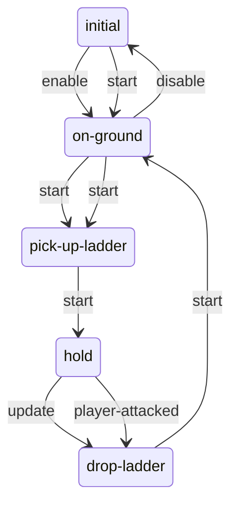

# Ladders: static evidence

CONFIRMED means a structure or call instruction is present. Branch reachability, native implementation and object configuration remain separate questions. Call offset is a hexadecimal byte offset in the original module; source SHA-256 is in `databases/file_manifest.json`. `result(...)` references another call in the same lambda, not its presumed return value.

## `dc1/ss-t2/ss-basic-ladder.bin`

156 call sites; 1 state scripts; 3 exported entries.

### `ss-basic-ladder`

Initial state field: `#0000000000000000`. A zero SID does not prove that the first table state starts automatically.

Edges represent explicit `go` call sites, including conditional alternatives. Same-target edges can occur in different tracks; this is not a guaranteed linear execution trace.

#### `initial`

5 call sites. Event listeners: `enable`.

| Call target | Example offset | Argument evidence |
| --- | --- | --- |
| `go` | `0x1750` | on-ground, 1 |

#### `on-ground`

41 call sites. Event listeners: `disable`.

| Call target | Example offset | Argument evidence |
| --- | --- | --- |
| `go` | `0x26D0` | initial, 1 |
| `alloc-vector` | `0x27F0` | 0.0, 1.0, 0.0, 1.0, 0 |
| `get-object-offset-locator` | `0x2808` | player, result(1540:25) |
| `ss-plank-closest-locator-on-ladder` | `0x2830` | result(1540:31) |
| `get-locator-distance` | `0x2848` | result(1540:28), result(1540:33) |
| `get-joint-locator` | `0x2A38` | player, headb |
| `draw-interactable-hud` | `0x2B58` | interact-default, result(1540:129), 0 |

#### `pick-up-ladder`

20 call sites. Event listeners: none.

| Call target | Example offset | Argument evidence |
| --- | --- | --- |
| `camera-locator` | `0x1810` | 0 |
| `flatten-locator` | `0x1820` | result(FC0:12) |
| `get-locator-rotation` | `0x1830` | result(FC0:14) |
| `alloc-vector` | `0x1C70` | -0.15, 0.75, 0.0, 1.0, 0 |
| `offset-locator` | `0x1C88` | result(1070:12), result(1070:24) |
| `rotate-locator-angle` | `0x1CB8` | result(1070:27), 0, 90.0 |
| `wait-stub-object-lerp-locator` | `0x1DE0` | result(1070:2), result(1070:61), 1.5, 1, 1.0 |
| `go` | `0x1FC0` | hold, 1 |

#### `hold`

69 call sites. Event listeners: `player-attacked`.

| Call target | Example offset | Argument evidence |
| --- | --- | --- |
| `disable-interactable-system` | `0x2060` |  |
| `go` | `0x21C0` | drop-ladder, 1 |
| `alloc-vector` | `0x22D0` | -0.15, 0.75, 0.0, 1.0, 0 |
| `offset-locator` | `0x22E8` | result(13E0:9), result(13E0:21) |
| `rotate-locator-angle` | `0x2318` | result(13E0:24), 0, 90.0 |
| `lerp-locator` | `0x2570` | result(13E0:58), result(13E0:78), result(13E0:101) |
| `set-object-locator` | `0x2588` | result(13E0:81), result(13E0:105) |
| `camera-locator` | `0x2F90` | 0 |
| `flatten-locator` | `0x2FA0` | result(15F0:14) |
| `get-locator-rotation` | `0x2FB0` | result(15F0:16) |
| `get-locator-position` | `0x37C8` | result(15F0:275) |

#### `drop-ladder`

13 call sites. Event listeners: none.

| Call target | Example offset | Argument evidence |
| --- | --- | --- |
| `rotate-locator-angle` | `0x19B8` | result(1018:18), 0, 90.0 |
| `wait-stub-object-lerp-locator` | `0x1A00` | result(1018:11), result(1018:24), 1.5, 1, 1.0 |
| `get-object-locator` | `0x1A50` | result(1018:41) |
| `alloc-vector` | `0x1AB8` | ?, -0.25, 0.0, 1.0, 0 |
| `offset-locator` | `0x1AD0` | result(1018:43), result(1018:56) |
| `go` | `0x1F08` | on-ground, 1 |

Named/global/embedded helpers: `ss-plank-closest-locator-on-ladder`.

## `dc1/anim-player/player-ladder.bin`

2 call sites; 0 state scripts; 1 exported entries.

Named/global/embedded helpers: `anim-state-phase-anim-func`, `anim-state-phase-func`, `anim-state-phase-func`, `anim-state-phase-func`, `anim-state-flip-func`, `anim-node-name-func`, `anim-node-name-func`, `anim-node-flip-func`, `anim-node-blend-func`, `anim-transition-cond-func`, `anim-node-name-func`.

## `dc1/anim-player/player-climb.bin`

2 call sites; 0 state scripts; 1 exported entries.

Named/global/embedded helpers: `anim-state-phase-func`, `anim-state-flip-func`, `anim-state-flip-func`, `anim-transition-cond-func`.

## `dc1/anim-player/player-edge-climb.bin`

7 call sites; 0 state scripts; 1 exported entries.

Named/global/embedded helpers: `anim-state-phase-func`, `anim-state-phase-func`, `anim-state-phase-func`, `anim-state-flip-func`, `anim-node-blend-func`, `anim-node-blend-func`, `anim-node-blend-func`, `anim-node-phase-func`, `anim-node-phase-func`, `anim-transition-cond-func`.

## `dc1/anim-player/player-squeeze-through.bin`

1 call sites; 0 state scripts; 1 exported entries.

Named/global/embedded helpers: `anim-state-phase-anim-func`, `anim-state-flip-func`, `anim-state-phase-func`, `anim-node-name-func`.
