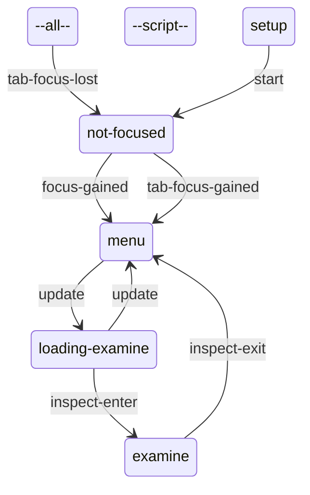

# Notes: static evidence

CONFIRMED means a structure or call instruction is present. Branch reachability, native implementation and object configuration remain separate questions. Call offset is a hexadecimal byte offset in the original module; source SHA-256 is in `databases/file_manifest.json`. `result(...)` references another call in the same lambda, not its presumed return value.

## `dc1/ss-hud2/ss-menu2-collectibles.bin`

616 call sites; 1 state scripts; 26 exported entries.

### `ss-menu2-collectibles`

Initial state field: `#0000000000000000`. A zero SID does not prove that the first table state starts automatically.

Edges represent explicit `go` call sites, including conditional alternatives. Same-target edges can occur in different tracks; this is not a guaranteed linear execution trace.

#### `setup`

72 call sites. Event listeners: none.

| Call target | Example offset | Argument evidence |
| --- | --- | --- |
| `gui2-find-widget-path` | `0xB1A0` | collectiblesList, self |
| `gui2-set-widget-state-immediate` | `0xB2B8` | result(9E30:13), off, 0, 0, 0 |
| `gui2-set-widget-visible` | `0xB310` | result(9E30:30), 0 |
| `get-collectible-category-icon` | `0xB770` | ? |
| `gui2-set-widget-image` | `0xB788` | result(9E30:170), result(9E30:174) |
| `get-category-slot-widget-path` | `0xB8B8` | result(9E30:213) |
| `gui2-set-widget-state` | `0xD230` | result(A7D0:52), focused, 0, 0, 0 |
| `get-collectible-category-title` | `0xD588` | ? |
| `gui2-set-widget-text-cipher` | `0xD5A0` | result(A7D0:69), result(A7D0:169) |
| `populate-collectibles-list` | `0xD5B0` |  |
| `treasure-focus-changed` | `0xD668` | 0 |
| `gui2-build-widget-path` | `0x114F0` | self, ref, 0, 0, 0, 0, 0, 0, 0 |
| `go` | `0x11620` | not-focused, 1 |

#### `--script--`

23 call sites. Event listeners: none.

| Call target | Example offset | Argument evidence |
| --- | --- | --- |

#### `not-focused`

2 call sites. Event listeners: `tab-focus-gained`, `focus-gained`.

| Call target | Example offset | Argument evidence |
| --- | --- | --- |
| `setup-on-focus--collectibles` | `0xCAD8` |  |
| `go` | `0xD918` | menu, 1 |

#### `menu`

120 call sites. Event listeners: `journal-enter`, `examined-treasure`, `focus-gained`, `focus-clamped`, `item-clicked`.

| Call target | Example offset | Argument evidence |
| --- | --- | --- |
| `update-tab-mouse-hover--collectibles` | `0xBFE8` |  |
| `event-arg-symbol` | `0xC018` | 3 |
| `event-arg-int32` | `0xC140` | 2 |
| `increment-collectible-category-index` | `0xC190` | 1, 1 |
| `gui2-widget-visible?` | `0xC270` | result(A040:76) |
| `gui2-get-widget-state` | `0xC300` | result(A040:92), 0 |
| `has-treasure-been-examined-by-picked-up-index?` | `0xC690` | ? |
| `get-treasure-id-by-picked-up-index` | `0xC710` | ? |
| `play-sound` | `0xE408` | sfx-menu-collectibles-hover, 0 |
| `get-collectible-category-title` | `0xE788` | ? |
| `get-inventory-item-quantity` | `0xE8F0` | parts |
| `get-treasure-by-id` | `0xEC68` | ?, 0 |
| `treasure-focus-changed` | `0xF210` | result(ACA0:4) |
| `mark-list-index-treasure-examined--collectibles` | `0xF470` | 1 |
| `is-collectibles-locked?` | `0xF890` |  |
| `log-event` | `0xF968` | locked-collectibles-action, 1, literal-sha256:e3b0c44298fc1c14, 0, 0 |
| `hud2-play-tutorial` | `0xFA78` | HUD_COLLECTIBLES_LOCKED_TEXT, 8.0, 0, 0, 1, 0, 0, 0 |
| `go` | `0xFE80` | loading-examine, 1 |
| `get-category-slot-widget-path` | `0xFFD0` | ? |
| `gui2-widget-is-currently-mouse-hovered?` | `0xFFF0` | result(AE00:233) |
| `jump-to-collectible-category-index` | `0x10100` | ?, 1 |

#### `loading-examine`

41 call sites. Event listeners: `inspect-enter`.

| Call target | Example offset | Argument evidence |
| --- | --- | --- |
| `get-treasure-by-id` | `0xBE00` | ?, 0 |
| `player-treasure-object-loaded?` | `0xBED0` |  |
| `player-investigate-treasure` | `0xBF08` |  |
| `go` | `0xC988` | examine, 1 |
| `gui2-assign-to-category` | `0xD798` | result(A828:6), 16 |
| `prepare-player-investigate-treasure` | `0xD940` |  |
| `menu2-push-page` | `0xDA20` | hudMenuStack, menu-collectibles/collect-loading-screen, 0 |
| `gui2-build-widget-path` | `0xEE58` | result(AB98:7), loading, 0, 0, 0, 0, 0, 0, 0 |
| `gui2-set-widget-state` | `0xEEA8` | result(AB98:25), off, 0, 0, 0 |

#### `examine`

24 call sites. Event listeners: `inspect-exit`.

| Call target | Example offset | Argument evidence |
| --- | --- | --- |
| `play-sound` | `0xCB18` | sfx-menu-examine-close, 0 |
| `go` | `0xD918` | menu, 1 |
| `get-treasure-by-id` | `0xDD08` | ?, 0 |
| `get-collectible-category-title` | `0xE068` | ? |
| `get-inventory-item-quantity` | `0xE260` | parts |

#### `--all--`

71 call sites. Event listeners: `tab-focus-lost`, `tab-focus-gained`, `designer-menu-changed`.

| Call target | Example offset | Argument evidence |
| --- | --- | --- |
| `field-config-add-widget` | `0x7DB0` | 0, textTitle |
| `field-config-add-property` | `0x7DE0` | 0, value |
| `get-treasure` | `0x82C0` | 0, 0 |
| `get-treasure-by-id` | `0x8468` | ?, 1 |
| `has-treasure-been-examined-by-picked-up-index?` | `0x8668` | ? |
| `adjust-journal-line--collectibles` | `0x86C8` |  |
| `fact-symbol` | `0x8E60` | player, default-collectibles-focus, 0, 0 |
| `populate-collectibles-list` | `0x8F30` |  |
| `fact-get-bool-safe` | `0x90C8` | player, collectibles-tutorial-active? |
| `send-event` | `0xCC70` | collectibles-tab-focus-lost, result(A460:3) |
| `gui2-disable-categories/f` | `0xD820` | 256 |
| `go` | `0x11620` | not-focused, 1 |

Named/global/embedded helpers: `refresh-collectible-category`, `treasure-focus-changed`, `mark-list-index-treasure-examined--collectibles`, `get-category-slot-child`, `populate-category-slot-children-darray`, `is-collectibles-locked?`, `jump-to-collectible-category-index`, `get-collectible-widget-dot`, `setup-on-focus--collectibles`, `increment-collectible-category-index`, `is-item-click-blocked?--collectibles`, `adjust-journal-line--collectibles`, `populate-collectibles-list`, `get-category-slot-widget-path`, `update-tab-mouse-hover--collectibles`, `get-collectible-category-icon--large`, `refresh-branch-dots`, `set-category-counts`, `get-collectible-widget`, `get-collectible-category-icon`, `get-collectible-category-title`, `respond-to-item-clicked`, `get-collectible-journal-line`.
