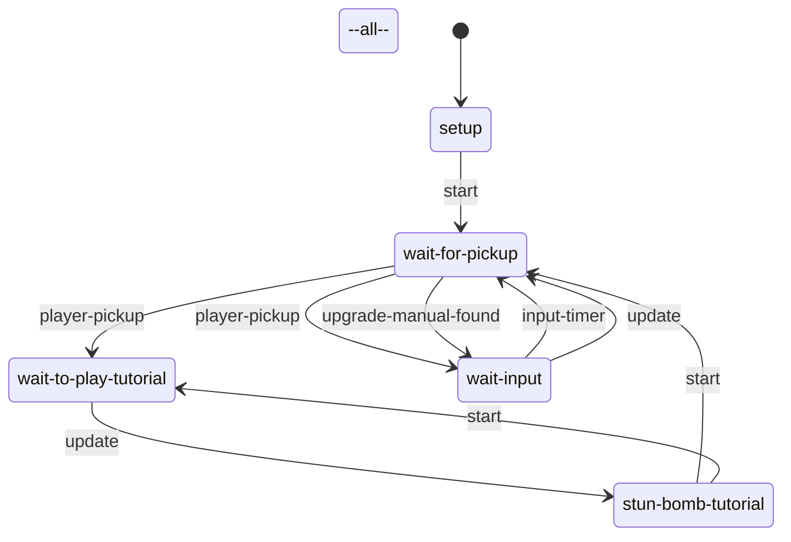
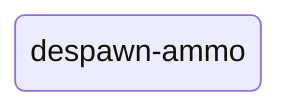
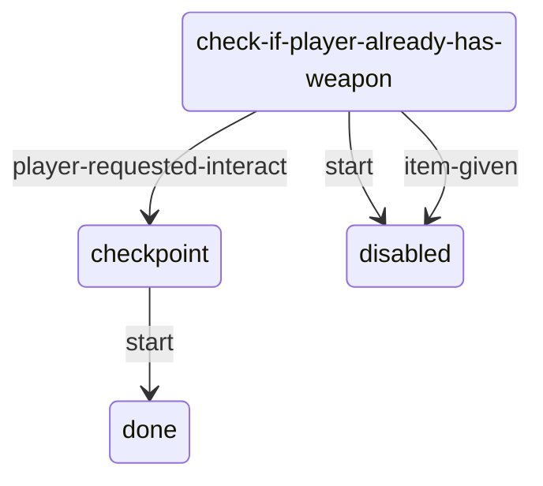

# Pickups: static evidence

CONFIRMED means a structure or call instruction is present. Branch reachability, native implementation and object configuration remain separate questions. Call offset is a hexadecimal byte offset in the original module; source SHA-256 is in `databases/file_manifest.json`. `result(...)` references another call in the same lambda, not its presumed return value.

## `dc1/ss-t2/ss-crafting-recipe-from-pickup.bin`

160 call sites; 1 state scripts; 11 exported entries.

### `ss-crafting-recipe-from-pickup`

Initial state field: `setup`. A zero SID does not prove that the first table state starts automatically.

Edges represent explicit `go` call sites, including conditional alternatives. Same-target edges can occur in different tracks; this is not a guaranteed linear execution trace.

#### `--all--`

11 call sites. Event listeners: `frame-ignore-touchpad-override`, `task-complete`, `player-upgrade-enabled`, `player-upgrade-removed`.

| Call target | Example offset | Argument evidence |
| --- | --- | --- |
| `set-svar-as-boolean` | `0x34F8` | player-found-first-supplement, 0 |
| `upgrade-stun-to-smoke-bomb` | `0x35D8` |  |

#### `setup`

17 call sites. Event listeners: none.

| Call target | Example offset | Argument evidence |
| --- | --- | --- |
| `go` | `0x3260` | wait-for-pickup, 1 |
| `player-upgrade-active?` | `0x39B8` | melee-upgrade-recipe |

#### `wait-for-pickup`

66 call sites. Event listeners: `player-pickup`, `upgrade-manual-found`.

| Call target | Example offset | Argument evidence |
| --- | --- | --- |
| `event-arg-symbol` | `0x2140` | 1 |
| `event-arg-bound-frame` | `0x22F8` | 4 |
| `log-event` | `0x2330` | player-learned-recipe, 1, ?, result(1C08:58), 0 |
| `hud2-request-new-item-notification` | `0x2378` | result(1C08:3), 0.0, 0 |
| `go` | `0x23C8` | wait-to-play-tutorial, 1 |
| `get-svar-as-boolean` | `0x2448` | player-found-first-supplement |
| `set-svar-as-boolean` | `0x2520` | player-found-first-supplement, 1 |
| `hud2-play-tutorial` | `0x25E0` | HUD_MIN_SUPPLEMENTS, 8.0, inventory-open, hud/tutorial/icons/supplement-tutorial.png, 1, 0, 0, 0 |
| `can-purchase-any-upgrades?` | `0x2650` | 0 |
| `tension-mode-is?` | `0x2728` | 3 |

#### `wait-to-play-tutorial`

4 call sites. Event listeners: none.

| Call target | Example offset | Argument evidence |
| --- | --- | --- |
| `hud2-new-item-notification-active?` | `0x38B8` |  |
| `go` | `0x38F8` | stun-bomb-tutorial, 1 |

#### `stun-bomb-tutorial`

6 call sites. Event listeners: none.

| Call target | Example offset | Argument evidence |
| --- | --- | --- |
| `go` | `0x3260` | wait-for-pickup, 1 |
| `hud2-new-item-notification-active?` | `0x32A0` |  |
| `hud2-play-tutorial` | `0x3370` | HUD_TUTORIAL_STUN_BOMB, 7.0, 0, 0, 1, 0, 0, 0 |

#### `wait-input`

7 call sites. Event listeners: `input-timer`.

| Call target | Example offset | Argument evidence |
| --- | --- | --- |
| `go` | `0x3260` | wait-for-pickup, 1 |
| `inventory-open-valid?` | `0x3418` |  |

Named/global/embedded helpers: `upgrade-stun-to-smoke-bomb`, `on-chapter-start`, `downgrade-smoke-to-stun-bomb`, `valid-new-recipe-task?`, `check-stun-vs-smoke-bomb`, `lambda@1920`.

## `dc1/ss-t2/ss-grounded-pickup-despawn.bin`

25 call sites; 1 state scripts; 25 exported entries.

### `ss-grounded-pickup-despawn`

Initial state field: `#0000000000000000`. A zero SID does not prove that the first table state starts automatically.

Edges represent explicit `go` call sites, including conditional alternatives. Same-target edges can occur in different tracks; this is not a guaranteed linear execution trace.

#### `despawn-ammo`

2 call sites. Event listeners: `task-complete`, `player-spawned`.

| Call target | Example offset | Argument evidence |
| --- | --- | --- |
| `despawn-grounded-pickups-if-well-supplied` | `0x1DE8` | result(1D78:2) |

Named/global/embedded helpers: `despawn-grounded-pickups-if-well-supplied`.

## `dc1/ss-t2/ss-item-pickup-optional-weapon.bin`

46 call sites; 1 state scripts; 1 exported entries.

### `ss-item-pickup-optional-weapon`

Initial state field: `#0000000000000000`. A zero SID does not prove that the first table state starts automatically.

Edges represent explicit `go` call sites, including conditional alternatives. Same-target edges can occur in different tracks; this is not a guaranteed linear execution trace.

#### `check-if-player-already-has-weapon`

32 call sites. Event listeners: `player-requested-interact`, `item-given`.

| Call target | Example offset | Argument evidence |
| --- | --- | --- |
| `event-arg-symbol` | `0x900` | 0 |
| `go` | `0x9D8` | checkpoint, 1 |
| `set-weapon-extra-joint-mods` | `0xAC0` | result(5F0:11), shotgun-baserri-db-bullet-chamber-darray |

#### `checkpoint`

14 call sites. Event listeners: none.

| Call target | Example offset | Argument evidence |
| --- | --- | --- |
| `hud2-request-new-item-notification` | `0x8B0` | result(540:6), 0.0, 0 |
| `tension-mode-is?` | `0xCB0` | 3 |
| `no-enemy-npc-interacting-with-player?` | `0xCE0` | 0 |
| `remember-dynamic-checkpoint` | `0xD80` | 1, 1, safeguard-stealth-checkpoint, ? |
| `go` | `0x1388` | done, 1 |

#### `done`

0 call sites. Event listeners: none.

| Call target | Example offset | Argument evidence |
| --- | --- | --- |

#### `disabled`

0 call sites. Event listeners: none.

| Call target | Example offset | Argument evidence |
| --- | --- | --- |
