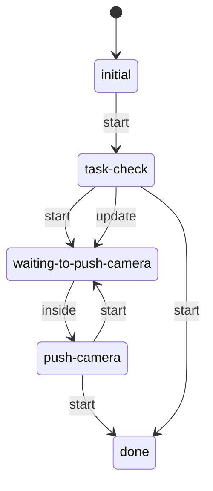
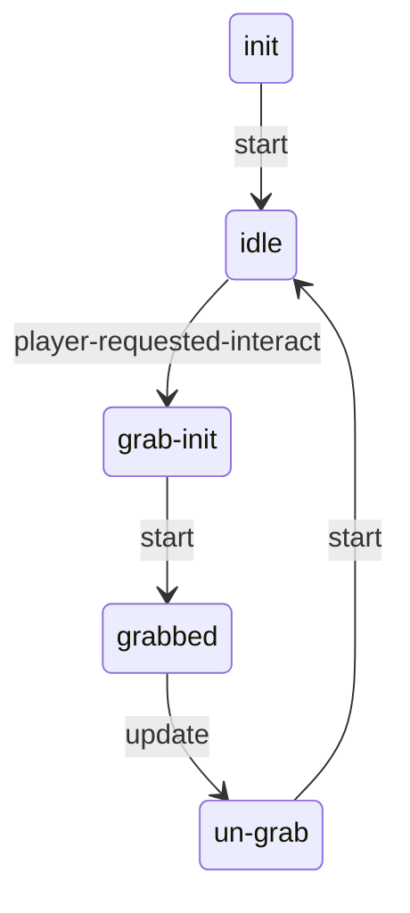

# Pushables: static evidence

CONFIRMED means a structure or call instruction is present. Branch reachability, native implementation and object configuration remain separate questions. Call offset is a hexadecimal byte offset in the original module; source SHA-256 is in `databases/file_manifest.json`. `result(...)` references another call in the same lambda, not its presumed return value.

## `dc1/push-object.bin`

0 call sites; 0 state scripts; 20 exported entries.

This module exports data structures. Zero script calls does not mean zero engine behavior.

## `dc1/anim-player/player-push-object.bin`

14 call sites; 0 state scripts; 1 exported entries.

Named/global/embedded helpers: `anim-state-phase-func`, `anim-node-blend-func`, `anim-node-blend-func`, `anim-node-blend-func`, `anim-node-blend-func`, `anim-transition-cond-func`, `anim-transition-cond-func`, `anim-transition-cond-func`, `anim-transition-cond-func`, `anim-transition-cond-func`.

## `dc1/ss/ss-push-follow-cam.bin`

32 call sites; 1 state scripts; 1 exported entries.

### `ss-push-follow-cam`

Initial state field: `initial`. A zero SID does not prove that the first table state starts automatically.

Edges represent explicit `go` call sites, including conditional alternatives. Same-target edges can occur in different tracks; this is not a guaranteed linear execution trace.

#### `initial`

2 call sites. Event listeners: none.

| Call target | Example offset | Argument evidence |
| --- | --- | --- |
| `go` | `0x1190` | task-check, 1 |

#### `task-check`

13 call sites. Event listeners: none.

| Call target | Example offset | Argument evidence |
| --- | --- | --- |
| `go` | `0xF00` | done, 1 |

#### `waiting-to-push-camera`

3 call sites. Event listeners: `inside`.

| Call target | Example offset | Argument evidence |
| --- | --- | --- |
| `go` | `0x12C0` | push-camera, 1 |

#### `push-camera`

13 call sites. Event listeners: none.

| Call target | Example offset | Argument evidence |
| --- | --- | --- |
| `camera-fade-out` | `0xDC0` | result(870:6), result(870:12), 0 |
| `camera-enable` | `0x1108` | result(978:6), follow, result(978:13), result(978:19), ?, ?, 1, 0, 0, 0, 0, -1.0 |
| `go` | `0x15B0` | waiting-to-push-camera, 1 |

#### `done`

1 call sites. Event listeners: none.

| Call target | Example offset | Argument evidence |
| --- | --- | --- |

## `dc1/ss-test/ss-test-bsingh/ss-bsingh-puzzle-pushable.bin`

58 call sites; 1 state scripts; 1 exported entries.

### `ss-bsingh-puzzle-pushable`

Initial state field: `#0000000000000000`. A zero SID does not prove that the first table state starts automatically.

Edges represent explicit `go` call sites, including conditional alternatives. Same-target edges can occur in different tracks; this is not a guaranteed linear execution trace.

#### `init`

7 call sites. Event listeners: none.

| Call target | Example offset | Argument evidence |
| --- | --- | --- |
| `get-object-locator` | `0xEF0` | result(7A8:9) |
| `get-spawner-locator` | `0xF48` | result(7A8:18), 1 |
| `transform-locator-world-to-local` | `0xF60` | result(7A8:11), result(7A8:22) |
| `go` | `0x10B8` | idle, 1 |

#### `idle`

21 call sites. Event listeners: `player-requested-interact`.

| Call target | Example offset | Argument evidence |
| --- | --- | --- |
| `interactable-enable` | `0x1118` | result(908:6) |
| `event-arg-symbol` | `0x1200` | 0 |
| `go` | `0x1270` | grab-init, 1 |
| `interactable-enabled?` | `0x1768` | result(C20:6) |
| `fact-symbol` | `0x17F8` | player, player-interactable, 0, 0 |
| `interactable-disable` | `0x1850` | result(C20:35) |

#### `grab-init`

11 call sites. Event listeners: none.

| Call target | Example offset | Argument evidence |
| --- | --- | --- |
| `go` | `0x1660` | grabbed, 1 |
| `fact-set` | `0x1948` | player, player-interactable, result(C78:13) |
| `interactable-disable` | `0x1B68` | result(D28:6) |

#### `grabbed`

19 call sites. Event listeners: none.

| Call target | Example offset | Argument evidence |
| --- | --- | --- |
| `go` | `0xE40` | un-grab, 1 |
| `camera-locator` | `0x1310` | 0 |
| `flatten-locator` | `0x1320` | result(A68:10) |
| `get-locator-rotation` | `0x1330` | result(A68:12) |
| `transform-locator-local-to-world` | `0x13D0` | result(A68:30), result(A68:23) |
| `get-object-locator` | `0x1458` | result(A68:49) |
| `blend-locator` | `0x14A0` | result(A68:51), result(A68:34), ? |
| `set-object-locator` | `0x14B8` | result(A68:41), result(A68:60) |

#### `un-grab`

3 call sites. Event listeners: none.

| Call target | Example offset | Argument evidence |
| --- | --- | --- |
| `fact-set` | `0x1040` | player, player-interactable, result(800:8) |
| `go` | `0x10B8` | idle, 1 |
