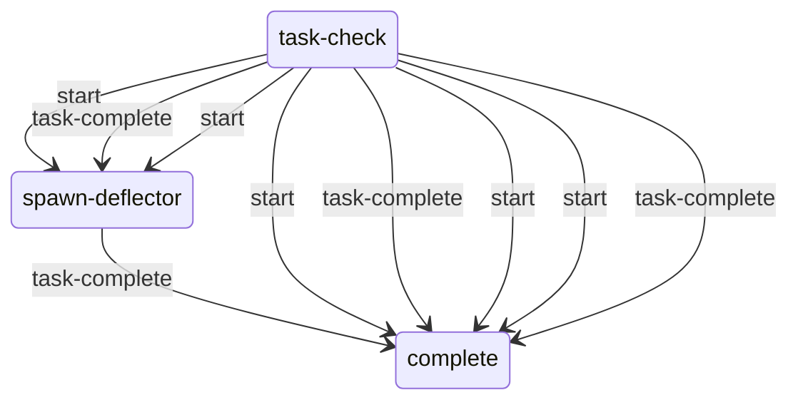
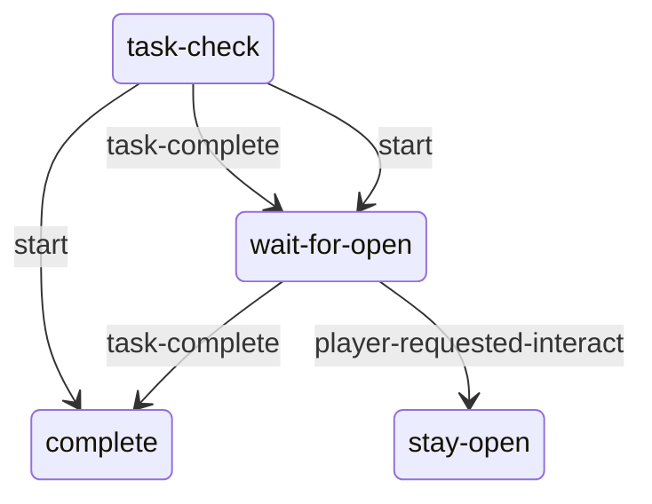

# Ropes: static evidence

CONFIRMED means a structure or call instruction is present. Branch reachability, native implementation and object configuration remain separate questions. Call offset is a hexadecimal byte offset in the original module; source SHA-256 is in `databases/file_manifest.json`. `result(...)` references another call in the same lambda, not its presumed return value.

## `dc1/rope.bin`

0 call sites; 0 state scripts; 2 exported entries.

This module exports data structures. Zero script calls does not mean zero engine behavior.

## `dc1/phys-ropes.bin`

0 call sites; 0 state scripts; 4 exported entries.

This module exports data structures. Zero script calls does not mean zero engine behavior.

## `dc1/anim-player/player-rope.bin`

3 call sites; 0 state scripts; 1 exported entries.

Named/global/embedded helpers: `anim-state-phase-func`, `anim-state-phase-anim-func`, `anim-state-flip-func`, `anim-state-phase-func`, `anim-state-phase-func`, `anim-node-name-func`, `anim-node-blend-func`, `anim-transition-cond-func`, `anim-transition-cond-func`, `anim-transition-cond-func`, `anim-transition-cond-func`, `anim-transition-cond-func`, `anim-transition-cond-func`, `anim-transition-cond-func`, `anim-transition-cond-func`, `anim-transition-cond-func`, `anim-transition-cond-func`, `anim-transition-cond-func`.

## `dc1/anim-player/player-wall-rope.bin`

13 call sites; 0 state scripts; 1 exported entries.

Named/global/embedded helpers: `anim-state-phase-func`, `anim-state-phase-func`, `anim-state-flip-func`, `anim-state-flip-func`, `anim-state-phase-func`, `anim-state-phase-func`, `anim-state-flip-func`, `anim-state-phase-func`, `anim-state-phase-anim-func`, `anim-state-flip-func`, `anim-state-flip-func`, `anim-state-flip-func`, `anim-node-blend-func`, `anim-node-name-func`, `anim-node-name-func`, `anim-node-blend-func`, `anim-transition-cond-func`, `anim-node-name-func`, `anim-transition-cond-func`, `anim-transition-cond-func`, `anim-transition-cond-func`, `anim-node-name-func`, `anim-transition-cond-func`, `anim-transition-cond-func`, `anim-transition-cond-func`, `anim-transition-cond-func`, `anim-transition-cond-func`, `anim-transition-cond-func`, `anim-transition-cond-func`, `anim-transition-cond-func`.

## `dc1/ss-seattlearrival/ss-sea-qz-wall-rope-deflector.bin`

16 call sites; 1 state scripts; 1 exported entries.

### `ss-sea-qz-wall-rope-deflector`

Initial state field: `#0000000000000000`. A zero SID does not prove that the first table state starts automatically.

Edges represent explicit `go` call sites, including conditional alternatives. Same-target edges can occur in different tracks; this is not a guaranteed linear execution trace.

#### `task-check`

12 call sites. Event listeners: `task-complete`.

| Call target | Example offset | Argument evidence |
| --- | --- | --- |
| `go` | `0x8B0` | complete, 1 |

#### `spawn-deflector`

6 call sites. Event listeners: `sea-qz-rope-deflector-region-in`, `sea-qz-rope-deflector-region-out`, `task-complete`.

| Call target | Example offset | Argument evidence |
| --- | --- | --- |
| `go` | `0xD38` | complete, 1 |

#### `complete`

0 call sites. Event listeners: none.

| Call target | Example offset | Argument evidence |
| --- | --- | --- |

## `dc1/ss-watchtower/ss-wat-infected-tunnels-rope-puzzle-door.bin`

12 call sites; 1 state scripts; 1 exported entries.

### `ss-wat-infected-tunnels-rope-puzzle-door`

Initial state field: `#0000000000000000`. A zero SID does not prove that the first table state starts automatically.

Edges represent explicit `go` call sites, including conditional alternatives. Same-target edges can occur in different tracks; this is not a guaranteed linear execution trace.

#### `task-check`

6 call sites. Event listeners: `task-complete`.

| Call target | Example offset | Argument evidence |
| --- | --- | --- |
| `go` | `0x848` | wait-for-open, 1 |

#### `wait-for-open`

3 call sites. Event listeners: `player-requested-interact`, `task-complete`.

| Call target | Example offset | Argument evidence |
| --- | --- | --- |
| `go` | `0x7C8` | stay-open, 1 |

#### `stay-open`

2 call sites. Event listeners: none.

| Call target | Example offset | Argument evidence |
| --- | --- | --- |
| `interactable-disable` | `0x8A8` | door-single-metal-b-l-ks9-bf079-1 |

#### `complete`

0 call sites. Event listeners: none.

| Call target | Example offset | Argument evidence |
| --- | --- | --- |

Named/global/embedded helpers: `lambda@380`.
