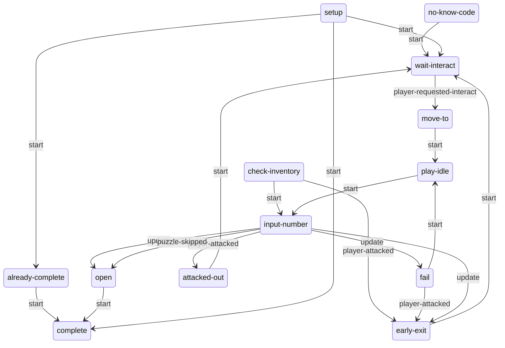
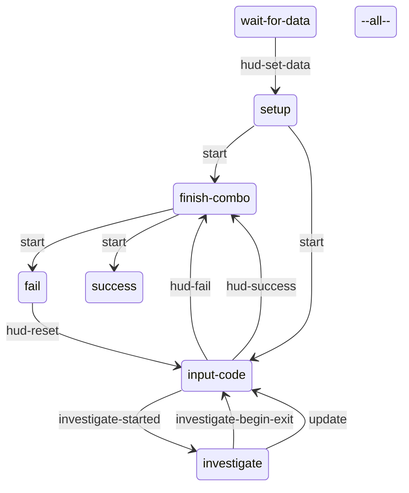

# Safes: static evidence

CONFIRMED means a structure or call instruction is present. Branch reachability, native implementation and object configuration remain separate questions. Call offset is a hexadecimal byte offset in the original module; source SHA-256 is in `databases/file_manifest.json`. `result(...)` references another call in the same lambda, not its presumed return value.

## `dc1/ss/ss-tumbler-safe.bin`

1056 call sites; 1 state scripts; 6 exported entries.

### `ss-tumbler-safe`

Initial state field: `#0000000000000000`. A zero SID does not prove that the first table state starts automatically.

Edges represent explicit `go` call sites, including conditional alternatives. Same-target edges can occur in different tracks; this is not a guaranteed linear execution trace.

#### `setup`

34 call sites. Event listeners: none.

| Call target | Example offset | Argument evidence |
| --- | --- | --- |
| `ss-svar` | `0xFD60` | opened, self |
| `get-svar-as-boolean` | `0xFD70` | result(67B8:6) |
| `go` | `0xFDA8` | already-complete, 1 |
| `interactable-disable` | `0x20DE8` | result(8910:26) |

#### `wait-interact`

22 call sites. Event listeners: `tension-changed`, `player-requested-interact`.

| Call target | Example offset | Argument evidence |
| --- | --- | --- |
| `object-anim-playing?` | `0xD670` | result(5D10:2), dial-anim, 1 |
| `animate_` | `0xDA60` | result(5D10:13), dial-anim, result(5D10:24) |
| `tension-mode-is?` | `0x1F408` | 3 |
| `interactable-disable` | `0x1F438` | result(84F0:24) |
| `interactable-enable` | `0x1F468` | result(84F0:30) |
| `go` | `0x1F5B8` | move-to, 1 |

#### `no-know-code`

22 call sites. Event listeners: none.

| Call target | Example offset | Argument evidence |
| --- | --- | --- |
| `has-collected-treasure?` | `0x123D8` | result(6DE8:17), 0 |
| `go` | `0x19AF0` | wait-interact, 1 |
| `interactable-disable` | `0x21D08` | result(8CD8:2) |

#### `move-to`

84 call sites. Event listeners: none.

| Call target | Example offset | Argument evidence |
| --- | --- | --- |
| `get-spawner-locator` | `0xC9D8` | self, 1 |
| `flatten-locator` | `0xC9E8` | result(5BB0:69) |
| `animate_` | `0xCBC0` | player, ?, result(5BB0:38) |
| `wait-animate_` | `0xD078` | player, ?, result(5BB0:166) |
| `camera-override-near-clip/f` | `0xF078` | 0.01 |
| `player-is-crouched?` | `0xFFE0` |  |
| `player-flashlight-on?` | `0x15608` |  |
| `enable-player-flashlight-shadows/f` | `0x15620` |  |
| `player-flashlight-override-near-clip/f` | `0x15640` | 0.1 |
| `hud2-hide-health-ammo/f` | `0x15AD8` | 0, 0 |
| `wait-player-move-to-entry` | `0x15D78` | ?, ?, 1, 0, 0.4, apReference-camera1, apReference, 0.0, 0, 1, -1, ?, 0.0, 0, 1 |
| `camera-enable-animated` | `0x17E98` | 2.0, -1.0, result(7C00:8), 1000, 0, 0, 0 |
| `ik-to-joint` | `0x199F8` | player, 1, result(8020:15), root, 0.7 |
| `gui2-disable-categories/f` | `0x19DB8` | 16777216 |
| `log-event` | `0x1F338` | safe-approached, 1, result(8498:7), 0, 0 |
| `check-lighting-estimate-over-threshold` | `0x21340` | result(8A70:19) |
| `turn-on-flashlight` | `0x21378` | player, 0 |
| `go` | `0x21CC8` | play-idle, 1 |
| `interactable-disable` | `0x21D08` | result(8CD8:2) |

#### `play-idle`

19 call sites. Event listeners: none.

| Call target | Example offset | Argument evidence |
| --- | --- | --- |
| `animate_` | `0xC228` | player, result(5B00:7), result(5B00:17) |
| `player-flashlight-on?` | `0xD558` |  |
| `enable-player-flashlight-shadows/f` | `0xD570` |  |
| `player-flashlight-override-near-clip/f` | `0xD590` | 0.1 |
| `go` | `0x122A8` | input-number, 1 |
| `cloth-no-reboot-on-camera-cut` | `0x122F0` | player, 0 |
| `get-object-locator` | `0x156F0` | result(7368:7) |
| `player-ik-to-locator` | `0x15740` | result(7368:9), 0, *player-ik-arm*, 0, 0.2 |
| `hud2-hide-health-ammo/f` | `0x15AD8` | 0, 0 |
| `get-spawner-locator` | `0x16B58` | self, 1 |

#### `check-inventory`

32 call sites. Event listeners: `player-attacked`.

| Call target | Example offset | Argument evidence |
| --- | --- | --- |
| `go` | `0xDC70` | early-exit, 1 |
| `camera-override-near-clip/f` | `0xF078` | 0.01 |
| `stop-animating` | `0xF840` | player, 2, 0.5, 0, 0 |
| `log-event` | `0xFE88` | safe-viewed-code, 1, literal-sha256:e3b0c44298fc1c14, 0, 0 |
| `player-set-quick-inspect-treasure/f` | `0x102C8` | result(6AD0:18) |
| `player-start-loading-treasure-object` | `0x10310` | result(6AD0:27) |
| `camera-enable-animated` | `0x162D0` | 0.5, -1.0, 1, 1000, 0, 0, 0 |
| `get-spawner-locator` | `0x19370` | self, 1 |
| `animate_` | `0x197B8` | player, result(7EC0:7), result(7EC0:17) |
| `gui2-disable-categories/f` | `0x19DB8` | 16777216 |
| `camera-fade-out-animated` | `0x21F18` | 0.5, 0 |

#### `input-number`

490 call sites. Event listeners: `player-attacked`, `puzzle-skipped`, `stop-fast-spin`, `access-swap-timer`, `reset-timer`.

| Call target | Example offset | Argument evidence |
| --- | --- | --- |
| `get-animation-phase` | `0x97E8` | result(5630:4), 1, dial-anim |
| `hud2-set-lock-minigame-curr-input` | `0x98A8` | result(5630:30), result(5630:17) |
| `play-sound-at-joint` | `0x9DC0` | sfx-gbl-safe-dial-rotate-tick-clue, result(5630:188), dial, 0, 0 |
| `play-sound` | `0x9E38` | ?, 0 |
| `player-flashlight-on?` | `0xD558` |  |
| `enable-player-flashlight-shadows/f` | `0xD570` |  |
| `player-flashlight-override-near-clip/f` | `0xD590` | 0.1 |
| `object-anim-playing?` | `0xDF78` | player, result(5EC8:15), 1 |
| `set-animation-phase` | `0xE150` | result(5EC8:66), result(5EC8:72), 1, dial-anim |
| `camera-override-near-clip/f` | `0xF078` | 0.01 |
| `go` | `0xF2A8` | attacked-out, 1 |
| `player-flashlight-force-facing` | `0xF3C0` |  |
| `get-svar-as-boolean` | `0xF460` | safe-tutorial-once |
| `set-svar` | `0xF720` | safe-tutorial-once, 1 |
| `stop-animating` | `0xFCD8` | player, 1, 0.0, result(6760:23), 0 |
| `get-spawner-locator` | `0x10FA0` | self, 1 |
| `animate_` | `0x113E8` | player, result(6C30:262), result(6C30:272) |
| `hud2-lock-minigame-submit-input` | `0x11B48` | result(6C30:684), ?, result(6C30:697) |
| `ik-to-joint` | `0x16430` | player, 1, result(7730:15), root, 0.0 |
| `stop-ik-to-joint` | `0x172E0` | player, 0.5 |
| `gui2-disable-categories/f` | `0x19DB8` | 16777216 |

#### `open`

113 call sites. Event listeners: none.

| Call target | Example offset | Argument evidence |
| --- | --- | --- |
| `get-treasure-by-id` | `0xAC98` | result(5790:18), 0 |
| `has-collected-treasure?` | `0xACF8` | result(5790:30), 0 |
| `get-svar-bit` | `0xDCE0` | safes-found, result(5E70:7) |
| `increment-svar` | `0xDD20` | safes-opened, 1 |
| `set-svar-bit` | `0xDD88` | safes-found, result(5E70:26), 1 |
| `collectible-stat-objective-completed` | `0xDDE0` | safes-found, result(5E70:39) |
| `get-svar` | `0xDE00` | safes-found |
| `camera-override-near-clip/f` | `0xF078` | 0.01 |
| `camera-fade-out-auto-gen-animated` | `0xF338` | 2.0, 10.0, 0 |
| `camera-fade-out-animated` | `0xF370` | 2.0, 0 |
| `hud2-win-lock-minigame` | `0xF418` | result(6448:6) |
| `stop-animating` | `0xFB40` | player, 1, 0.2, result(66B0:9), 0 |
| `stop-ik-to-joint` | `0x10138` | player, 0.5 |
| `log-event` | `0x104D0` | safe-opened, 1, result(6B80:7), 0, 0 |
| `ss-svar` | `0x16780` | opened, self |
| `set-svar` | `0x167A0` | result(77E0:6), 1 |
| `go` | `0x18290` | complete, 1 |
| `gui2-disable-categories/f` | `0x19DB8` | 16777216 |
| `broadcast-event` | `0x1A110` | opened-safe, result(8390:8) |
| `get-spawner-locator` | `0x1F890` | self, 1 |
| `animate_` | `0x1FB38` | player, ellie-systemic-safe-open-success-long, result(8758:19) |
| `alloc-vector` | `0x1FD90` | 0.0, ?, 0.0, 1.0, 0 |
| `offset-locator` | `0x1FDA8` | result(8758:183), result(8758:209) |
| `flatten-locator` | `0x1FDB8` | result(8758:212) |
| `wait-animate_` | `0x203F8` | player, ellie-systemic-safe-open-success-long, result(8758:151) |
| `player-flashlight-on?` | `0x21D70` |  |
| `enable-player-flashlight-shadows/f` | `0x21D88` |  |
| `player-flashlight-override-near-clip/f` | `0x21DA8` | 0.1 |

#### `fail`

116 call sites. Event listeners: `player-attacked`.

| Call target | Example offset | Argument evidence |
| --- | --- | --- |
| `get-spawner-locator` | `0x90B0` | self, 1 |
| `animate_` | `0x94F8` | player, result(5420:7), result(5420:17) |
| `stop-animating` | `0x9638` | player, 1, 0.3, result(5528:9), 0 |
| `go` | `0x9720` | punch-start, 1 |
| `play-sound-at-joint` | `0xB670` | sfx-gbl-safe-dial-reset, result(5948:3), dial, 0, 0 |
| `player-flashlight-on?` | `0xD558` |  |
| `enable-player-flashlight-shadows/f` | `0xD570` |  |
| `player-flashlight-override-near-clip/f` | `0xD590` | 0.1 |
| `wait-animate_` | `0xEF20` | player, result(5FD0:7), result(5FD0:17) |
| `camera-override-near-clip/f` | `0xF078` | 0.01 |
| `hud2-fail-lock-minigame` | `0xF250` | result(62E8:6) |
| `ik-to-joint` | `0x12548` | player, 1, self, button, 1.0 |
| `broadcast-event` | `0x13B98` | failed-safe, result(7260:8) |
| `get-treasure-by-id` | `0x18360` | result(7E68:18), 0 |
| `has-collected-treasure?` | `0x183C0` | result(7E68:30), 0 |
| `gui2-disable-categories/f` | `0x19DB8` | 16777216 |
| `log-event` | `0x21C70` | safe-failed-to-open, 1, result(8C28:7), 0, 0 |

#### `early-exit`

76 call sites. Event listeners: none.

| Call target | Example offset | Argument evidence |
| --- | --- | --- |
| `interactable-enable` | `0xEFD8` | result(6080:2) |
| `camera-override-near-clip/f` | `0xF078` | 0.01 |
| `stop-animating` | `0xFB40` | player, 1, 0.2, result(66B0:9), 0 |
| `log-event` | `0xFF60` | safe-left, 1, result(6918:7), 0, 0 |
| `stop-ik-to-joint` | `0x13398` | player, 0.0 |
| `camera-disable-animated` | `0x13C08` |  |
| `camera-enable-animated` | `0x13C88` | 0.0, -1.0, 1, 1000, 0, 0, 0 |
| `get-spawner-locator` | `0x13E78` | self, 1 |
| `animate_` | `0x14238` | player, ?, result(72B8:56) |
| `alloc-vector` | `0x14528` | 0.0, ?, 0.0, 1.0, 0 |
| `offset-locator` | `0x14540` | result(72B8:274), result(72B8:300) |
| `flatten-locator` | `0x14550` | result(72B8:303) |
| `wait-animate_` | `0x14C50` | player, ?, result(72B8:242) |
| `camera-fade-out-animated` | `0x15A90` | 2.0, 0 |
| `gui2-widget-exists?` | `0x168F0` | result(7890:6) |
| `hud2-hide-lock-minigame` | `0x16950` | result(7890:16), 1 |
| `go` | `0x19AF0` | wait-interact, 1 |
| `player-flashlight-on?` | `0x21D70` |  |
| `enable-player-flashlight-shadows/f` | `0x21D88` |  |
| `player-flashlight-override-near-clip/f` | `0x21DA8` | 0.1 |

#### `attacked-out`

34 call sites. Event listeners: none.

| Call target | Example offset | Argument evidence |
| --- | --- | --- |
| `log-event` | `0xB750` | safe-attacked-out, 1, result(59F8:7), 0, 0 |
| `camera-override-near-clip/f` | `0xF078` | 0.01 |
| `camera-fade-out-animated` | `0xF1F0` | 1.0, 0 |
| `stop-animating` | `0xF840` | player, 2, 0.5, 0, 0 |
| `gui2-widget-exists?` | `0x168F0` | result(7890:6) |
| `hud2-hide-lock-minigame` | `0x16950` | result(7890:16), 1 |
| `go` | `0x19AF0` | wait-interact, 1 |
| `player-flashlight-on?` | `0x21D70` |  |
| `enable-player-flashlight-shadows/f` | `0x21D88` |  |
| `player-flashlight-override-near-clip/f` | `0x21DA8` | 0.1 |

#### `already-complete`

9 call sites. Event listeners: none.

| Call target | Example offset | Argument evidence |
| --- | --- | --- |
| `animate_` | `0x18178` | result(7D08:2), door-anim, result(7D08:13) |
| `go` | `0x18290` | complete, 1 |
| `interactable-disable` | `0x21D08` | result(8CD8:2) |

#### `complete`

8 call sites. Event listeners: none.

| Call target | Example offset | Argument evidence |
| --- | --- | --- |
| `gui2-widget-exists?` | `0x168F0` | result(7890:6) |
| `hud2-hide-lock-minigame` | `0x16950` | result(7890:16), 1 |

Named/global/embedded helpers: `spawn-or-reset-tumbler-hud`, `max-rate-adj`, `cw-amount2`, `circle-approach-target`, `punch-in-number`, `lambda@3D60`, `lambda@3E58`.

## `dc1/ss-hud2/ss-hud2-lock-minigame.bin`

312 call sites; 1 state scripts; 14 exported entries.

### `ss-hud2-lock-minigame`

Initial state field: `#0000000000000000`. A zero SID does not prove that the first table state starts automatically.

Edges represent explicit `go` call sites, including conditional alternatives. Same-target edges can occur in different tracks; this is not a guaranteed linear execution trace.

#### `wait-for-data`

23 call sites. Event listeners: `hud-set-data`.

| Call target | Example offset | Argument evidence |
| --- | --- | --- |
| `event-arg-boolean` | `0x5310` | 3 |
| `event-arg-int32` | `0x5390` | 2 |
| `gui2-go-widget-state` | `0x56F8` | self, off, 0, 0, 0 |
| `get-svar-as-boolean` | `0x5AA0` | safe-tutorial-once |
| `set-svar-as-boolean` | `0x5AE0` | tumbler-spinner-prompt-seen, 1 |
| `event-arg-symbol` | `0x5DA0` | 0 |
| `go` | `0x66A8` | setup, 1 |
| `gui2-assign-to-category` | `0x6B70` | self, 1048576 |

#### `setup`

100 call sites. Event listeners: none.

| Call target | Example offset | Argument evidence |
| --- | --- | --- |
| `gui2-find-widget-path` | `0x6CC0` | attachableFader, self |
| `gui2-show-permanent-attachable-widget` | `0x6FC8` | result(4B50:72), hud-minigames/hud-lock/lock-analog-static-ws, result(4B50:83), result(4B50:89), 0, 0, 0.0, *lock-minigame-spinner-attach-params* |
| `gui2-set-widget-state` | `0x7080` | result(4B50:115), spin, 0, 0, 0 |
| `hud2-set-button-prompt-stack-ciphers` | `0x7710` | result(4B50:181), result(4B50:233), result(4B50:298), result(4B50:327), 1 |
| `go` | `0x7F00` | finish-combo, 1 |
| `gui2-set-widget-visible` | `0x7FB8` | result(4B50:606), 0 |
| `gui2-set-widget-layout-mode` | `0x8158` | result(4B50:652), 3 |
| `gui2-set-widget-flow-spacing` | `0x83E8` | result(4B50:742), 9.0 |
| `gui2-update-widget-layout` | `0x8480` | result(4B50:706) |
| `gui2-get-parent-widget` | `0x8570` | result(4B50:793) |
| `gui2-get-widget-pivot-parentspace` | `0x85A8` | result(4B50:795) |
| `alloc-vector2` | `0x85E8` | 500.0, 0.0, 0 |
| `vector2-add` | `0x8600` | result(4B50:802), result(4B50:810) |
| `gui2-set-widget-pivot-parentspace` | `0x8618` | result(4B50:795), result(4B50:813) |

#### `input-code`

30 call sites. Event listeners: `hud-input-changed`, `hud-lock-in-code`, `hud-reset`, `hud-success`, `hud-fail`, `investigate-started`.

| Call target | Example offset | Argument evidence |
| --- | --- | --- |
| `send-event` | `0x5098` | show-spinner-timer, self |
| `mark-spinner-interacted--lock-minigame` | `0x5738` | 1 |
| `get-svar-as-boolean` | `0x59A8` | tumbler-spinner-prompt-seen |
| `go` | `0x5D20` | investigate, 1 |
| `event-arg-int32` | `0x6650` | 0 |

#### `finish-combo`

8 call sites. Event listeners: none.

| Call target | Example offset | Argument evidence |
| --- | --- | --- |
| `go` | `0x5F50` | success, 1 |

#### `success`

8 call sites. Event listeners: none.

| Call target | Example offset | Argument evidence |
| --- | --- | --- |
| `set-svar-as-boolean` | `0x5B48` | tumbler-spinner-prompt-seen, 1 |
| `gui2-set-widget-state` | `0x6510` | self, fadeSlow, 0, 1, 0 |
| `gui2-fade-to-widget-state` | `0x8BC8` | result(4D08:34), success, 0.5, 9, 0, 0, 0 |

#### `fail`

24 call sites. Event listeners: `hud-reset`.

| Call target | Example offset | Argument evidence |
| --- | --- | --- |
| `gui2-widget-is-animating?` | `0x4EB8` | result(3DE8:31) |
| `go` | `0x57D8` | input-code, 1 |
| `gui2-go-widget-state` | `0x6170` | result(4730:43), error, 0, 0, 0 |
| `gui2-set-widget-state` | `0x6350` | result(4730:103), off, 0, 0, 0 |

#### `investigate`

5 call sites. Event listeners: `investigate-begin-exit`.

| Call target | Example offset | Argument evidence |
| --- | --- | --- |
| `gui2-set-widget-state` | `0x5440` | self, active, 0, 0, 0 |
| `go` | `0x57D8` | input-code, 1 |

#### `--all--`

19 call sites. Event listeners: `show-spinner-timer`, `kill-hud`, `hud-disable-prompt`.

| Call target | Example offset | Argument evidence |
| --- | --- | --- |
| `get-svar-as-boolean` | `0x5130` | safe-tutorial-once |
| `gui2-set-widget-state` | `0x5C00` | self, off, 0, 1, 0 |
| `event-arg-int32` | `0x6868` | 0 |
| `event-arg-boolean` | `0x68E8` | 1 |
| `hud2-set-button-in-prompt-stack-disabled` | `0x6908` | result(4998:24), HUD_LOCK_MINIGAME_RESET, result(4998:29) |
| `hud2-hide-health-ammo/f` | `0x6B30` | 0, 0 |

Named/global/embedded helpers: `hide-spinner--lock-minigame`, `update-digits-selected--lock-minigame`, `get-arrows-path--lock-minigame`, `show-spinner--lock-minigame`, `restore-lock-minigame-to-prior-state`, `is-keypad?--lock-minigame`, `update-code-text--lock-minigame`, `mark-spinner-interacted--lock-minigame`, `setup-number-slot-child-darray--lock-minigame`, `get-number-slot-child-type--lock-minigame`, `relevant-joypad-command-pressed?--lock-minigame`.
