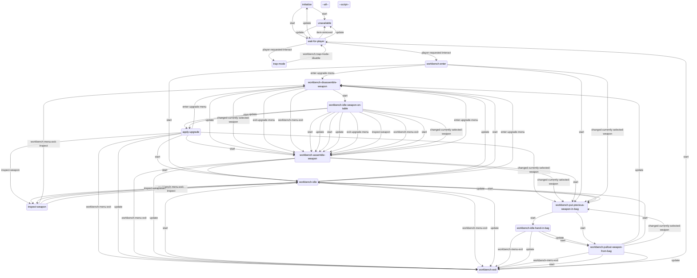
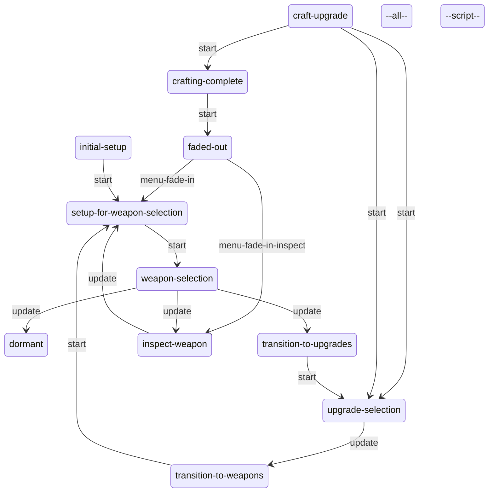

# Workbench: static evidence

CONFIRMED means a structure or call instruction is present. Branch reachability, native implementation and object configuration remain separate questions. Call offset is a hexadecimal byte offset in the original module; source SHA-256 is in `databases/file_manifest.json`. `result(...)` references another call in the same lambda, not its presumed return value.

## `dc1/ss-t2/ss-workbench.bin`

2082 call sites; 1 state scripts; 18 exported entries.

### `ss-workbench`

Initial state field: `#0000000000000000`. A zero SID does not prove that the first table state starts automatically.

Edges represent explicit `go` call sites, including conditional alternatives. Same-target edges can occur in different tracks; this is not a guaranteed linear execution trace.

#### `initialize`

40 call sites. Event listeners: `turn-on-light`.

| Call target | Example offset | Argument evidence |
| --- | --- | --- |
| `go` | `0x1A570` | wait-for-player, 1 |
| `get-spawner-locator` | `0x24880` | self, 1 |
| `ss-workbench--turn-on-lights` | `0x2A478` | 0 |
| `get-object-locator` | `0x34F68` | self |
| `set-object-locator` | `0x34F80` | result(11170:31), result(11170:35) |
| `ss-workbench--turn-off-lights` | `0x443A8` | 1 |
| `get-svar-bit` | `0x4AC10` | accessibility-workbenches-found, result(12B38:7) |
| `interactable-set-exclude-from-pickup-scan` | `0x4AC48` | self, 1 |
| `interactable-enable` | `0x568A0` | self |

#### `wait-for-player`

113 call sites. Event listeners: `item-removed`, `item-given`, `player-found-workbench-timer`, `workbench-trap-mode-enable`, `workbench-trap-mode-disable`, `player-requested-interact`, `turn-on-light`, `turn-off-light`.

| Call target | Example offset | Argument evidence |
| --- | --- | --- |
| `get-svar-bit` | `0x16270` | workbenches-found, result(F0C8:24) |
| `interactable-enabled?` | `0x162A8` | self |
| `interactable-is-interactive?` | `0x162D0` | self |
| `interactable-disable` | `0x16558` | self |
| `player-can-afford-any-weapon-upgrade?` | `0x16B30` | -1 |
| `interactable-is-activated?` | `0x16B58` | result(F2D8:13) |
| `interactable-is-excluded-from-pickup-scan?` | `0x16C08` | result(F2D8:35) |
| `interactable-get-def-id` | `0x16C38` | self |
| `override-interact-def` | `0x16CC8` | self, ? |
| `interactable-set-exclude-from-pickup-scan` | `0x16D38` | self, result(F2D8:37) |
| `alloc-vector` | `0x1AB60` | 0.65, 1.5, -0.25, 1.0, 0 |
| `go` | `0x24E88` | trap-mode, 1 |
| `collectible-stat-objective-completed` | `0x26C60` | workbenches-found, result(100F0:7) |
| `ss-workbench--turn-off-lights` | `0x41848` | 1 |
| `get-spawner-locator` | `0x41A60` | self, 1 |
| `offset-locator` | `0x41AD8` | result(11A60:24), result(11A60:36) |
| `get-locator-position` | `0x41AE8` | result(11A60:39) |
| `ss-workbench--turn-on-lights` | `0x43A98` | 1 |
| `set-svar-bit` | `0x44798` | workbenches-found, result(12560:7), 1 |
| `interactable-scripted-unavailable?` | `0x4B0E0` | self |
| `tension-mode-is?` | `0x4B110` | 3 |

#### `unavailable`

14 call sites. Event listeners: `item-given`.

| Call target | Example offset | Argument evidence |
| --- | --- | --- |
| `interactable-camera-remap-force-inactive` | `0x415C0` | self |
| `interactable-set-unavailable` | `0x50400` | self, 1 |
| `interactable-enabled?` | `0x57AD8` | self |
| `tension-mode-is?` | `0x57B00` | 3 |
| `interactable-camera-remap-force-active` | `0x57C40` | self |
| `go` | `0x57C70` | wait-for-player, 1 |

#### `trap-mode`

32 call sites. Event listeners: `workbench-hide-menu`, `workbench-show-menu`, `workbench-trap-mode-disable`.

| Call target | Example offset | Argument evidence |
| --- | --- | --- |
| `go` | `0x1A570` | wait-for-player, 1 |
| `hud2-push-menu-page` | `0x1A688` | pc/workbench/bench-weapons-root-pc |
| `fact-set` | `0x3F908` | player, in-workbench, result(114E0:8) |
| `interactable-enable` | `0x57178` | self |

#### `workbench-enter`

336 call sites. Event listeners: `player-draw-weapon-done`, `workbench-menu-exit`, `enter-upgrade-menu`, `changed-currently-selected-weapon`.

| Call target | Example offset | Argument evidence |
| --- | --- | --- |
| `event-arg-symbol` | `0x152C8` | 0 |
| `get-svar-as-boolean` | `0x15878` | player-used-workbench |
| `hud2-request-reminder` | `0x158B8` | *resources-are-scarce*, 1 |
| `set-svar-as-boolean` | `0x158E8` | player-used-workbench, 1 |
| `ss-workbench--workbench-upgrade-def-map-valid?` | `0x15BE8` | result(F070:76) |
| `wait-until-anim-phase` | `0x1A7D8` | player, ?, ?, 2 |
| `get-animation-fade` | `0x1A8D8` | player, ? |
| `tension-mode-is?` | `0x1A9B8` | 3 |
| `object-anim-reached-phase?` | `0x21100` | player, ?, ?, 2 |
| `ss-workbench--turn-on-lights` | `0x211A0` | 0 |
| `hud2-push-menu-page` | `0x28640` | pc/workbench/bench-weapons-root-pc |
| `get-joint-locator` | `0x29AE0` | player, l_hand_prop |
| `camera-enable-animated-stick` | `0x29B80` | result(10930:6), lookup(*workbench-animated-stick-cam*), 0.5, 0.5, 1, 500, 0, 0, 0.0, 0 |
| `get-parent-attach-point` | `0x29F98` | result(10B40:9) |
| `wait-holster-player-weapon` | `0x2A098` | 0, 1.0 |
| `holster-player-weapon-physically` | `0x2A0E0` | result(10B40:47), ? |
| `wait-player-move-to-entry` | `0x2A9E0` | ?, result(10D50:48), 1, ?, 0.4, apReference-camera1, apReference, 0.0, 0, 0, 0, 1, 0.0, 0, 1 |
| `player-get-silencer-anim-phase` | `0x2AC10` |  |
| `stop-animating` | `0x2B190` | player, 1, ?, ?, 0 |
| `camera-enable-animated-with-id` | `0x2B338` | workbench-enter, 1.5, -1.0, 1, 1000, 0, 0, 0 |
| `get-animation-phase` | `0x2BA10` | player, 1, ? |
| `animate_` | `0x2BD30` | ?, ?, result(10D50:533) |
| `player-get-anim-backpack` | `0x2DBB8` |  |
| `wait-animate_` | `0x2F068` | player, ?, result(10D50:2147) |
| `broadcast-event` | `0x2F0D8` | workbench-entered, result(10D50:2352) |
| `go` | `0x2F268` | workbench-put-previous-weapon-in-bag, 1 |
| `get-object-locator` | `0x34F68` | self |
| `set-object-locator` | `0x34F80` | result(11170:31), result(11170:35) |
| `spawn-camera` | `0x3F818` | result(11488:17), workbench-camera, 1 |
| `player-flashlight-on?` | `0x421B8` |  |
| `wait-player-fade-flashlight-off` | `0x423E8` | ?, 4 |
| `get-svar-bit` | `0x43400` | workbenches-found, result(11D78:17) |
| `set-svar-bit` | `0x434B0` | workbenches-found, result(11D78:37), 1 |
| `collectible-stat-objective-completed` | `0x435A0` | workbenches-found, result(11D78:69) |
| `accessibility-suppress-control-sounds/f` | `0x43630` |  |
| `disable-interactable-system` | `0x441C0` |  |
| `log-event` | `0x4A2A0` | workbench-entered, 1, ?, 0, 0 |
| `hud2-hide-health-ammo/f` | `0x4ADF0` | 0, 0 |
| `player-swap-to-anim-backpack` | `0x4AE40` | 0 |
| `holster-player-weapon` | `0x4C150` | 4, 1.0 |
| `gui2-disable-categories/f` | `0x56700` | 16777216 |
| `fact-set` | `0x56780` | player, in-workbench, result(13740:8) |
| `get-animation-duration` | `0x56E18` | player, ? |
| `camera-shake` | `0x571E0` | camera-mocap-idle-small, 1.0, 1.0, 1 |
| `object-anim-playing?` | `0x58210` | player, ?, 0 |
| `attach` | `0x58610` | ?, player, ?, 0.0 |
| `camera-fade-out` | `0x58738` | workbench-enter, 0.5, 0 |

#### `workbench-idle`

135 call sites. Event listeners: `enter-upgrade-menu`, `workbench-menu-exit`, `inspect-weapon`.

| Call target | Example offset | Argument evidence |
| --- | --- | --- |
| `go` | `0x19F50` | workbench-put-previous-weapon-in-bag, 1 |
| `ss-workbench--workbench-weapon-has-animation?` | `0x25570` | result(FFE8:16) |
| `stop-animating` | `0x256B8` | player, 1, 0.2, ?, 0 |
| `accessibility-suppress-control-sounds/f` | `0x43630` |  |
| `animate_` | `0x45300` | ?, ?, result(125B8:218) |
| `player-get-anim-backpack` | `0x482A8` |  |
| `gui2-disable-categories/f` | `0x56700` | 16777216 |
| `camera-shake` | `0x571E0` | camera-mocap-idle-small, 1.0, 1.0, 1 |
| `tension-mode-is?` | `0x57258` | 3 |

#### `workbench-idle-weapon-on-table`

120 call sites. Event listeners: `changed-currently-selected-weapon`, `exit-upgrade-menu`, `workbench-menu-exit`, `inspect-weapon`.

| Call target | Example offset | Argument evidence |
| --- | --- | --- |
| `camera-fade-out-animated-stick` | `0x164D8` | 0.5 |
| `event-arg-symbol` | `0x24748` | 0 |
| `go` | `0x247A0` | workbench-assemble-weapon, 1 |
| `tension-mode-is?` | `0x298F8` | 3 |
| `player-weapon-upgrade-get-active-bundles` | `0x35208` | result(11278:5) |
| `ss-workbench--workbench-upgrade-def-map-contains-upgrade?` | `0x35490` | result(11278:5), ? |
| `ss-workbench--get-workbench-upgrade-def-based-on-current-weapon` | `0x354C8` | result(11278:5), ? |
| `get-joint-locator` | `0x35600` | player, l_hand_prop |
| `camera-enable-animated-stick` | `0x356A0` | result(11278:136), lookup(*workbench-animated-stick-cam*), 0.5, 0.5, 1, 500, 0, 0, 0.0, 0 |
| `animate_` | `0x35F08` | ?, ?, result(11278:294) |
| `player-get-anim-backpack` | `0x38BA8` |  |
| `accessibility-suppress-control-sounds/f` | `0x43630` |  |
| `gui2-disable-categories/f` | `0x56700` | 16777216 |
| `camera-shake` | `0x571E0` | camera-mocap-idle-small, 1.0, 1.0, 1 |

#### `workbench-idle-hand-in-bag`

58 call sites. Event listeners: `workbench-menu-exit`.

| Call target | Example offset | Argument evidence |
| --- | --- | --- |
| `go` | `0x14290` | workbench-pullout-weapon-from-bag, 1 |
| `animate_` | `0x27018` | player, ?, result(10148:23) |
| `accessibility-suppress-control-sounds/f` | `0x43630` |  |
| `gui2-disable-categories/f` | `0x56700` | 16777216 |
| `camera-shake` | `0x571E0` | camera-mocap-idle-small, 1.0, 1.0, 1 |
| `tension-mode-is?` | `0x57258` | 3 |
| `attach` | `0x58610` | ?, player, ?, 0.0 |

#### `apply-upgrade`

277 call sites. Event listeners: `enter-upgrade-menu`, `changed-currently-selected-weapon`, `workbench-menu-exit`, `inspect-weapon`.

| Call target | Example offset | Argument evidence |
| --- | --- | --- |
| `set-mesh-visible` | `0x14680` | ?, ?, 0 |
| `ss-workbench--get-workbench-upgrade-def-based-on-current-weapon` | `0x14B40` | result(EEB8:5), ? |
| `wait-until-anim-phase` | `0x14BB0` | player, ?, ?, 2 |
| `animate_` | `0x15208` | result(EEB8:193), ?, result(EEB8:211) |
| `player-has-weapon-upgrade?` | `0x167E0` | result(F280:5), ? |
| `ss-workbench--workbench-upgrade-def-map-contains-upgrade?` | `0x16818` | result(F280:5), ? |
| `get-animation-phase` | `0x169A8` | player, 2, ? |
| `go` | `0x16A18` | workbench-put-previous-weapon-in-bag, 1 |
| `player-weapon-upgrade-get-active-bundles` | `0x181E8` | result(F4E8:5) |
| `ss-workbennch--log-event-workbench-upgrade` | `0x18900` | result(F4E8:5), ? |
| `weapon-upgrade-apply-bundle` | `0x191B8` | ?, ?, 0 |
| `send-event` | `0x1A628` | menu-fade-in, result(F6F8:7) |
| `event-arg-symbol` | `0x24D88` | 0 |
| `camera-fade-out` | `0x27538` | apply-upgrade, 0.5, 0 |
| `player-weapon-upgrade-update-trophy-stats` | `0x29558` |  |
| `get-joint-locator` | `0x29AE0` | player, l_hand_prop |
| `camera-enable-animated-stick` | `0x29B80` | result(10930:6), lookup(*workbench-animated-stick-cam*), 0.5, 0.5, 1, 500, 0, 0, 0.0, 0 |
| `audio-gameplay-event` | `0x2FAB0` | workbench, result(10FB8:5), result(10FB8:7) |
| `camera-enable-animated-with-id` | `0x3A808` | apply-upgrade, 0.5, -1.0, 1, 1000, 0, 0, 0 |
| `player-get-anim-backpack` | `0x3D7F8` |  |
| `wait-animate_` | `0x3E9D0` | player, ?, result(11328:2280) |
| `accessibility-suppress-control-sounds/f` | `0x43630` |  |
| `set-all-meshes-visible` | `0x4B880` | ?, 0 |
| `gui2-disable-categories/f` | `0x56700` | 16777216 |
| `camera-shake` | `0x571E0` | camera-mocap-idle-small, 1.0, 1.0, 1 |
| `tension-mode-is?` | `0x57258` | 3 |
| `attach` | `0x58610` | ?, player, ?, 0.0 |

#### `inspect-weapon`

60 call sites. Event listeners: `workbench-menu-exit-inspect`.

| Call target | Example offset | Argument evidence |
| --- | --- | --- |
| `log-event` | `0x25AE8` | workbench-inspect-weapon, 1, ?, 0, 0 |
| `animate_` | `0x25FE0` | result(10040:153), ?, result(10040:169) |
| `player-investigate-set-camera-indices` | `0x26918` | 2, 3, ?, 0, -1, -1, result(10040:559), result(10040:565) |
| `tension-mode-is?` | `0x2A270` | 3 |
| `go` | `0x2A370` | workbench-idle, 1 |
| `accessibility-suppress-control-sounds/f` | `0x43630` |  |
| `event-arg-boolean` | `0x56448` | 0 |
| `gui2-disable-categories/f` | `0x56700` | 16777216 |
| `camera-shake` | `0x571E0` | camera-mocap-idle-small, 1.0, 1.0, 1 |

#### `workbench-pullout-weapon-from-bag`

126 call sites. Event listeners: `changed-currently-selected-weapon`, `workbench-menu-exit`.

| Call target | Example offset | Argument evidence |
| --- | --- | --- |
| `get-animation-phase` | `0x155A0` | player, 2, ? |
| `stop-animating` | `0x15778` | player, 1, 0.2, ?, 0 |
| `go` | `0x157B8` | workbench-disassemble-weapon, 1 |
| `wait-until-anim-phase` | `0x1A080` | player, ?, ?, 2 |
| `event-arg-symbol` | `0x24D88` | 0 |
| `camera-fade-out` | `0x28398` | workbench-pullout-weapon-from-bag, 0.5, 0 |
| `accessibility-suppress-control-sounds/f` | `0x43630` |  |
| `audio-gameplay-event` | `0x4CE00` | workbench, result(13320:264), result(13320:266) |
| `camera-enable-animated-with-id` | `0x4CE90` | workbench-pullout-weapon-from-bag, 0.5, -1.0, 1, 1000, 0, 0, 0 |
| `animate_` | `0x4D6B8` | ?, ?, result(13320:412) |
| `player-get-anim-backpack` | `0x4F0B8` |  |
| `wait-animate_` | `0x500B8` | player, ?, result(13320:1758) |
| `gui2-disable-categories/f` | `0x56700` | 16777216 |
| `camera-shake` | `0x571E0` | camera-mocap-idle-small, 1.0, 1.0, 1 |
| `tension-mode-is?` | `0x57258` | 3 |
| `attach` | `0x58610` | ?, player, ?, 0.0 |

#### `workbench-put-previous-weapon-in-bag`

96 call sites. Event listeners: `changed-currently-selected-weapon`, `workbench-menu-exit`.

| Call target | Example offset | Argument evidence |
| --- | --- | --- |
| `go` | `0x15958` | workbench-idle-hand-in-bag, 1 |
| `tension-mode-is?` | `0x1A9B8` | 3 |
| `get-animation-phase` | `0x215C8` | ?, 2, ? |
| `camera-enable-animated-with-id` | `0x218B8` | workbench-put-previous-weapon-in-bag, 0.5, -1.0, 1, 1000, 0, 0, 0 |
| `animate_` | `0x220E0` | ?, ?, result(FC20:335) |
| `player-get-anim-backpack` | `0x23360` |  |
| `wait-animate_` | `0x24360` | player, ?, result(FC20:1441) |
| `event-arg-symbol` | `0x24D88` | 0 |
| `attach` | `0x25400` | ?, player, ?, 0.0 |
| `wait-until-anim-phase` | `0x294F0` | player, ?, ?, 2 |
| `detach-without-physicalizing` | `0x29730` | ?, 0.0 |
| `accessibility-suppress-control-sounds/f` | `0x43630` |  |
| `camera-fade-out` | `0x49DB0` | workbench-put-previous-weapon-in-bag, 0.5, 0 |
| `gui2-disable-categories/f` | `0x56700` | 16777216 |
| `camera-shake` | `0x571E0` | camera-mocap-idle-small, 1.0, 1.0, 1 |

#### `workbench-disassemble-weapon`

192 call sites. Event listeners: `changed-currently-selected-weapon`, `exit-upgrade-menu`, `workbench-menu-exit`.

| Call target | Example offset | Argument evidence |
| --- | --- | --- |
| `camera-fade-out` | `0x1B588` | workbench-disassemble-weapon, 0.5, 0 |
| `gui2-widget-exists?` | `0x24918` | result(FDD8:6) |
| `wait-until-anim-phase` | `0x24C88` | player, ?, ?, 2 |
| `send-event` | `0x24CE0` | show-upgrade-screen, result(FDD8:126) |
| `event-arg-symbol` | `0x24D88` | 0 |
| `go` | `0x27D88` | workbench-idle-weapon-on-table, 1 |
| `player-has-weapon-upgrade?` | `0x288F0` | result(105C0:5), magazine-reload |
| `set-mesh-visible` | `0x28B78` | ?, result(105C0:9), 1 |
| `detach-without-physicalizing` | `0x29730` | ?, 0.0 |
| `get-animation-phase` | `0x35128` | player, 2, ? |
| `wait-until-anim-fully-faded-in` | `0x3FAC0` | player, ? |
| `is-mesh-visible?` | `0x410B0` | ?, ? |
| `accessibility-suppress-control-sounds/f` | `0x43630` |  |
| `tension-mode-is?` | `0x4A390` | 3 |
| `set-global-sound-variable` | `0x4BAC0` | bullet-hidden, 0.0 |
| `player-weapon-upgrade-get-active-bundles` | `0x50C70` | result(13530:5) |
| `ss-workbench--workbench-upgrade-def-map-contains-upgrade?` | `0x50EC0` | result(13530:5), ? |
| `ss-workbench--get-workbench-upgrade-def-based-on-current-weapon` | `0x50EF8` | result(13530:5), ? |
| `audio-gameplay-event` | `0x510A8` | workbench, result(13530:271), result(13530:273) |
| `camera-fade-out-animated-stick` | `0x510C8` | 0.5 |
| `camera-enable-animated-with-id` | `0x51158` | workbench-disassemble-weapon, 0.5, -1.0, 1, 1000, 0, 0, 0 |
| `animate_` | `0x519E0` | ?, ?, result(13530:441) |
| `player-get-anim-backpack` | `0x54930` |  |
| `wait-animate_` | `0x55B08` | player, ?, result(13530:2554) |
| `gui2-disable-categories/f` | `0x56700` | 16777216 |
| `camera-shake` | `0x571E0` | camera-mocap-idle-small, 1.0, 1.0, 1 |

#### `workbench-assemble-weapon`

186 call sites. Event listeners: `changed-currently-selected-weapon`, `enter-upgrade-menu`, `workbench-menu-exit`.

| Call target | Example offset | Argument evidence |
| --- | --- | --- |
| `get-animation-phase` | `0x1AFB8` | player, 2, ? |
| `go` | `0x1B068` | workbench-disassemble-weapon, 1 |
| `wait-until-anim-phase` | `0x1B740` | player, ?, ?, 2 |
| `set-mesh-visible` | `0x1B990` | ?, ?, 0 |
| `player-weapon-upgrade-get-active-bundles` | `0x1BE80` | result(FB70:5) |
| `ss-workbench--workbench-upgrade-def-map-contains-upgrade?` | `0x1C0D0` | result(FB70:5), ? |
| `ss-workbench--get-workbench-upgrade-def-based-on-current-weapon` | `0x1C108` | result(FB70:5), ? |
| `audio-gameplay-event` | `0x1C2B8` | workbench, result(FB70:260), result(FB70:262) |
| `camera-enable-animated-with-id` | `0x1C348` | workbench-assemble-weapon, 0.5, -1.0, 1, 1000, 0, 0, 0 |
| `animate_` | `0x1CBB0` | ?, ?, result(FB70:422) |
| `player-get-anim-backpack` | `0x1FC40` |  |
| `wait-animate_` | `0x20E18` | player, ?, result(FB70:2575) |
| `event-arg-symbol` | `0x24D88` | 0 |
| `camera-fade-out` | `0x284C0` | workbench-assemble-weapon, 0.5, 0 |
| `gui2-widget-exists?` | `0x28EB0` | result(10618:6) |
| `set-all-meshes-visible` | `0x29370` | ?, 0 |
| `get-joint-locator` | `0x29AE0` | player, l_hand_prop |
| `camera-enable-animated-stick` | `0x29B80` | result(10930:6), lookup(*workbench-animated-stick-cam*), 0.5, 0.5, 1, 500, 0, 0, 0.0, 0 |
| `player-has-weapon-upgrade?` | `0x42DA8` | result(11CC8:5), magazine-reload |
| `accessibility-suppress-control-sounds/f` | `0x43630` |  |
| `send-event` | `0x43E48` | hide-upgrade-screen, result(12198:50) |
| `gui2-disable-categories/f` | `0x56700` | 16777216 |
| `camera-shake` | `0x571E0` | camera-mocap-idle-small, 1.0, 1.0, 1 |
| `tension-mode-is?` | `0x57258` | 3 |
| `attach` | `0x58610` | ?, player, ?, 0.0 |

#### `workbench-exit`

218 call sites. Event listeners: none.

| Call target | Example offset | Argument evidence |
| --- | --- | --- |
| `camera-fade-out-animated-stick` | `0x164D8` | 0.5 |
| `go` | `0x1A570` | wait-for-player, 1 |
| `wait-until-anim-phase` | `0x1A7D8` | player, ?, ?, 2 |
| `broadcast-event` | `0x29A80` | workbench-exit-started, result(108D8:8) |
| `tension-mode-is?` | `0x2A5F0` | 3 |
| `no-enemy-npc-interacting-with-player?` | `0x2A620` | 0 |
| `remember-dynamic-checkpoint` | `0x2A6C0` | 1, 1, safeguard-stealth-checkpoint, ? |
| `camera-enable-animated-with-id` | `0x2FBE0` | workbench-exit, 0.5, -1.0, 1, 1000, 0, 0, 0 |
| `animate_` | `0x307A8` | ?, ?, result(11068:299) |
| `player-get-anim-backpack` | `0x31728` |  |
| `wait-animate_` | `0x32400` | player, ?, result(11068:1050) |
| `get-animation-playing?` | `0x32478` | player, ?, 2 |
| `get-animation-frame` | `0x32500` | player, 2, ? |
| `get-animation-duration` | `0x32560` | player, ? |
| `camera-fade-out-auto-gen` | `0x32C48` | workbench-exit, 2.0, 5.0, ? |
| `get-joint-parented-bound-frame` | `0x33018` | player, spined |
| `log-event` | `0x34258` | workbench-exited, 1, ?, 0, 0 |
| `get-inventory-item-quantity` | `0x34370` | parts |
| `player-get-silencer-anim-phase` | `0x34890` |  |
| `weapon-upgrade-apply-bundle` | `0x34A80` | result(11068:2537), silencer, 0 |
| `fact-set` | `0x3F908` | player, in-workbench, result(114E0:8) |
| `accessibility-suppress-control-sounds/f` | `0x43630` |  |
| `interactable-set-exclude-from-pickup-scan` | `0x43A00` | self, 1 |
| `turn-on-flashlight` | `0x44020` | player, 0 |
| `disable-interactable-system` | `0x441C0` |  |
| `wait-player-fade-flashlight-on` | `0x4BFA8` | ?, 1 |
| `object-anim-reached-phase?` | `0x4C2B0` | player, ?, ?, 2 |
| `ss-workbench--turn-off-lights` | `0x4C350` | 0 |
| `gui2-disable-categories/f` | `0x56700` | 16777216 |
| `interactable-enable` | `0x57178` | self |
| `camera-shake` | `0x571E0` | camera-mocap-idle-small, 1.0, 1.0, 1 |

#### `--all--`

24 call sites. Event listeners: `enter-upgrade-menu`, `apply-upgrade-event`, `changed-currently-selected-weapon`, `inspect-weapon`, `workbench-menu-exit-inspect`.

| Call target | Example offset | Argument evidence |
| --- | --- | --- |
| `event-arg-symbol` | `0x573C8` | 0 |

#### `--script--`

4 call sites. Event listeners: none.

| Call target | Example offset | Argument evidence |
| --- | --- | --- |

Named/global/embedded helpers: `ss-workbench--float-in-point-curve-range?`, `ss-workbench--weapon-swap-queued?`, `ss-workbench--set-visible-all-backpack-weapons`, `ss-workbench--turn-on-lights`, `ss-workbench--prioritize-texture-streaming`, `ss-workbench--override-render-settings`, `ss-workbench--clear-all-spawned-weapons`, `ss-workbench--spawn-tools`, `ss-workbench--any-enemy-aware-of-player?`, `ss-workbench--turn-off-lights`, `ss-workbench--get-float-from-float-array`, `get-mag-from-weapon`, `ss-workbench--npc-aware-of-player?`, `ss-workbennch--log-event-workbench-upgrade`, `ss-workbench--flicker-oil-lamp`, `ss-workbench--update-list-of-weapons`, `ss-workbench--spawn-all-acquired-weapons`, `lambda@BDB8`, `lambda@C740`.

## `dc1/ss-hud2/ss-menu2-workbench.bin`

1079 call sites; 1 state scripts; 27 exported entries.

### `ss-menu2-workbench`

Initial state field: `#0000000000000000`. A zero SID does not prove that the first table state starts automatically.

Edges represent explicit `go` call sites, including conditional alternatives. Same-target edges can occur in different tracks; this is not a guaranteed linear execution trace.

#### `initial-setup`

27 call sites. Event listeners: none.

| Call target | Example offset | Argument evidence |
| --- | --- | --- |
| `gui2-find-widget-path` | `0x12B58` | sizer, self |
| `populate-workbench-upgrade-list-item-child-darray` | `0x12F80` |  |
| `go` | `0x13968` | setup-for-weapon-selection, 1 |
| `gui2-get-widget-height` | `0x14CC8` | result(113F0:8) |
| `reset-available-upgrades--workbench` | `0x190F0` | available-upgrades--workbench, result(11C88:7) |

#### `setup-for-weapon-selection`

30 call sites. Event listeners: none.

| Call target | Example offset | Argument evidence |
| --- | --- | --- |
| `gui2-get-widget-transform` | `0x12C20` | self |
| `gui2-rxfm-get-scale-ps` | `0x12C30` | result(10948:13) |
| `set-vector2` | `0x12C58` | base-hud-scale, result(10948:15), self |
| `gui2-rxfm-get-pivot-ps` | `0x12CA0` | result(10948:27) |
| `play-sound` | `0x12CF8` | sfx-menu-workbench-enter, 0 |
| `gui2-set-widget-visible` | `0x13410` | self, 1 |
| `go` | `0x17748` | weapon-selection, 1 |
| `get-inventory-item-max-count` | `0x183A0` | parts |

#### `weapon-selection`

37 call sites. Event listeners: `focus-gained`.

| Call target | Example offset | Argument evidence |
| --- | --- | --- |
| `ss-workbench--workbench-upgrade-def-map-valid?` | `0x13010` | result(10AA8:13) |
| `play-sound` | `0x13048` | sfx-menu-workbench-weapon-upgrade-enter, 0 |
| `go` | `0x13078` | transition-to-upgrades, 1 |
| `send-event` | `0x13190` | workbench-menu-exit, result(10AA8:60) |
| `play-hover-weapon-sound--workbench` | `0x18790` | result(117B8:112) |

#### `dormant`

6 call sites. Event listeners: none.

| Call target | Example offset | Argument evidence |
| --- | --- | --- |
| `send-event` | `0x18CF0` | workbench-menu-exit, result(119C8:14) |
| `play-sound` | `0x192B8` | sfx-menu-workbench-exit, 0 |

#### `transition-to-upgrades`

19 call sites. Event listeners: none.

| Call target | Example offset | Argument evidence |
| --- | --- | --- |
| `send-event` | `0x12320` | enter-upgrade-menu, result(10688:7) |
| `menu2-push-page` | `0x12888` | hudMenuStack, workbench/null-page, 0 |
| `initial-setup-upgrades--workbench` | `0x14200` |  |
| `go` | `0x18E18` | upgrade-selection, 1 |
| `gui2-go-widget-state` | `0x18EB8` | result(11AD0:6), default, 0, 0, 0 |

#### `transition-to-weapons`

7 call sites. Event listeners: none.

| Call target | Example offset | Argument evidence |
| --- | --- | --- |
| `menu2-push-page` | `0x12888` | hudMenuStack, workbench/null-page, 0 |
| `go` | `0x13968` | setup-for-weapon-selection, 1 |

#### `upgrade-selection`

42 call sites. Event listeners: `focus-gained`, `primary-mouse-pressed`.

| Call target | Example offset | Argument evidence |
| --- | --- | --- |
| `update-info-pane-upgrades-page--workbench--with-tts` | `0x133D0` |  |
| `get-workbench-upgrade-slot-child` | `0x13B98` | 0, 3 |
| `gui2-widget-visible?` | `0x13BB8` | result(10F20:12) |
| `respond-to-upgrades-purchase-press--workbench` | `0x13C08` | 0 |
| `send-event` | `0x14040` | exit-upgrade-menu, result(10F20:158) |
| `play-sound` | `0x14070` | sfx-menu-workbench-weapon-upgrade-exit, 0 |
| `go` | `0x140A0` | transition-to-weapons, 1 |
| `play-upgrade-hover-sound--workbench` | `0x188F0` | result(11810:6), result(11810:12) |
| `get-focused-upgrade-slot-index--workbench` | `0x18F68` |  |
| `gui2-widget-is-currently-mouse-hovered?` | `0x19398` | result(11E40:10) |

#### `craft-upgrade`

138 call sites. Event listeners: none.

| Call target | Example offset | Argument evidence |
| --- | --- | --- |
| `get-upgrade-cost--workbench` | `0x123D0` | result(106E0:6), result(106E0:12) |
| `gui2-build-widget-path` | `0x124A0` | result(106E0:23), countPrecalc, 0, 0, 0, 0, 0, 0, 0 |
| `gui2-set-widget-text-formatted-numeric` | `0x124F8` | result(106E0:41), ? |
| `lookup-weapon-upgrade-by-bundle-id` | `0x14F88` | result(11448:66), result(11448:72) |
| `get-workbench-upgrade-slot-child` | `0x15088` | result(11448:103), 0 |
| `gui2-get-progress-bar-percent` | `0x150A8` | result(11448:107) |
| `gui2-set-widget-state` | `0x15110` | ?, crafting, 0, 0, 0 |
| `lookup-weapon-upgrade-bundle-resources` | `0x15428` | result(11448:219), ? |
| `lookup-player-upgrade` | `0x15458` | ?, 0 |
| `gui2-go-widget-state` | `0x15840` | result(11448:344), off, 0, 0, 0 |
| `play-sound` | `0x158D0` | ?, 0 |
| `get-focused-upgrade-slot-index--workbench` | `0x15AE0` |  |
| `hud2-cancel-crafting-action?` | `0x15AF0` | result(11448:438) |
| `gui2-set-progress-bar-percent-at-speed` | `0x15B58` | result(11448:107), 0.0, 1.5, 1, 0.0 |
| `send-event` | `0x15BB0` | stop-weapon-upgrade, result(11448:461) |
| `stop-sound` | `0x15BF8` | result(11448:471) |
| `hud2-button-hold-decay-at-speed` | `0x16328` | result(11448:697), 1.5, 1 |
| `go` | `0x163E0` | upgrade-selection, 1 |
| `hud2-set-button-hold-percent` | `0x16578` | result(11448:771), result(11448:433), 1 |
| `gui2-set-progress-bar-percent` | `0x165C8` | result(11448:107), result(11448:433), 0.0, 12 |
| `gui2-widget-cancel-drag` | `0x18A48` | result(118C0:10) |

#### `crafting-complete`

75 call sites. Event listeners: none.

| Call target | Example offset | Argument evidence |
| --- | --- | --- |
| `get-workbench-upgrade-slot-child` | `0x127D8` | result(10790:7), 3 |
| `hud2-set-upgrade-component-upgraded` | `0x12818` | result(10790:11), 1, 1, 7 |
| `gui2-seek-widget-property` | `0x134A0` | result(10C08:6), fcolor.a, 0.0, 0.3 |
| `gui2-go-widget-state` | `0x14A68` | result(112E8:114), off, 0, 0, 0 |
| `gui2-widget-is-animating?` | `0x14BA0` | result(11398:11) |
| `get-upgrade-cost--workbench` | `0x17A20` | result(11708:58), result(11708:64) |
| `gui2-get-widget-anim-phase` | `0x17AB0` | result(11708:83) |
| `stop-sound` | `0x17B80` | result(11708:109) |
| `play-sound` | `0x17BB0` | sfx-craft-upgrade-complete, 0 |
| `send-event` | `0x17D90` | apply-upgrade-event, result(11708:150), result(11708:161), result(11708:172) |
| `broadcast-event` | `0x17ED0` | workbench-upgrade-purchased, result(11708:190), result(11708:201), result(11708:212) |
| `player-weapon-upgrade-apply-bundle` | `0x17F60` | player, result(11708:225), result(11708:231) |
| `gui2-set-widget-state` | `0x17FC0` | ?, focused, 0, 0, 0 |
| `gui2-go-widget-state-immediate` | `0x18068` | result(11708:258), default, 0, 0, 0 |
| `player-has-all-available-upgrades?` | `0x18160` | result(11708:297) |
| `go` | `0x197D0` | faded-out, 1 |

#### `faded-out`

8 call sites. Event listeners: `menu-fade-in`, `menu-fade-in-inspect`.

| Call target | Example offset | Argument evidence |
| --- | --- | --- |
| `menu2-push-page` | `0x12888` | hudMenuStack, workbench/null-page, 0 |
| `go` | `0x13968` | setup-for-weapon-selection, 1 |

#### `inspect-weapon`

9 call sites. Event listeners: none.

| Call target | Example offset | Argument evidence |
| --- | --- | --- |
| `menu2-push-page` | `0x12888` | hudMenuStack, workbench/null-page, 0 |
| `send-event` | `0x12EA0` | workbench-menu-exit-inspect, result(109A0:7), result(109A0:13) |
| `play-sound` | `0x14608` | sfx-menu-workbench-weapon-inspect-exit, 0 |
| `go` | `0x14638` | setup-for-weapon-selection, 1 |

#### `--all--`

11 call sites. Event listeners: `popped`, `item-given`.

| Call target | Example offset | Argument evidence |
| --- | --- | --- |
| `event-arg-symbol` | `0x13598` | 0 |
| `play-sound` | `0x13658` | sfx-menu-workbench-exit, 0 |
| `hud2-hide-health-ammo/f` | `0x19488` | 0, 0 |

#### `--script--`

6 call sites. Event listeners: `show-upgrade-screen`, `hide-upgrade-screen`.

| Call target | Example offset | Argument evidence |
| --- | --- | --- |

Named/global/embedded helpers: `get-workbench-weapon-slot-child`, `populate-workbench-upgrade-slot-child-darray`, `get-tts-upgrade-symbol-from-index--workbench`, `reset-available-upgrades--workbench`, `populate-workbench-weapon-slot-child-darray`, `update-info-pane-upgrades-page--workbench`, `adjust-weapons-sizer-worst-case--workbench`, `respond-to-upgrades-purchase-press--workbench`, `populate-upgrades-list--workbench`, `populate-upgrades-slots--workbench`, `update-weapon-wrench--workbench`, `get-focused-weapon-slot-index--workbench`, `adjust-upgrades-sizer-worst-case--workbench`, `populate-workbench-upgrade-list-item-child-darray`, `get-workbench-upgrade-slot-child`, `refresh-player-parts--workbench`, `get-workbench-upgrade-list-item-child`, `refresh-workbench`, `populate-weapons--workbench`, `update-info-pane-upgrades-page--workbench--with-tts`, `initial-setup-upgrades--workbench`, `get-focused-upgrade-slot-index--workbench`, `update-info-pane-weapons-page--workbench`, `refresh-stats--workbench`, `update-all-weapon-wrenches--workbench`, `get-shown-stat-count--workbench`.

## `dc1/ss-hud2/ss-menu2-workbench-upgrades.bin`

5 call sites; 1 state scripts; 1 exported entries.

### `ss-menu2-workbench-upgrades`

Initial state field: `#0000000000000000`. A zero SID does not prove that the first table state starts automatically.

Edges represent explicit `go` call sites, including conditional alternatives. Same-target edges can occur in different tracks; this is not a guaranteed linear execution trace.

#### `forward-events`

5 call sites. Event listeners: `pass-page-path`, `focus-gained`.

| Call target | Example offset | Argument evidence |
| --- | --- | --- |
| `event-arg-symbol` | `0x398` | 0 |
| `send-event` | `0x490` | focus-gained, result(320:17) |

## `dc1/workbench-script-funcs-impl.bin`

322 call sites; 0 state scripts; 93 exported entries.

Named/global/embedded helpers: `play-hover-weapon-sound--workbench`, `upgrade-weapon-is-holster?`, `get-reload-time`, `get-bow-charge-time`, `worst-weapon-reload-speed-for-character`, `get-weapon-sway-for-upgrade`, `player-can-afford-weapon-upgrade?`, `get-weapon-sway-for-weapon`, `best-weapon-fire-rate-for-character`, `worst-weapon-recoil-for-character`, `get-weapon-multi-fire-for-weapon`, `worst-weapon-fire-rate-for-character`, `get-weapon-damage-for-weapon`, `get-weapon-reload-speed-for-upgrade`, `get-weapon-accuracy-for-upgrade`, `get-weapon-recoil-for-upgrade`, `get-upgrade-stat`, `get-best-stat`, `player-can-afford-any-weapon-upgrade?`, `get-weapon-stat`, `best-weapon-damage-for-character`, `get-weapon-fire-rate-for-upgrade`, `get-damage-for-weapon`, `get-weapon-recoil-for-weapon`, `get-stat-percentage-for-weapon-upgrade`, `invalid-workbench-weapon`, `ss-workbench--get-workbench-upgrade-def-based-on-current-weapon`, `worst-weapon-multi-fire-for-character`, `get-weapon-damage-for-upgrade`, `get-bow-charge-time-for-weapon`.

## `dc1/workbench-settings.bin`

0 call sites; 0 state scripts; 8 exported entries.

This module exports data structures. Zero script calls does not mean zero engine behavior.

## `dc1/workbench-settings-ellie.bin`

668 call sites; 0 state scripts; 13 exported entries.

Named/global/embedded helpers: `lambda@14A8`, `lambda@3868`, `lambda@3C90`, `lambda@4C68`, `lambda@4D88`, `lambda@54B0`, `lambda@5658`, `lambda@5760`, `lambda@5A88`, `lambda@7338`, `lambda@A460`, `lambda@A8F0`, `lambda@B6B0`, `lambda@B7E0`, `lambda@BD10`, `lambda@C320`, `lambda@CEF0`, `lambda@CFB8`, `lambda@102E8`, `lambda@10618`, `lambda@10670`, `lambda@10A10`, `lambda@10AA0`, `lambda@10E28`, `lambda@10EE0`, `lambda@10F70`, `lambda@11038`, `lambda@110F0`, `lambda@11868`, `lambda@118C0`.

## `dc1/workbench-settings-abby.bin`

842 call sites; 0 state scripts; 14 exported entries.

Named/global/embedded helpers: `lambda@11E8`, `lambda@1330`, `lambda@3460`, `lambda@4030`, `lambda@4798`, `lambda@58F0`, `lambda@60D8`, `lambda@6180`, `lambda@62B0`, `lambda@6470`, `lambda@65D0`, `lambda@6628`, `lambda@6930`, `lambda@6A80`, `lambda@6DE0`, `lambda@7930`, `lambda@7EA8`, `lambda@80B8`, `lambda@BB90`, `lambda@C270`, `lambda@CF98`, `lambda@D660`, `lambda@D740`, `lambda@D808`, `lambda@D930`, `lambda@D988`, `lambda@DC78`, `lambda@DEC0`, `lambda@DF50`, `lambda@E790`.
