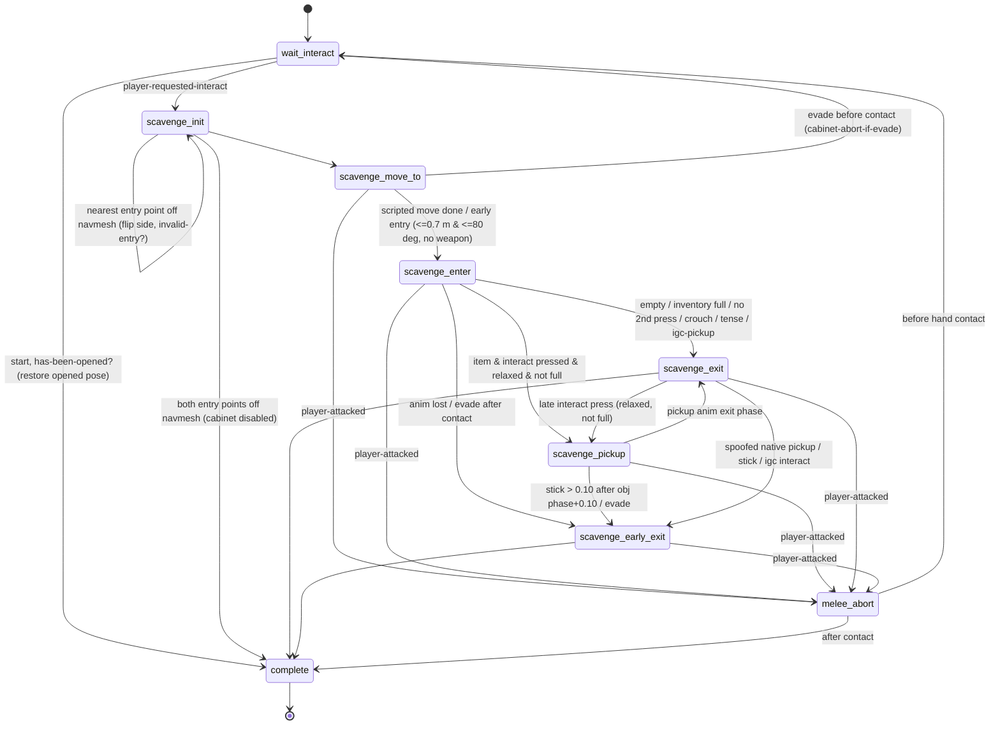

# Openable Cabinets: `ss-openable-cabinet` (compared with the drawer)

Source script: `ss-t2/ss-openable-cabinet.bin` (original `t2r/src/game/scriptx/ss-t2/ss-openable-cabinet.dcx`), 119,730 bytes,
5 entries: 4 script-lambdas plus 1 state script. Evidence comes from `.private/dconstruct_out/dc1/ss-t2/ss-openable-cabinet.bin.dcpl`
and `.asm`. Drawer reference: `interactions/drawers/README.md`. The pickup layer both openables hand off to is in
`interactions/pickups/README.md`, and the inventory boundary is in `systems/inventory/README.md`.

Data files written next to this README (all generated by scripts in `tools/analysis/`):

| file | content | generator |
|---|---|---|
| `cabinet_anim_sets.json` | the 22 Ellie cabinet animation sets with every tuning value (IK frames, phases, handle height, preferred hand, low-camera flag, custom-abort flag) | `cabinets_anim_table.py` |
| `cabinet_looks.json` | the 111 `look2` cabinet props, grouped by skeleton (`cab-{high,short}-skel-{l,r}`), with the script flags each skeleton produces | inline extraction from `look2/props.bin.asm` |

---

## 1. Overview & files

| file | role | confidence |
|---|---|---|
| `ss-t2/ss-openable-cabinet.bin` | per-object state script on a cabinet door (`options { player }`, initial state `wait-interact`) | CONFIRMED |
| `ss-t2/ss-openable-grips.bin` | **shared DC helper module** (no state script): `openable-grip-and-scale(art-group)` and `openable-mirrored-grip-exists?()`, called by both cabinet and drawer | CONFIRMED (`functions.json` kind = dc-script) |
| `ss-test/ss-test-mzhuravlov/openable-funcs.bin` | an older/test copy of `openable-grip-and-scale` with 60 branches (the shipping one has 88) | CONFIRMED |
| `ss-test/ss-test-mzhuravlov/ss-mzhuravlov-test-cabinets-and-drawers.bin` | developer test rig. It spawns `cab-high-l-1`, `cab-high-r-1`, `cab-low-l-1`, `cab-low-r-1` plus two schema drawers, moves them in 10 cm steps between 0 and 1.6 m (D-pad up/down), toggles "Scripted/Schema" (R1: an embedded copy of the scav logic vs the shipping script), and draws "Current handle height" | CONFIRMED |
| `drawer-pickup-offset.bin` | data only: `*global-drawer-translation-offsets*` (140 drawer looks), `*global-junk-rotation-offsets*` (11), `*global-pickup-rotation-offsets*` (93 item art-groups). No DC code reads these symbols, so they are consumed natively (INFERRED: they position the spawned pickup inside the openable). There is **no cabinet equivalent table**. See `interactions/pickups/drawer_pickup_offsets.json` | CONFIRMED data; consumer INFERRED |
| `item-drop.bin` → `*cabinet-drop-table*`, `*rogue-cabinet-drop-table*` | what a cabinet may contain (none / ammo / crafting / full-item). See pickups README §2 | CONFIRMED data; consumer native |
| `interactable.bin` → `interact-openable-cabinet` | the cabinet's `game-interactable-def`: interaction joint `handle`, accessibility SFX `sfx-ui-acc-interact-cabinet-open` | CONFIRMED |
| `ss-t2/ss-cabinet-limit.bin` | a different cabinet type: a **physics** door. After 1 s it reads `get-joint-angle-diff-from-bindpose(self, door)` and clamps `set-body-constraint-limits(self, door, …)`. It has no player animation | CONFIRMED |
| `ss-t2/ss-shiv-cabinet.bin` | a locked cabinet that **consumes a shiv**: `get-inventory-item-quantity` → `player-inventory-consume-item`, `wait-player-move-to-entry`, `spawn-attachable`. It is its own state machine and is not built on `ss-openable-cabinet` | CONFIRMED |
| `ss-t2/ss-openable-object.bin` | a generic openable: tag-driven `animation-idle` / `animation-open`, optional `ellie-scavenge-open-drawer-mid-intro`. No pickup handling | CONFIRMED |
| `audio-sfx/common-objects/aud-sfx-gbl-cabinet-{wood,metal,metal-fridge,metal-locker}.bin`, `aud-sfx-gbl-drawer-and-cabinet-handle.bin` | material SFX packages | CONFIRMED |
| **Fridge and locker variants** | There is **no** fridge or locker state script. Fridges and lockers are ordinary cabinet *looks* on the shared cabinet skeletons, so they run `ss-openable-cabinet`: `cab-short-fridge-french-door-l` (short-l), `cab-high-gym-locker-door-a-l` (high-l), `cab-short-wat-tunnel-fire-locker-r`, `cab-short-locker-shelf-{b,c}-r`, `cab-short-san-resort-weapon-locker-a-{l,r}`. Only their SFX differ (`aud-sfx-gbl-cabinet-metal-fridge`, `…-metal-locker`). Other "fridge" hits are unrelated: `ss-afm-brewery-push-fridge` (a pushable) and a test fridge slam | CONFIRMED (look2 skeleton); script binding HIGH CONFIDENCE (level data not visible) |

Native process classes behind openables (from the SID dictionary): `OpenableObject`, `OpenableObjectDynamic`, `OpenableObjectStatic`
(UNKNOWN / NEEDS NATIVE RESEARCH). This could explain why `get-openable-spawned-pickup` is native.

## 2. State machine



All transitions above are CONFIRMED from `go(...)` calls and match `state_scripts.json`.

## 3. Per-state call graph

`!` = native call (functions.json kind ≠ dc-script). Values are CONFIRMED unless marked otherwise.

```
wait-interact
 ├─ start
 │   ├─ interactable-disable!(tag-symbol(linked-door)) when tag linked-door exists    [CONFIRMED; purpose INFERRED: partner door/pane]
 │   ├─ set-collision-layer!(self, door, door); enable-collision-gamedriven(self, door, 0)
 │   ├─ disable-nav-blocker-object!(self)
 │   ├─ reset 18 flags (mirror?, is-crouch?, *-ik-in-use?, obj-picked-up?, pickup-exists?, has-been-contact? …)
 │   └─ if has-been-opened?: wait-animate_!(self, open) → let-cabinet-door-go-wide-open(0.30) → go(complete)
 └─ event player-requested-interact (arg0 = interactable)
     ├─ current-interactable-scav = event-arg-symbol(0)
     ├─ object-height = get-joint-position!(cab, handle).y − get-object-position!(player).y
     ├─ debug warning if object-height ≥ 1.60 ("Maximum handle hight for high cabinets is 1.6m")
     ├─ get-object-skeleton!(cab): cab-high-skel-r → mirror?, "--cab-r"
     │                              cab-short-skel-l → is-low-cab, "--cab-l-short"
     │                              cab-short-skel-r → is-low-cab, mirror?, "--cab-r-short"
     │                              (else cab-high-skel-l → default "--cab")
     └─ go(scavenge-init)

scavenge-init
 ├─ animate_!(cab, open, {20: 0.0})                                     [key 20 meaning UNKNOWN]
 ├─ goal-straight = frame(handle.x, player.y, handle.z, cabinet rotation)   (NOT rotated toward player, unlike drawer `goal`)
 ├─ player-handle-angle-plus = angle-in-between-locators-plus!(goal-straight, rotate-locator-lookat-object!(goal-straight, player))
 ├─ towards? = angle ≥ −20° (non-mirrored) | angle < 20° (mirrored)   → door swings toward / against the player
 ├─ is-crouch? = (crouched ∧ h ≤ 1.15) ∨ (prone ∧ h ≤ 1.15) ∨ (combat ∧ h ≤ 0.60)   [CONFIRMED: shared block L_1 in .asm]
 ├─ invalid-entry? → flip towards?;  tag force-entry-point (left|right, mirror-aware) → forces the side
 ├─ open-type = {crouch|tense|relaxed}-{toward|against}[-low]          (tense = tension-mode 2/3/4)
 ├─ pick 1 of 22 animation sets (§4)  → l-ik-on-frame −= 6
 ├─ invis-proxy-ik-main   = spawn-object!(invisible-cube, SimpleObject, get-joint-locator!(cab, handle)); wait spawned
 ├─ invis-proxy-ik-second = same; wait spawned
 ├─ set-update-bucket!(cab, MainDriver); set-update-bucket!(proxy-main, Platform)
 ├─ parent!(proxy-main, cab, door)                                     (main IK target rides the door joint)
 ├─ path-goal = get-align-from-ap-ref!(player, enter-anim, goal-straight, 0.10, apReference-straight)
 ├─ mirror? → reflect path-goal x and quaternion in goal-straight space
 ├─ is-point-on-nav-mesh?!(path-goal, 0.40, 1.0) and the point 0.40 m sideways
 │     off-mesh → invalid-entry? = 1, go(scavenge-init) | second failure → go(complete)
 ├─ go(scavenge-move-to)
 └─ update: accessibility-suppress-control-sounds/f

scavenge-move-to
 ├─ start/main-move-to
 │   ├─ joypad-disable-all-commands-except!(evade-start)
 │   ├─ if weapon out: holster-player-weapon!(0, speed)   speed: bow 2.2, beretta/taurus 2.0, mpx5/remington/dina 1.8,
 │   │                 shotgun 1.4, other 1.7 (tense modes only, else 1.0); signal(scav-entry-is-holstering)
 │   ├─ wait-player-scripted-move-new!(path-goal, 1,0,2,0,1) crouch | (0,0,1,0,1) combat & unarmed | (1,0,1,0,1) else
 │   └─ go(scavenge-enter)
 ├─ start/holster-tail: wait-for(scav-entry-is-holstering)
 ├─ update
 │   ├─ set-player-global-boolean!(114, enable-evade-during-move-to, 1); set-player-no-igc-kill-grenade!
 │   ├─ ss-cabinet-attachment(enter-anim + suffix)                    (§3a)
 │   ├─ early entry: xz ≤ 0.70 m & angle ≤ 80° (non-relaxed) / 0.40 m & 45° (relaxed), unarmed & not holstering → go(scavenge-enter)
 │   └─ cabinet-abort-if-evade()
 └─ event player-attacked → is-early-exit, go(melee-abort)

scavenge-enter
 ├─ start
 │   ├─ broadcast-event!(scav-obj-open-starting)                       (cabinet only; no DC handler)
 │   ├─ if h < 0.50: offset goal-straight by lerp-scale(0..0.30 → 0..0.15) of (anim-h − h) (x mirrored, −z)
 │   ├─ player-ik-root-adjust!(handle-height-in-animation − object-height, l-ik-on-frame/30)
 │   ├─ animate_!(cab, enter-anim + suffix, {30: 0.0})
 │   ├─ animate_!(player, enter-anim, {28:0.6, 27:2, 45:0.3|0.6, 30:0, 29:2, 13:3, 49:1, 10:goal-straight,
 │   │                                  14:apReference-straight, 32:1, 44:mirror?, 3:1, 24:18|1, 87:1, 5:1})
 │   └─ wait while any scav anim plays → go(scavenge-early-exit)       (fallback if update never leaves)
 ├─ update
 │   ├─ player-interacted? |= joypad-command-active?!(interact, 6)     (the second press = "take the item")
 │   ├─ ss-cabinet-attachment(enter-anim + suffix)
 │   ├─ current-pickup-obj (once) = tag igc-pickup | tag pre-placed-pickup | get-openable-spawned-pickup!(cab)
 │   │   pickup-object-height = item.y − get-ap-ref-from-align!(cab, prop-anim, …, 0, apReference-pickup-point).y
 │   ├─ frame ≥ l-ik-on-frame → joint-ik-characters!(player, proxy-main, 0=left | 1=right if mirror, root, 0, 0.33, 1)
 │   ├─ phase ≥ exit-phase−0.30 & no item & stick > 0.10 → broadcast scav-obj-been-opened, send scavenge-obj-is-empty, go(scavenge-exit)
 │   ├─ frame ≥ l-ik-on-frame+6 → send-event!(contact-completed, self), has-been-contact? = 1
 │   ├─ cabinet-abort-if-evade()
 │   └─ phase ≥ enter-exit-phase → broadcast scav-obj-been-opened
 │         no item → send scavenge-obj-is-empty → go(scavenge-exit)
 │         item → pickup-exists? = 1; igc-pickup → exit;
 │                player-pickup-is-full!(item-pickup-get-item-id!(item)) ∨ ¬player-interacted? → go(scavenge-exit)
 │                crouch ∨ tension 2/3/4 → go(scavenge-exit)
 │                else → go(scavenge-pickup)
 └─ event player-attacked → go(melee-abort)

scavenge-pickup
 ├─ start: animate_!(cab, pickup-anim + suffix, {28:1.0, 30:0, 56:1.0|1.2}); animate_!(player, pickup-anim, {…, 56: 1.0 combat | 1.2})
 ├─ update
 │   ├─ ss-cabinet-attachment(pickup-anim + suffix)
 │   ├─ obj-phase ≤ phase < stow-phase, once (the "grab"):
 │   │   detach-without-physicalizing!(item, 0) → obj-picked-up? = 1 → set-show-in-flashlight-flag!(item, 0)
 │   │   item-pickup-play-pickup-sound!(item, r_wrist | l_wrist if mirror)
 │   │   openable-grip-and-scale(get-art-group!(item))                  [DC, ss-openable-grips]
 │   │   set-overlay-set!(player, anim-overlay-player-pickup-hand-right)      (non-mirror)
 │   │   mirror: openable-mirrored-grip-exists?() → if pickup-grip-l-hand: set-overlay-set!(…-hand-left)
 │   │   pickup-grip-anim ≠ none → animate_!(player, grip-anim, {40:1, 28:0, 44:mirror-flag, 31:1, 5:1}); set-uniform-scale!(item, scale)
 │   │   has-anim?!(item, collect|single-collect-a) → animate_!(item, collect-anim)
 │   │   attach!(item, player, rightHand | leftHand if mirror, 0)
 │   ├─ 0.10 ≤ phase < obj-phase → pickup IK: joint-ik-characters!(player, proxy-second, 1=right | 0=left if mirror, root, 0, dur·(objph−0.1), 0)
 │   ├─ phase ≥ obj-phase → stop-joint-ik!(pickup-ik, (stow−obj)·dur/2)
 │   ├─ stick > 0.10 after obj-phase+0.10 → go(scavenge-early-exit)
 │   ├─ cabinet-abort-if-evade()
 │   └─ phase ≥ pickup-exit-phase → go(scavenge-exit)
 └─ event player-attacked → go(melee-abort)

scavenge-exit
 ├─ start
 │   ├─ fact-set-bool-safe(player, scav-anim-active, 1)                 [DC; fact gates 148 pickup gesture-defs]
 │   ├─ animate_!(cab, exit-anim + suffix, {28:0.6, 27:2}); animate_!(player, exit-anim, {…, 27:4, 45:0.6, 30:0.6, …})
 │   ├─ stop-player-script-ik!(0.50); player-set-capsule-size!(0.10)
 │   ├─ wait (≤0.7 s) → wait(0.60) → let-cabinet-door-go-wide-open(2.00) → door-is-motored = 1
 │   ├─ wait for anims (≤3 s) → stop r/l/pickup IK (0.20) → wait(0.21) → kill-entity!(proxies)
 │   └─ go(complete)
 ├─ update
 │   ├─ ss-cabinet-attachment(exit-anim + suffix); stop-animating!(player, layer 1, 0.20)
 │   ├─ late press: frame < l-ik-off−8, relaxed, not crouched, not full, item exists → go(scavenge-pickup)
 │   ├─ else press & item & not grabbed → "SPOOFED PICKUP":
 │   │      prefered-pickup-hand swapped if mirror → player-pickup!(item, 0, hand, 0, 0) → go(scavenge-early-exit)
 │   ├─ stick > 0.10 while enter anim still playing → go(scavenge-early-exit)
 │   ├─ igc-pickup & interacted → go(scavenge-early-exit)
 │   └─ frame ≥ l-ik-off-frame → stop-joint-ik!(main, 0.40 r | 0.20 l)
 └─ event player-attacked → go(melee-abort)

scavenge-early-exit
 ├─ start: stop-player-script-ik!(0.80); capsule 0.10; stop-animating!(player, 2, 0.80)
 │         if pickup anim playing & item grabbed → re-animate_!(player, pickup-anim, {57: current frame, 28:0.2, 40:1,
 │                                   75: *scav-drawer-exit-{l|r}-hand*, 30:0.4, 44:mirror, 5:1})   (shares the DRAWER exit symbol)
 │         wait(0.50) → if !door-is-motored: let-cabinet-door-go-wide-open(1.00) → kill proxies → go(complete)
 └─ update: ss-cabinet-attachment(exit-anim); obj-picked-up? → disable-interactable-interaction!; stop IKs (0.40)

melee-abort
 ├─ stop-player-script-ik!(0); stop-animating!(player, 2, 0); stop all IK (0)
 ├─ grabbed item → send-event!(suppress-pickup-sound, item) → player-apply-pickup!(item)   (item is never lost on interrupt)
 └─ before contact: cancel-player-move-to!, interactable-enable!(cab), animate_!(cab, idle), send contact-cancelled → go(wait-interact)
    after contact: let-cabinet-door-go-wide-open(2.00) unless motored → go(complete)

complete
 └─ wait until player-is-picking-up?!() or ~2 s → fact-set-bool-safe(player, scav-anim-active, 0)
```

### 3a. Script-lambdas in the module

| lambda | what it does | confidence |
|---|---|---|
| `let-cabinet-door-go-wide-open(blend)` | `send-event(start-open-collision-detection, self)` → `animate_(self, motor, {28: blend})` → `enable-nav-blocker-object(self)`. The open door becomes a nav blocker and never closes again (contrast: the drawer closes with `motor-ajar`) | CONFIRMED |
| `ss-cabinet-attachment(prop-anim)` | Per frame: (1) puts `proxy-second` on the prop animation's `apReference-r-hand` channel at the *next* frame (`phase + 1/(dur·30)`), rotated 180° if mirrored. (2) During the pickup anim (0 < phase < stow) it slides that target toward the item (`pickup-obj-root` captured until obj-phase, raised by `pickup-object-height`, weight `lerp-scale(0, dur·objph−0.2, 1→0, pickup-obj-ik-timer)`). (3) At stow phase (or anim end) after a grab: `item-pickup-play-pickup-done-sound`, `suppress-pickup-sound`, **`player-apply-pickup(item)`**, stop the grip layer. (4) Suppresses the generic icon (`disable-drawing-interactable-icon`) before stow, then shows the item's icon (`interactable-draw-icon(item)`) once the enter frame passes `l-ik-on-frame+16`. (5) IGC: lets the native interactable scan run from the camera (`player-check-for-interactables-during-igc-use-camera-loc`); debug strings "Allow IGC interact" and "HACK FOR PAT DRAWER ON" (copied from the drawer) | CONFIRMED |
| `cabinet-abort-if-evade()` | `joypad-command-active?(evade-start)` → stop the 3 IK solvers (0.10). Before contact it resets (`cancel-player-move-to`, `interactable-enable(cab)`, `animate_(cab, idle)`, `contact-cancelled`, `go(wait-interact)`); after contact it goes to `scavenge-early-exit` | CONFIRMED |
| `camera-adjustment-cabinet()` | `camera-set-overlay(*camera-remap-crouch-map*, 1, 1.40, 2, 2.40, 6, 100)` when `camera-required-low?`. **It is never called** (functions.json: 0 callers; no call in the .dcpl), so `camera-required-low?` currently has no effect. The drawer's `camera-adjustment-drawer` is dead code in the same way | CONFIRMED |

## 4. Animation selection (cabinet)

The inputs are handle height `h` (handle joint y − player y), the skeleton (high/short, hinge left/right), the entry side
(toward/against, from the ±20° angle), and tension/crouch. The table holds CONFIRMED values from `scavenge-init`. `l-ik-on` is shown before the
global −6 adjustment. Hand: 0/1 = `prefered-pickup-hand`, which is used only by the spoofed native `player-pickup` path.

| open-type | band | set `ellie-scav-…` | l-ik on/off | enter-exit ph | pickup-exit ph | obj ph | stow ph | anim handle h | hand | low cam |
|---|---|---|---|---|---|---|---|---|---|---|
| tense-toward-low | h ≥ 0.80 | `tense-cabinet-low-toward-100cm` | 16/9 | .81 | .79 | .31 | .67 | 1.00 | 0 | |
| tense-toward-low | else | `…-low-toward-70cm` | 16/8 | .78 | .79 | .31 | .67 | 0.70 | 0 | ✔ |
| tense-against-low | h ≥ 0.80 | `tense-cabinet-low-against-100cm` | 11/8 | .69 | .80 | .38 | .69 | 1.00 | 0 | |
| tense-against-low | else | `…-low-against-70cm` | 10/10 | .85 | .80 | .38 | .69 | 0.70 | 1 | ✔ |
| crouch-toward-low | h ≥ 0.80 / > 0.55 / else | `crouch-cabinet-low-toward-{100,70,40}cm` | 14/9, 18/8, 16/8 | .82 | .68/.68/.75 | .30/.30/.27 | .60/.60/.71 | 1.0/0.7/0.4 | 1,1,0 | |
| crouch-against-low | h ≥ 0.80 / > 0.55 / else | `crouch-cabinet-low-against-{100,70,40}cm` | 14/8, 14/8, 19/17 | .76/.82/.87 | .74/.74/.82 | .36/.36/.32 | .71 | 1.0/0.7/0.4 | 0,1,1 | |
| tense-toward | h > 1.30 / else | `tense-cabinet-toward-{160,120}cm` | 19/9, 13/9 | .72/.60 | .71/.75 | .27/.37 | .61/.70 | 1.6/1.2 | 0 | |
| tense-against | h > 1.30 / else | `tense-cabinet-against-{160,120}cm` | 16/12, 14/10 | .68/.65 | .73/.68 | .47/.35 | .84/.71 | 1.6/1.2 | 0 | |
| relaxed-toward-low | h ≥ 0.90 / else | `relaxed-cabinet-low-toward-{110,50}cm` | 18/12, 20/8 | .70/.90 | .90/.85 | .29/.43 | .65/.69 | 1.1/0.5 | 0 | 50cm ✔ (+custom-abort) |
| relaxed-against-low | h ≥ 0.90 / else | `relaxed-cabinet-low-against-{110,50}cm` | 16/8, 20/10 | .81/.80 | .82/.80 | .37/.34 | .58/.62 | 1.1/0.8 | 1 | 50cm ✔ |
| relaxed-against | h ≥ 1.40 / else | `relaxed-cabinet-against-{160,120}cm` | 18/14, 17/15 | .78/.74 | .82/.84 | .30/.36 | .54/.56 | 1.61/1.2 | 0 | |
| *(fallthrough)* relaxed-toward | h ≥ 1.40 / else | `relaxed-cabinet-toward-{160,120}cm` | 14/15, 16/16 | .74/.72 | .78/.86 | .30/.38 | .51/.56 | 1.61/1.2 | 0 | |

Each player clip `X` is paired with prop clip `X--cab`, `X--cab-r`, `X--cab-l-short` or `X--cab-r-short`, chosen by skeleton.

**Edge case (CONFIRMED in code, runtime effect INFERRED):** a crouched player at a *high* cabinet with `h ≤ 1.15` gets
`open-type = crouch-toward|crouch-against`, which has no high branch. It falls into the final `else`, the relaxed-toward 120/160 set,
whatever the entry side. Since `is-crouch?` is set, the script then skips the dedicated pickup anim.

There is **no width, depth or door-count logic**. The cabinet never queries the rigid-body OBB (the drawer does:
`get-rigid-body-obb-max`, `drawer-edge-height/width`). Handedness comes only from the hinge side encoded in the skeleton name. Double
cabinets appear to be separate cabinet objects, and `linked-door` disables a partner interactable (INFERRED).

## 5. Side-by-side: cabinet vs drawer

| aspect | cabinet (`ss-openable-cabinet`) | drawer (`ss-openable-drawer`) | shared? |
|---|---|---|---|
| states | wait-interact, **scavenge-init**, move-to, enter, pickup, exit, early-exit, melee-abort, complete (9) | wait-interact, **interact**, move-to, enter, pickup, exit, early-exit, **spawned-open**, **wait-pickup**, melee-abort, complete (11) | skeleton shared; the drawer adds a post-open "item still inside" loop |
| module lambdas | `let-cabinet-door-go-wide-open`, `ss-cabinet-attachment`, `cabinet-abort-if-evade`, `camera-adjustment-cabinet` (dead) | `let-drawer-close`, `drawer-atachments`, `drawer-stick-early-abort`, `abort-if-evade`, `camera-adjustment-drawer` (dead) | parallel copies, **not** a shared module |
| shared DC helpers | `openable-grip-and-scale`, `openable-mirrored-grip-exists?` (ss-openable-grips), `fact-set-bool-safe` | same | **yes** (the only real shared code) |
| shared natives | `get-openable-spawned-pickup`, `player-pickup-is-full`, `item-pickup-get-item-id`, `item-pickup-play-pickup(-done)-sound`, `player-apply-pickup`, `player-pickup`, `attach`, `detach-without-physicalizing`, `set-overlay-set`, `joint-ik-characters`, `player-ik-root-adjust`, `wait-player-scripted-move-new`, `holster-player-weapon` | same set | yes |
| geometry measured | handle height only | handle height + drawer edge height/width (rigid-body OBB) | partial |
| variant selection | **skeleton** (`cab-high/short-skel-l/r`) → mirror + low + prop suffix; entry **side toward/against** (±20°) | entry angle (clamped, mirror if ≥ 20°) | different |
| anim sets | 22 (`ellie-scav-{relaxed,tense,crouch}-cabinet[-low]-{toward,against}-{40..160}cm`) | 10 (`ellie-scav-{relaxed,tense,crouch}-drawer-{30..120}cm`) | same naming pattern |
| crouch rule | crouched/prone `h ≤ 1.15`, combat `h ≤ 0.60` | crouch forced for non-relaxed `h ≤ 0.60` | similar |
| player goal | `goal-straight` (unrotated), `get-align-from-ap-ref(…, 0.10, apReference-straight)`, mirrored in local space | rotated `goal`, `(…, 0.15, apReference)` | different ap channel/tolerance |
| navmesh validation | yes: `is-point-on-nav-mesh?` for the goal and a 0.40 m side point; flips side, else disables | no | cabinet only |
| `force-entry-point` tag | yes (left/right) | no | cabinet only |
| hip adjust | `player-ik-root-adjust(Δh, l-ik-on/30)` (+ goal offset when h < 0.5) | `(Δh, 0.7)` (+0.01 for Abby) | different timing |
| hand IK on handle | 1 solver on `proxy-main` **parented to the `door` joint**; non-mirror = left hand | proxies follow `apReference-hand-l[-alt]` (alt if |angle| ≥ 30°), second IK raised by drawer edge height | same tech (invisible-cube proxies + `joint-ik-characters`), different targets |
| pickup IK | `proxy-second` on `apReference-r-hand`, lerped onto the item | `proxy-second` on hand channel, raised by `pickup-object-height` | similar |
| pickup hand (anim path) | **right** hand by default (attach rightHand, r_wrist, right overlay); mirror → left | **left** by default (attach leftHand, l_wrist); mirror → right | mirrored conventions |
| pickup when tense/crouched | **no pickup anim**; `scavenge-exit` + spoofed native `player-pickup(item, 0, prefered-hand, 0, 0)` on press | pickup anim variants exist for crouch/tense | different |
| 2nd press required | yes (`player-interacted?` from `joypad-command-active?(interact)` during enter/exit) | yes | shared |
| full inventory | `player-pickup-is-full(item-id)` → exit, item stays | same check | shared |
| auto/spoofed pickup args | `player-pickup(item, 0, hand, 0, 0)` | `player-pickup(item, 1, -1, 0, 0)` | args differ (meaning UNKNOWN) |
| item gating | never disables the item; only draws its icon | `interactable-disable` on igc/pre-placed items until opened, then `interactable-enable` | different |
| end state of prop | door motored wide open (`motor`), **stays open**, nav blocker **enabled** | `motor-ajar` closes; nav blocker enabled during exit, disabled after `drawer-closing-timer` | different |
| timers | `pickup-obj-ik-timer` | `drawer-close-timer`, `drawer-closing-timer`, `delay-pickup-timer` | different |
| events out | `scav-obj-open-starting` (cabinet only), `scav-obj-been-opened`, `scavenge-obj-is-empty`, `contact-completed/cancelled`, `start-open-collision-detection` (cabinet only), `suppress-pickup-sound` | the same minus the two cabinet-only events | mostly shared |
| events in | `player-requested-interact` (wait-interact only), `player-attacked` | plus `exit-drawer-early`, `done-with-investigate`, `exiting-investigate-cut`, timers | drawer integrates investigate objects |
| camera overlay | `camera-adjustment-cabinet` (1.40/2.40), never called | `camera-adjustment-drawer` (1.00/1.00), never called | both dead |
| persistence on load | `has-been-opened?` → open pose, door wide open, `complete`. **Does not restore the item** | `has-been-opened?` + `has-item?` ∧ ¬`item-has-been-picked?` → `spawned-open` → `wait-pickup` | different |
| holster speed table | bow 2.2 … shotgun 1.4 | identical | copy |
| exit gesture symbol | `*scav-drawer-exit-{l,r}-hand*` | same symbols | shared data |

## 6. Answers (cabinet-specific)

| question | answer | confidence |
|---|---|---|
| How is cabinet height considered? | Only the handle joint height relative to the player's feet. Bands: high cabs 1.30/1.40 (120 vs 160 cm), low cabs 0.80/0.90 and 0.55 (crouch 40 cm). Anything over 1.60 m only gets a debug warning | CONFIRMED |
| Width / door count? | Not considered. One door per script instance. `linked-door` disables another interactable (likely the second door) | CONFIRMED (absence); INFERRED purpose |
| Handedness? | Skeleton `…-r` (hinge right) → `mirror?` → left-hand pickup, right-hand handle IK, mirrored path goal, `--cab-r[-short]` prop anims | CONFIRMED |
| Which side does Ellie open from? | toward/against from the ±20° angle, flipped if the closest stand point is off the navmesh, or forced by `force-entry-point` | CONFIRMED |
| What does the player see when the cabinet is empty? | The enter anim finishes and `scavenge-obj-is-empty` is sent. If the stick is pushed after `exit-phase − 0.30`, the anim is cut early | CONFIRMED |
| What does the door do afterwards? | It is driven fully open by its `motor` anim and becomes a nav blocker. It never closes | CONFIRMED |

## 7. Engine boundary

| layer | owns |
|---|---|
| DC (this script + `ss-openable-grips`) | decisions, thresholds, which clip and when, IK on/off timing, side choice, navmesh check calls, grip/scale per art group, when to call `player-apply-pickup` |
| Data | `interact-openable-cabinet` (interactable.bin), `look2/props.bin` (111 cabinet looks → skeleton), `item-drop.bin` cabinet drop tables, the ~66 cabinet clips plus `--cab*` prop clips, `aud-sfx-gbl-cabinet-*` |
| Native | interactable scan & prompt, `player-requested-interact`, scripted move, animation/IK solvers, navmesh queries, spawned-pickup creation (`get-openable-spawned-pickup`), inventory (`player-apply-pickup`, `player-pickup`, `player-pickup-is-full`), notifications, persistence of `has-been-opened?` |

## 8. Events in/out

| dir | event | sender/receiver | confidence |
|---|---|---|---|
| in | `player-requested-interact` (arg0 = interactable) | native → wait-interact | CONFIRMED |
| in | `player-attacked` | native → 5 states → melee-abort | CONFIRMED |
| out | `scav-obj-open-starting` (broadcast) | no DC handler → native listener (AI noise/stats?) | CONFIRMED send; consumer INFERRED |
| out | `scav-obj-been-opened` (broadcast) | waited on by `ss-vox-med-hospital-basement-power-on:open-ambulance-drawer` | CONFIRMED |
| out | `scavenge-obj-is-empty`, `contact-completed`, `contact-cancelled`, `start-open-collision-detection` (to self) | no DC handler → native openable process (INFERRED) | CONFIRMED send |
| out | `suppress-pickup-sound` → item | consumed natively by the ItemPickup (INFERRED) | CONFIRMED send |
| internal | `signal/wait-for(scav-entry-is-holstering)` | track sync inside move-to. Note: the drawer *waits* for it but never signals it | CONFIRMED |

## 9. Persistence

`has-been-opened?`, `has-item?` and `item-has-been-picked?` are declared and read, but are never written by any DC code (`q.py uses`
shows only declaration/read roles in cabinet and drawer). The writer is native, presumably the openable process's save record
(UNKNOWN / NEEDS NATIVE RESEARCH). The cabinet ignores `has-item?` entirely, so after a reload an unpicked item in an opened cabinet is
whatever the native item system restores. It is a normal ItemPickup that can still be picked with the generic pickup (see pickups README §6).

## 10. Animation / camera / UI / audio hooks

- Anim: player layer 2 = scav clip; layer 1 = grip clip (`stop-animating(player, 1, …)`); prop clips on the cabinet; `collect` / `single-collect-a` on the item.
- Overlays: `anim-overlay-player-pickup-hand-right|left` (CONFIRMED).
- Camera: overlay helper exists but is never called (CONFIRMED dead).
- UI: `disable-drawing-interactable-icon`, `interactable-draw-icon(item)`. The prompt itself is native from `interact-openable-cabinet`.
- Audio: only the item pickup sounds (`item-pickup-play-pickup-sound` at the grab, `…-done-sound` at stow, on `r_wrist`/`l_wrist`). Cabinet creaks are not scripted, so they presumably come from prop-anim events and the `aud-sfx-gbl-cabinet-*` material packages (INFERRED).
- Accessibility: `accessibility-suppress-control-sounds/f` each frame in init/move/enter; `sfx-ui-acc-interact-cabinet-open` in the interactable def.

## 11. Confidence table

| claim | label |
|---|---|
| state graph, call order, thresholds, anim names, tuning table | CONFIRMED |
| skeleton → mirror / low / suffix mapping | CONFIRMED |
| crouch-at-high-cab fallthrough | CONFIRMED (code), runtime INFERRED |
| `camera-adjustment-cabinet` dead | CONFIRMED |
| `animate_` keys 14 (ap channel), 24 (stance/crouch mode), 40 (layer), 57 (start frame), 75 (exit transition) | INFERRED |
| meaning of `player-pickup` args 2/3 (0/1 and hand −1/0/1) | INFERRED (arg 3 = hand: −1 any, 0 left, 1 right) |
| who writes `has-been-opened?` | UNKNOWN / NEEDS NATIVE RESEARCH |
| purpose of `start-open-collision-detection`, `scav-obj-open-starting` | UNKNOWN (native consumers) |

## 12. Open questions

1. Who sets `has-been-opened?` (openable save record?) and whether `has-item?` is set for cabinets at all.
2. How `get-openable-spawned-pickup` chooses and places the cabinet item (drop table + some offset? There is no cabinet offset table).
3. What `start-open-collision-detection` does natively (does the door push the player or NPCs?).
4. The `player-pickup` 2nd argument (cabinet 0 vs drawer 1).

## 13. Modding surface

| change | rating | why |
|---|---|---|
| retune IK frames, phases, height bands, holster speeds | GREEN | plain constants in `scavenge-init`/`move-to` |
| swap to other existing clips, change side/mirror rules, disable navmesh flip | GREEN/YELLOW | DC only, but new clips must have the matching `--cab*` prop clips and ap channels |
| enable the low-camera overlay (call `camera-adjustment-cabinet` in update) | GREEN | the helper already exists |
| let the door close after looting (reuse drawer `motor-ajar` idea) | YELLOW | needs a `motor-ajar`-style clip on cabinet art and nav-blocker handling |
| new cabinet skeleton or size class | ORANGE | needs new animation and skeleton data (look2) plus a new branch |
| change what spawns inside cabinets | YELLOW (data) / RED (logic) | odds live in `item-drop.bin *cabinet-drop-table*`; the spawning code is native |
| change inventory acceptance or persistence | RED | `player-apply-pickup`, `player-pickup-is-full` and the save record are native |
