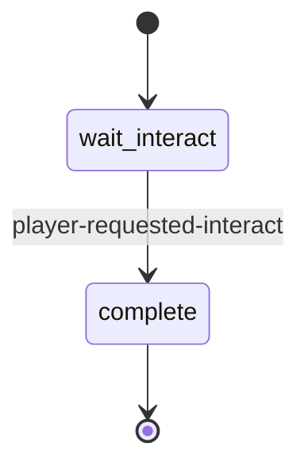
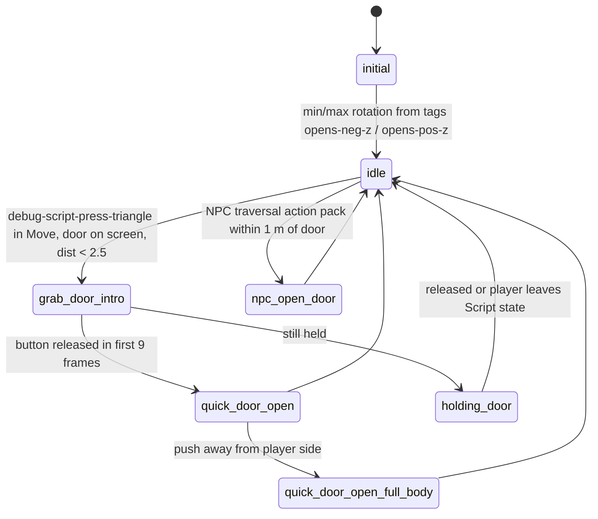
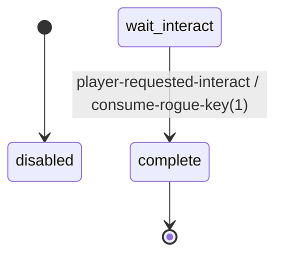
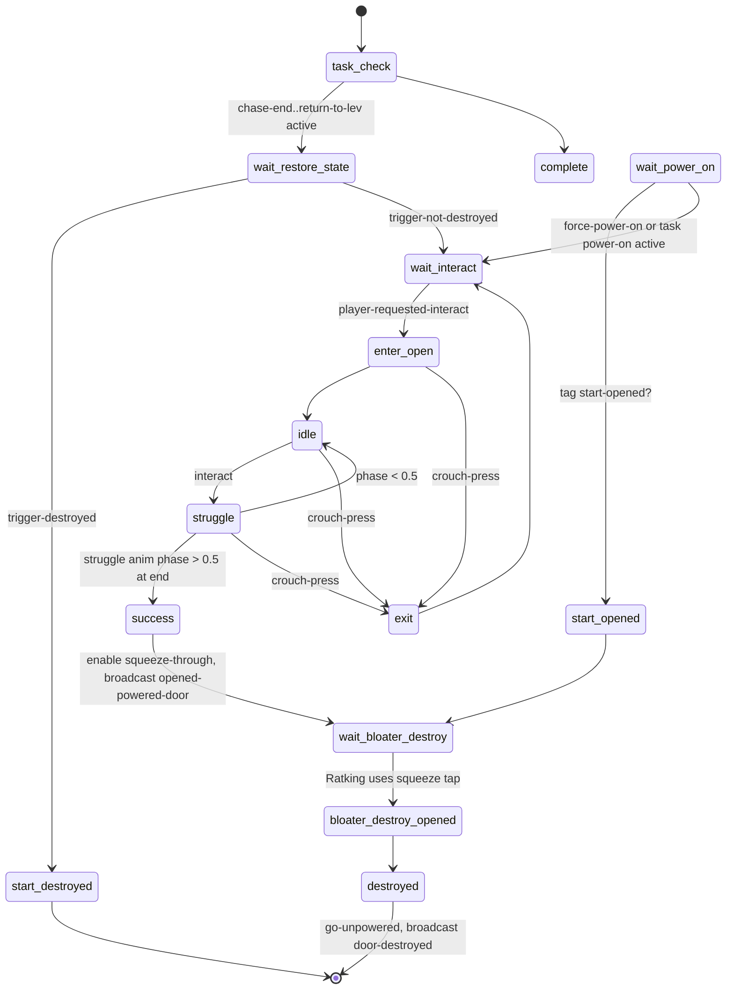
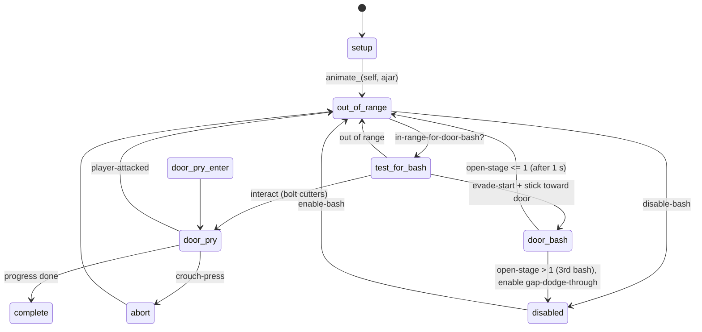

# Doors and gates (TLOU2R PC 1.6)

Evidence sources: dconstruct output (`.private/dconstruct_out/dc1/`, private), `databases/*.json`, `tools/analysis/q.py`.
New helper: `tools/analysis/doors_diff_interact_defs.py` (diffs `game-interactable-def` entries field by field).
Companion data: [`door_interact_variants.json`](door_interact_variants.json) (29 door/power/mash interact defs with key
fields, diffs against `interact-door` and DC usage, plus the player door-anim state table).
Power and generator wiring is in [`../generators/README.md`](../generators/README.md).

Labels: **CONFIRMED** · **HIGH CONFIDENCE** · **INFERRED** · **UNKNOWN / NEEDS NATIVE RESEARCH**.

---

## 1. Overview & files: where door logic lives

**Short answer: ordinary doors are a native object system configured by data. DC scripts only wrap special cases.**

| Layer | File / symbol | What it holds | Class |
|---|---|---|---|
| Native door object | functions `door-open`, `door-close`, `door-lock`, `is-door-open?`, `is-door-locked?`, `get-door-angle`, `door-enable-systemic`, `door-disable-auto-close/f`, `door-never-auto-close`, `door-reset-save-state`, `door-close-immediate-no-physics`, `door-force-tried`, `door-unlock-tried?`, `door-clear?`, `dog-request-door-open`, `npc-force-door-kick`, `player-force-{fullbody,combat}-door-anims/f`, `door-{en,dis}able-systemic-high-contrast-mode-update` | Every one is `native-or-builtin` / `native-confirmed` in functions.json (no DC body). `player-is-door-scripted-move?` is native-confirmed at **0x142B13B60** | **Native** |
| Native-originated events | `door-opened` (27 DC handlers, 0 shipping DC senders; only `ss-proto-door-interact-aim` and a pellis test send it); `set-door-open` and `open-door` (sent by DC, **0 DC handlers**) | The door object both emits and consumes events | **Native** (HIGH CONFIDENCE) |
| Player door animation states | `anim-player/player-door.bin` → `anim-player-door-states` (actor-state-list) | 8 states with player/door anim pairs, `DoorHandleIkAction`, abort phases (§4.3) | **Data** |
| Interact prompt definitions | `interactable.bin` → 15 `interact-door*` defs (+ `interact-igc-door`, rogue defs) | radii, angle, prompt, locked/needs-power text, accessibility sound | **Data** |
| Player tuning | `player-settings.bin` → `*player-door-gesture-map*` (fact-map, 40 rules on `angle`, `weapon-type`, `weapon-id`=bow-ellie, `distance`); `*ellie-move-to-run-combat-door-tense*` (player-move-to-settings); gesture `ellie-door-open-push-upclose-45rt-l-hand-gesture` | hand-gesture selection while passing doors; move-to settings | **Data** (values of the fact-map not decoded) |
| Audio | `aud-sfx2.bin`: `sfx-ui-acc-interact-door-{open,close,bash}{,-distant,-menu}`; physical families in bank `objects-doors` (e.g. `sfx-wood-door-push-npc-close-relaxed`, `sfx-metal-door-push-relaxed-info`, `sfx-wood-screen-door-rattle-lrg`) | **Data** (triggering native) |
| Generic door script | `ss-t2/ss-openable-door.bin` (39 dcpl lines) | only toggles high-contrast via tag `disable-systemic-high-contrast`, then `player-requested-interact → complete` | **DC (thin)** |
| Empty native hook | `ss-t2/ss-code-analog-door.bin` | one `state disabled {}`, nothing else. Name suggests the "analog door" moved to code | **DC stub** (INFERRED) |
| Prototypes | `ss-t2/ss-proto-simple-analog-door`, `ss-proto-analog-door`, `ss-proto-state-based-door`, many `ss-test/*door*` | the **only** DC code that selects `interact-door-open-{in,out}-{left,right}` | **DC, test/proto** |
| Special-case level doors | powered/struggle (`ss-med-ratking-powered-door-*`), locked/key (`ss-rogue/ss-locked-room-door`, `ss-afd-nature-walk-door-locked`), managers (`ss-aquarium/ss-aquarium-door-manager`), bash/pry (`ss-jordanescape/ss-joe-door-bash-open`), barricade (`ss-med-rooftop-fight-barricade-doors`), blocked (`ss-fob-on-foot-boat-door-block-igc`), lifts (`ss-flo-tunnel-double-door`) | scripted IGCs plus calls into the native door API | **DC** |

The door entities (hinge side, swing limits, locked flags, interact def, attached script) are placed in level `.pak`
data, which is not in the DC corpus. No level-set JSON mentions `ss-openable-door` or any `interact-door*`. **CONFIRMED** (rg)

---

## 2. State machines

### 2.1 `ss-openable-door` (generic, `ss-t2/ss-openable-door.bin`)


### 2.2 `ss-proto-simple-analog-door` (prototype, the only directional-prompt selector)


### 2.3 `ss-locked-room-door` (rogue mode, `ss-rogue/ss-locked-room-door.bin`)

(`disabled → wait-interact` is entered from outside via a `go`/spawn, which is not visible in this file.)

### 2.4 `ss-med-ratking-powered-door-animated` (powered struggle door)


### 2.5 `ss-med-ratking-powered-door-single` (power-gated native door)
```mermaid
stateDiagram-v2
    [*] --> task_check : spawn-script-multiple light-manager; send go-unpowered
    task_check --> complete : power-on complete
    task_check --> check_door : finding-power..back-rooms
    task_check --> unlock_and_open : power-on active
    check_door --> wait_power : player-requested-interact → vox checked-door-*
    check_door --> wait_power : checked-one-door
    wait_see_wire_source --> see_wire_source : wire-source-timer
    see_wire_source --> wait_power
    wait_power --> unlock_and_open : task power-on active
    unlock_and_open --> complete : door-lock(self,0,1); door-lock(self,0,0); go-unlocked
```

### 2.6 `ss-joe-door-bash-open` (bash / pry)


---

## 3. Per-state call graph (key states)

```
ss-openable-door:wait-interact                                   [CONFIRMED]
 ├─ if tag-specified?(disable-systemic-high-contrast, self):
 │    wait entity-exists?(self) → door-disable-systemic-high-contrast-mode-update(self, 1)   [native]
 └─ on player-requested-interact → go(complete)                   (complete has no body)

ss-proto-simple-analog-door:--all--/update                        [CONFIRMED, prototype]
 ├─ block-nav-poly-under-object(self) when |rotation| < 30°, else unblock-nav-poly-under-object   [native]
 ├─ player-dist = distance from player to the door slab (DOOR-WIDTH 1.25, DOOR-THICKNESS 0.12) in door local space
 ├─ desired-player-loc = spawner locator + (0.60, 0, ±0.85 + lerp-scale(80..−80 ⇒ 1..−1.5, rotation)), camera yaw
 ├─ clamp rotation to the allowed side(s) (tags opens-neg-z / opens-pos-z), ±90°
 └─ mesh rotation lerps 5·dt toward rotation; set-object-locator(self, rotate-locator-angle(spawner, y, −rot))
ss-proto-simple-analog-door:idle/update
 ├─ player-in-front? (hysteresis ±0.20 m around dot(door z, spawner x)·DOOR-WIDTH)
 ├─ NPC traversal action pack near (0.75,0,0) → go(npc-open-door)
 ├─ choose prompt: close | open-in-left | open-in-right | open-out-left | open-out-right (see §4.1)
 ├─ gui2-show-interactable-hud(<def>, door offset (0.70,1.20,0), 0)                  [native]
 └─ Move state + debug-script-press-triangle → fact-set(player, current-door, self) → go(grab-door-intro)
ss-proto-simple-analog-door:grab-door-intro
 ├─ animate_(player, ellie-mm-crouch-idle | ellie-mm-tense-idle, {12:crouch?, 24:18|2, 28:0.20})
 ├─ gesture_(player, ellie-tense-reach-rhand-gesture, target = door offset (1.15,0.90,0))
 ├─ wait-stub-object-lerp-bound-frame(player, desired-player-loc, max(0.30, dist/2.5))
 └─ go(quick-door-open | holding-door)
ss-proto-simple-analog-door:holding-door/update
 └─ rotation += 75·dt·stick_z (stick in door local space); camera-set-overlay(*camera-remap-close*)

ss-med-ratking-powered-door-single:unlock-and-open                [CONFIRMED]
 ├─ interactable-enable(self)
 ├─ door-enable-systemic(self, 1)
 ├─ door-lock(self, 0, 1); door-lock(self, 0, 0)        unlock both sides
 ├─ send-event(go-unlocked, self)                       → ss-med-ratking-powered-door-light-manager (same entity)
 └─ go(complete)

ss-med-ratking-powered-door-animated:struggle                     [CONFIRMED]
 ├─ animate_(door, abby-open-door-struggle--door) ∥ wait-animate_(player, abby-open-door-struggle--abby)
 ├─ update: draw-interactable-hud(interact-default-mash, door locator + (0,1.2,0))
 ├─ update: interact-repeat → speed→1.5 (rate scaled by Ratking distance); none → speed→−0.8
 ├─ update: set-animation-speed(player|door, speed)
 └─ end: phase > 0.5 → success · < 0.5 → idle · crouch-press → exit
ss-med-ratking-powered-door-animated:success
 ├─ animate_(door, abby-open-door-success--door) ∥ wait-animate_(player, …--abby)
 ├─ send-event(enable, tag squeeze-through)
 ├─ broadcast-event(opened-powered-door, self)
 └─ go(wait-bloater-destroy)

ss-aquarium-door-manager:aqu-relock-all-doors (fn)               [CONFIRMED]
 └─ foreach aquarium-doors: door-reset-save-state → door-enable-systemic(d,1) → door-close-immediate-no-physics → aqu-lock-door(d,1,1)
```

---

## 4. Answers to the specific questions

### 4.1 How the four directional defs are selected
- **Data:** `interact-door-open-in-left`, `-in-right`, `-out-left`, `-out-right` and `interact-door` are **byte-identical apart from the name** (all top-level fields). Run `python3 -I tools/analysis/doors_diff_interact_defs.py '^interact-door-open-(in|out)-(left|right)$|^interact-door$'`, which prints "all selected defs identical". **CONFIRMED** The direction therefore carries no tuning. It is only an identity key.
- **gui2-game.bin:** the names appear in `*hud-photo-mode*` field 0x5E0, a 120-entry string-array of interact def names that also holds `interact-mash`, `interact-workbench` and others. This is a photo-mode prompt list (purpose **INFERRED**), **not** a selector. **CONFIRMED** location.
- **DC:** the only code that picks among them is `ss-t2/ss-proto-simple-analog-door:idle`:
  - `in` / `out` = whether the door may swing toward the player's side: (player-in-front? ∧ tag `opens-neg-z`) ∨ (¬player-in-front? ∧ tag `opens-pos-z`) → "in" (pull toward you), else "out" (push away).
  - `left` / `right` = `player-in-front?` true → left, false → right. This is the side of the slab the player stands on, so the handle appears left or right (INFERRED reading).
  - `interact-door-close` when |rotation| > 85° on the player's side, or the door is ajar between ±5°.
  - Fallback `interact-default`. The prompt is shown with `gui2-show-interactable-hud(def, door offset (0.70,1.20,0))`. **CONFIRMED** (prototype)
- **Shipping:** `q.py uses interact-door-open-in-left` → `interactable.bin`, `modules.bin` (export list) and the proto script only. In the real game the native door object picks the def (or uses `interact-door`). **HIGH CONFIDENCE**. The exact rule is **NEEDS NATIVE RESEARCH**; the proto rule is the best documented model.

### 4.2 Approach side, push/pull, open-in/out, alignment
- **Native.** No shipping DC computes approach side or chooses push or pull. Evidence: there are no callers of the anim states in §4.3; `player-is-door-scripted-move?` is a native query (used only by `ss-accessibility-lost-control-sound` to suppress a cue during native door moves); `player-force-fullbody-door-anims/f` and `player-force-combat-door-anims/f` are native overrides that scripts call each frame in IGCs (7 + 2 sites). **HIGH CONFIDENCE**
- Data hints: `*player-door-gesture-map*` rules key on `angle` bands (−180…−45, 49…81, ±180), `weapon-type`, `weapon-id = bow-ellie` and `distance`. **CONFIRMED** keys; rule values are **UNKNOWN** (not decoded).
- Scripted doors do their own alignment with the standard `wait-player-move-to-entry(<anim>, door locator, …)`. They flip the door so the player is on the anim's side (`set-object-z-direction(door, −z)` when dot(door z, player−door) > 0 in `ss-med-ratking-powered-door-animated:enter-open`). **CONFIRMED**

### 4.3 Door and player animation (data, `anim-player/player-door.bin`) **CONFIRMED**

| State | Player anim | Door anim | Exit |
|---|---|---|---|
| `s_door-open-push-quick` | `ellie-door-stand-right-open-push-quick` | `…-door` | abort-idle 0.90 / abort-out 0.90 |
| `s_door-open-push-far` | `ellie-relaxed-door-right-open-push-fw` | `…--door` | 0.85 / 0.90 |
| `s_door-open-push-left` | `ellie-relaxed-door-right-open-push-90lt` | `…--door` | 0.85 / 0.90 |
| `s_door-open-push-right` | `ellie-relaxed-door-right-open-push-90rt` | `…--door` | 0.85 / 0.90 |
| `s_door-open-pull-quick` | `ellie-door-stand-right-open-pull-quick` | `…-door` | 0.90 / 0.90 |
| `s_door-open-locked` | `ellie-door-relaxed-right-try-locked` | `…-door` | 0.90 / 0.90 |
| `s_door-open-unlock` | `ellie-door-relaxed-right-unlock` | `…-door` | auto → `s_door-open-push-quick` at phase 0.92 (blend 0.20) |
| `s_door-combat-open` | `combat-door-open` | `t2-door-right-open-combat` | `*door-fingers*` hand pose |

Every state wraps an `anim-node-subsystem-ik` with `DoorHandleIkAction`, uses the `door` subsystem tag, overlays
`ellie-meatshield-struggle-aim--add` and re-enables motion matching on exit. All anims are "right": left-hinged
doors must be mirrored at runtime (**INFERRED**). Speed is scaled by native `player-anim-speed-mult`.

### 4.4 Door state and locks **CONFIRMED** (call sites)
- `door-open(door, flag)` / `door-close(door, flag)`. The second arg is 1 in most calls and 0 on reload paths (e.g. `ss-sea-qz-puzzle-gate:first-state` calls `door-open(…,0)` then polls `is-door-open?`). Meaning is **UNKNOWN** (instant vs animated suspected).
- `door-lock(door, locked?, side)` is **per side**: `aqu-unlock-door` checks `is-door-locked?(d,1)` then `door-lock(d,0,1)`, and `is-door-locked?(d,0)` then `door-lock(d,0,0)`; `aqu-lock-door(d, a, b)` = `door-lock(d,a,1)` + `door-lock(d,b,0)`. Which physical side 0 or 1 is: **UNKNOWN**. This is how TLOU2 "locked from the other side" doors work, with the `s_door-open-unlock` anim (**INFERRED** link).
- `door-force-tried(door, 1)` (after a scripted try-locked IGC) and `door-unlock-tried?(door)` are native flags tracking whether the player has tried the door.
- `door-enable-systemic(door, 0|1)` (121 calls, 66 files) turns native player/NPC door interaction off during IGCs and back on afterwards (**INFERRED** meaning; CONFIRMED usage pattern).
- `door-disable-auto-close/f` (per frame) and `door-never-auto-close` are native auto-close controls.
- `get-door-angle(door)` (degrees, e.g. `> 10`, `> 87`) and `is-door-open?` are polled by scripts.
- **Locked message:** `game-interactable-def` field 0x178 is the unavailable or locked text: `HUD_INTERACT_LOCKED` for all door defs, `HUD_INTERACT_NEEDS_POWER` for `interact-door-needs-power` (**the only difference** from `interact-door`), `HUD_INTERACT_ROGUE_LOCKED_NEEDKEY` for rogue. Field 0x168 is the available-text override (rogue `interact-rogue-locked-room-door`). Scripts force the greyed state with `interactable-set-unavailable(x,1)` + `override-interact-def(x, …)`.
- **Jammed doors** are not a door state. `jammed-door` is a VO event (`ss-flo-jesse-lead-convention-backrooms → ss-vox-flo-into-the-city-backroom-explore`).

### 4.5 Power requirement
- `interact-door-needs-power` has **no DC reference** outside `interactable.bin` and the `modules.bin` export list. The native door (or level data) applies it, presumably to locked doors flagged as unpowered. **UNKNOWN / NEEDS NATIVE RESEARCH**
- Scripted power doors (hospital) combine three things: (a) lock both sides and keep the door's own interactable for "check door" VO; (b) on task `med-hospital-basement-power-on`, call `door-enable-systemic(self,1)` and unlock both sides; (c) colour lamps via `ss-med-ratking-powered-door-light-manager{,-chase,-combat}` with states `unpowered/unlocked/locked/malfunctioning`, driven by `go-*` events and red/green/orange light fades. **CONFIRMED**
- Non-door powered objects use `interact-needs-power` / `interact-needs-power-npc-blockable` (Seattle keypads). **CONFIRMED**

### 4.6 AI / nav
- Native: `dog-request-door-open(npc, pos)`, `npc-force-door-kick(npc, 0|1)` (`ss-res-ruins-downhill`), `door-clear?(door)` inside melee condition lambdas, buddy door use. **CONFIRMED** calls, internals native.
- Scripted doors manage nav themselves: `disable-nav-blocker-object` and spawning `nav-blocker-open[-flipped]` entities (Ratking), `send enable/disable` to squeeze-through objects, `enable-/disable-action-pack(npc-tap)`, and in the prototype `block-nav-poly-under-object` while |rotation| < 30°. The prototype also has an `npc-open-door` state triggered by `npc-using-traversal-action-pack?`; infected NPCs make it `kill-entity` the door. **CONFIRMED**

### 4.7 Sound
- Accessibility prompt sounds come from the def (0x1E8 `sfx-ui-acc-interact-door-open`) plus `-distant`, `-close`, `-bash` and `-menu` variants. Physical door sounds live in the `objects-doors` bank and are triggered natively or by anim (**INFERRED**). Bash prototypes make AI noise via `audio-gameplay-event(melee-hit, player pos, player)` (`door-open-make-npc-alert-noise`). **CONFIRMED**

### 4.8 Kicks, barricades, blocked and destroyed doors
- **Bash/pry** (`ss-jordanescape/ss-joe-door-bash-open`; copy in `ss-test/ss-test-em`):
  - In range when |x| < 0.75 and |z| < 2 in interact-loc space, the player is in Move/Melee/Jump/Swim, the y-difference is < 1 m and no NPC is within 0.5 m.
  - Bash needs stick y < −0.67 and the stick pushed toward the door (45°), then `evade-start`. It plays `open-a/b/c` stages with speed 1.0/1.0/0.25.
  - Pry uses bolt-cutter anims with `progress` driven by the move stick. `progress-limit` starts at 0.25 and ratchets up, with 0.35/0.66 stage pops. It still draws debug "POP" strings, so it is **INFERRED** to be prototype-grade.
- **NPC kick:** native `npc-force-door-kick`.
- **Barricade:** `ss-med-rooftop-fight-barricade-doors` is a pure IGC (door and pipe props, combat vs stealth variants, sends `door-baricaded`).
- **Blocked door:** `ss-fob-on-foot-boat-door-block-igc` runs a forward/backward struggle, then `send open-door` to the native door.
- **Destroyed:** the Ratking door anims `ratking-break-door-opened[-flipped]--door`, and `kill-entity(obj-door-amb-bay-1)` on power.

### 4.9 Persistence
- Native door save state exists (`door-reset-save-state` used to reset doors that should not stay open across chapters). **CONFIRMED** call, internals native.
- Scripts persist important doors via svars (`sea-qz-door-opened`) or tasks, and re-apply on load (`door-open`, `animate-done(door, …)`). **CONFIRMED**

---

## 5. Engine boundary (DC vs data vs native)

| Behaviour | Class | Evidence |
|---|---|---|
| Proximity, prompt choice, approach side, push/pull, hinge mirror, scripted move, physics swing, auto-close, NPC/dog use, save state | **Native** | API above has no DC bodies; native-confirmed `player-is-door-scripted-move?`; `door-opened` emitted by no shipping DC |
| Player/door anim pairs, IK action, abort phases | **Data** (`player-door.bin`) | actor-state-list |
| Prompt radii, angles, locked/needs-power text, accessibility sounds | **Data** (`interactable.bin`) | defs |
| Gesture rules, move-to settings | **Data** (`player-settings.bin`) | fact-map |
| Door placement, hinge, swing, lock flags, attached script | **Level data (.pak)** | absent from DC (**UNKNOWN** format) |
| Special doors (powered, struggle, bash, barricade, key, chapter managers) | **DC** | state scripts listed |

## 6. Events in / out

| Event | Sender → receiver |
|---|---|
| `player-requested-interact` | native → door script (`ss-openable-door`, rogue, powered doors) |
| `door-opened` (arg0 = door) | native → 27 handlers (e.g. `ss-afm-aquarium-dock:wait-open-exterior-door`, `ss-nor-ellie-alone-animal-surprise`) |
| `set-door-open`, `open-door` | DC → native door (0 DC handlers) |
| `opened-powered-door`, `door-destroyed` | powered door → chase scripts |
| `go-unpowered / -unlocked / -locked / -malfunctioning` | door scripts → lamp managers |
| `enable` / `disable` | → squeeze-through objects |
| `door-baricaded`, `jammed-door`, `try-door`, `tried-other-door`, `reached-blocked-door` | IGC → VO / combat scripts |
| `door-interact-started / -complete / -canceled` | dmattson test door → test manager only |

## 7. Persistence
See §4.9. Tasks + svars at script level; `door-reset-save-state` and `door-close-immediate-no-physics` at native level.

## 8. Animation / camera / UI / audio hooks
- Anim: §4.3. Scripted doors play paired `…--abby|--ellie` / `…--door` anims with `animate_` / `wait-animate_` at the door locator.
- Camera: `camera-set-overlay(*camera-remap-close*, …)` (proto); `camera-enable-animated` in IGCs.
- UI: defs above; `gui2-show-interactable-hud`, `draw-interactable-hud` (mash/hold auto-switch via def byte 0x1FB + `button-mashes-are-holds?`).
- High contrast: `door-{en,dis}able-systemic-high-contrast-mode-update(door, flag)` (72 calls).

## 9. Shared components
Interactable pipeline (drawers, pickups), mash/hold prompts (melee, generators), nav blockers and squeeze-throughs
(traversal), keypads (Seattle gate), tasks and svars (all level scripts), power wiring (generators).

## 10. Confidence table

| Claim | Label |
|---|---|
| Ordinary door behaviour is native; `ss-openable-door` is a thin wrapper | CONFIRMED (no DC bodies, 39-line script) |
| 4 directional defs identical to `interact-door` | CONFIRMED |
| Only a prototype selects the directional defs; shipping selection is native | CONFIRMED / HIGH CONFIDENCE |
| `interact-door-needs-power` differs only in the locked text | CONFIRMED |
| Door locks are per side (third arg of `door-lock`) | CONFIRMED (aquarium helpers) |
| Which side 0 or 1 is; `door-open` 2nd arg meaning | UNKNOWN |
| Left-hinged doors use mirrored "right" anims | INFERRED |
| `door-enable-systemic` toggles native interaction | INFERRED |

## 11. Open questions
1. The native rule that picks `interact-door-open-*` / `-close` / `-needs-power` (needs native RE around the door object; start from `player-is-door-scripted-move?` at 0x142B13B60).
2. Level-data door fields (hinge, swing sides, lock flags, power flag) in `.pak`.
3. Values in `*player-door-gesture-map*` (fact-map value array not decoded by dconstruct).
4. Semantics of flag byte 0x1F9 (0 for `-with-ping`, `-elm`, `-large-…-with-ping`; 1 otherwise).

## 12. Modding surface

| Rating | Target | Reason |
|---|---|---|
| GREEN | `interactable.bin` door defs (radii 0x008/0x028/0x030, angle 0x034, locked text 0x178) | plain data; identical copies, so edits are predictable |
| GREEN | special door scripts (powered/struggle thresholds 1.5 / −0.8 / 0.5, bash ranges) | self-contained DC state scripts |
| YELLOW | `anim-player/player-door.bin` abort phases / anim names | data, but shared by every door |
| YELLOW | using `door-lock` / `door-enable-systemic` / `override-interact-def(..., interact-door-needs-power)` from new scripts | known API; side semantics untested |
| ORANGE | door entities themselves (hinge, lock flags, attached script) | level `.pak` data, outside DC |
| RED | approach-side / push-pull selection, door physics, NPC door use | native code |
