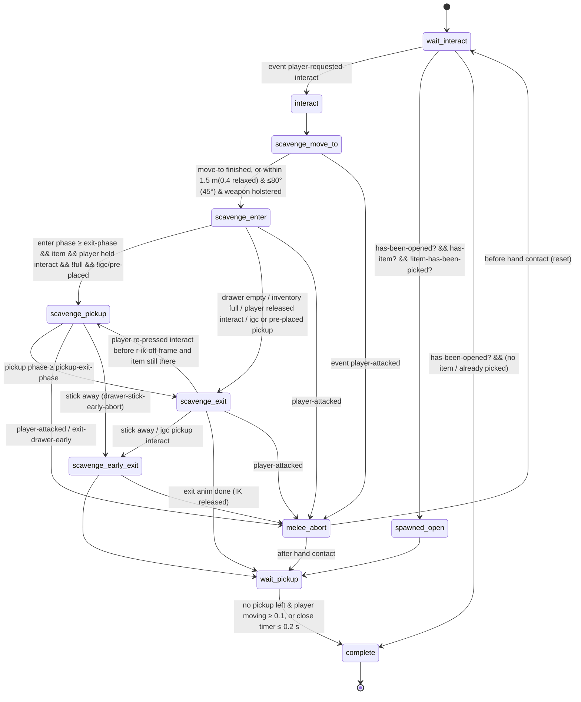

# Openable Drawers — `ss-openable-drawer`

> Source analysed: TLOU2R PC 1.6 `bin.psarc` → `dc1/ss-t2/ss-openable-drawer.bin` (125,044 bytes, 6 entries,
> 195 functions incl. lambdas). Original source path embedded in the binary:
> `t2r/src/game/scriptx/ss-t2/ss-openable-drawer.dcx`. Evidence comes from our own state-script parser
> (`tools/analysis/dclib.py`) cross-checked against dconstruct's decompilation. Line references are to the
> private `.dcpl` (not committed).
>
> Labels: **CONFIRMED** = read directly from code/data · **HIGH** = high confidence · **INFERRED** · **UNKNOWN**.

## 1. Overview

The drawer is a **per-object state script** attached to the drawer actor (`options { player }`, initial state
`wait-interact`). It owns: geometry measurement, animation-set selection, player alignment, input locking,
weapon holstering, prop/player animation synchronisation, script-driven IK, pickup hand-off and drawer closing.
It does **not** own: interactable detection/prompting, the move-to locomotion, the animation engine, IK solving,
inventory, HUD notifications or material SFX. Those are reached through native calls.

Entries in the module (CONFIRMED):

| entry | type | role |
|---|---|---|
| `ss-openable-drawer` | state-script | the state machine |
| `let-drawer-close` | script-lambda | closes drawer via `animate_(self, motor-ajar, …)` + 2 s `drawer-closing-timer` |
| `drawer-atachments` (sic) | script-lambda | per-frame IK-proxy placement, pickup stow + `player-apply-pickup`, pickup icon gating |
| `drawer-stick-early-abort` | script-lambda | left-stick away from drawer (> 0.14, outside 60°) → `scavenge-early-exit` |
| `camera-adjustment-drawer` | script-lambda | `camera-set-overlay(*camera-remap-crouch-map*, …)` when `camera-required-low?` |
| `abort-if-evade` | script-lambda | dodge (`evade-start`) cancels; before hand contact → full reset to `wait-interact` |

61 declared state variables (CONFIRMED) include geometry (`object-height`, `drawer-edge-height`, `drawer-edge-width`,
`player-handle-angle-plus`, `handle-height-in-animation`, `handle-rotation-adjustment`, `player-handle-pos-max-offset`),
animation selection (`scav-enter/pickup/exit-animation`, 4 phase thresholds), IK (`invis-proxy-ik-main/second`,
`r/l/pickup-ik-solver`, on/off frames, blend frames) and persistence-looking flags (`has-been-opened?`, `has-item?`,
`item-has-been-picked?`, `igc-pickup-done?`).

## 2. State machine (CONFIRMED from `go(...)` calls)



Event handlers per state (CONFIRMED): `player-requested-interact` (wait-interact, scavenge-early-exit, wait-pickup),
`player-attacked` (move-to, enter, pickup, exit, early-exit), `exit-drawer-early` (pickup), `exiting-investigate-cut`
(enter … complete), `done-with-investigate` (exit … complete), timers `delay-pickup-timer`, `drawer-closing-timer`.

## 3. Per-state call graph (evidence-based; `!` = native call)

```
wait-interact  (on start, 22 track segments)
 ├─ enable-collision-gamedriven(self, drawer, 0.0)! · set-collision-layer(self, game-object, drawer)!
 ├─ disable-nav-blocker-object(self)!                                   [nav: drawer does not block while closed]
 ├─ for tag igc-pickup / pre-placed-pickup: wait entity-exists? → interactable-disable(item)!
 │                                           [item inside drawer not pickable until drawer is open]
 ├─ reset 16 booleans; set-symbol(pickup-collect-anim, collect)
 └─ if get-boolean(has-been-opened?):                                 [restore path]
      ├─ item still there → current-pickup-obj = tag igc-pickup | pre-placed-pickup | get-openable-spawned-pickup(self)!
      │                     interactable-enable(item)! → go(spawned-open)
      └─ else animate_(self, motor-ajar, {28:0.2})! · disable-nav-blocker-object! → go(complete)
 on (event player-requested-interact)
 ├─ current-interactable-scav = event-arg-symbol(0)                   [the native system passes the interactable]
 ├─ object-height = get-joint-position(scav, handle).y − get-object-position(player).y
 ├─ debug-draw-string-2d("Drawer handle height %0.4f")                [dev overlay, still shipped]
 └─ go(interact)

interact
 ├─ animate_(scav, idle, {31:1})!
 ├─ is-crouch? = player-is-prone?() || player-is-crouched?() || (!tension-mode-is?(1) && object-height ≤ 0.60)
 ├─ ANIMATION SET SELECTION (table §4)
 ├─ r-ik-on-frame −= r-ik-blend-in-frames
 ├─ goal = bound-frame(pos = (handle.x, player.y, handle.z), rot = get-object-rotation(scav))
 ├─ player-handle-angle-plus = angle-in-between-locators-plus(goal, rotate-locator-lookat-object(goal, player), 2, 1)
 ├─ invis-proxy-ik-main/second = spawn-object(invisible-cube, SimpleObject, get-joint-locator(scav, handle))!
 ├─ drawer-edge-width  = get-rigid-body-obb-max(scav, drawer).x ;  drawer-edge-height = …obb-max.y − 0.08
 ├─ clamp angle: ±50° if relaxed && width ≤ 0.24 && !crouch, else ±10°; 0° for art-group drawer-filing-cabinet-b-scaled
 ├─ rotate IK proxy by entry angle; if handle-height-in-animation > 0.75: extra pitch = lerp-scale(−0.1..0.1 → 30..−30°)
 ├─ set-update-bucket(scav, MainDriver)!; proxies → Platform; parent(proxy, scav, drawer)!
 ├─ mirror? = entry angle ≥ 20°  (mirror also flips x of player-handle-pos-max-offset)
 ├─ goal = rotate(goal, angle) then offset by vector-lerp-scale(0..60° → 0..player-handle-pos-max-offset)
 └─ go(scavenge-move-to)

scavenge-move-to
 track main-move-to
 ├─ joypad-disable-all-commands-except(evade-start)!                  [input lock; dodge stays live]
 ├─ path-goal = get-align-from-ap-ref(player, scav-enter-animation, goal, 0.15, apReference)!
 │                                                                     [player root target derived FROM the anim's apReference]
 ├─ if weapon out / switching: holster-player-weapon(0, speed) with combat speed-up per weapon
 │     (bow 2.2×, beretta/taurus 2.0×, mpx5/bolt/dina 1.8×, pump shotgun 1.4×, default 1.7×; 1.0× when relaxed)
 ├─ wait-player-scripted-move-new(path-goal, …)!  (3 arg profiles: crouch / combat+unarmed / default)
 └─ go(scavenge-enter)
 track holster-tail: wait-for(scav-entry-is-holstering)
 on update: set-player-global-boolean(enable-evade-during-move-to) · set-player-no-igc-kill-grenade()! ·
            drawer-atachments(enter--drawer) · early go(scavenge-enter) when within distance/angle (see diagram) ·
            abort-if-evade()

scavenge-enter
 ├─ wait (≤ 4 s) for holster
 ├─ animate_(scav, "<enter-anim>--drawer", {56:speed, 44:mirror?, 28:0.4, 30:0.0})!   [PROP animation]
 ├─ animate_(player, <enter-anim>, {56, 28:0.5, 27:2, 45:0.5, 30:0, 13:3, 49:1, 10:goal, 32:1, 44:mirror?, 1:1,
 │                                  3:1, 12:camera-required-low?, 24:crouch?18:1, 87:1, 5:1})!   [PLAYER animation]
 ├─ player-ik-root-adjust(handle-height-in-animation − object-height (+0.01 if Abby), 0.70)!
 │                                       [hips lowered/raised so authored hand height meets real handle]
 │   (skipped when crouched and height ≤ 0.60: print-string "no-hips-adjust")
 on update
 ├─ joypad-command-active?(interact, 6) → player-interacted? = 1      [holding/re-pressing △ means "take item"]
 ├─ drawer-atachments(enter--drawer)
 ├─ first frame: resolve current-pickup-obj; pickup-object-height from apReference-pickup-point;
 │   high item in 70 cm relaxed set → swap to ellie-scav-relaxed-drawer-70cm-pickup-high
 │   pickup-is-full = player-pickup-is-full(item-pickup-get-item-id(item))!
 ├─ frame ≥ r-ik-on-frame → joint-ik-characters(player, proxy-main, hand(0=L|1=R by mirror), root, 0, blend/29.96, 1)!
 │   + second hand on proxy-second when use-second-ik
 ├─ frame ≥ r-ik-on-frame + blend → send-event(contact-completed, self)        [point of no return]
 ├─ phase ≥ enter-exit-phase → broadcast-event(scav-obj-been-opened)!
 │      empty → send-event(scavenge-obj-is-empty, self) → go(scavenge-exit)
 │      else → scavenge-pickup or scavenge-exit (rules in diagram)
 └─ abort-if-evade()

scavenge-pickup
 ├─ animate_(scav, "<pickup-anim>--drawer", …)! · animate_(player, <pickup-anim>, …)!
 on update (phase windows)
 ├─ object-phase ≤ phase < stow-phase, once:
 │    detach-without-physicalizing(item)! · set-show-in-flashlight-flag(item, 0)!
 │    item-pickup-play-pickup-sound(item, l_wrist|r_wrist)!
 │    openable-grip-and-scale(art-group) → set-overlay-set(player, anim-overlay-player-pickup-hand-left|right)!
 │    optional grip anim + set-uniform-scale(item) · animate_(item, collect) if has-anim?
 │    attach(item, player, leftHand|rightHand, 0)!                       [HAND ATTACHMENT]
 ├─ IK hand-overs: release second hand at object-phase+0.1, pickup-ik on proxy-second at stow-phase+0.1
 ├─ drawer-atachments → at stow phase: item-pickup-play-pickup-done-sound! · send-event(suppress-pickup-sound, item)
 │                      · player-apply-pickup(item)!                     [INVENTORY OWNERSHIP STARTS HERE]
 │                      · stop-animating(player, 1, 0.1, grip-anim)
 ├─ drawer-stick-early-abort() after object-phase
 └─ phase ≥ pickup-exit-phase → go(scavenge-exit)

scavenge-exit
 ├─ fact-set-bool-safe(player, scav-anim-active, 1)                    [DC-defined helper in script-user-funcs-impl]
 ├─ animate_(scav, "<exit-anim>--drawer") · animate_(player, <exit-anim>)
 ├─ wait drawer exit frame ≥ r-ik-off-frame + 8 → stop-player-script-ik(0.4)! · player-set-capsule-size(0.10)!
 │   · enable-nav-blocker-object(self)!                                [open drawer now blocks navigation]
 ├─ stop all joint IK (0.2) → go(wait-pickup)
 on update: re-press △ before r-ik-off-frame → back to scavenge-pickup (second grab);
            close timer ≤ 0.5 s with item still inside → player-pickup(item, 1, −1, 0, 0)!  [auto-collect]
            close timer ≤ 0.2 s → let-drawer-close()

wait-pickup → (item gone & player speed ≥ 0.1) let-drawer-close → complete
complete    → kill-entity(IK proxies)! · wait ≤ 2 s for !player-is-picking-up? · fact-set-bool-safe(scav-anim-active, 0)
              on drawer-closing-timer: disable-nav-blocker-object(self)!
melee-abort → stop IK/anim instantly; if item already in hand → player-apply-pickup (never lose the item);
              before contact → cancel-player-move-to! + animate_(scav, reset) + contact-cancelled → wait-interact
```

## 4. Animation-set selection table (CONFIRMED values from `interact` state)

`object-height` = handle height above the player's feet (m). Branch order matters (first match wins).

| condition | set (`ellie-scav-…-drawer-`) | r-ik on / off | l-ik off | enter exit-ph | pickup exit-ph | obj ph | stow ph | handle-h in anim | 2nd IK | low cam |
|---|---|---|---|---|---|---|---|---|---|---|
| crouch & h ≥ 0.95 | `crouch-…-120cm` | 18 / 12 | 12 | 0.78 | 0.80 | 0.20 | 0.43 | 1.19 | ✔ | |
| crouch & h ≤ 0.50 | `crouch-…-30cm` | 16 / 8 | 10 | 0.70 | 0.84 | 0.21 | 0.50 | 0.28 | ✔ | |
| crouch (else) | `crouch-…-80cm` | 20 / 20 | 20 | 0.60 | 0.86 | 0.27 | 0.56 | 0.79 | ✔ | |
| tense (mode 2/3/4) & h ≥ 0.95 | `tense-…-120cm` | 12 / 11 | 16 | 0.58 | 0.76 | 0.14 | 0.51 | 1.19 | ✔ | |
| tense (else) | `tense-…-70cm` | 14 / 11 | 15 | 0.58 | 0.84 | 0.29 | 0.58 | 0.70 | ✔ | ✔ |
| relaxed & h ≥ 1.10 | `relaxed-…-120cm` | 21 / 17 | 16 | 0.60 | 0.75 | 0.18 | 0.48 | 1.20 | ✔ | |
| relaxed & h > 0.80 | `relaxed-…-90cm` | 21 / 17 | 21 | 0.60 | 0.75 | 0.18 | 0.48 | 0.90 | ✔ | |
| relaxed & h > 0.60 | `relaxed-…-70cm` (+`-pickup-high`) | 19 / 4 | – | 0.60 | 0.75 | 0.28 | 0.57 | 0.75 | | ✔ |
| relaxed & h ≤ 0.40 | `relaxed-…-35cm` | 22 / 8 | – | 0.66 | 0.90 | 0.28 | 0.67 | 0.36 | | ✔ |
| relaxed (0.40–0.60) | `relaxed-…-50cm` | 19 / 4 | – | 0.60 | 0.75 | 0.28 | 0.57 | 0.50 | | ✔ |

Each player animation has a paired **prop animation** named `<player-anim>--drawer`, played on the drawer itself.
Note that crouch is forced for any non-relaxed state with a handle at or below 0.60 m.

`tension-mode-is?(3)` = **combat** (CONFIRMED: the debug string `(if combat? (tension-mode-is? (tension-mode combat)) #t)`
compiles to `tension-mode-is?(3)` in `melee/player-standing/player-open-dodges`). Mode 1 = relaxed (HIGH: the drawer's
"relaxed" branch runs exactly when modes 2/3/4 are false, and `!tension-mode-is?(1)` gates tense crouching). Modes 2 and 4
are other non-relaxed states, presumably suspicious/search (INFERRED).

Only Ellie (`ellie-scav-*`) animation names appear. Abby gets the same sets with a +1 cm hip offset
(`is-player-abby?` → `player-ik-root-adjust(0.01 + Δ)`), which suggests the anim names are retargeted or aliased
per character elsewhere (INFERRED; see `systems/animation`).

## 5. The full "player approaches drawer" chain

| # | question | answer | confidence |
|---|---|---|---|
| 1 | How is it detected? | The drawer is an interactable actor. Proximity/eligibility scanning is native (`get-closest-enabled-interactable`, `get-best-nearby-interactable` are native-confirmed functions). The drawer script only toggles eligibility: `interactable-disable/enable`, plus the collision layer `drawer`. | CONFIRMED (native boundary); detection internals UNKNOWN |
| 2 | Why does the △/E prompt appear? | The prompt comes from the interactable's definition (`interact-openable-drawer` in `gui2-game.bin`; see `systems/ui`) and is drawn by the native interactable HUD. The drawer script doesn't draw it. It only suppresses the pickup icon during the reach (`disable-drawing-interactable-icon`) and re-enables the item's icon later (`interactable-draw-icon(item)`). | HIGH |
| 3 | How is the interaction definition selected? | Per actor/art-group data, not by this script. This script never calls `override-interact-def` (other scripts do). | HIGH |
| 4 | Where does Ellie stand? | `goal` = handle x/z at player height, oriented like the drawer, rotated by the clamped entry angle and slid by `player-handle-pos-max-offset`. Then `path-goal = get-align-from-ap-ref(player, enter-anim, goal, 0.15, apReference)` turns it into the **animation's own start pose**: the stand point is whatever puts the anim's apReference on the handle. | CONFIRMED |
| 5 | How does she turn toward it? | `wait-player-scripted-move-new(path-goal, …)` (native scripted locomotion) walks and turns her to the align. The update block lets her start early within 1.5 m and 80° (0.4 m and 45° when relaxed, which oddly is stricter). | CONFIRMED (calls); locomotion internals native |
| 6 | Which reach animation? | §4 table: handle height × tension mode × crouch/prone. Mirror when the entry angle is ≥ 20°. | CONFIRMED |
| 7 | How is drawer height considered? | Three ways: (a) the handle joint height picks the set; (b) `player-ik-root-adjust(anim-handle-height − real-height)` shifts the hips; (c) hand IK on proxy cubes placed at the `handle` joint, tracked each frame through `get-ap-ref-from-align(… apReference-hand-l[-alt] …)` and raised by `drawer-edge-height` (rigid-body OBB). | CONFIRMED |
| 8 | How is the prop animated? | `animate_(drawer, "<anim>--drawer", …)` runs in lock-step with the player anim. Both use the same mirror flag, and the drawer is put in update bucket `MainDriver` while the proxies use `Platform`. | CONFIRMED |
| 9 | When does the drawer sound play? | Not in this script. There's no audio call for the drawer itself, only the item pickup sounds. Drawer SFX are almost certainly triggered by animation events in the `--drawer` prop anims and resolved per material by the `aud-sfx-gbl-drawer-*` packages (see `systems/audio`). | INFERRED |
| 10 | How does an item become available? | The item is either a tagged pre-placed or IGC actor, or one spawned by the openable (`get-openable-spawned-pickup`, native). It stays `interactable-disable`d until the reach anim passes `r-ik-on-frame+16`, then `interactable-enable` and `interactable-draw-icon`. | CONFIRMED |
| 11 | How does the hand attach? | Between `scav-pickup-object-phase` and `stow-phase`: `detach-without-physicalizing` → `attach(item, player, leftHand/rightHand)`, with a grip overlay set and optional grip anim and scale. | CONFIRMED |
| 12 | How does inventory receive it? | `player-apply-pickup(item)` (native) at the stow phase, or `player-pickup(item,1,-1,0,0)` (native) on the auto-collect path. Fullness is pre-checked with `player-pickup-is-full(item-pickup-get-item-id(item))`. | CONFIRMED boundary; internals native |
| 13 | How does the UI react? | Native, downstream of `player-apply-pickup` (pickup notification). The script only suppresses the duplicate pickup sound (`suppress-pickup-sound`). | INFERRED |
| 14 | How does the game remember it? | The script *reads* `has-been-opened?`, `has-item?` and `item-has-been-picked?` but never writes them, so another layer sets them (native save of state-script vars or another script; see `systems/persistence`). It restores to `spawned-open` (shows the opened pose with the item) or to `complete`. | CONFIRMED read-only; writer UNKNOWN here |
| 15 | How is control restored? | `stop-player-script-ik` → stop joint IK → `player-set-capsule-size(0.10)` → anim exit. The input lock is per-frame (`joypad-disable-all-commands-except` is re-issued each update), so control returns once the state stops issuing it. `fact-set-bool-safe(scav-anim-active, 0)` marks the end. | HIGH |

## 6. Events

| direction | event | when |
|---|---|---|
| in | `player-requested-interact` (arg0 = interactable) | native → wait-interact (start), wait-pickup/early-exit (second press on item) |
| in | `player-attacked` | native/combat → `melee-abort` |
| in | `exit-drawer-early` | external → `melee-abort` (sender not found in script: native or level) |
| in | `exiting-investigate-cut`, `done-with-investigate` | from `ss-investigate-object` when the item is an investigate object (IGC/pre-placed pickup) → close drawer |
| out | `broadcast scav-obj-been-opened` | enter anim reaches exit phase. Not handled by any script, so it's for native listeners (AI/audio/stats?), INFERRED |
| out | `send scavenge-obj-is-empty` (self) | empty drawer |
| out | `send contact-completed` / `contact-cancelled` (self) | hand reached handle / aborted before contact |
| out | `send suppress-pickup-sound` (item) | before `player-apply-pickup` |

## 7. Engine boundary

| layer | what | examples |
|---|---|---|
| **DC script (this file)** | decisions, thresholds, sequencing, which anim and when, IK on/off timing | everything in §3–4 |
| **Animation data** | the 30+ `ellie-scav-*-drawer-*` clips, their apReference / `apReference-hand-l[-alt]` / `apReference-pickup-point` channels, prop anims `--drawer`, anim events (likely SFX) | referenced by name only |
| **Native** | interactable scan & prompt, scripted move-to, animation playback & blending, IK solver (`joint-ik-characters`), hip adjust, holster, attach, inventory (`player-apply-pickup`), HUD, nav blockers, physics OBB query | all calls marked `!` |

## 8. Shared components

`ss-openable-cabinet` shares this skeleton (scavenge-move-to/enter/pickup/exit/early-exit, melee-abort, the same
events and `player-apply-pickup`). See `interactions/cabinets`. Shared helpers called here:
`fact-set-bool-safe` (DC, `script-user-funcs-impl`), `openable-grip-and-scale` / `openable-mirrored-grip-exists?`
(called as plain functions; see cabinets/pickups for where they're defined), `get-openable-spawned-pickup` (native).

## 9. Confidence summary

| claim | label |
|---|---|
| State graph, transitions, event handlers | CONFIRMED |
| Height/tension/crouch → anim set table and per-set constants | CONFIRMED |
| Stand position derived from anim apReference via `get-align-from-ap-ref` | CONFIRMED |
| Script-driven hand IK on spawned invisible proxy cubes | CONFIRMED |
| Inventory hand-off at `player-apply-pickup` / `player-pickup` | CONFIRMED |
| `animate_` option keys (28 blend-in, 44 mirror, 56 speed, 10 ap-ref, 30 start-phase) | INFERRED (see `systems/animation`) |
| Drawer SFX via prop-anim events + material packages | INFERRED |
| tension 3 = combat | CONFIRMED · 1 = relaxed HIGH · 2/4 INFERRED |
| Who writes `has-been-opened?` etc. | UNKNOWN here (see persistence) |

## 10. Modding surface

* **GREEN**: thresholds and constants (height bands, phases, IK frames, holster speed-ups, early-start distances, close
  timers), anim choice (swap to any existing `ellie-scav-*` set), and adding or removing states. All of it is plain DC
  data/bytecode, editable via dconstruct `-e` edits or DCPL recompilation.
* **YELLOW**: new behaviour built from existing natives (e.g. auto-loot without animation by calling `player-pickup`
  directly from `wait-interact`, or a different camera overlay). It depends on native functions with unknown side effects.
* **ORANGE**: new animations (need the anim pipeline), new IK behaviour beyond `joint-ik-characters` parameters, and changing
  the prompt/detection logic.
* **RED**: the inventory internals and the native scripted-move/animation engine.
