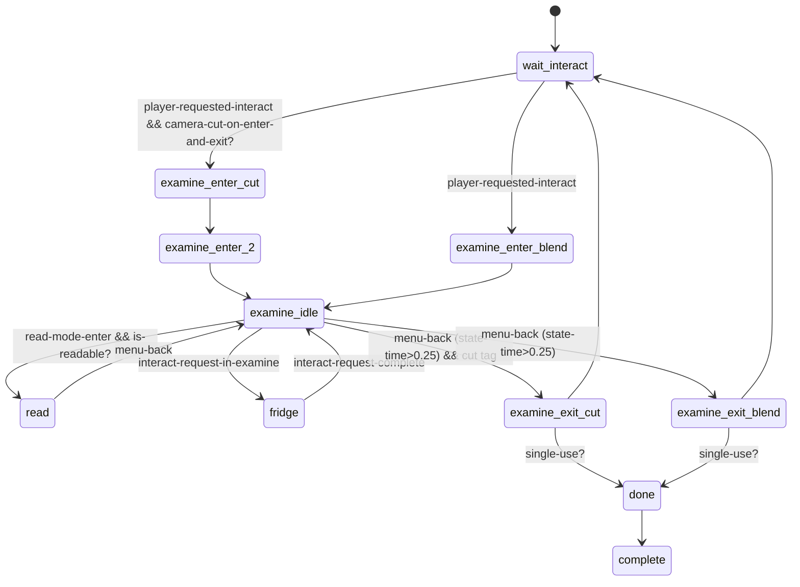

# EXAMINE — camera-only inspection of a world spot (`ss/ss-examine`)

TLOU2R PC 1.6 DC corpus. Scope: `ss/ss-examine.bin` (generic examine), `examines.bin`
(`*examines*` read-page map), its clone `ss-ellie-flashback-ult/ss-efu-find-papers`, the
prototype `ss-abby-flashback-dad/ss-examine-proto`, and the Scar-intro map examples.

Labels: **CONFIRMED** · **HIGH** · **INFERRED** · **UNKNOWN/NATIVE**.

---

## 1. Overview & files

**Key finding:** *Examine is not object inspection.* `ss-examine` never attaches, rotates, tilts or
flips anything. The player crouches or leans into a pose (`ellie-inspect-ground-*` by default), the
camera switches to an **animated stick camera** that the right stick can look around within
limits, and an optional **read page** pops up for written content. All rotate / tilt / flip / swap
behaviour belongs to INVESTIGATE (native + `anim-player/player-investigate`, see
[`../investigate/README.md`](../investigate/README.md) §6). **CONFIRMED**: no `attach`,
`player-investigate-*`, `investigate-flip` or parametric reference appears in `ss-examine.dcpl`.

| File | Kind | Role |
|---|---|---|
| `ss/ss-examine.bin` | state script (10 states + implicit `complete`) + 4 `stick-camera-settings` | generic examine |
| `examines.bin` | `*examines*` map, 13 entries → `examine-data {title, location, text}` ciphers | read-page content keyed by `examine-id` |
| `ss-ellie-flashback-ult/ss-efu-find-papers.bin` | copy of ss-examine plus `point-of-interest`/`poi-look-at-radius` | per-level fork (hospital corridor papers) |
| `ss-abby-flashback-dad/ss-examine-proto.bin` | 6-state prototype (`examine-enter`, `-crouched`, `-idle`, `-exit`) | earlier version, still in modules |
| `ss-patrol/ss-pat-supermarket-wall-examine.bin` | 3 states | level wrapper (task gating only) |
| `ss-finding-nora/ss-igc-scar-intro-map-examine.bin` | prototype: placeholder caption "Where am I...", `camera-enable(cam-…-investigate-map-1, fixed-look-around…)` | superseded |
| `ss-finding-nora/ss-nor-scar-intro-igc-map-examine.bin` | shipped Scar intro map: a one-shot animated IGC (`nor-scar-intro-map-interact--ellie`) + VO | not ss-examine at all |

Interactable defs: `interact-examine` (prompt icon `hud/interactions/investigate.png`, range 3/7 m)
and `interact-examine-used` in `interactable.bin`. **CONFIRMED**

---

## 2. State machine



Declarations (defaults, **CONFIRMED**): `enter-anim = ellie-inspect-ground-enter`,
`enter-anim-2 = ellie-inspect-ground-enter-2`, `idle-anim = ellie-inspect-ground-idle`,
`exit-anim = ellie-inspect-ground-exit`, `exit-anim-2 = ellie-inspect-ground-exit-2`, `ap-ref = nullptr`,
`disabled = nullptr`, `used` (i32, used as `ss-svar`), blends 0.5/0.5/0/0.5/0/0.8, stick-abort 12 frames / 0.8 s,
`camera-settings = *examine-ground-stick-camera-settings-default*`, stick fade-in/out 1.33 s, fade-out distance 5,
`stick-camera-maya-index = 1`, `max-angle = 90`, `z-offset-for-lookat = 2`, `buffer-before-allow-input = 1.0`,
`examine-id`, `object-additional` + 5 object anims, `single-use?`, `allow-in-combat?`.

---

## 3. Per-state call graphs

```
wait-interact
 ├─ buffer-before-allow-input = blend-to-idle (if non-zero and not cut mode)
 ├─ igc-ap-ref-spawner → set-spawner-locator(it, examine-ap)
 ├─ examine-ap = get-spawner-locator(ap-ref, 1)
 ├─ object-additional-animate-start? && !already-used-once? → animate-start(object-additional, object-enter-anim, ap-ref, 0)
 ├─ dev-menu → svar used = 0 ; svar used → interactable-set-accessibility-used(self)
 ├─ disabled || (enemies alive && !allow-in-combat? && tension 3|4) → interactable-disable(self)
 ├─ on tension-changed → enable/disable by the same rule
 └─ on player-requested-interact
     ├─ broadcast player-entering-examine(self)
     ├─ tag flashlight-force-facing? → spawn-entity(obj-examine-flashlight-dir-1)
     ├─ ap-ref: using-generic-anims? → examine-ap = flatten(ap.x, player.y, ap.z, ap.rot) else spawner locator
     ├─ max-angle ≥ 0 → examine-ap = rotate-locator-lookat-object(examine-ap, player)   ← faces the player
     └─ go(examine-enter-cut | examine-enter-blend)

examine-enter-cut
 ├─ wait-player-move-to-entry(enter-anim, examine-ap, 1, 0, 0.40, apReference-camera1, apReference, 0, …)
 ├─ object-additional enter anim (first use only)
 ├─ wait-animate_(player, enter-anim, {10:ap, 28:blend-to-enter, 30:blend-to-enter-2, 13: collision-ground? 2:0})
 ├─ camera-enable-animated-stick(get-channel-locator-from-ap-ref(player, enter-anim-2, ap, 0, apReference-camera1, apReference),
 │        lookup(camera-settings, stick-camera-settings), 0, 0, stick-camera-maya-index, 1000, 0, object-locator, 0, 1)   ← hard cut
 ├─ go(examine-enter-2)
 └─ update: hud2-hide-health-ammo/f; use-esc-for-back/f; joypad-set-stick-scale(camera, 0)

examine-enter-2
 ├─ flashlight-force-facing? → send flashlight-set-target-object(player, obj-examine-flashlight-dir-1)
 ├─ object-additional enter-2 anim
 ├─ wait-animate_(player, enter-anim-2, {10, 28:blend-to-enter-2, 30:blend-to-idle, 13})
 ├─ go(examine-idle)
 └─ update: hide HUD; stick scale 0; move flashlight target along apReference-flashlight channel or camera+z

examine-enter-blend
 ├─ wait-player-move-to-entry(enter-anim, examine-ap, …)
 ├─ object-additional enter anim
 ├─ camera-enable-animated-stick(channel locator of (use-idle-anim-for-stick-camera? idle-anim : enter-anim) at phase 0,
 │        stick-camera-settings, stick-camera-fade-in-sec 1.33, stick-camera-fade-out-sec 1.33, maya-index, 1000, 0,
 │        camera-pivot-spawner locator | object locator, 0, 1)                    ← blended camera
 ├─ wait-animate_(player, enter-anim, {…}) ; tag blend-use-enter-2? → wait-animate_(player, enter-anim-2, {…})
 ├─ go(examine-idle)
 └─ update: hide HUD; stick scale 0; ik-look-at-bound-frame = idle cam channel − z-offset; flashlight target

examine-idle
 ├─ high-contrast-mode-target-obj → set-high-contrast-mode-type(it, 0)
 ├─ interactable-disable(self); tag flashlight-on? → turn-on-flashlight(player)
 ├─ broadcast in-examine-idle(self)
 ├─ is-readable? = (*examines*[examine-id] exists && its +16 text cipher != 0)
 ├─ hud2-show-investigate(is-readable? ? 50304 (0xC480) : 17536 (0x4480), 0, 0)      ← prompt bar, +0x8000 = Read
 ├─ object-additional idle (loop, key 31:1)
 ├─ animate_(player, idle-anim, {10:ap, 31:1 (loop), 13, 28:blend-to-idle, 30:blend-from-idle})
 ├─ track flashlight-lerp: 3 s lerp of the flashlight target from the anim channel to the camera-relative frame
 ├─ update
 │   ├─ debug-draw-locator(...)                                (dev only)
 │   ├─ state-time < buffer-before-allow-input → joypad-set-stick-scale(camera, 0)   ← no look-around yet
 │   ├─ flashlight-toggle → toggle flashlight
 │   ├─ hide HUD; esc-for-back; camera-near-override tag → camera-override-near-clip/f
 │   ├─ menu-back && state-time > 0.25 → go(examine-exit-cut | examine-exit-blend)
 │   ├─ read-mode-enter && is-readable? → go(read)
 │   ├─ ik-look-at-bound-frame = camera-locator + (0,0,z-offset-for-lookat)
 │   ├─ player-ik-look-at(that point, 2, 0, 0.33, 1)           ← Ellie's head follows the stick camera
 │   └─ flashlight-force-facing? → flashlight target = camera + z
 └─ on interact-request-in-examine → go(fridge)

fridge     (nested interaction while examining, e.g. a note on a fridge)
 ├─ on entering-investigate-cut → camera-disable-animated-stick()
 ├─ on interact-request-complete → camera-enable-animated-stick(idle channel, settings, 0, 0, 1, 1000, …); go(examine-idle)
 └─ update: hud2-hide-health-ammo/f

read
 ├─ start: hud2-show-read-page(*examines*[examine-id]+16 (text cipher), 0, 0, 0, 1)    [native UI]
 └─ update: stick scale 0; esc-for-back; menu-back → hud2-hide-read-page(0); go(examine-idle); hide HUD

examine-exit-cut / examine-exit-blend
 ├─ object-additional exit / exit-2 anims (+ animate-done when object-additional-animate-end?)
 ├─ hud2-hide-investigate(); broadcast exiting-examine(self); send flashlight-clear-target-object(player)
 ├─ (blend: camera-fade-out-early? → camera-fade-out-animated-stick(stick-camera-fade-out-sec))
 ├─ wait-animate_(player, exit-anim, {10, 28:blend-from-idle, 13, (blend: 30)})
 ├─ cut:   use-auto-gen-exit-camera? → camera-fade-out-auto-gen-animated-stick(1.33, 5.0, 0)
 │         else camera-fade-out-animated-stick(1.33)
 │  blend: same, after exit-anim (or after exit-anim-2 for auto-gen)
 ├─ wait-animate_(player, exit-anim-2, {10, 28:blend-to-exit-2, 30:blend-from-exit, 13, 61:12, 60:0.8})  ← stick can abort
 ├─ broadcast examine-done(self); kill obj-examine-flashlight-dir-1
 ├─ !object-additional-allow-anim-repeats? → already-used-once? = 1
 └─ single-use? → go(done)
    else interactable-enable; interactable-set-accessibility-used; (blend: high-contrast 2); svar used = 1; go(wait-interact)

done → interactable-disable(self); go(complete)
```

---

## 4. Answers to the specific questions

| Topic | How it works | Confidence |
|---|---|---|
| Object rotation / tilt | **None in examine.** The "examined" thing stays static; only the camera moves. | CONFIRMED |
| Front/back viewing, flipping, swap | **None in examine.** Flip and swap are investigate anim-graph states (`investigate-idle-front^idle-back`, `investigate-swap*`) requested natively. | CONFIRMED (absence) |
| Input | Camera stick scaled to 0 during enter and for `buffer-before-allow-input` s. Then the right stick drives the native stick camera. `menu-back` exits (≥ 0.25 s), `read-mode-enter` reads, `flashlight-toggle` toggles. `use-esc-for-back/f` maps PC Esc. | CONFIRMED |
| Zoom | None. (`stick-camera-settings` may include FOV-like floats.) | CONFIRMED / INFERRED |
| Camera | `camera-enable-animated-stick(start-locator = player anim's apReference-camera1 channel relative to examine-ap, stick-camera-settings, fade-in, fade-out, maya cam index 1, priority 1000, …, pivot locator, …)`. Native evaluates the stick offset inside the limits. Exit: `camera-fade-out-animated-stick` or `…-auto-gen-animated-stick(time, distance)`. | CONFIRMED (calls), NATIVE (behaviour) |
| `stick-camera-settings` | 4 presets in `ss-examine.bin`: ground (-6.5, 0, -5, 5, 0.75, 1, 1, 1, 1, 0, 30, 6.5), wall (-13, 7.5, -10, 10, …, 20, 6.5), wall-directory (…, 30), 1m (-50, 15, -10, 10, 1.0, …, 35, 6.5). INFERRED: pitch min/max, yaw min/max (deg), speed/scales, FOV(?) 20–35, spring 6.5. | data CONFIRMED / meaning INFERRED |
| Read action | `*examines*[examine-id]` → `examine-data {+0 title, +8 location, +16 text}`. `is-readable?` iff text ≠ 0. `hud2-show-read-page(text, …)` / `hud2-hide-read-page`. 13 keys incl. `nor-calendar`, `sea-court-registry`, `examine-sle-scar-island-logbook`, `examine-efp-outpost-ledger`. | CONFIRMED |
| Animation | Player: 5 anims (enter, enter-2, idle loop, exit, exit-2) on `examine-ap`, with collision mode 2 when tag `collision-ground?`. Optional `object-additional` prop plays matching anims on first use. Head IK: `player-ik-look-at(camera-forward point)`. | CONFIRMED |
| UI | `hud2-show-investigate(bits)` prompt bar (0x4480 / 0xC480 with read), health/ammo hidden every frame, read page. | CONFIRMED (bits INFERRED) |
| Exit | Two variants (cut / blend). Exit-2 can be aborted by stick after frame 12 (0.8 s blend). Camera returns via stick-camera fade or auto-generated remap. | CONFIRMED |
| Owner of rotation/flip | **Not applicable to examine.** For investigate: anim graph (parametric blend + flip transition) driven by native. See investigate README §6. | HIGH |

---

## 5. Engine boundary

* **DC:** sequencing, AP computation, anim playback, read-page selection, prompts, input gating, flashlight target, head IK, broadcasts.
* **Data:** `*examines*` map, stick-camera presets, interactable defs.
* **Native:** stick-camera evaluation (`camera-enable-animated-stick`), read page (`hud2-show-read-page`), prompt bar (`hud2-show-investigate`), `player-ik-look-at`, `wait-player-scripted-move-new` motion.

## 6. Events in / out

In: `player-requested-interact`, `tension-changed`, `interact-request-in-examine` /
`interact-request-complete` (sent by `ss-the-soldier-bedroom-note`), `entering-investigate-cut` (in `fridge`).
Out: broadcast `player-entering-examine` (2 handler scripts), `in-examine-idle` (2 + 1 waiter),
`exiting-examine` (5), `examine-done` (1 + 2 waiters); `flashlight-set-target-object` /
`flashlight-clear-target-object` → player.

**Nested-inspect pattern (CONFIRMED, `ss-theater/ss-the-soldier-bedroom-note`):** wait for `in-examine-idle` →
send `interact-request-in-examine` (examine enters `fridge`) and `player-requested-interact` to an
`ss-investigate-object` note. `entering-investigate-cut` kills the stick camera, the investigate runs,
and on `exiting-investigate-cut` it sends `interact-request-complete`. The stick camera is restored
and examine returns to idle.

## 7. Persistence

`ss-svar(used)` boolean → accessibility "used" marker. `already-used-once?` (script-local) gates
the `object-additional` anims. `single-use?` → `done`/`complete`. No treasure calls: examine never
grants collectibles. **CONFIRMED**

## 8. Shared components

`wait-player-move-to-entry`, `get-channel-locator-from-ap-ref`, `hud2-*`, flashlight target events,
high-contrast mode, accessibility svar. These are the same as investigate and drawers.

## 9. Concrete level compositions

**Scar intro map (Finding Nora, `nor-scar-intro-subway`):**
* `ss-nor-scar-intro-igc-map-examine` (shipped). `wait-interact` polls `player-in-region?(rgn-nor-subway-exit-1)` + stick angle toward `ap-nor-scar-intro-map-igc-1` < 100° + `jump` (or auto-traversal accessibility) → `task-complete!(find-nora, nor-scar-intro-subway)` → `igc`: `holster-player-weapon(2)`, `wait-player-move-to-entry(nor-scar-intro-map-interact--ellie, ap…)`, `camera-enable-animated(2.5, …)`, `wait-animate_(player, nor-scar-intro-map-interact--ellie, {10, 28:0.7, 30:0.5})`, `say(vox-igc-ell-igc-nor-scar-intro-map-interact-001)`, `send vox-forest-start`, `wait-camera-fade-out-animated-to-remap(3.5, *camera-remap-close*, 10)` → `task-complete!(… subway-squeeze-through)`. The "map examine" is a **cinematic squeeze-through IGC**, not ss-examine and not investigate. **CONFIRMED**
* `ss-igc-scar-intro-map-examine` (prototype, still in modules): `player-look-at-point`, `wait-player-scripted-move-new(pos-investigate-map-1)`, `camera-enable(cam-nor-scar-intro-investigate-map-1, fixed-look-around, …)`, `script-caption("Where am I...")`, spawns a shadow NPC flit, exits on `move`. **CONFIRMED placeholder**
* Same area: `ss-nor-scar-intro-journal` enables `int-nor-journal-scars-1` (journal-entry interactable) on `combat-done` (see notes README).

**Patrol supermarket wall:** `ss-pat-supermarket-wall-examine` is only a task-gated wrapper (`task-check → wait-use → complete`). The examine itself is an `ss-examine` instance on the spawner. **HIGH**

## 10. Confidence table

| Claim | Label |
|---|---|
| ss-examine is camera-only; no rotation/flip | CONFIRMED |
| Read via `*examines*` map → `hud2-show-read-page` | CONFIRMED |
| Stick-camera preset field meanings | INFERRED |
| `hud2-show-investigate` bit meanings | INFERRED |

## 11. Open questions

1. Exact `stick-camera-settings` semantics (native `camera-enable-animated-stick`).
2. Which spawners instantiate `ss-examine` and their tag overrides (level data, outside DC).
3. Why `examine-id` keys `test-examine*` remain in shipped data (debug leftovers).

## 12. Modding surface

| Change | Rating | Why |
|---|---|---|
| Edit/add `*examines*` entries (title/location/text ciphers) | GREEN | simple map; needs matching text ciphers |
| Re-tune stick-camera presets | GREEN/YELLOW | data, meanings inferred |
| Change default anims / blend timings / input buffer | YELLOW | DC edit affecting every examine |
| Add object rotation to examine | RED | would need investigate's native path. Better to switch the object to `ss-investigate-object` |
