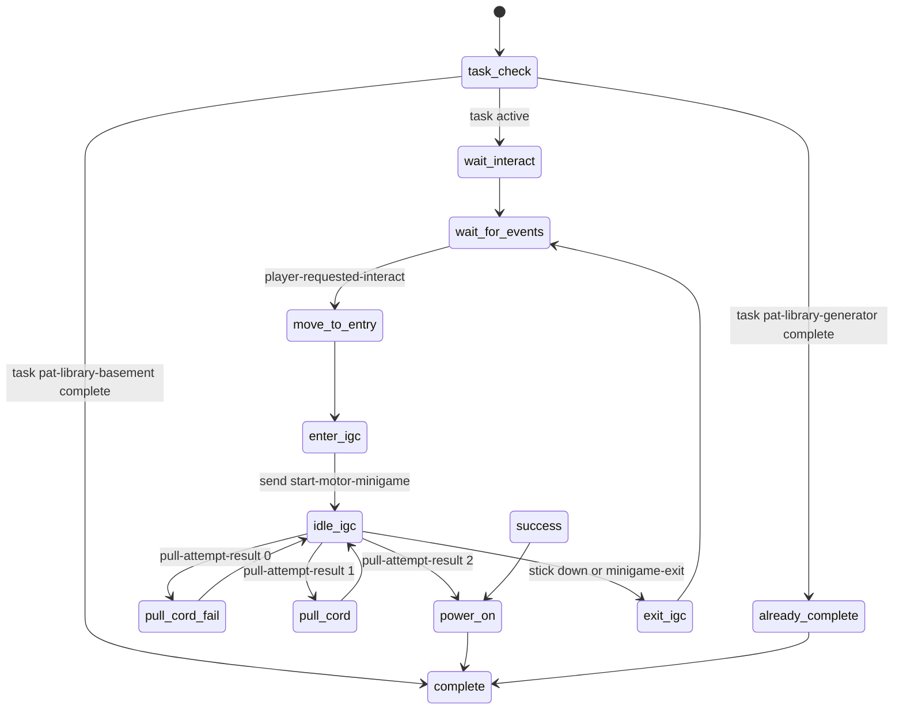
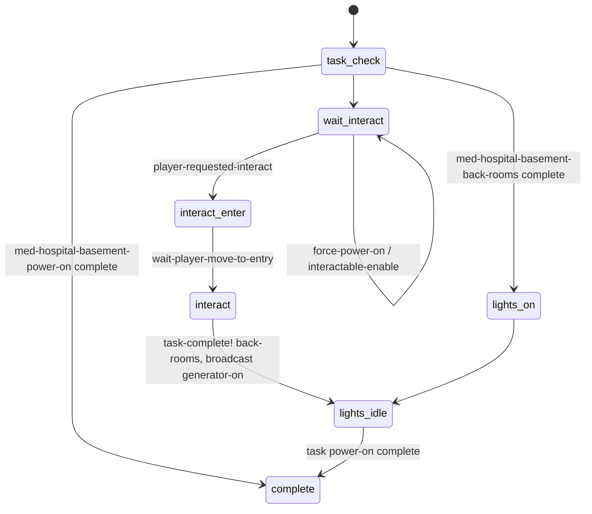
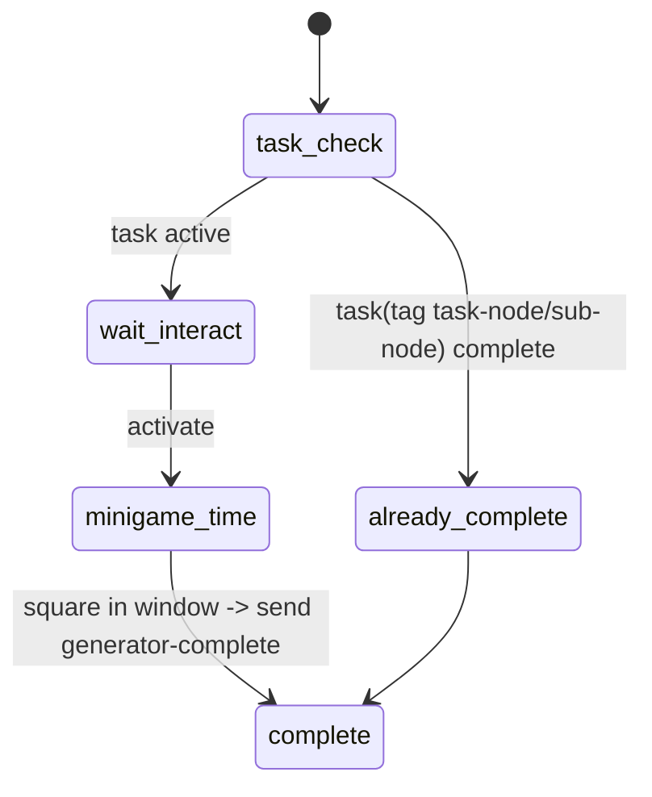
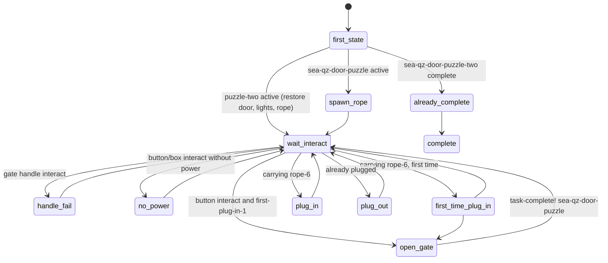
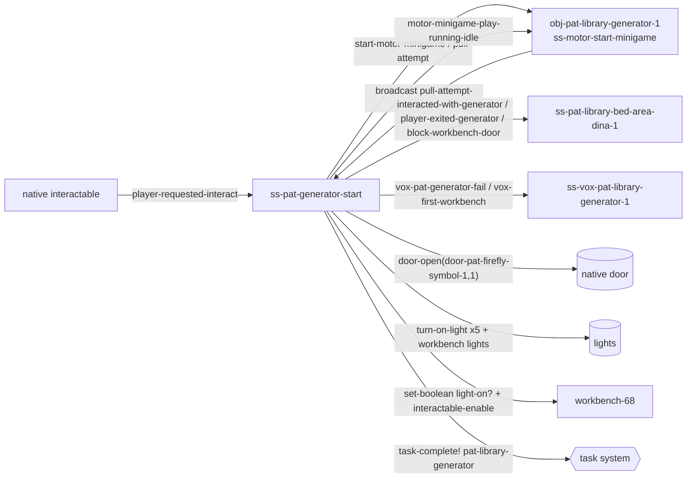
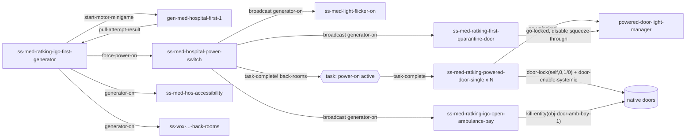
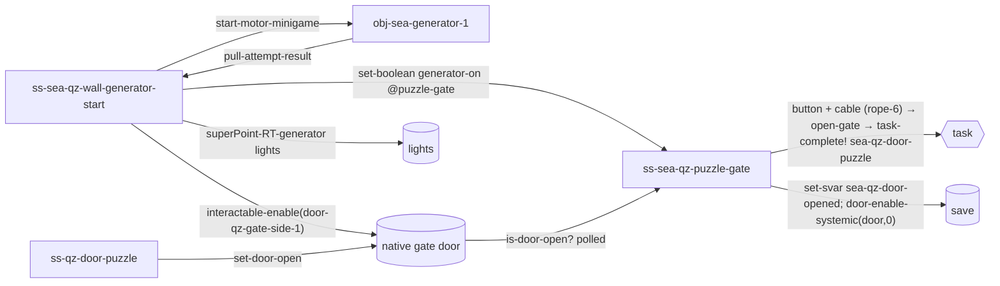

# Generators, switches and power (TLOU2R PC 1.6)

Evidence sources: dconstruct `.dcpl`/`.asm` under `.private/dconstruct_out/dc1/` (private), `databases/events.json`,
`databases/functions.json`, `tools/analysis/q.py`. Companion data: [`power_event_graph.json`](power_event_graph.json)
(nodes = scripts/states/objects, edges = events, tasks, remote variables, native calls) for five levels.
Door-side details (locks, `interact-door-needs-power`, mash doors) are in [`../doors/README.md`](../doors/README.md).

Labels: **CONFIRMED** (seen in code/data) · **HIGH CONFIDENCE** · **INFERRED** · **UNKNOWN / NEEDS NATIVE RESEARCH**.

---

## 1. Overview & files

There is **no generic "power network" in DC**. Power is a level-design idea built from these pieces:

| Layer | File(s) | Role |
|---|---|---|
| Shared pull-cord minigame | `ss-t2/ss-motor-start-minigame.bin` (1,045 dcpl lines) | Runs on the generator or outboard-motor object. Handles the bounce physics, pull timing, HUD, haptics, running-idle anim and light. Used by **every** shipping generator and by the boats. **CONFIRMED** |
| Minigame HUD | `ss-hud2/ss-hud2-motor-minigame.bin` + widget `hud-minigames/hud-motor/motor-root` (`motor-alt/motor-alt-root` alt HUD) | Spinner and progress widget. Receives `pass-boat-object`, `success`, `failed`; replies `hud-anim-complete`. **CONFIRMED** |
| Per-level wrapper | `ss-patrol/ss-pat-generator-start`, `ss-medicine/hospital-annex/ss-med-ratking-igc-first-generator`, `ss-theater/ss-the-generator`, `ss-seattlearrival/ss-sea-horse-{hotel,bank}-generator`, `ss-sea-qz-wall-generator-start`, `ss-sea-horse-leave-hub` | Handles the interactable, player alignment, the paired player/generator IGC anims, camera and input polling. Converts minigame results into world changes. **CONFIRMED** |
| Switches / breakers | `ss-medicine/hospital-annex/ss-med-hospital-power-switch` (breaker panel `obj-circuit-breaker-1`, dials `obj-power-dial-1..8`); `ss-seattlearrival/ss-sea-qz-puzzle-gate` (junction box + button + rope used as a cable) | One-shot IGC interaction that completes a task and/or broadcasts `generator-on`. **CONFIRMED** |
| World consumers | light scripts (`ss-med-light-flicker-on`, `ss-the-lighting-controller`, `pat-library-lighting-funcs`), door scripts (`ss-med-ratking-powered-door-*`, `ss-med-ratking-first-quarantine-door`, `ss-med-ratking-igc-open-ambulance-bay`), sound loops (`ss-snd-*-generator-lp`), VO scripts (`ss-vox-*`), keypads (`ss-sea-horse-keypad`) | React to an event, a task change, a remote boolean or a save variable. **CONFIRMED** |
| Legacy hold minigame | `ss-seattlearrival/ss-sea-qz-generator-minigame.bin` | The `task-check → wait-interact → minigame-time → complete` flow named in the brief. It uses a hold/choke "flood" gauge with a debug-draw HUD and `debug-script-press-*` commands. **INFERRED unused in shipping** (see §4.4) |
| Data | `interactable.bin` → `interact-generator`, `interact-needs-power`, `interact-needs-power-npc-blockable`, `interact-door-needs-power`, `interact-default-mash`, `interact-attack-mash`; `ss-motor-start-minigame.bin` d-arrays `motor-minigame-default-impulse-levels`, `motor-minigame-flo-final-impulse-levels` | Tuning data. **CONFIRMED** |

No DC scripts named fuse, lever or breaker-network exist. The `rg` search over all `.dcpl` file names for lever, fuse, breaker, circuit and elec only finds the hospital switch, the Seattle gate and `ss-nor-scar-scavenge-circuit-board` (a scavenge item). **CONFIRMED**

---

## 2. State machines

### 2.1 `ss-motor-start-minigame` (shared, runs on the generator object)

```mermaid
stateDiagram-v2
    [*] --> setup
    setup --> wait_for_events : entity exists; listen-mode-visible(tag show-in-listen-mode)
    wait_for_events --> init : start-motor-minigame [arg0 = impulse darray]
    wait_for_events --> generator_running : motor-minigame-play-running-idle
    wait_for_events --> turn_off_genertor : motor-minigame-turn-off-power
    init --> bounce
    bounce --> bottom_of_bounce : current-power <= 0 and velocity < 0
    bottom_of_bounce --> bounce : velocity = impulse[count]
    bounce --> pull_success : pull-attempt, power <= 0.18
    bounce --> fail_and_reset : pull-attempt, power > 0.18 (or always-fail)
    pull_success --> bounce
    fail_and_reset --> bounce : after 1.2 s
    bounce --> success : at max count and current-power >= 1.0
    bounce --> wait_for_events : exit-minigame (exit-requested?)
    success --> generator_running : hud-anim-complete and running idle requested
    success --> wait_for_events : hud-anim-complete
    generator_running --> turn_off_genertor : power-on? becomes false
    turn_off_genertor --> wait_for_events
    alt_hud --> wait_for_events : motor-minigame-success
```

(`turn-off-genertor` keeps the source's spelling. `alt-hud` has no incoming `go()` in DC, so it is **INFERRED** to be unused.)

### 2.2 Level wrapper template: `ss-pat-generator-start` (all wrappers share this shape)



The hospital, theater, bank and QZ wrappers have the same states (`pull-cord`, `pull-cord-fail`, `success`, `exit-igc`).
The hotel wrapper adds a no-gas branch: `no-gas-enter-igc → no-gas-idle-igc → no-gas → tutorial-map`. **CONFIRMED** (`q.py ss`)

### 2.3 `ss-med-hospital-power-switch`



### 2.4 `ss-sea-qz-generator-minigame` (legacy hold minigame)



### 2.5 `ss-sea-qz-puzzle-gate` (powered button and cable)



---

## 3. Per-state call graph (key states)

`ss-motor-start-minigame` (all **CONFIRMED**, `ss-t2/ss-motor-start-minigame.bin`):
```
setup
 ├─ wait until entity-exists?(motor-minigame-get-target-object())   (tag target-generator-object or self)
 ├─ listen-mode-visible(target, tag show-in-listen-mode, 1, -1)       [native]
 └─ go(wait-for-events)
wait-for-events
 ├─ kill-widget: gui2-set-widget-state(w-power, off) → wait 0.5
 ├─ on start-motor-minigame: pull-impulse-darray = event-arg-symbol(0) or motor-minigame-default-impulse-levels → go(init)
 └─ update: haptics generator-idle-haptic while power-on? (play-hfx-id / hfx-continue / hfx-stop)
init
 ├─ motor-minigame-reset-vars()   (count 0, velocity 0, cumulative 0, ignore-input? 1, ...)
 ├─ current-power = 0.50
 └─ go(bounce)
bounce
 ├─ track ignore-input: re-enable input when not at max count (decompiled wait condition is mangled; INFERRED: after the first rise)
 ├─ update: velocity += gravity·speed-scalar·dt   (gravity −1.80; inverted when at max count and power ≥ 0.44)
 ├─ update: current-power += velocity·dt
 ├─ update: increase- or degrade-cumulative-power()
 ├─ update: motor-minigame-ui-update-widget(); accessibility sound in window (play-accessibility-interact-sound-at-position r_hand)
 ├─ update: go(success) when at max count and current-power ≥ 1.0
 ├─ update: go(bottom-of-bounce) when power ≤ 0 and velocity < 0
 └─ on pull-attempt: score → broadcast-event(pull-attempt-result, i32) → go(pull-success | fail-and-reset)
bottom-of-bounce
 ├─ optional --successful-pull-count (decay penalty)
 ├─ current-power = 0; velocity = impulse[count]·speed-scalar
 └─ go(bounce)
pull-success
 ├─ velocity = impulse[count]·speed-scalar·lerp-scale(0,0.18 → 1.00,0.82, current-power)
 ├─ send-event(success, w-power, count, max)        → HUD
 ├─ increase-cumulative-power? = 1; ignore-input? = 1
 └─ go(bounce)
fail-and-reset
 ├─ reset vars; widget-color = t2-red; progress bar → 0; send-event(failed, w-power)
 ├─ wait(1.20); start error-fade-timer 2.0 s; miss-pos marker fade 3.0 s
 └─ go(bounce)
success
 ├─ broadcast-event(motor-minigame-success, target); power-on? = 1
 ├─ rumble-curve or play-hfx-id(generator-pull-haptic-3)
 └─ on hud-anim-complete: go(generator-running) if motor-minigame-play-running-idle was received, else go(wait-for-events)
generator-running
 ├─ animate_(target, tag running-idle-anim, {28:0.30, 30:0.30})      (option keys INFERRED: blend-in, start phase)
 ├─ if tag running-idle-has-light: set-shader-instance-blend-offset ramp 0→1 over 5 s with ±0.15 random flicker
 ├─ listen-mode-add-reveal(target, …, 25 m, 3600 s) loop when show-in-listen-mode
 └─ go(turn-off-genertor) when power-on? = 0
turn-off-genertor
 ├─ stop-animating(target, …, 2.0); shader blend offset 1→0 over 1.5 s
 └─ go(wait-for-events)
```

`ss-pat-generator-start` (level wrapper, **CONFIRMED**):
```
wait-interact
 ├─ turn-off-light(rt-stairway-generator-light-1 / rt-lower-uplight-a-1 / …)   (DC wrapper → send turn-on/turn-off to light)
 ├─ interactable-enable(int-pat-generator-1)                                    [native]
 └─ go(wait-for-events)
wait-for-events
 └─ on player-requested-interact (native) → go(move-to-entry)
move-to-entry
 ├─ interactable-disable(int-pat-generator-1)
 ├─ send-event(interacted-with-generator, ss-pat-library-bed-area-dina-1)
 ├─ wait-player-move-to-entry(start-generator-enter--ellie, get-object-locator(generator), …, apReference)   (DC, script-user-funcs-impl)
 └─ go(enter-igc)
enter-igc
 ├─ camera-enable-animated(2.5, …)
 ├─ animate_(obj-pat-library-generator-1, start-generator-enter--generator) ∥ wait-animate_(player, start-generator-enter--ellie)
 ├─ send-event(start-motor-minigame, obj-pat-library-generator-1)
 └─ go(idle-igc)
idle-igc
 ├─ turn-off-flashlight(player); loop start-generator-idle--{generator,ellie}
 ├─ update: joypad-command-active?(minigame-interact, 6) → send-event(pull-attempt, generator)
 ├─ update: stick-pressed-down?(move, 0.30) or minigame-exit → send exit-minigame → go(exit-igc)
 └─ on pull-attempt-result: 0 → pull-cord-fail · 1 → pull-cord · 2 → power-on
pull-cord / pull-cord-fail
 └─ start-generator-pull--* or -fail--* anims; workbench lights sputter (wait-pat-light-flicker); vox-pat-generator-fail
power-on
 ├─ camera-enable-animated(1.5); wait-animate_(player, pat-library-generator-interact--ellie) + feather-blend exit
 ├─ send motor-minigame-play-running-idle → generator; send block-workbench-door → Dina
 ├─ track lights: pat-library-turn-on-generator-related-lights()
 ├─ track door:   door-open(door-pat-firefly-symbol-1, 1)                         [native door]
 ├─ track bench:  workbench lights + emissive + fx-workbench-light-flare-beam-1, set-boolean(light-on?, 1, workbench-68), interactable-enable(workbench-68)
 ├─ task-complete!(patrol, pat-library-generator); Ellie/Dina VO; send vox-first-workbench
 └─ go(complete) on player-requested-interact
```

`ss-med-hospital-power-switch:interact` (**CONFIRMED**):
```
interact
 ├─ camera-enable-animated(1.5)
 ├─ animate_(obj-circuit-breaker-1, med-hospital-basement-turn-on-power--panel) ∥ wait-animate_(player, …--abby)
 ├─ dial anims obj-power-dial-1..8 (…--dial then …-idle--dial)
 ├─ task-complete!(medicine, med-hospital-basement-back-rooms)
 ├─ broadcast-event(generator-on)
 ├─ haptics on anim frames 26 / 62 / 71
 └─ go(lights-idle)
```

---

## 4. Answers to the specific questions

### 4.1 How a generator interaction works end to end (**CONFIRMED**)
1. The engine's interactable system sends `player-requested-interact` to the wrapper (same as for drawers).
2. The wrapper disables the interactable, aligns the player with `wait-player-move-to-entry(<enter anim>, generator locator, …)`, starts an animated camera and plays the paired `start-generator-enter--ellie` / `--generator` anims. The Seattle wrappers use `sea-qz-door-start-generator-*`.
3. It sends `start-motor-minigame` to the **generator object**, which runs `ss-motor-start-minigame`.
4. Each frame it polls `joypad-command-active?(minigame-interact, 6)` (native) and forwards each press as `pull-attempt`.
5. The minigame scores the press against its bounce and broadcasts `pull-attempt-result`: −1 ignored, 0 fail, 1 good pull, 2 good pull at the maximum count. The wrapper turns this into anims (`pull-cord-fail`, `pull-cord` with sputtering lights, `success` / `power-on`).
6. On power-on the wrapper makes all world changes **directly** (door-open, lights, tasks, remote booleans, events). The minigame itself only broadcasts `motor-minigame-success`, whose sole DC handler is its own `alt-hud` state.

### 4.2 How pull-cord progress is computed (all values **CONFIRMED** from `ss-motor-start-minigame.bin`)

| Quantity | Value / formula |
|---|---|
| Gravity on the gauge (`current-power`) | −1.80 per s² × `speed-scalar` (1.00) |
| Default impulse levels (`motor-minigame-default-impulse-levels`) | 0.96, 1.20, 1.45, 1.55 → max pull count = n−1 = **3** |
| Flooded City final level (`motor-minigame-flo-final-impulse-levels`) | 0.96, 1.20, 1.45 → max 2 |
| Boats | pass `motor-restart-impulse-array` (boat controller variable) as the `start-motor-minigame` arg |
| Bounce apex, h = v²/(2·1.8) | 0.256 · 0.400 · 0.584 · 0.667 |
| Success window for a pull | `current-power ≤ 0.18`, i.e. near the bottom of the bounce |
| Prompt and accessibility window | 0.18, or 0.22 when `is-traversal-audio-cues?()`. This only affects the HUD prompt and sound, not scoring |
| Pull-timing quality | new velocity = impulse[count] × lerp-scale(0→0.18 ⇒ 1.00→0.82, power). An earlier pull gives up to 18 % more height |
| Final spin-up | at max count, while v > 0 and power ≥ 0.44, gravity flips sign → power accelerates to ≥ 1.00 → `success` |
| Failure | a pull above the window (or `always-fail`) → count = 0, red HUD (`t2-red`), 1.2 s lockout, error fade 2.0 s, miss marker fade 3.0 s |
| Decay | `cumulative-power` decays 0.05/s after a 0.40 s pause. The pause is skipped while task `flo-approach-bay-wreck` is active. Dropping below the previous peak sets `decrement-pull-count?` → count −1 at the next bottom |
| HUD | progress = lerp-scale(0.16→1.0 ⇒ 0.04→1.0, cumulative-power); spinner speed = count × 0.40; fader phase = current-power |
| Haptics | `generator-pull-haptic-1` (cumulative < 0.30) / `-2`, `-3` on success, `generator-idle-haptic` loop while running; `rumble(current-power)` fallback without haptics |

In short, the player needs three consecutive well-timed presses near the bottom of each bounce. Each one raises the
next bounce until the third triggers the spin-up. A missed press resets to zero.

### 4.3 "Mash" / "hold" pull and struggle prompts (**CONFIRMED** unless noted)
- The motor minigame is **timing based, not mash based**: one press per bounce on `minigame-interact`.
- Mash interactions (struggle doors, lifts, melee) use `joypad-command-active?(interact-repeat | melee-repeat, 6)` with prompts `interact-default-mash` (68 DC refs) or `interact-attack-mash` (92). In `interactable.bin` these defs carry widget `"pc/button-prompt/button-mash-hold-hybrid-pc.widget"`, hold command `interact-hold` / `melee-repeat` at offset 0x0F0, and a `gui2-attachable-params` prompt-spring block (the `-no-spring` variant lacks it).
- The accessibility switch is in `script-funcs.bin → draw-interactable-hud`. If byte **0x1FB** of the def is set (the mash flag) and native `button-mashes-are-holds?()` (native-confirmed, 0x140409260) is true, the prompt becomes `hud2-show-interactable-hold(def, loc, 0.50, 1)`. Otherwise it is a normal mash prompt.
- Progress patterns:
  - **Anim-speed as progress**, used by `ss-med-ratking-powered-door-animated:struggle`. While `interact-repeat` is held, speed = lerp(speed, 1.5, dt). The rate rises with Ratking proximity: lerp-scale(6→15 m ⇒ 10→2)·dt. With no input, speed → −0.8 at 2·dt. `set-animation-speed` drives both the player and the door; at anim end, phase > 0.5 → success, < 0.5 → idle.
  - **Template lift** (`ss-flo-tunnel-double-door`): repeat → speed 1.0, release → −1.5; success at phase ≥ 0.98 (`template-double-lift-check-struggle-complete`).
  - **Counter** (`ss-nor-ellie-alone-igc-workbench → update-struggle`): +1 per active frame (+2 when `button-mashes-are-holds?`), −0.3 otherwise.

### 4.4 The legacy "wait-interact → minigame-time → complete" generator (`ss-sea-qz-generator-minigame`)
- Hold/press triangle (`debug-script-press-triangle` / `-hold-triangle`). Each press adds (`increase-rate`/30)·k to `flood-des-amount`, with k = 2 when flood < 15 and ×1.5 while `boost-timer` runs, inside a 0.9 s `flood-timer`. Release adds `decrease-rate` (from a tag; INFERRED negative) and starts `release-timer` = curve-scale(0.9 … `decay-rate`). Over-pressing jitters the gauge (±2, or 0..10 below 10).
- `flood-amount` approaches the target at `approach-rate`, and `needle-a` anim phase = flood/100.
- Square pressed while flood is within 75 ± 15 → `send generator-complete` to `tag my-generator` → complete. Square outside the window → `generator-fail`, plus a 3 s penalty that adds 3·decrease-rate per frame. Each press also sends `generator-press`.
- The HUD is drawn with `debug-draw-*`. Its `generator-complete/-fail/-press` handlers remain in `ss-sea-horse-hotel-generator`, `ss-sea-horse-leave-hub` and `ss-sea-qz-wall-generator-start` (`idle-igc`), and those wrappers now use the motor minigame. No resolved sender of `activate` targets this script. **INFERRED: prototype kept in the build, unused in shipping.** All tunables are instance tags (level data, **UNKNOWN** values).

### 4.5 How a power interaction reaches doors, lights, audio, level scripts, AI and world state
Six mechanisms appear, often mixed in one level (**CONFIRMED**, see JSON):

| Mechanism | Example |
|---|---|
| Direct native call from the wrapper | `door-open(door-pat-firefly-symbol-1, 1)`, `interactable-enable(door-qz-gate-side-1)`, `set-light-process-intensity`, `set-table-shader-material-values-param`, `kill-entity(obj-door-amb-bay-1)` |
| Light events | `turn-on-light(x, instant?)` (DC wrapper) → `send-event(turn-on | turn-on-instantly, light)`. `turn-on-instantly` has 0 DC handlers → native light entity |
| Targeted event | `send-event(force-power-on, ss-med-hospital-power-switch-1)`, `block-workbench-door` → Dina NPC script, `vox-*` → VO scripts |
| Broadcast | `broadcast-event(generator-on)` (power switch) → 6 handlers: lights, quarantine door, ambulance bay, VO, accessibility |
| Task system | `task-complete!(…)`. Consumers test `task-active?` / `task-complete?` in `event_task-complete` (theater lighting controller, sound loop, powered doors) |
| Remote variable / save variable | `set-boolean(generator-on, 1, ss-sea-qz-puzzle-gate-1)`; `set-svar(sea-horse-finding-gas, 7)` gates the hub keypad |

AI: there is no direct generator → AI link in DC. AI is affected indirectly: doors open or unlock and nav blockers or squeeze-throughs are toggled (see doors README). Noise and alert from a running generator are **UNKNOWN** (not in DC).

### 4.6 Event graphs (three or more concrete levels)

**A. Patrol / Jackson library**


**B. Hospital basement (Abby)**


**C. Seattle QZ wall gate**


**D. Seattle hub hotel and E. Theater** are in `power_event_graph.json`. The hotel case shows power stored as svar `sea-horse-finding-gas == 7`, which the keypad reads to swap `interact-needs-power-npc-blockable` for the working keypad. The theater case drives lights, the radio and sound loops through task `theater/the-generator`.

---

## 5. Engine boundary (DC vs data vs native)

| Concern | Where | Evidence |
|---|---|---|
| Minigame physics, scoring, HUD driving | **DC** | full logic in `ss-motor-start-minigame.bin` |
| Impulse tables, interact prompts, widgets | **Data** | d-arrays in the same `.bin`; `interactable.bin` defs |
| Instance options (`target-generator-object`, `show-in-listen-mode`, `has-running-performance`, `running-idle-anim`, `running-idle-has-light`, `rumble-during-startup`) | **Level data** (spawner tags, `tag-*`) | read via `tag-boolean/tag-symbol`; values not in DC (**UNKNOWN**) |
| Interact detection, prompt display, `player-requested-interact` | **Native** | same as the drawer reference |
| Input commands `minigame-interact`, `minigame-exit`, `interact-repeat`; `button-mashes-are-holds?` | **Native** | `joypad-command-active?` native-confirmed 0x140D4C710 |
| Doors (`door-open`, `door-lock`, …), light entities (`turn-on` handling), `set-light-process-intensity` | **Native** | functions.json kind ≠ dc-script; 0 DC handlers for `turn-on-instantly` |
| Haptics, listen mode, animation, camera | **Native** called from DC | `play-hfx-id`, `listen-mode-add-reveal`, `animate_`, `camera-enable-animated` |
| Power-to-world wiring | **DC, per level** | no generic power manager exists |

## 6. Events in / out

| Event | Direction | Notes |
|---|---|---|
| `player-requested-interact` | native → wrappers | **CONFIRMED** |
| `start-motor-minigame`, `pull-attempt`, `exit-minigame`, `motor-minigame-play-running-idle` | wrapper → generator object | 11 send sites for start: 7 generator wrappers (8 sends) + 3 boat scripts |
| `pull-attempt-result` (i32) | broadcast by minigame | handled by every wrapper plus Flooded City VO scripts |
| `motor-minigame-success` | broadcast | only its own `alt-hud` handles it |
| `success`, `failed`, `pass-boat-object` → `hud-anim-complete` | minigame ↔ HUD widget | |
| `generator-on` | send / broadcast | hospital (6 handlers) |
| `force-power-on` | send | handled by power switch and two powered-door scripts |
| `opened-powered-door`, `door-destroyed` | broadcast | powered door → gurney-hall chase |
| `go-unpowered / go-unlocked / go-locked / go-malfunctioning` | send | door-lamp manager states |
| `generator-press / -complete / -fail` | legacy minigame → wrapper | |
| `turned-on`, `blend-light-on` | send | **0 DC handlers** (vestigial, or handled by a native object; **UNKNOWN**) |

## 7. Persistence
- **Tasks** are the main persistence. Every wrapper's `task-check` replays the end state (`already-complete`, `lights-on`) from `task-complete?` / `task-active?` / `task-range-active?`. **CONFIRMED**
- **Save variables** (`set-svar`, `set-svar-as-boolean`): `sea-horse-finding-gas` (0–8 progress), `sea-horse-hotel-generator-tried`, `sea-qz-door-opened`. **CONFIRMED**
- Script-instance booleans (`generator-on` on the puzzle gate) are **not** persistent on their own. The puzzle gate rebuilds them from tasks on load (`first-state`). **CONFIRMED**
- Door open/closed persistence is native (`door-reset-save-state`). **HIGH CONFIDENCE**

## 8. Animation / camera / UI / audio hooks
- Paired anims `<igc>--ellie` / `--generator`, on Abby `--abby` / `--panel` / `--dial`. Families: `start-generator-{enter,idle,pull,fail,pull-3-success,exit}`, `sea-qz-door-start-generator-{enter,enter-empty,idle,pull-a/c/d,fail,success,success-idle,exit}`. The theater reuses the `sea-qz-door-…` set. **CONFIRMED**
- Camera: `camera-enable-animated(2.5|1.5, …)`; `fade-flashlight-using-render-settings/f`; `turn-off-flashlight(player)`; the hospital points the flashlight at the breaker with `flashlight-set-target-object`.
- UI: widget `hud-minigames/hud-motor/motor-root` (children `missPos`, `progress`, `prompt`, `counterSpinner.circle`, `spinner`, `pulse`, `fader`); category 1048576; `hud2-hide-health-ammo/f` while in progress.
- Audio: sound-loop scripts `ss-snd-the-generator-lp` (`sfx-igc-sea-qz-generator-success-startup`, `sfx-igc-the-generator-lp`, building/light-buzz loops), `ss-snd-pat-library-generator-lp`, `ss-snd-sea-qz-generator-hum-logic`, `ss-snd-med-*-generator-lp`; accessibility cue `play-accessibility-interact-sound-at-position(r_hand_prop_attachment)` inside the pull window.

## 9. Shared components with other systems
- `ss-motor-start-minigame` is shared with **boats** (`ss-vehicle-boat-*`, Flooded City wrecks).
- Interact pipeline and `wait-player-move-to-entry` are shared with drawers, workbench and pickups.
- Mash and hold prompts are shared with melee struggles and doors.
- Keypads (`ss-sea-horse-keypad`) and ropes (rope-6 as a cable, `start-with-rope`) appear in the Seattle power puzzles. See the keypads and ropes READMEs.

## 10. Confidence table

| Claim | Label |
|---|---|
| One shared minigame drives all shipping generators; numbers in §4.2 | CONFIRMED |
| World effects are done by per-level wrappers, not by the minigame | CONFIRMED |
| No generic power network or fuse system in DC | CONFIRMED (name and xref search) |
| Light entities handle `turn-on`/`turn-on-instantly` natively | HIGH CONFIDENCE |
| `ss-sea-qz-generator-minigame` unused in shipping | INFERRED |
| `animate_` option keys 28/30 = blend-in / start phase | INFERRED (from the drawer brief) |
| Who delivers `force-power-on` to `ss-med-ratking-powered-door-animated` | UNKNOWN |
| Byte 0x1FB = mash flag in `game-interactable-def` | CONFIRMED (read by `draw-interactable-hud`) |

## 11. Open questions
1. Values of the instance tags (`speed-scalar` overrides, `running-idle-anim`, legacy minigame rates) live in level `.pak` data, not DC.
2. Whether `turned-on` / `blend-light-on` are handled by a native object class or are dead sends.
3. What the `6` argument of `joypad-command-active?` selects (likely an input-context mask, **INFERRED**).
4. Whether a running generator emits AI-audible noise (no DC evidence).

## 12. Modding surface

| Rating | Target | Reason |
|---|---|---|
| GREEN | `motor-minigame-default-impulse-levels` / `-flo-final-` d-array floats; `gravity`, `cumulative-power-degrade-increment`, `error-fade-time` declaration defaults | plain data in one DC file; affects every generator and boat |
| GREEN | per-wrapper effects (which door opens, which lights turn on) in level wrapper DC | self-contained state scripts, standard calls |
| YELLOW | the 0.18 window, 0.44 spin-up and 1.0 success thresholds | inline constants in DC code (bytecode edit); also drive HUD and accessibility |
| YELLOW | adding power-gating to new objects with `interactable-set-unavailable` + `override-interact-def(x, interact-needs-power)` | existing pattern; requires tasks or svars for persistence |
| ORANGE | chaining power across levels (new tasks/svars) | task graph and save variables are shared global state |
| RED | input commands, mash/hold accessibility, light entity behaviour | native |
