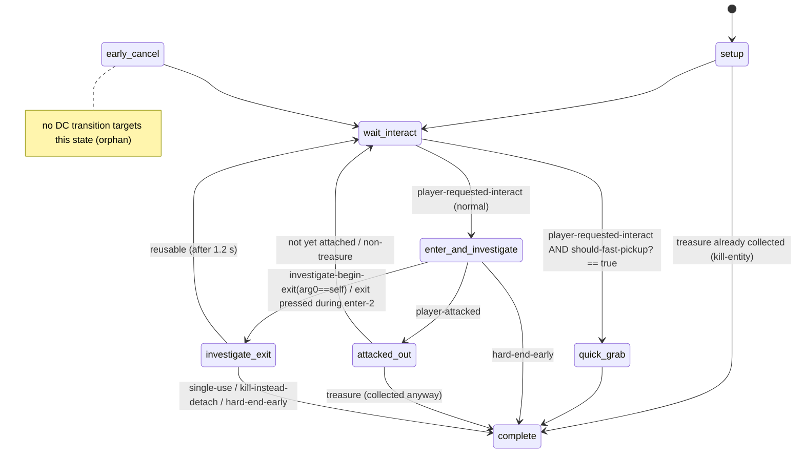
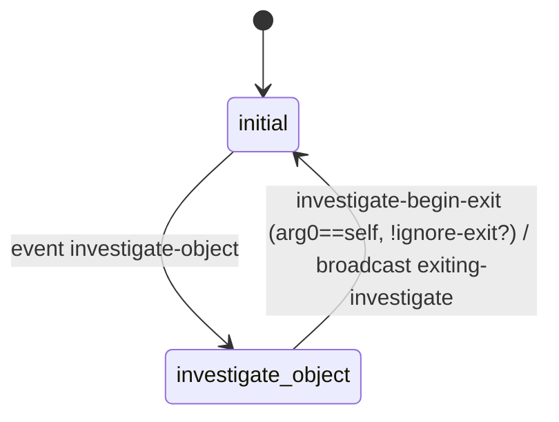

# INVESTIGATE — "pick it up and turn it over in your hands"

TLOU2R PC 1.6 DC script corpus. Scope: `ss/ss-investigate-object` (the generic hand-held inspect
script), `ss/ss-investigate-in-igc` (inspect driven from a level IGC), `script-funcs-investigate`,
`investigate.bin` (159 `investigate-params` structs), `anim-player/player-investigate` (the player
anim state graph), `anim-player/player-look-at`, and the native boundary behind them.

Sibling docs: [`../examine/README.md`](../examine/README.md) (camera-only inspection of a world spot)
and [`../notes/README.md`](../notes/README.md) (treasure/collectible/journal data and the full
"player picks up a book" walk-through).

Confidence labels: **CONFIRMED** (seen in code or data) · **HIGH** · **INFERRED** · **UNKNOWN/NATIVE**.

---

## 1. Overview & files

| File | Kind | Role |
|---|---|---|
| `ss/ss-investigate-object.bin` | state script, 8 states, 104 declarations, 3 helper lambdas | Generic world inspectable: notes, photos, manuals, coins, cards, holsters. It sets the object up, aligns the player, plays enter-1/enter-2, attaches the object, then **hands control to native `player-investigate-object`**. When the native side asks to exit, it plays exit-1/exit-2, detaches the object or collects it as a treasure, and restores gameplay. |
| `ss/ss-investigate-in-igc.bin` | state script, 2 states | Same native hand-off without the approach/attach. A level IGC script sends it `investigate-object` once its own animation already has the object in Ellie's hand. |
| `script-funcs-investigate.bin` | 1 lambda | `player-investigate-clear-readable()` = `player-investigate-make-readable(0,0,0)` **CONFIRMED** |
| `script-user-funcs-impl.bin` | helpers | `investigate-object-restart(obj)` → `send-event(re-investigate, obj)`; `investigate-object-ignore-exit/allow-exit(obj)` → set `ignore-exit?` on the object script; `force-examine-object(obj)` → `send-event(skip-pickup, obj)` **CONFIRMED** |
| `investigate.bin` | data, 188 entries | 159 `investigate-params`, 15 `stick-pan-camera-settings`, 13 `symbol-array` (physics joint lists such as `*investigate-phys-joints-standard*`), 1 `map-chevron-settings`. **The only file in the corpus that defines `investigate-params`** (the 160th grep hit is `ai-investigate-params` in `ai/ai-globals`, an unrelated NPC-AI "investigate a noise" struct). |
| `anim-player/player-investigate.bin` | `actor-state-list`, 33 anim states | The player anim graph for inspect: enter/exit, parametric idle front/back, flip, close, swap, plus horse and photograph variants. |
| `anim-player/player-parametric-move-sets.bin` | data | `investigate-front-parametric-set` / `investigate-back-parametric-set` (5 poses each) |
| `player-overlays.bin` | data | 128 `anim-overlay-player-investigate-*` and 14 `anim-overlay-player-investigate-object-*` overlay sets. These remap the generic state animations to per-object clips. |
| `anim-player/player-look-at.bin` | `actor-state-list`, 3 states | `inspect-idle`, `inspect-run-forward`, `inspect-run-backward`: an aim-style look-around locomotion layer. It is **not** used by `ss-investigate-object`. The head look-at during investigate is native `player-look-at-point`. **CONFIRMED** (no reference from the investigate scripts) |

Machine-readable table of all 159 params: [`investigate_params.json`](investigate_params.json)
(generator: `tools/analysis/investigate_params_dump.py`).

> Naming trap: "investigate" also names the NPC-AI search behaviour (`npc-investigating?`,
> `faction-investigating?`, `ss-test/ss-test-mgallant/ss-investigate-testbed`). None of that is part
> of this system.

---

## 2. State machine — `ss-investigate-object`



There is no "investigating" state in the DC script. While the player turns the object over, the
script sits in `enter-and-investigate` with its update block and event handlers running. The
inspection itself belongs to the native player state `Investigate`
(`player-in-state?(Investigate)` in `ss-menu2-collectibles`). **CONFIRMED**

### `ss-investigate-in-igc`



---

## 3. Per-state call graphs (ss-investigate-object)

```
setup
 ├─ if tag treasure-id: get-treasure-by-id(id,0) else display-error "Treasure data not found"   [CONFIRMED]
 ├─ wait until entity-exists?(self)
 ├─ if treasure-id && !tag dont-auto-kill-treasure && has-collected-treasure?(id,0)
 │     → kill-entity(self); go(complete)                                       [CONFIRMED]
 ├─ if treasure-id && is-collectible-tracking-hud-enabled?() && has-collected-treasure?(id,1)
 │     → override-interact-def(self, get-collected-interactable-def-id(
 │           interactable-get-def-id(self), is-treasure-progression-important?(id)))   [CONFIRMED]
 ├─ task-played-from-dev-menu? → set-svar-as-boolean(ss-svar(used), 0)
 ├─ get-svar-as-boolean(ss-svar(used)) → interactable-set-accessibility-used(self)
 ├─ tag interaction-single-use → interaction-single-use?
 ├─ tag weapon-def-id && player-has-weapon? → weapon-upgrade-apply-all-active-bundles-to-weapon-instance(self, def, ellie|abby, regular)
 └─ wait-one-frame; go(wait-interact)

wait-interact
 ├─ reset enter-anim-2-start / exit-anim-2-start / picked-up-treasure
 ├─ set-high-contrast-mode-type(self, 3)
 ├─ tag obj-anim-start → animate_(self, obj-anim-start, {56:0.0, 10:ap-ref-or-self-locator})
 ├─ enemies alive && !allow-in-combat? && tension 3|4 → send-event(enable-fast-pickup, self)
 │   else if is-coin? || is-card? → send-event(enable-fast-pickup, self)          [CONFIRMED in .asm]
 ├─ track glow: loop wait-set-single-shader-instance-param(glow-object|self, shimmerIntensity, 0↔glow-brightness, 0.5)
 │              while interactable enabled / disabled
 ├─ track disable-after-distance: if use-count>0 && player further than disable-after-use-distance
 │              → interactable-disable(self); broadcast disabling-investigate-object
 ├─ on npc-died / tension-changed: re-evaluate enable-/disable-fast-pickup (same rule)
 ├─ on player-requested-interact:
 │     send-event-box-result(should-fast-pickup?, self)       ← answered natively (0 DC handlers)
 │     ├─ false → go(enter-and-investigate)
 │     └─ true  → go(quick-grab)
 └─ update: coins (or grow-anyway?) set-animation-phase(self, curve-scale(2..12 m → 0.4..0.9)) when < 12.1 m

quick-grab                                   (combat / coin / card fast path)
 ├─ send-event(no-map-hint, ss-seattle-map-materials-1)
 ├─ log-event("found-coin" | "found-card", 1, spawner-name, locator, 0)          [analytics]
 ├─ if treasure && !dont-collect-treasure?:
 │     log-event("quick-investigate-object", …); collect-treasure(id); hud2-request-pick-up-notification(id, 0)
 │     unless dont-notify: hud2-request-new-item-notification(id, 0.0, 1) (coin/card/combat branches)
 ├─ broadcast-event(done-with-investigate, self)
 ├─ wait while ss-sea-horse-map-writing-1 exists (≤ 5 s)                        [level special-case]
 ├─ kill-entity(self); go(complete)
 ├─ track script-lambda: tag on-exit → script-eval-condition(lookup(on-exit, script-lambda), 1, …) until true
 └─ update: coin/card → player-set-quick-inspect-treasure/f(id)   (native quick-inspect from notification)

enter-and-investigate      (13 parallel tracks; main track order shown)
 main
 ├─ log-event("found-investigate-object", 1, spawner-name, locator, 0)            [analytics]
 ├─ p = lookup-symbol(investigate-params, investigate-params) → copy sfx-enter/exit-1/2 + frames (p+96..p+152)
 ├─ interactable-disable(self); set-high-contrast-mode-type(self, 1)
 ├─ calculated-ap-loc = ap-ref spawner locator
 │        else flatten(point(obj.x, player.y, obj.z), rot = rotate-to-player ? lookat(player)+180°
 │                                                   : use-spawner-rotation ? spawner rot : object rot)
 ├─ original-object-loc = get-object-locator(self)
 ├─ player-look-at-point(object-position, 10.0)                                  [native head look-at]
 ├─ set-overlay-set(player, anim-overlay-player-investigate-<p+8>)
 ├─ set-overlay-set(player, anim-overlay-player-investigate-object-<p+16>)
 ├─ broadcast moving-to-enter-investigate
 ├─ if enter-anim != null-anim:
 │     phase = use-best-entry-phase? ? get-best-entry-phase(player, enter-anim, ap, ≤50% dur, apReference-object|apReference) : 0
 │     crouched? = player-is-crouched?()
 │     if move-to-entry?: wait-player-move-to-entry(enter-anim, ap, 1, override-move-settings, 0.40,
 │                         apReference-camera1, apReference-object|apReference, phase, …, crouch?2:1, …)
 │     broadcast entering-investigate; signal(start-igc)
 │     tag recalculate-ap → recompute calculated-ap-loc
 │     tag enter-anim-1-cam? → camera-enable-animated(fade, cam-enter-anim-2-fade-out, camera-index-inspect, 1000, …)
 │     wait-animate_(player, crouch-enter-anim | enter-anim,
 │                   {10:ap, 28:fade-in(≤45% dur), 30:enter-anim-fade-out, 27:2, 58:phase, 14:apReference})
 ├─ signal(enter-anim-2-starting); enter-anim-2-start = 1
 ├─ broadcast entering-investigate-cut
 ├─ hand-gesture → gesture_(player, hand-gesture, params)
 ├─ if enter-anim-2 != null-anim:
 │     send-event(pop-flashlight, player)
 │     camera-enable-animated-stick-pan(treasure zoom pan-settings | "[DATA POINTER]",
 │                                      cam-enter-anim-2-fade-in, cam-enter-anim-2-fade-out, camera-index-inspect, 1000, 0)
 │     no fade-in → signal-camera-cut(0)
 │     wait-animate_(player, enter-anim-2, {10:ap, 28, 30, 14:interior-apref-ch|apReference})
 ├─ signal(clear-camera); player-clear-look-at()
 ├─ broadcast entered-into-investigate; signal(investigate-started)
 ├─ vox-id → say(player, vox-id, 2, 0)
 ├─ collect-investigate-object(investigate-id | get-art-group(self))             [native; INFERRED "seen" stat]
 ├─ flags = 16 | (!allow-flip?·4) | (pan-while-zoomed?·8) | (allow-rotate-in-zoom?·64)  (+128 if always-pan?)
 ├─ hud-elements-zoomed = pan-while-zoomed? ? 2178 : 2050
 ├─ start-timer(mark-treasure-seen-timer?, 2.0)
 ├─ setup-and-investigate-object()                       ← NATIVE HAND-OFF (see §4)
 └─ loop: camera-animation-enable(investigate-camera-additive, camera-shake-steadycam-tense-idle, 0.5,0.5,0.1,1,0.2)
 track attach
 ├─ wait (attach-on-enter-1-frame ? start-igc : enter-anim-2-starting) + attach-frames
 ├─ picked-up-treasure = 1; signal(did-attach)
 └─ attach(self, player, tag attach-joint | rightHand, attach-on-enter-1-frame ? 0.2 : 0.0)   [CONFIRMED]
 track obj-anim      object playing paper-startpose-04 → enter-anim-2-obj = paper-animpose;
                     coins: set-animation-phase(self,0); wait-animate_(self, enter-anim-2-obj, {…,32:1,…})
 track camera        blend-to-crouch-cam → camera-set-overlay(*camera-remap-medium-shot-crouch*, …) per frame;
                     wait clear-camera + enter-anim-2-fade-out → camera-fade-out-animated(cam-enter-anim-2-fade-out)
 track flashlight    remember flashlight-was-on?; after flashlight-frames: force-flashlight? or
                     check-lighting-estimate-over-threshold(self) → turn-on-flashlight(player)
 track flashlight-volumetric   loop player-flashlight-set-particle-fade(0, 0.06|0)
 track suppress-buddy-flashlight  send suppress-flashlight to dina/jesse/lev/yara/manny/mel/joel/tommy if alive
 track holster-weapon holster-player-weapon(2, 1.0); signal(holstered-weapon)
 track ik            set-character-ik-mode-override(player,5,0.3); after ik-enable-frames, while enter-2 running:
                     player-ik-point-at(obj + (0, ik-hand-height, 0), ik-left-hand?, *player-point-at-investigate-ik*, 0, 0.4)
 track ik-off        enter-1-stop-ik-frame; at enter-2: stop-player-script-ik(0); ik-mode-override(player,1,0)
 track sfx           play-sound-at-joint(sfx-enter-1 at frame, self) ; at enter-2: sfx-enter-2
 track object-physics  after phys-frames: enable-physics(self, joint, physicalize-time) for each joint in
                       physicalize-list (e.g. *investigate-phys-joints-standard*) else enable-collision(self,1,0,t)
 track clear-glow    shimmerIntensity → 0
 track allow-cancel  until investigate-started: joypad-disable-commands(camera);
                     exit pressed during enter-2 (and !ignore-exit?) → go(investigate-exit)
 track photo-mode    photo-mode-disable-show-hide/f(inspect) until investigate-started
 track accessibility on speak-text-to-speech signal: TTS of INVESTIGATE_HUD_ROTATE_OBJECT, HUD_READ_MODE,
                     INVESTIGATE_HUD_PUT_BACK, INVESTIGATE_HUD_ZOOM, (INVESTIGATE_HUD_FLIP if allow-flip?)
 track world-hud     use-activate-tutorial?: wait front?/back side → allow-activate?, wait joypad investigate-activate
 events
 ├─ investigate-begin-exit(arg0==self) → go(investigate-exit)
 ├─ investigate-begin-flip(arg1 = front?) → front? = arg; investigate-object-show-readable-hud(front or back ciphers)
 ├─ re-investigate → setup-and-investigate-object(); replay hand-gesture
 ├─ hard-end-early → send detach; camera-fade-out-animated(0.5); broadcast disabling-investigate-object; go(complete)
 └─ player-attacked → go(attacked-out)
 update (every frame)
   camera-override-near-clip/f(0.01); player-disable-wall-touch(); pause-all-hints(); use-esc-for-back/f()
   flashlight facing camera (before enter-2) or facing forward
   ignore-exit? → joypad-disable-commands(investigate-exit, inventory-open)
   hold-exit?   → joypad-disable-commands(investigate-exit, inventory-open, investigate-activate)
   no-zoom? → disable investigate-zoom ; !allow-flip? → disable investigate-flip
   once enter-2 started: enable-player-flashlight-shadows/f, player-flashlight-force-investigate-offsets/f(params),
                         override-render-settings(tag render-settings, …) (+ task-level override at task+336)

attacked-out
 ├─ player-investigate-clear-readable(); camera-fade-out-animated(0); stop-animating(player, 2, 0)
 ├─ player-flashlight-set-particle-fade(1,0); send pop-flashlight
 ├─ broadcast exiting-investigate, exiting-investigate-cut, done-with-investigate
 └─ branch:
     ├─ !picked-up-treasure (not attached yet) → enable-collision(self,0); interactable-enable; go(wait-interact)
     ├─ treasure → collect-treasure(id); hud2-request-pick-up-notification(id,1);
     │             timer expired → mark-treasure-examined-by-id(id,1); kill-entity(self); go(complete)
     └─ else → send detach; enable-collision; set-object-locator(self, original-object-loc);
               interactable-enable; go(wait-interact)

early-cancel   (orphan — no `go(early-cancel)` anywhere in the corpus)
 └─ camera fade 0 → pop-flashlight → disable-camera-look-at → stop-animating(player,2,0.4) → broadcasts ×3
    → clear-readable → wait 1.2 → interactable-enable → go(wait-interact)

investigate-exit
 main
 ├─ interactable-disable; player-investigate-clear-readable(); front? = 1
 ├─ force-exit-camera-fade → camera-fade-out-animated
 ├─ broadcast exiting-investigate
 ├─ exit-anim != null: camera-enable-animated(min(0.5, dur−0.03), 0, camera-index-inspect, 1000,…);
 │     wait-animate_(player, exit-anim, {10:ap, 28, 30, 12:11, 14}); then fade/disable camera
 ├─ camera-animation-disable(investigate-camera-additive, camera-shake-fade-out|0)
 ├─ signal(clear-and-detach); exit-anim-2-start = 1
 ├─ !flashlight-was-on? → turn-off-flashlight(player)
 ├─ broadcast exiting-investigate-cut
 ├─ exit-anim-2 != null: camera-enable-animated(exit-cam-fade-in, -1, camera-index, 2000,…) unless no-exit-2-cam;
 │     signal-camera-cut; pop-flashlight;
 │     wait-animate_(player, crouch-exit-anim-2 | exit-anim-2,
 │        {10:ap, 28, 30, 29:2, 61:stick-abort-frame(6), 60:stick-abort-fade-sec(0.6), 13:collision 2|0,
 │         14:apReference, 24: end-crouched 18 | 1})
 │     feather-blend? → re-animate_ exit-anim-2 as upper-body gesture layer (75:*default-upperbody-gestures*)
 ├─ signal(exit-2-done); broadcast done-with-investigate
 ├─ wait detached; wait ik-done; music-stinger → play-music-stinger(*music-playlist-empty-file*)
 ├─ single-use? || kill-instead-detach:
 │     broadcast disabling-investigate-object;
 │     tag manual-id → inventory-item-add-quantity(manual-id, 1);
 │                     log-event("upgrade-manual-found", 1, "<manual-id>-ellie|-abby", spawner locator, 0)
 │     kill-instead-detach → kill-entity(self); go(complete)
 └─ ++use-count; wait 1.2; interactable-enable (unless dont-enable-after-use);
    interactable-set-accessibility-used; set-svar-as-boolean(ss-svar(used), 1); go(wait-interact)
 track clear-gesture  (the put-down)
 ├─ wait clear-and-detach (unless detach-enter-1); clear-gesture(player)
 ├─ detach-early? → send detach (+ collision off)
 ├─ wait detach-frames (default 10)
 ├─ treasure && !dont-collect-treasure? → collect-treasure(id); hud2-request-pick-up-notification(id,1);
 │      (2 s timer elapsed) → mark-treasure-examined-by-id(id,1)
 ├─ kill-instead-detach → set-visible(self,0) + collision off
 │   else send-event(detach, self); unless just-detach →
 │        wait-stub-object-lerp-locator(self, original-object-loc, lerp-to-origin-time, 10, 1.0)   ← object glides home
 └─ signal(detached); anim-startpose-early? → re-pose object
 track object-physics  re-enable game-driven collision / physics on put-down
 track ik / ik-arm     foot-IK override off/on; player-ik-point-at(original-object-loc + (0,0.2,−0.1)) until detach-complete
 track sfx             sfx-exit-1 at frame; at clear-and-detach sfx-exit-2
 track camera          wait exit-2-done → wait-camera-fade-out-animated-to-remap(remap-time, remap-camera, remap-distance, 12, …)
                       or camera-fade-out-animated(remap-time)
 track suppress-flashlight  suppress-flashlight-off to the 8 buddies
 track manual-notification  hud2-request-new-item-notification(manual-id, 0, 0)
 update   near-clip, pause-all-hints, flashlight facing, shadows, while Script state: player-set-capsule-size(0.10),
          until exit-2: force-investigate-offsets + render-settings override
 end      set-character-ik-mode-override(player,1,0); stop-player-script-ik(0)
```

---

## 4. The native hand-off (`setup-and-investigate-object`)

```
setup-and-investigate-object()                                  [dc lambda in ss-investigate-object]
 ├─ text = treasure? treasure+24 (front text)  : readable-hud-cipher-id
 │  title = treasure? treasure+8               : readable-hud-title-cipher-id
 │  loc   = treasure? treasure+16              : readable-hud-location-cipher-id
 ├─ investigate-object-show-readable-hud(text, title, loc)
 │     → player-investigate-clear-readable(); player-investigate-make-readable(text, title, loc)   [native]
 ├─ cam-blend  = skip-inv-cam-blend ? 0 : inv-custom-cam-blend | 1.0
 │  anim-blend = skip-inv-cam-blend ? 0 : inv-custom-anim-blend | 0.30
 ├─ hud = (no-zoom? ? 0 : 0x4000) | 0x2 | (treasure ? (is-holster? ? 0x2000 : 0x1000) : 0x0800)
 ├─ player-investigate-object(self, investigate-params, cam-blend, -1.0, anim-blend, flags, hud, hud-elements-zoomed, -1.0)   [native, 9 args]
 ├─ pan = treasure ? (treasure+224 override if its +16 ≥ 0 else treasure+168) : lookup(stick-pan-settings)
 │  zoom-pan = treasure ? (treasure+216 override else treasure+176) : none
 ├─ player-investigate-set-camera-indices(camera-index-inspect(1), camera-index-inspect-zoom(2), pan, zoom-pan, -1, -1, 0, 0)  [native]
 └─ tag sfx-rotate-loop → player-investigate-set-extra-sounds(sfx-rotate-loop, sfx-rotate-loop-joint | root)                 [native]
```

**Bitfield evidence (CONFIRMED as computed; native meaning INFERRED):**

| Arg | Value(s) in DC | Derivation | INFERRED meaning |
|---|---|---|---|
| `flags` (6th) | 16, 20, 24, 28, 80, 84, 88, 92, +128 | 16 always; +4 iff `!allow-flip?`; +8 iff `pan-while-zoomed?`; +64 iff `allow-rotate-in-zoom?`; +128 iff tag `always-pan?` | 4 = no flip, 8 = pan in zoom, 64 = rotate in zoom, 128 = always pan |
| `hud` (7th) | 0x0802, 0x1002, 0x2002, 0x4802, 0x5002, 0x6002 | 0x4000 iff zoom allowed; 0x1000 treasure; 0x2000 treasure holster; 0x0800 non-treasure | 0x4000 zoom prompt, 0x1000 "keep/collect", 0x0800 "put back", 0x2000 holster prompt |
| `hud-elements-zoomed` (8th) | 2050 (0x802) / 2178 (0x882) | +0x80 iff `pan-while-zoomed?` | 0x80 pan prompt while zoomed |
| `player-investigate-set-hud` (used by IGCs) | 16386 → 16642 → 20482 (`ss-pat-library-firefly-symbol`) | +0x100 when the script releases flip | 0x100 flip prompt (HIGH) |

---

## 5. Answers to the specific questions

| Question | Answer | Confidence |
|---|---|---|
| **Camera** | Three camera phases. (1) Optional animated camera on enter-1 (`enter-anim-1-cam?` → `camera-enable-animated(…, camera-index-inspect…)`). (2) Enter-2: `camera-enable-animated-stick-pan(zoom-pan-settings, fade-in, fade-out, camera-index-inspect, 1000, 0)`, a camera baked into the player anim's camera channel that the stick can pan. (3) The steady-state inspect camera is native, configured by `player-investigate-set-camera-indices(inspect=1, zoom=2, pan, zoom-pan…)`. Script adds a handheld additive shake every frame (`camera-animation-enable(investigate-camera-additive, camera-shake-steadycam-tense-idle…)`) and a 0.01 near-clip override. Exit uses `camera-enable-animated` on exit-1, then `wait-camera-fade-out-animated-to-remap(remap-time 1.0, remap-camera, remap-distance 5.0…)` back to the follow camera. | CONFIRMED (calls); native internals UNKNOWN |
| **Player state** | Input: camera stick disabled until `investigate-started`. Weapon: `holster-player-weapon(2,1.0)`. Collision: capsule shrunk to 0.10 m during Script state on exit. Wall-touch off, hints paused. The player enters native state `Investigate` inside `player-investigate-object`. | CONFIRMED |
| **Player alignment** | `calculated-ap-loc` (ap-ref spawner, else the object's XZ at the player's Y with object, spawner or look-at-player rotation, flattened) → `wait-player-move-to-entry(enter-anim, ap, …, 0.40, apReference-camera1, apReference(-object))` → `wait-player-scripted-move-new(get-animation-entry(...))` (dc-script in script-user-funcs-impl). `get-best-entry-phase` lets the enter anim start mid-way when the player is already close. | CONFIRMED |
| **Object attachment** | `attach(self, player, attach-joint \| rightHand, 0.0\|0.2)` at enter-2 start + `attach-frames`. `investigate-params+0` holds `rightHand`/`leftHand` (116/43), but the script never reads that field. Native reads it, presumably for the hold. Put-down is `send-event(detach, self)` + `wait-stub-object-lerp-locator(self, original-object-loc, lerp-to-origin-time…)`. | CONFIRMED / params+0 use INFERRED |
| **Visibility** | `set-visible(self,0)` only for `kill-instead-detach`. Treasure objects are `kill-entity`'d after collection. Flashlight model hidden in some IGCs (`set-invisible/f(player-get-flashlight())`). | CONFIRMED |
| **Collectible checks** | `has-collected-treasure?(id,0)` → auto-kill at setup. `has-collected-treasure?(id,1)` + `is-collectible-tracking-hud-enabled?` → `override-interact-def` to the "collected" interactable def (checkmark icon, e.g. `interact-collected` uses `hud/collectibles/artifacts-checkmark.png` vs `interact-collectible` `artifacts-category.png`). | CONFIRMED |
| **Event broadcasting** | Order on a full inspect: `moving-to-enter-investigate` → `entering-investigate` → `entering-investigate-cut` → `entered-into-investigate` → (`investigate-begin-flip`×n from native) → `exiting-investigate` → `exiting-investigate-cut` → `done-with-investigate` [→ `disabling-investigate-object`]. All carry `boxed_symbol(self)` except `moving-to-enter-investigate`. | CONFIRMED |
| **Cancellation** | (a) exit pressed during enter-2 → `investigate-exit`; (b) native `investigate-begin-exit` (normal exit); (c) another script sends `investigate-begin-exit` (6 IGC senders) or `hard-end-early` (1 sender: `ss-fob-hostile-territory-manny-note`); (d) `ignore-exit?`/`hold-exit?` block the exit button. `early-cancel` exists but is unreachable from DC. | CONFIRMED |
| **Attacked during inspection** | `player-attacked` (0 DC senders → native) → `attacked-out`: instant camera cut, `stop-animating`, all three exit broadcasts. If the object was attached and is a treasure, it is **still collected**. Otherwise it is detached and snapped back to `original-object-loc` and re-enabled. In combat (enemies alive, tension 3/4) the object is switched to fast pickup in advance. | CONFIRMED |
| **Analytics/logging** | `log-event` (native-confirmed, 3,698 calls corpus-wide) with keys `found-investigate-object`, `quick-investigate-object`, `found-coin`, `found-card`, `upgrade-manual-found` (args: name, count 1, spawner name / manual-id + character, locator, 0). | CONFIRMED |
| **override-interact-def** | Native-confirmed (52 calls). Here it is used only for the collected-treasure prompt variant. The def id comes from native `get-collected-interactable-def-id(def, progression-important?)`. | CONFIRMED |
| **done-with-investigate / exiting-investigate-cut** | Sent **only** by `ss-investigate-object` (quick-grab, attacked-out, early-cancel, investigate-exit). The events DB lists only investigate-exit because of call-site dedupe. Consumers: 16 / 13 handler scripts, 10 / 2 waiting scripts. `exiting-investigate` is also sent by `ss-investigate-in-igc`. | CONFIRMED |

---

## 6. Rotation, tilt, flip, zoom: who owns what (evidence summary)

| Concern | Owner | Evidence | Confidence |
|---|---|---|---|
| Stick → rotate/tilt the held object | **Anim graph parametric blend, fed by native.** `investigate-idle-front` = `anim-node-subsystem-ik` › `anim-node-parametric "investigate-front-node"` (5×5) over `investigate-front-parametric-set` = {`investigate-idle-front`, `…-turn-idle-front-fw`, `-bw`, `-lt`, `-rt`}. The two blend inputs are script-lambdas returning `*(f32*)(ctx+2868)` and `+4`, floats in a native player struct. Subsystem `InvestigateTurnSpringAction` (a C++ anim-action class name) smooths it. | `anim-player/player-investigate.bin.asm` state [4]; `player-parametric-move-sets.bin.asm` entries 0 & back set | CONFIRMED structure; the stick→float mapping is NATIVE |
| Front ↔ back flip | **Anim graph transition `flip`** (`investigate-idle-front` → `investigate-idle-front^idle-back`, 0.2 s; back → `investigate-idle-back^idle-front`). Requested natively on `investigate-flip`. Native then broadcasts `investigate-begin-flip(obj, front?)`. DC only swaps the readable HUD text (front vs back ciphers) and the activate tutorial. Flip sounds live in `investigate-params+0xC0/+0xC8`, which DC never reads. | 0 DC senders of `investigate-begin-flip`; `ss-investigate-object` handler | HIGH |
| Zoom | Native: `investigate-zoom` / `investigate-zoom-press` commands, zoom camera index (`camera-index-inspect-zoom` 2, IGC 7) and zoom-pan settings. DC can only disable it (`no-zoom?`). | joypad commands; set-camera-indices | HIGH |
| Read mode | Native: HUD readable built by `player-investigate-make-readable(text,title,loc)`. TTS line `HUD_READ_MODE`. Collectibles menu can force it via `player-investigate-request-read()`. No DC read state in investigate. | | HIGH |
| Close / put-back | Anim transition `abort` → `investigate-close` (`investigate-idle-front^close`) → `idle`, plus DC exit-1/exit-2. | anim graph + investigate-exit | CONFIRMED |
| Swap | `investigate-swap-enter` → `investigate-swap` (loop) → `investigate-swap-exit` → `investigate-idle-front`, using `ellie-inspect-paper-backpack-swap--enter/loop/exit` and horse variants. Auto transition when phase reaches 1.0 or `player-animation-abort-active?` && a native byte flag (+208). No DC caller requests it. Most likely used when the backpack/collectibles viewer swaps one paper for another. | anim graph | INFERRED |
| Per-object clips | Overlay remap: e.g. `anim-overlay-player-investigate-paper` maps `investigate-idle-front` → `ellie-inspect-paper-idle-front`, `investigate-idle-front^idle-back` → `ellie-inspect-paper-turn-back`, tilt fw/bw/lt/rt → `…-tilt-*`, `hero-inspect-additive` → `ellie-inspect-paper-idle--add`. Object overlays (e.g. `…-object-farm-joel-watch`) map the same state names to the prop's own clips (`…--watch`). | `player-overlays.bin.asm` | CONFIRMED |

No investigate animation or anim state is named `…front-to-back` or `…back-to-front` (those strings occur only in unrelated audio/curtain/car scripts). The
"front-to-back / back-to-front" clips are the `^` transition states
`investigate-idle-front^idle-back` / `investigate-idle-back^idle-front`. **CONFIRMED**

---

## 7. `investigate-params` — field map (159 entries, `investigate.bin`)

Full per-entry values: [`investigate_params.json`](investigate_params.json).

| Off | Type | Distinct | Meaning | Confidence |
|---|---|---|---|---|
| 0x000 | sid | 2 | hand joint `rightHand`(116)/`leftHand`(43) | INFERRED (native-read) |
| 0x008 | string | 110 | player overlay suffix → `anim-overlay-player-investigate-<s>` | **CONFIRMED** (`+8`) |
| 0x010 | string | 101 | object overlay suffix → `anim-overlay-player-investigate-object-<s>` | **CONFIRMED** (`+16`) |
| 0x018 | int | {0,1,256} | flags. 1 = books/manuals/maps, 256 = workbench long guns / trophy / watch | UNKNOWN |
| 0x020 | ptr→vec4 | — | offset vector, e.g. (-0.12,-0.08,0,1) | INFERRED: flashlight/hold offset (`player-flashlight-force-investigate-offsets/f(params)`) |
| 0x040 | int | {0,1} | 0 on manuals/cards/coins/dogtags | UNKNOWN |
| 0x048 | sid | 2 | put-away prompt: `MENU_COLLECTIBLES_PUT_AWAY_PROMPT_WORLDSPACE` (149), `MENU_COLLECTIBLES_BACK_PROMPT` (10 workbench) | HIGH (name) |
| 0x050 | float | {5,15,30} | 15 = workbench weapons, 30 = wall paper/photo | UNKNOWN (rotation limit or zoom?) |
| 0x054 | int | {0,1} | 1 on cards/coins/dogtags/maps | UNKNOWN |
| 0x058 | float | {0.4,1.0} | | UNKNOWN |
| 0x060/0x068 | sid/int | 21 | `sfx-enter-1`, frame | **CONFIRMED** (`+96/+104`) |
| 0x070/0x078 | sid/int | 31 | `sfx-enter-2`, frame (pick-up) | **CONFIRMED** (`+112/+120`) |
| 0x080/0x088 | sid/int | 28 | `sfx-exit-1`, frame (put-away) | **CONFIRMED** (`+128/+136`) |
| 0x090/0x098 | sid/int | 14 | `sfx-exit-2`, frame | **CONFIRMED** (`+144/+152`) |
| 0x0A0/0x0A8 | sid/int | 18 | backpack take-out sfx (`sfx-inspect-note-backpack-takeout`) | INFERRED (native-read) |
| 0x0B0/0x0B8 | sid/int | 19 | backpack put-away sfx | INFERRED |
| 0x0C0 | sid | 18 | flip-to-front sfx (`sfx-inspect-note-flip-front`) | INFERRED |
| 0x0C8 | sid | 19 | flip-to-back sfx | INFERRED |
| 0x0D0/0x0D8 | sid/sid | 25/11 | rotate-loop sfx + joint (`root`, `chain_a`, `scope1`, `strap15`…) | INFERRED (mirrors `player-investigate-set-extra-sounds(sfx, joint)`) |
| 0x0E0 | float | 9 | 0.1 default, 0.01–0.06 on small backpack trinkets | UNKNOWN |
| 0x0E4 | int | {0,1} | 0 on workbench | UNKNOWN |
| 0x0F0 | sid | 3 | alternate params (`*investigate-superhero-cards-gloved-params*` …) | INFERRED (gloved-hands variant) |
| 0x0F8 | int | {1,257} | | UNKNOWN |

Other consumers of `investigate-params`: `ss-workbench:inspect-weapon` (workbench gun inspect),
`ss-cin-efm-swim-flashback-capsule`, `ss-pat-supermarket-molotov` (all call
`player-investigate-object`). Treasures carry their own params for the backpack viewer
(see notes README).

`stick-pan-camera-settings` (8 × 4 bytes), e.g. `*investigate-stick-pan-settings-default*` =
(-0.04, 0.04, -0.06, 0.06, 0.00, 1.00, 0, 0). INFERRED: x-min, x-max, y-min, y-max pan (m),
an offset, and a scale. A value < 0 at +0x10 marks "unset" (treasure override fallback, **CONFIRMED** branch).

---

## 8. Engine boundary

| Layer | Owns |
|---|---|
| **DC state script** | approach/alignment, enter-1/2 and exit-1/2 animation, attach/detach, put-down lerp, physics on/off, flashlight policy, buddy flashlight suppression, foot/hand IK, render overrides, HUD text selection (front/back), input locks, combat fast-pickup policy, treasure collection call, analytics, all broadcast events |
| **Data** | `investigate-params` (overlay names + SFX + offsets), overlay sets (per-object clips), parametric sets, stick-pan settings, treasure records (texts, pan settings), interactable defs (prompt icon, ranges) |
| **Anim graph** | parametric rotate/tilt blend, flip/close/swap transitions, face state `investigate-idle-face`, `InvestigateTurnSpringAction` and `PlayerInventoryAnimAction` subsystems |
| **Native** | `player-investigate-object` (enters player state `Investigate`; stick input → parametric floats; flip/zoom/read/exit commands; sends `investigate-begin-flip`, `investigate-begin-exit`, `inspect-enter/exit`), `player-investigate-set-camera-indices/-set-hud/-set-extra-sounds/-make-readable`, `collect-treasure`, `has-collected-treasure?`, `mark-treasure-examined-by-id`, `collect-investigate-object`, `get-collected-interactable-def-id`, `override-interact-def`, fast-pickup decision (`should-fast-pickup?` answered by 0 DC handlers), `player-attacked`, `attach`, `log-event` |

## 9. Events in / out

**In:** `player-requested-interact` (native), `npc-died`, `tension-changed`, `investigate-begin-exit`
(native + 6 IGC senders), `investigate-begin-flip` (native only), `re-investigate`
(`investigate-object-restart`, 0 callers), `hard-end-early` (1 sender), `player-attacked` (native).
`ss-investigate-in-igc` also takes `investigate-object` (6 IGC senders).

**Out (broadcast, arg = self):** `moving-to-enter-investigate` (0 listeners), `entering-investigate`
(18 handler scripts), `entering-investigate-cut` (12 + 12 waiters), `entered-into-investigate`
(36 + 17), `exiting-investigate` (40 + 15), `exiting-investigate-cut` (13 + 2),
`done-with-investigate` (16 + 10), `disabling-investigate-object` (0 listeners).
**Sent:** `enable-/disable-fast-pickup`, `should-fast-pickup?` (box) → self; `pop-flashlight` →
player; `suppress-flashlight(-off)` → 8 buddies; `detach` → self; `no-map-hint` →
`ss-seattle-map-materials-1`.

## 10. Persistence

* Treasure ownership: native `collect-treasure(id)`. "Examined" flag: `mark-treasure-examined-by-id(id,1)`, only if the 2 s `mark-treasure-seen-timer?` has expired (you must actually look at it).
* `collect-investigate-object(investigate-id | art-group)`: native. INFERRED: an "objects inspected" stat or trophy list.
* Per-object `ss-svar(used)` boolean (set on reusable exit, cleared when the task is started from the dev menu) → `interactable-set-accessibility-used` (accessibility "already used" marker).
* Upgrade manuals: `inventory-item-add-quantity(manual-id, 1)`.
* `use-count` and `front?` are script-local (lost on reload).

## 11. Animation / camera / UI / audio hooks

Anim: `hero-inspect-enter` / `null-anim` / `hero-inspect-exit-2` defaults (overlay-remapped);
`animate_` keys used: 10 ap-ref, 28 fade-in, 30 fade-out, 27/29 (=2), 58 start phase, 14
ap channel, 12 (=11), 13 collision mode, 24 end-stance (1/18), 61 stick-abort frame, 60 stick-abort
fade, 32, 40, 57 frame, 75 gesture layer: all INFERRED meanings per the shared brief. UI:
`world-widget-investigate-x-inspect`, `world-widget-investigate-left-stick-navigate`,
high-contrast mode 3→1, `hud2-request-pick-up-notification`, `hud2-request-new-item-notification`, TTS lines.
Audio: per-params SFX at frames, `play-music-stinger(music-stinger)` on enter-2, cleared on exit.

## 12. Shared components

`wait-player-move-to-entry` (644 calls) · `attach`/`detach` · `holster-player-weapon` ·
`player-ik-point-at` · `wait-stub-object-lerp-locator` · `override-render-settings` ·
interactable enable/disable/high-contrast. These are the same as drawers/pickups. The treasure API is
shared with notes, the collectibles menu and the notification manager (`player-set-quick-inspect-treasure/f`).
The workbench reuses `player-investigate-object` for weapon inspect.

## 13. Confidence table

| Claim | Label |
|---|---|
| 8-state machine, transitions, events, call order | CONFIRMED |
| Native owns the steady-state inspect (no DC state for it) | CONFIRMED |
| Rotation = parametric 5-pose blend fed by native floats at ctx+2868/+2872 | CONFIRMED (structure) / NATIVE (input) |
| Flip requested natively, DC reacts via `investigate-begin-flip` | HIGH |
| flags/hud bit meanings | INFERRED (bits CONFIRMED) |
| params 0x60–0x98 SFX | CONFIRMED; other params fields INFERRED/UNKNOWN |
| `early-cancel` orphaned | CONFIRMED (no `go(early-cancel)` in corpus) |

## 14. Open questions

1. How the stick maps to the two parametric floats (ctx+2868), including speed, spring constants and limits. Is `params+0x50` (5/15/30) a rotation limit? Needs native RE of `InvestigateTurnSpringAction`.
2. Meanings of params 0x018, 0x040, 0x054, 0x058, 0x05C, 0x0E0, 0x0F8.
3. Exactly when native requests `investigate-swap*` (backpack viewer browsing?).
4. What `collect-investigate-object` records.
5. Which world entities carry `ss-investigate-object`. Spawner tags (`treasure-id`, `investigate-params`, `enter-anim`, …) live in level data, outside DC.

## 15. Modding surface

| Change | Rating | Why |
|---|---|---|
| Swap SFX / frames in an `investigate-params` entry | GREEN | pure data, offsets confirmed |
| Point an object at a different params / overlay suffix | GREEN | `+8/+16` strings drive overlays, confirmed |
| Re-tune stick-pan settings or treasure pan overrides | GREEN/YELLOW | data; field meanings inferred |
| Change script defaults (fade times, attach/detach frames, flashlight policy, combat fast-pickup rule) | YELLOW | DC edit, self-contained, but used by every inspectable |
| Add new per-object anims | ORANGE | needs new overlay set + anim assets |
| Change rotation feel/limits, flip/zoom/read behaviour | RED | native (`player-investigate-object`, `InvestigateTurnSpringAction`) |
