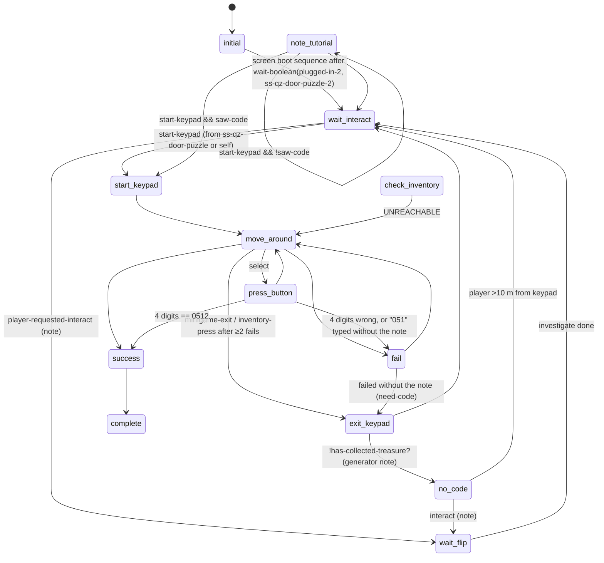
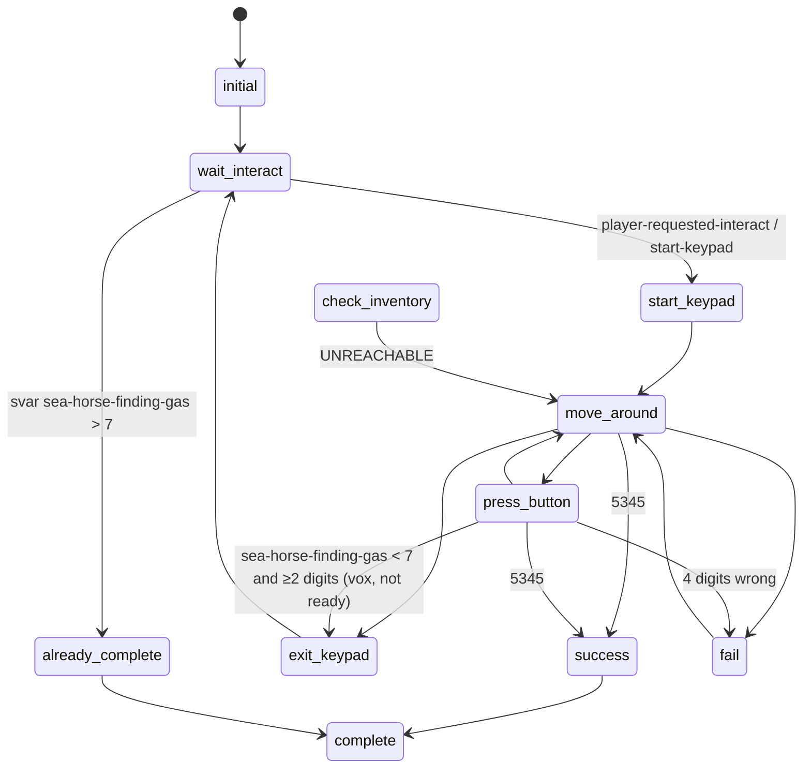
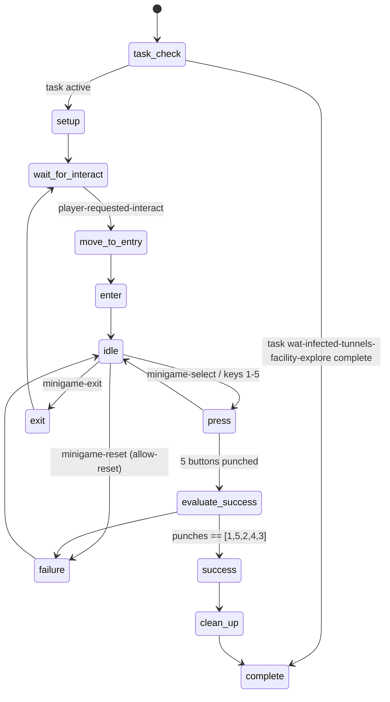
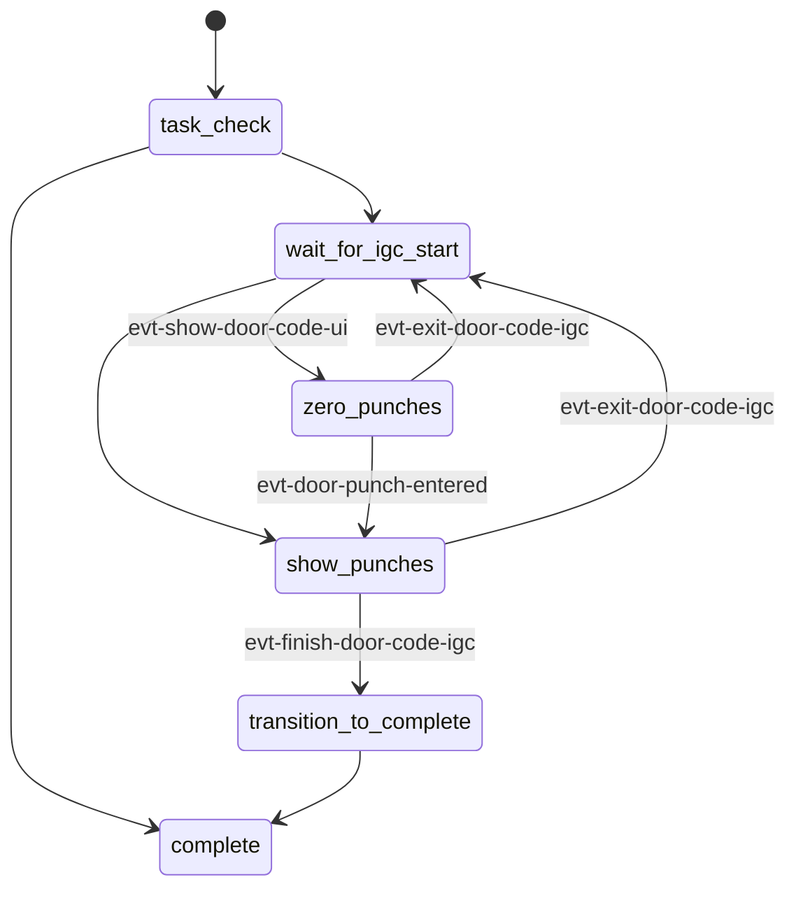
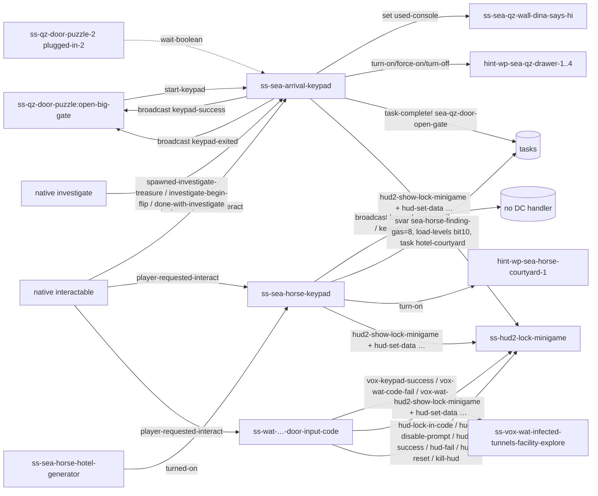

# Keypads / code doors — TLOU2R PC 1.6

Scope: every DC script that implements a code-entry device other than the dial safes:

| Script | Where | Device | Code (CONFIRMED in DC) | Note that holds the code |
|---|---|---|---|---|
| `ss-seattlearrival/ss-sea-arrival-keypad` | Seattle Day 1, QZ wall main gate (`seattle-arrival / sea-qz-door-open-gate`) | 12-key keypad on console `obj-12916` + computer screen | **0512** (`code-length > 3 && code-num == 512`) | `collectible-sea-qz-generator-note` (code on the note's **back**, `HUD_COL_NOTE_SEA_QZ_GENERATOR_BACK`) |
| `ss-seattlearrival/ss-sea-horse-keypad` | Seattle hub, hotel courtyard gate (`obj-sea-horse-keypad-1`) | 12-key keypad, needs generator power | **5345** (`=f(code-num, 5345.0)`) | passes `collectible-sea-qz-generator-note` to the HUD (unused); gated by svar progress, not by a note |
| `ss-watchtower/ss-wat-infected-tunnels-door-input-code` | Capitol Hill / Watchtower infected tunnels facility door | 5 mechanical push buttons, each pressed once | **1-5-2-4-3** (data `wat-door-input-code--correct-code`, d-array of 5 boxed i32) | `collectible-wat-doorcode-soda` (also `collectible-wat-doorcode`) |
| `ss-watchtower/ss-wat-infected-tunnels-door-input-code-ui` | same door, IGC overlay of punches | UI-only state script | — | — |
| `ss-seattlearrival/ss-qz-door-puzzle` | QZ gate puzzle controller | Sends `start-keypad`, waits for `keypad-success` | — | — |

Instance table: `keypad_instances.json` (this folder). Shared HUD and safe details: `../safes/README.md`.
Labels: **CONFIRMED**, **HIGH**, **INFERRED**, **UNKNOWN**.

Unlike the dial safes, **all keypad codes are hardcoded in the level's own DC script**, either as a float literal compared with
`=f` or as a DC data array. No spawner tags are involved, so they can be changed by patching DC alone.

---

## 1. Overview & files

* There is no generic keypad script. Each keypad is a bespoke level script. The two Seattle keypads are near-copies sharing the
  same skeleton: `initial → wait-interact → start-keypad → move-around ⇄ press-button → fail/success/exit-keypad`, plus a dead
  `check-inventory`.
* All three use the **same HUD widget as safes** (`hud2-show-lock-minigame` → `hud-minigames/hud-lock/lock-root`, state script
  `ss-hud2-lock-minigame`), in two different modes:
  * **"hack prompt-stack" mode** (Seattle keypads): `hud2-set-lock-minigame-data(w, self, 0, 1, 0, <note>, is-tumbler=0, hack=1)`.
    The HUD only shows the **button prompt stack**. The combo row (`comboAndLine`) is hidden and no numbers are sent.
    The digits appear on the in-world screen through shader params instead (`*sea-qz-computer-screen-asterisks*`).
  * **"keypad" mode** (Watchtower): `hud2-set-lock-minigame-data(w, int-…-door-input-code-1, 0, total=5, wat-door-input-code--punches, 0, 0, 0)`.
    It shows 5 single-digit slots plus the CONFIRM/RESET/BACK prompts, and uses `hud2-lock-minigame-submit-input`, `hud2-disable-lock-minigame-prompt`,
    `hud2-win/fail/reset-lock-minigame`. The input darray is also passed as `prior-state-darray`, so the HUD can rebuild entered
    digits (`restore-lock-minigame-to-prior-state`).
* Key highlight on the Seattle keypads is a **world particle**: `spawn-particles-at-joint(key-outline, obj, <joint>, …)` on joints
  `delete, zero, enter, number_1..9`, tinted `t2-white`. Watchtower uses `wat-tunnels-update-highlight-part`.

## 2. State machines

### 2.1 `ss-sea-arrival-keypad` (`options { player sea-arrival-wall-script }`)


`note-tutorial` is only entered from inside itself, so it is unreachable in 1.6, and so is `check-inventory` (no `go`). (CONFIRMED)

### 2.2 `ss-sea-horse-keypad`



### 2.3 `ss-wat-infected-tunnels-door-input-code`



### 2.4 `ss-wat-infected-tunnels-door-input-code-ui`

None of its events (`evt-show-door-code-ui`, `evt-door-punch-entered`, …) has a DC sender. They probably come from IGC or animation
data, or this is an older UI path that 1.6 no longer drives (UNKNOWN).

## 3. Per-state call graphs

### 3.1 `ss-sea-arrival-keypad`
```
initial
 ├─ track screen: all console shader tables → 0 (glow, text-scroll, static-text, asterisks, amber, big-red, big-green)
 │   wait-boolean(plugged-in-2, 1, ss-qz-door-puzzle-2)   (power puzzle)            [CONFIRMED]
 │   amber/red/glow on; boot animation of text-scroll/static-text in 0.1 s steps; underscores 0.88; go(wait-interact)
 ├─ track teach-flip: wait teach-flip? → ignore-exit? on collect-sea-hub-generator-note-1,
 │   hud2-set-investigate-prompts-disabled(4096,1), block investigate-exit until the note is flipped,
 │   hud2-set-investigate-flip-prompt-flashing
 └─ events: investigate-begin-flip → flipped-note=1; player-requested-interact → teach-flip?=1; start-keypad → really-start=1
wait-interact
 ├─ interactable-enable(int-sea-lever-gate-2); if really-start → send-event(start-keypad, self)
 ├─ start-keypad → set used-console on ss-sea-qz-wall-dina-says-hi-1; go(start-keypad)
 ├─ player-requested-interact ×4 (drawers/note; turn off hint-wp-sea-qz-drawer-1..4, first-drawer?, go(wait-flip))
 ├─ done-with-investigate → turn-on/force-on hint waypoints 2/3; hint-displayed/show-awhile/toggle-hint4 hint plumbing
 └─ spawned-investigate-treasure → saw-code = 1 if near-keypad
wait-flip: investigate prompts disabled except flip; wait until flipped; saw-code = flipped && near-keypad; go(wait-interact)
no-code
 ├─ vox-no-code? = 1; interactable-disable(int-sea-lever-gate-2)
 ├─ say(player, vox-igc-ell-gam-sea-qz-door-open-gates-keypad-slf-001)
 ├─ hint: has-collected-treasure?(collectible-seattle-map) ? (drawer-1 unopened ? hint drawer-1 : drawer-3) : hint drawer-4
 └─ wait until player >10 m away → interactable-enable; go(wait-interact)
start-keypad
 ├─ set-high-contrast-mode-type(obj-12916, 5)
 ├─ wait-player-move-to-entry(sea-qz-keypad-enter--ellie, spawner-locator(self,1), …, apReference-camera1, apReference, …)
 ├─ screen shader params; camera-enable-animated(2.00, -1.00, 1, 1000, 0,0,0)
 ├─ animate_(obj-12916, sea-qz-keypad-enter--console) + wait-animate_(player, sea-qz-keypad-enter--ellie); idle pair
 ├─ w = hud2-show-lock-minigame(); hud2-set-lock-minigame-data(w, self, 0, 1, 0, collect-sea-hub-generator-note-1, 0, 1)
 └─ go(move-around)
move-around
 ├─ start: map selected-num → joint {0 delete, 1 zero, 2 enter, 3-5 = 7 8 9, 6-8 = 4 5 6, 9-11 = 1 2 3};
 │         highlight = spawn-particles-at-joint(key-outline, obj-12916, joint …); set-effect-color-vec(t2-white);
 │         arrival-keypad-minigame-speak-tts(selected) (ACCESSIBILITY_KEYPAD_ENTER / _DELETE / number)
 ├─ update: show-tts-text--arrival-keypad/f (environment-reads: world-space loc text INTERACT_LOC_QZ_MAIN_GATE / _SCREEN_PASSWORD)
 │   inventory-press && fail-count > 1 → exit-to-look-at-col = 1, go(exit-keypad)
 │   d-pad / menu dirs (weapon-cross-*) → move finger-pos on a 3×4 grid: selected = 3·x + 3·floor(4·y)
 │   minigame-select | menu-select: delete → code-num = floor(code-num/10), length-1;
 │       enter → length > 3 && code-num == 512 ? go(success) : go(fail);
 │       digit d → if length ≤ 3: code-num = code-num·10 + d, ++length;  then go(press-button)
 │   minigame-exit → go(exit-keypad)
 └─ options-menu-changed → recolor highlight
press-button
 ├─ animate_(obj-12916, keypad-press-anim) + wait-animate_(player, ellie-press-anim)  (per-key anim pair); idle pair
 ├─ set-table-shader-material-values-param(*sea-qz-computer-screen-asterisks*, 0.25·length)  (screen shows *)
 ├─ if length > 2 && code-num == 51 && !has-collected-treasure?(collectible-sea-qz-generator-note) → go(fail)  (anti-guess)
 ├─ elif length > 3 && code-num == 512 → go(success); elif length > 3 → go(fail); else go(move-around)
 └─ track haptics: play-hfx-id(hfx-photobooth-button-press)
fail
 ├─ kill-particles; selected-num = 7; anim keypress-03 → sea-qz-keypad-fail--console/--ellie → idle
 ├─ code-num = 0; length = 0; if has note → ++fail-count
 ├─ no note → need-code = 1, go(exit-keypad)
 ├─ fail-count > 1 → hud-play-tutorial(HUD_TUT_TOUCHPAD_COLLECTIBLES, 6.0, …, inventory-open);
 │     fact-set-bool-safe(player, collectibles-tutorial-active?, 1); start-timer(clear-fact-bool-timer, 6.5)
 ├─ go(move-around)
 ├─ track string: screen flicker (asterisks/static/text-scroll); with note → wait-say(…keypad-fail-slf-001)
 └─ track haptics: play-hfx-id(climb-hand-right-light-rumble-settings)
success
 ├─ hud2-hide-lock-minigame(w,1); kill-particles; keypress-03 anim
 ├─ broadcast-event(keypad-success, boxed_symbol(self))     → wait-for-event in ss-qz-door-puzzle:open-big-gate
 ├─ sea-qz-keypad-succeed--console/--ellie; camera-fade-out-animated(2.0)
 ├─ task-complete!(seattle-arrival, sea-qz-door-open-gate)                [CONFIRMED persistence]
 ├─ screen: big-red 0 → big-green 1; haptics hfx-san-button-press + push-haptic-hard-impact
 └─ go(complete)
exit-keypad
 ├─ hud2-hide-lock-minigame(w,1); kill-particles; sea-qz-keypad-exit--console/--ellie (speed 0.4 if leaving to read the note)
 ├─ camera-fade-out-animated(2.0); broadcast-event(keypad-exited, self)   → ss-qz-door-puzzle:open-big-gate
 ├─ !has-collected-treasure?(generator note) → go(no-code)
 ├─ exit-to-look-at-col → wait 0.1, menu2-push-player-menu(2)  (opens the collectibles tab)
 └─ go(wait-interact)
--all--: clear-fact-bool-timer → fact-set-bool-safe(player, collectibles-tutorial-active?, 0)
check-inventory (UNREACHABLE): paper-reach anim → player-force-quick-investigate(0) → Investigate on
 player-set-quick-inspect-treasure/f(collectible-sea-qz-generator-note) → paper-return → go(move-around)
```

### 3.2 `ss-sea-horse-keypad` (differences from 3.1)
```
initial: animate_(obj-sea-horse-keypad-1, sea-hub-keypad-enter--keypad); *general-keypad-{red,green}-lights*, *-lights-progression* = 0
wait-interact
 ├─ svar sea-horse-finding-gas > 7 → go(already-complete)
 ├─ during sea-hub-explore with finding-gas < 7: interactable-set-unavailable + override-interact-def(int-sea-horse-keypad-1,
 │     interact-needs-power-npc-blockable)
 ├─ wait-for-event(turned-on)   ← ss-sea-horse-hotel-generator:dina-turns-on        [CONFIRMED]
 ├─ prioritize-texture-streaming-for(sea-hub-keypad); red lights on;
 │   loop: play-sound-at-joint(sfx-igc-sea-hub-keypad--wait-interact, obj, light_b) every 0.74 s while finding-gas == 7
 └─ approach-keypad → enter anim; player-requested-interact / start-keypad → go(start-keypad)
start-keypad: set-svar-as-boolean(sea-horse-hotel-keypad-tried, 1); wait-player-move-to-entry(sea-hub-keypad-enter--ellie,
 pos-sea-horse-keypad-2…); camera-enable-animated(2.0,…); hud2-show-lock-minigame + set-data(…, collectible-sea-qz-generator-note, 0, 1);
 camera-shake(camera-mocap-idle-small) in update
move-around/press-button: same grid; play-sound-at-joint(sfx-igc-sea-hub-keypad--select-ui|--select-beep); finding-gas < 7 and
 length > 1 → say(vox-igc-ell-gam-temp-sea-hub-explore-intro-slf-006), exit; code 5345 → success
fail: sfx-igc-sea-hub-keypad--fail-beep; same collectibles-tutorial fact after 2 fails
success: hud2-hide-lock-minigame; set-svar(sea-horse-finding-gas, 8); set-svar-bit(sea-horse-load-levels, 10, 1);
 task-set-active-continue!(hotel-courtyard,…); broadcast-event(keypad-success, self); sfx …--success-beep;
 send-event(turn-on, hint-wp-sea-horse-courtyard-1); Dina/Ellie vox open-checkpoint-gate-001; go(complete)
exit-keypad: hide HUD; broadcast keypad-exited; finding-gas < 7 → …; exit-to-look-at-col → menu2-push-player-menu(2) /
 menu2-set-desired-player-menu-tab/f(2)
```

### 3.3 `ss-wat-infected-tunnels-door-input-code`
```
task-check / setup → wait-for-interact
 ├─ override-player-instance-flags; set-instance-flag-hero; interactable-enable(int-…-door-input-code-1)
 ├─ tried-door && !has-collected-treasure?(collectible-wat-doorcode-soda) → interactable-set-exclude-from-pickup-scan(…, 1)
 │   (stops the keypad from stealing pickup-scan focus once tried without the note; INFERRED intent)
 ├─ wat-tunnels-exclude-pickup-scan-in-locked-room(1)  (13 pickups behind the door)
 └─ player-requested-interact → interactable-disable; door-disable-systemic-high-contrast-mode-update; go(move-to-entry)
move-to-entry: player-clear-look-at; wait-player-move-to-entry(…) → go(enter)
enter: camera-enable-animated(1.80, …); intro anims (--door / --ellie);
 w = hud2-show-lock-minigame(); hud2-set-lock-minigame-data(w, int-…-1, 0, 5, wat-door-input-code--punches, 0, 0, 0);
 tried-door = 1; go(idle)
idle (update)
 ├─ minigame-reset && allow-reset → resetting? = 1, go(failure)
 ├─ keyboard 1-5 (keys 49-53 and 129-133, filtered by keypad-allow-key-range? against minigame-select/exit/reset bindings)
 │     → wat-tunnels-door-press-button(n) → joypad-force-command(minigame-select)
 ├─ minigame-select | menu-select → go(press)
 ├─ up/down (menu, stick ±0.5) → wat-tunnels-door-change-selection(±1) (skips pressed buttons), wat-door-code--TTS,
 │     play-sound-at-joint(sfx-igc-wat-infected-tunnels-facility-explore-punch-door--ui-select, door, button_3)
 └─ minigame-exit → go(exit)
press: animate_(door, "wat-infected-tunnels-door-input-code-<n>-press--door") + wait-animate_(player, "<n>-press--ellie");
 wat-tunnels-door-punch-input: wait 21 frames, set-animation-speed(door, 0) (button stays in), play-hfx-id(hfx-photobooth-button-press)
 | rumble-curve; pressed-n = 1; darray-append(punches, n); hud2-lock-minigame-submit-input(w, n, count);
 hud2-disable-lock-minigame-prompt(w, 0, count == 0)
 → count == 5 ? go(evaluate-success) : go(idle)
evaluate-success: foreach i: punches[i] == wat-door-input-code--correct-code[i] (1,5,2,4,3) else go(failure); go(success)
success: hud2-win-lock-minigame(w); open anims; camera-fade-out-animated(1.80);
 log-event("wat-infected-tunnels-door-input-code success"); send-event(vox-keypad-success, ss-vox-wat-infected-tunnels-facility-explore-1)
 → clean-up → complete
failure: hud2-fail-lock-minigame(w) (unless just a reset); fail anims; darray-clear(punches); hud2-reset-lock-minigame(w);
 log-event("… failure"); send-event(vox-wat-code-fail, …); go(idle)
exit: send-event(vox-wat-code-exit, …); hud2-hide-lock-minigame(w,1); camera-fade-out-animated(1.0); go(wait-for-interact)
```

## 4. Answers to the specific questions

* **Shared with safes?** Partly. They share the **HUD widget and its script** (`ss-hud2-lock-minigame`, `hud2-*` wrappers), the
  entry helper (`wait-player-move-to-entry` + `apReference-camera1`), animated camera (`camera-enable-animated` /
  `camera-fade-out-animated`), the `use-esc-for-back/f` / `hud2-hide-health-ammo/f` boilerplate, the investigate-based note
  reading and the dead `check-inventory` pattern (`player-force-quick-investigate` + `player-set-quick-inspect-treasure/f`).
  They share **no logic**: keypad code checking is per script, and safe code checking is in `ss-tumbler-safe`. (CONFIRMED)
* **Combination system:** none shared. The two Seattle keypads use a float accumulator `code-num = code-num·10 + d` (max 4 digits) and a
  literal `=f` compare. Watchtower uses a DC d-array compared in order. (CONFIRMED)
* **Inventory code knowledge:** as with safes, it is a **collected treasure** (`has-collected-treasure?`), with no svar or fact.
  Keypads use it more than safes do:
  * QZ keypad: fails "051…" without the note; a failed attempt without the note kicks you out to `no-code` with hint waypoints
    to drawers; `saw-code` tracks whether the note's back was flipped near the keypad.
  * Watchtower: pickup-scan exclusion.
  * Hub keypad: gated on progress svar `sea-horse-finding-gas == 7` plus generator power instead.
  (CONFIRMED)
* **Notes:** QZ note `collectible-sea-qz-generator-note` is one of the 3 `*quick-access-treasures*` (touchpad quick view) together
  with the two Seattle maps. That is why after 2 fails the keypad shows `HUD_TUT_TOUCHPAD_COLLECTIBLES` and sets player fact
  `collectibles-tutorial-active?` for 6.5 s. (CONFIRMED data + code)
* **World flags:** QZ: `wait-boolean(plugged-in-2, ss-qz-door-puzzle-2)`, `set-boolean(used-console, ss-sea-qz-wall-dina-says-hi-1)`,
  `task-complete!(seattle-arrival, sea-qz-door-open-gate)`. Hub: svars `sea-horse-finding-gas` (→8),
  `sea-horse-load-levels` bit 10, `sea-horse-hotel-keypad-tried`, task `hotel-courtyard`. Watchtower: task
  `watchtower / wat-infected-tunnels-facility-explore` (complete → script skips to `complete`). (CONFIRMED)
* **Keypad HUD:** no dedicated keypad widget. It reuses `lock-root`: the Seattle keypads use prompts only (hack mode,
  `is-keypad?` true → combo hidden, pivot +500 px), Watchtower uses 5 digit slots. Digits show on the **world screen** for
  Seattle (shader params) and in the HUD slots for Watchtower. No menu2 page is involved except `menu2-push-player-menu(2)`
  (collectibles tab) on "look at note" exit. (CONFIRMED)

## 5. Engine boundary
* **DC:** all states, code values, grid navigation, HUD event protocol, shader-param screen, vox, tasks and svars.
* **DC data:** `wat-door-input-code--correct-code`, `wat-door-input-code--punches` (d-arrays), `*sea-qz-*` and `*general-keypad-*`
  shader tables, `aud-sfx-obj-keypad.bin` (`sfx-igc-sea-hub-keypad--*`), `*quick-access-treasures*`.
* **Native:** interactables (`player-requested-interact`), `has-collected-treasure?`, `spawn-particles-at-joint`, `set-effect-color-vec`,
  shader param setters, `keyboard-button-pressed?`, `joypad-key-from-command`, `joypad-force-command`, `menu2-push-player-menu`,
  `fact-set-bool-safe` target storage, animation and camera, `play-hfx-id`, investigate state.
* **Level data:** keypad prop/console placement, entry locators (`spawner-locator(self,1)`, `pos-sea-horse-keypad-2`), hint
  waypoints. The QZ keypad's console animations probably carry its sounds, since that script makes no `play-sound` call (INFERRED).

## 6. Events in/out and graph



## 7. Persistence

| Key | Script | Effect |
|---|---|---|
| task `seattle-arrival / sea-qz-door-open-gate` | QZ keypad success | gate open is persisted through task progress (initial resets `saw-code` while the task is active) |
| svar `sea-horse-finding-gas` (7 → 8) | hub keypad success | `> 7` → already-complete on load |
| svar bit `sea-horse-load-levels` #10 | hub keypad success | level streaming flag (INFERRED) |
| svar `sea-horse-hotel-keypad-tried` | hub keypad start | read elsewhere (vox/hints, INFERRED) |
| task `watchtower / wat-infected-tunnels-facility-explore` | Watchtower door (read) | complete → skip |
| player fact `collectibles-tutorial-active?` | both Seattle keypads | temporary (6.5 s timer) |
| The Watchtower door itself writes no svar or task. On reload mid-task the door is locked again (INFERRED from task-check) | | |

## 8. Animation / camera / UI / audio hooks
* **Anims:** paired player and prop sets: `sea-qz-keypad-{enter,idle,keypress-NN,fail,succeed,exit,paper-reach,paper-return}--{ellie,console}`;
  `sea-hub-keypad-*--{ellie,keypad}`; `wat-infected-tunnels-door-input-code-{intro,<n>-press,<n>-idle,all-idle,open,fail}--{ellie,door}`.
* **Camera:** `camera-enable-animated(2.0|1.8, -1, 1, 1000…)`, `camera-fade-out-animated(2.0|1.8|1.0)`, `camera-shake(camera-mocap-idle-small)` (hub).
* **UI:** lock HUD prompt stack (`HUD_LOCK_MINIGAME_CONFIRM/RESET/LOCK_IN`, `MENU_COLLECTIBLES_BACK_PROMPT`), world-space
  `hud-localization/loc-text-root` labels (environment reads), key-outline particle, high-contrast mode 5, tutorials
  `HUD_TUT_TOUCHPAD_COLLECTIBLES` (and dead `HUD_TUT_HOLD_TOUCHPAD`), investigate prompt masks 4096/2048/1024.
* **Audio:** hub `sfx-igc-sea-hub-keypad--{wait-interact,select-ui,select-beep,fail-beep,success-beep}` (script);
  bank `aud-sfx-obj-keypad` also lists `--enter-cloth/--exit-cloth/--fail-bang/--select-press-key…` (animation-driven, INFERRED);
  Watchtower `sfx-igc-wat-infected-tunnels-facility-explore-punch-door--ui-select`. Haptics `hfx-photobooth-button-press`,
  `hfx-san-button-press`, `push-haptic-hard-impact`, `climb-hand-right-light-rumble-settings`. TTS `ACCESSIBILITY_KEYPAD_*`.
* **Telemetry:** only Watchtower logs (`log-event("wat-infected-tunnels-door-input-code success|failure")`).

## 9. Shared components
The HUD lock widget and its event protocol, `wait-player-move-to-entry`, animated camera, the investigate/collectibles system,
accessibility TTS. Drawers (`sea-qz-cabinet-drawer-1` `has-been-opened?` is read for the hint choice) and the hint-waypoint
system. No component is shared with the safe's dial math, svars or trophy logic.

## 10. Confidence table
| Claim | Label |
|---|---|
| Codes 0512 / 5345 / 1-5-2-4-3 hardcoded in DC | CONFIRMED |
| Keypads reuse `ss-hud2-lock-minigame` (two modes) | CONFIRMED |
| `check-inventory` (both Seattle keypads) and `note-tutorial` unreachable | CONFIRMED |
| "051" anti-guess without note | CONFIRMED |
| Keypad SFX for QZ come from animations | INFERRED |
| `-ui` script events sent by IGC data | UNKNOWN |
| Multiple same-event `player-requested-interact` blocks in one state are told apart by interactable binding | UNKNOWN (no filter in dcpl/asm listing) |

## 11. Open questions
1. How DC tells apart the several `event player-requested-interact` blocks in one state (QZ keypad has 4 in `wait-interact`).
2. Senders of the Watchtower `-ui` events.
3. Whether any other code doors exist only in level/IGC data (no other DC script calls `hud2-show-lock-minigame`).

## 12. Modding surface
| Change | Rating | Why |
|---|---|---|
| Change a keypad code | GREEN | Float literal (`512`, `5345`) or DC d-array (`wat-door-input-code--correct-code`) inside the script file |
| Remove the note requirement on QZ | GREEN | Drop the `051` and `need-code` branches |
| Show typed digits on HUD for Seattle keypads | YELLOW | Switch to keypad mode (hack=0, total=4) and call `hud2-lock-minigame-submit-input`; widget support already exists |
| New keypad elsewhere | ORANGE | Needs a new DC script plus level placement of prop, locators and interactable |
| Change keypad layout/visuals | RED | Prop meshes, shaders and GUI2 layout assets |
