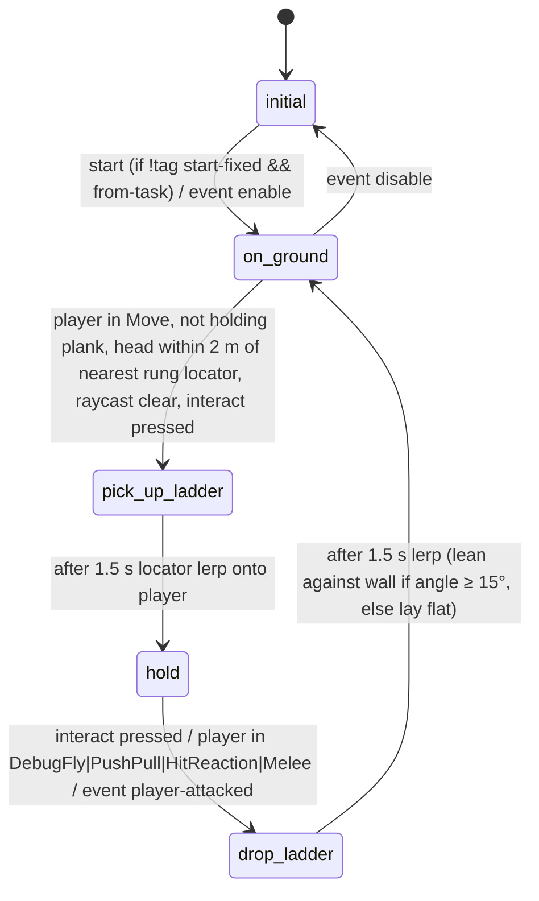
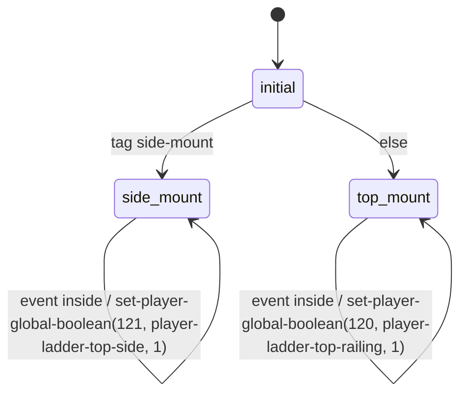
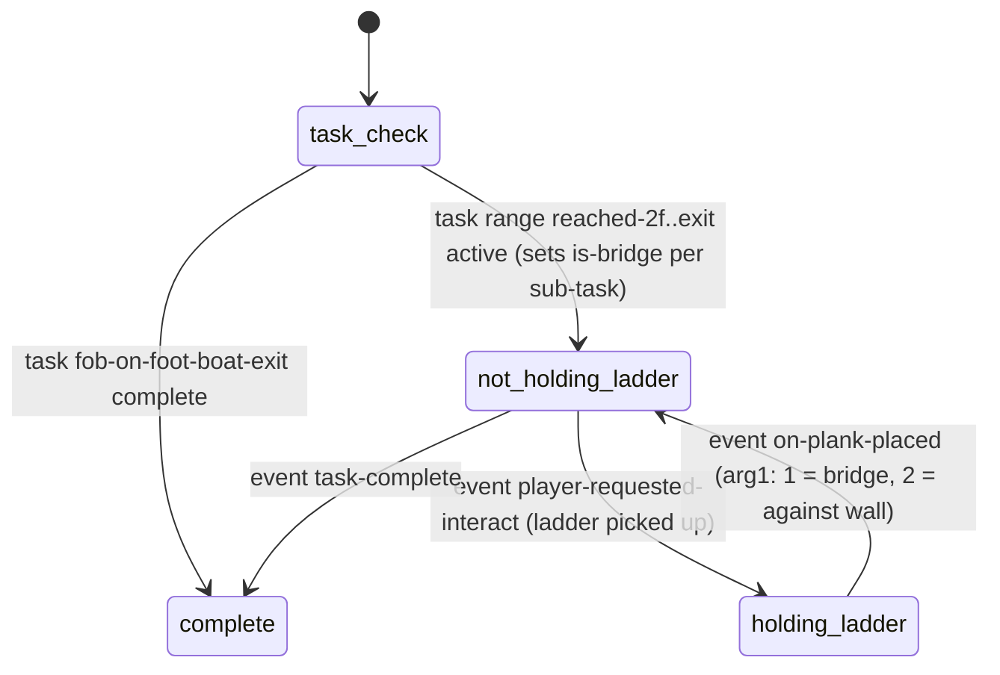
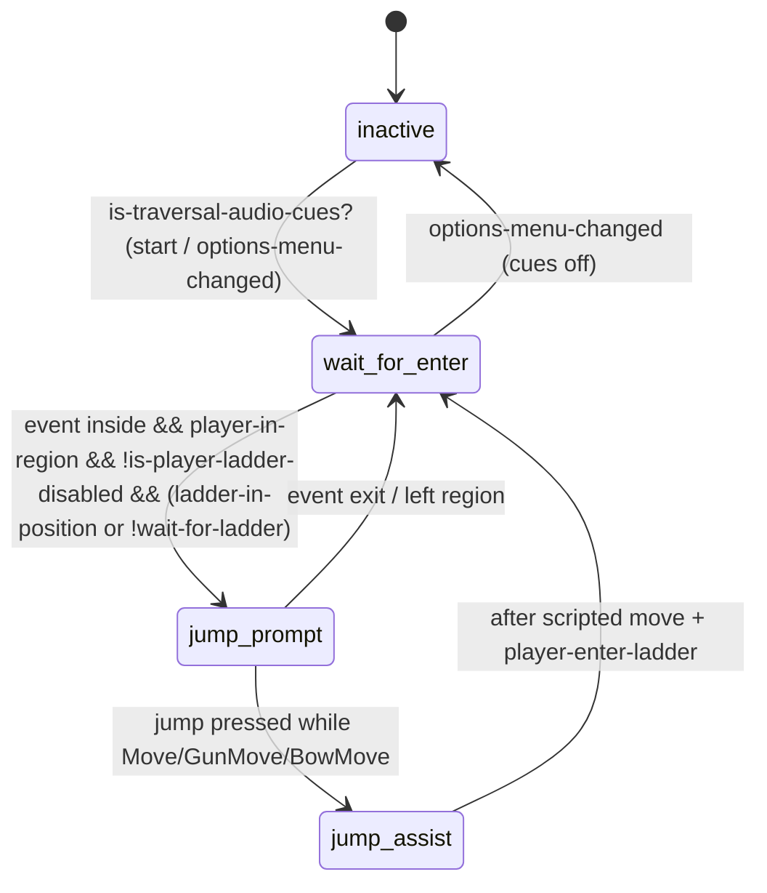
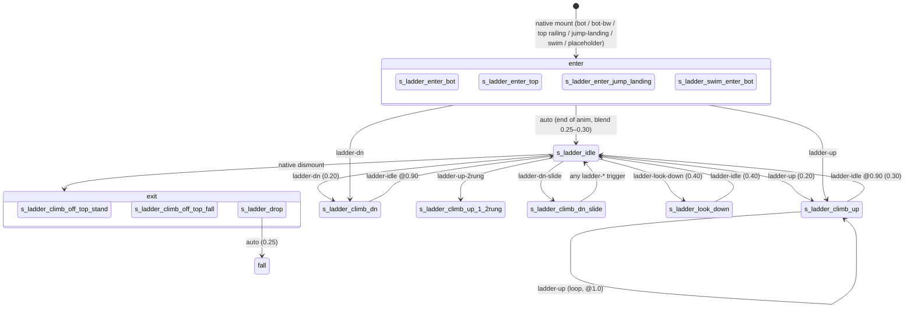

# Ladders, Climbing & Traversal — native `Ladder` state, `anim-player-ladder-states`, carried ladders

> Source analysed: TLOU2R PC 1.6 `bin.psarc` → `dc1/` (dconstruct 2.2.0 `.asm`/`.dcpl`, private). Anim-graph data
> extracted with `tools/analysis/traversal_asl.py` (new helper; parses dconstruct `.asm` data trees) →
> [`traversal_anim_graphs.json`](traversal_anim_graphs.json). State machines cross-checked with
> `databases/state_scripts.json` (`q.py ss`).
>
> Labels: **CONFIRMED** = read directly from code/data · **HIGH** = high confidence · **INFERRED** · **UNKNOWN**.

## 1. Overview & files

TLOU2's ladder/climb/traversal stack has **three layers**, and almost nothing about the climb itself is script:

| layer | where | what it holds | evidence |
|---|---|---|---|
| **Native player controller** | engine (no DC) | player states `Ladder`, `LedgeClimbUp`, `LedgeDrop`, `Edge`, `EdgeClimbUp`, `WallShimmy`, `FallingGrab`, `Jump`, `Fall`, `SqueezeThrough`, `Carry`, `BalanceFall`; ladder/edge detection; mount/dismount; rung stepping; IK solving | 51 script queries `player-in-state?(Ladder)`, 205 of `SqueezeThrough`, 8 `LedgeClimbUp` … (CONFIRMED as queried names; implementation native) |
| **Animation definition (data)** | `anim-player/player-ladder.bin`, `player-climb.bin`, `player-edge.bin`, `player-edge-climb.bin`, `player-jump.bin`, `player-squeeze-through.bin`, `player-carry-plank.bin`, `player-parametric-climb-sets.bin`, `player-climb-anims.bin`, `anim-character/character-ladder.bin`, `camera.bin` | actor-state-lists (anim state graphs), anim variant lists, subsystem sub-state tags, transition triggers/blend times, per-state dynamic flags, camera strafe settings | CONFIRMED (data-only modules; `.dcpl` holds only tiny embedded lambdas) |
| **DC state scripts (level / puzzle glue)** | `ss-t2/ss-basic-ladder`, `ss-t2/ss-t2-ladder-top-rgn`, `ss-t2/accessibility/ss-accessibility-jump-to-ladder`, `ss-forwardbase/ss-fob-on-foot-boat-ladder-controller`, `…-puzzle-ladder`, many `ss-*` hint/vox/IGC scripts | enabling/disabling ladders, top-mount hints, accessibility assists, carried-ladder (plank) placement, collision/nav for movable ladders, tutorials | CONFIRMED |

Key files (sizes are `.asm`/`.dcpl`):

| file | type | notes |
|---|---|---|
| `anim-player/player-ladder.bin` | data (20 states) | `anim-player-ladder-states`, every state tagged `CharacterLadder` subsystem |
| `anim-character/character-ladder.bin` | data | 6 `symbol-array` anim variant lists (idle, look-down, climb-up/dn, 2-rung up/dn) |
| `anim-player/player-climb.bin` | data (10 states) | `CharacterLedgeClimbUp` clamber states |
| `anim-player/player-edge.bin` / `player-edge-climb.bin` | data (39 / 116 states) | ledge hang, shimmy, jump, corner; directional hand-over-hand climb, dyno |
| `anim-player/player-jump.bin` | data (46 states) | jump-long, wall-jump, piton (U4 leftover), jeep-climb, horse-jump |
| `anim-player/player-parametric-climb-sets.bin` | data | 3 `array*` of `param-anim` — `piton-reach{3,5}-{N}o-stab-end[-fail]` (11 each) |
| `player-climb-anims.bin` | data | `*player-climb-info*` (`climb-info` → `climb-ref-array` of 11 reach refs), `*hail-mary-climb-timer*`=1.80, `*stamina-mid-tell-stamina-threshold*`=80, lean curves, `*piton-slide-settings*` |
| `anim-player/player-squeeze-through.bin` | data (1 state) | single placeholder state; anims chosen natively |
| `anim-player/player-carry-plank.bin` | data (3 states) | `s_pickup-plank-single`, `s_putdown-plank-single`, `s_pickup-plank-partial` (bindpose placeholders) |
| `ss-t2/ss-basic-ladder.bin` | **state script** | prototype "pick up a ladder and lean it on a wall" object (`pick-up-ladder` lives here) |
| `ss-forwardbase/ss-fob-on-foot-boat-ladder-controller.bin` | state script | the shipped movable ladder (Abby, boat-shop puzzle) — a **plank** carry object |

## 2. State machines

### 2.1 `ss-basic-ladder` (object script, `options { player }`) — CONFIRMED

The ladder **object** state machine the brief refers to (`rg -l pick-up-ladder` → only this file). Its only reference
outside itself is `modules.bin` (no script spawns it by name; it is assigned in level data — INFERRED). The shipped
game's carryable ladder uses the native plank system instead (§2.3), so treat this as a prototype/alternate path.



### 2.2 `ss-t2-ladder-top-rgn` (region script) — CONFIRMED



### 2.3 `ss-fob-on-foot-boat-ladder-controller` (shipped movable ladder) — CONFIRMED



`ss-fob-on-foot-boat-puzzle-ladder` (`setup → track-ladder → complete`) tracks *where* the ladder was placed
(`ladder-on-1f/2f`, `ladder-bridge-to-boat/catwalk`) from the same `on-plank-placed` event and sends
`player-made-bridge-to-boat` / `restart-puzzle-hint-timer` (CONFIRMED, `q.py ss`).

### 2.4 `ss-accessibility-jump-to-ladder` — CONFIRMED



### 2.5 Animation graph `anim-player-ladder-states` (data, 20 states) — CONFIRMED

Every state carries a `subsystem-state-info { CharacterLadder, <sub-state> }` and a `character-ladder-state-info`.
Sub-states: `character-ladder-state-enter` (6 enter states), `-idle` (2), `-move` (9), `-exit` (3).



Full table of anims/transitions/flags: `traversal_anim_graphs.json` → `anim-player-ladder-states`.

## 3. Per-state call graph

### `ss-basic-ladder` (`!` = native)

```
initial
 ├─ start: if !tag-boolean(start-fixed) && from-task → go(on-ground)          [CONFIRMED]
 └─ event enable → go(on-ground)
on-ground
 ├─ set-boolean(from-task, 0) · enable-collision(self, 1, 0, 0.0) → send physicalize   [CONFIRMED]
 └─ loop (per frame, only while player-in-state?(Move)! && !player-holding-plank?())
     ├─ rung = ss-plank-closest-locator-on-ladder(self)
     │     = object locator + Y-axis offset clamp(dot(ladder-Y, player-head-offset), 0, 5 m), rotated 90°  [CONFIRMED]
     ├─ while distance(player+1 m, rung) < 2.0:
     │    ├─ kick-raycast(joint headb → rung, player, 5)!  · wait-raycast-hit-nothing?()!      [line-of-sight]
     │    ├─ draw-interactable-hud(interact-default, rung, 0)!                               [prompt is script-drawn]
     │    └─ joypad-command-active-and-enabled?(interact, 2)! → go(pick-up-ladder)
pick-up-ladder
 ├─ disable-collision(self, 0) → send unphysicalize
 ├─ rotated-player-loc = bound-frame(player pos, flattened camera rotation)
 ├─ wait-stub-object-lerp-locator(self, carry-pose, 1.5 s, 1, 1.0)!
 │     carry-pose = rotated-player-loc + (−0.15, 0.75, 0) rot 90° about X, − 0.5·LADDER-LENGTH along Y, rot 90° about Y
 ├─ update: joypad-disable-all-commands-except(camera)!
 └─ go(hold)
hold
 ├─ track wall-raycasts (per frame)
 │    ├─ 20 kick-raycast()! fans from player up to 0.75·LADDER-LENGTH, each reaching sqrt(L² − h²) forward (mask 6147)
 │    ├─ angle = atan2(hitY − baseY, distXZ) of hits; smoothed angle += (target − angle)·7.5·dt
 ├─ update: joypad-disable-all-commands-except(move, camera, interact)! · set-move-mode(walk)! · disable-interactable-system()!
 ├─ update: set-object-locator(self, lerp(carry-pose, lean-pose(90° − angle), lerp-scale(5..15° → 0..1)))!
 ├─ update: interact | DebugFly | PushPull | HitReaction | Melee → go(drop-ladder)
 └─ event player-attacked → go(drop-ladder)
drop-ladder
 ├─ angle < 15° → wait-stub-object-lerp-locator(self, flat on floor, 1.5 s)!
 │  else       → wait-stub-object-lerp-locator(self, current − 0.25 m Y, 1.5 s)!   [lean against wall]
 └─ go(on-ground)
```

The script never puts the player into the `Ladder` state; climbability of the placed ladder must come from the
ladder's own level/collision data (INFERRED).

### `ss-fob-on-foot-boat-ladder-controller`

```
task-check
 ├─ task-range-active?(forward-base, reached-2f .. exit) → is-bridge per sub-task;
 │    reached-boat → override-interact-def(ladder-boat-shop-puzzle-1, interact-carry-plank-far)!   [CONFIRMED]
 ├─ set-region-enabled(rgn-…-jump-to-ladder-1/2, 0)!
 └─ go(not-holding-ladder)
not-holding-ladder (start)
 ├─ orientation test: dot(z-axis of joint grab_bot_a, world-up)
 │    |dot| > 0.70 (upright → against wall)
 │      ├─ pick lower grab joint (grab_bot_x / grab_top_x by y-axis sign)
 │      ├─ wait-spawn-entity(ladder-collision-boat-shop-puzzle-1)! · set-object-locator(→ joint)! · set-body-teleport()!
 │      ├─ enable-collision(…, 1) ; if is-bridge → disable-collision(main), disable-collision(top)
 │      └─ if ladder-against-wall: loop until player-in-state?(Ladder)!:
 │           dist² < 2.25 & facing → play-accessibility-jump-sound-at-position(+1.25 m, sfx-ui-acc-interact-ladder-climb)
 │           dist² < 9.0          → …-ladder-climb-distant  (gated by enough-time-since-player-fact? 2 s)
 │    else (horizontal → bridge)
 │      └─ spawn nav-blocker-rect-fob-boat-2f-1 at lower joint + 0.37 m along z; enable-nav-blocker-object()!
 ├─ event player-requested-interact
 │    ├─ disable-collision(ladder-collision…, 0) · disable-nav-blocker-object + kill-entity(nav blocker)
 │    ├─ set-region-enabled(jump-to-ladder-1/2, 0)
 │    └─ go(holding-ladder)
holding-ladder
 ├─ override-interact-def(ladder-boat-shop-puzzle-1, interact-carry-plank)!
 ├─ disable-action-pack(tap-accessibility-jump-boat-3f-1/2) · npc-request-buddy-look(mel) (random)
 ├─ a11y loop: get-player-plank-action()! ∈ {1,2} → play sfx-ui-acc-interact-ladder-place at get-player-plank-locator()!
 ├─ update: disable-player-release-plank()!                                   [native carry rules]
 └─ event on-plank-placed (native-sent)
      ├─ arg1 == 1 && at first bridge → override-interact-def(…, interact-carry-plank-far)
      ├─ arg1 == 2 → ladder-against-wall = 1; enable-action-pack(tap-accessibility-jump-boat-3f-1/2)
      └─ go(not-holding-ladder)
```

### `ss-accessibility-jump-to-ladder`

```
jump-assist
 ├─ camera-look-at-locator(jump-target, 20, 5)!
 ├─ player-scripted-move-new(jump-start, 1, 0, 7, 0, 0)!
 ├─ wait 0.5 → player-enter-ladder(0.5, jump-target position)!      [native mount from script]
 ├─ update: joypad-disable-all-commands() · player-force-move-stick-dir(jump-start z)!
 └─ disable-camera-look-at() · cancel-player-move-to() → go(wait-for-enter)
```

## 4. Answers to the specific questions

**How do level geometry, interaction point, animation, root motion, controller, IK, physics and navigation work together on a ladder?**

1. **Geometry / detection — native, UNKNOWN details.** No DC code detects ladders. Scripts only gate the system:
   `player-disable-ladders()` (12 calls, per-frame in `update` blocks), `is-player-ladder-disabled()`,
   `player-force-ladder-climb-up()` (3), `player-enter-ladder(blend, pos)` (1), `disable-ladder-camera-pull-around()` (1)
   — all native (`functions.json` kind ≠ dc-script). For the movable ladder the climbable volume is a separately
   spawned collision entity (`ladder-collision-boat-shop-puzzle-1`, sub-collisions `main`/`top`) placed at a grab joint
   (CONFIRMED in script; that the engine reads this collision as "ladder" is INFERRED).
2. **Top-mount variant — script → controller flag.** `ss-t2-ladder-top-rgn` sets player-global booleans
   `player-ladder-top-railing` / `player-ladder-top-side` when the player is inside the region (CONFIRMED). The anim
   graph has `s_ladder-enter-top` (`ellie-ladder-enter-top-railing-bw`) so the flag almost certainly picks the
   railing/side enter (HIGH).
3. **Interaction point / prompt.** Ladders in the shipped game are **not interactables**; you climb by moving into
   them (no `interact-*ladder*` def exists in `interactable.bin`; only carried planks use `interact-carry-plank[-far]`,
   whose activation SFX is `sfx-ui-acc-interact-ladder-pickup`) (CONFIRMED absence). `ss-basic-ladder` draws its own
   prompt with `draw-interactable-hud(interact-default, …)`.
4. **Animation (data).** The native `Ladder` state drives `anim-player-ladder-states` by firing triggers
   `ladder-up`, `ladder-dn`, `ladder-up-2rung`, `ladder-dn-2rung`, `ladder-dn-slide`, `ladder-look-down`, `ladder-idle`
   (CONFIRMED trigger names; the sender is native). Variation: `character-ladder-state-info` points at a
   `*character-ladder-anim-list-…*` (4 climb-up/dn variants `-a..-d`, 2 idles `l-hand`/`r-hand`) — the controller picks
   a variant per cycle (INFERRED).
5. **Rung bookkeeping (data, INFERRED meaning).** `character-ladder-state-info` int pair = `+1/-1` for single-rung
   climb, `+2/-2` for 2-rung, `±2`/`±1` for the 1^2 / 2^1 transition states, 0 for enter/exit — looks like rung delta
   and rung step size used by the controller.
6. **Root motion / alignment.** Enter states set dynamic params `custom-motion-fade-channel-xz/-y/-rot =
   apReference-motion-fade-*` and `custom-motion-fade-block-movement-beyond-ap-plane = true` (bottom enter) — i.e. the
   enter anim's root is faded onto the ladder's AP reference (CONFIRMED values; semantics HIGH).
   Exit `s_ladder-climb-off-top-stand` sets `enable-motion-matching`, `motion-matching-suppress-change(-abort-angle 20°)`,
   `exit-move`, `character-leg-ik = false`; `-fall` sets `exit-fall` (CONFIRMED). Both use `bindpose-anim` placeholders,
   so the actual dismount anim is chosen natively (INFERRED).
7. **IK.** All climbing states wrap the anim in `anim-node-subsystem-ik[ladder-ik]` (CONFIRMED); the hand/foot solve is
   native. `ladder-ik` is also referenced by `anim-npc.bin` — buddies share it (CONFIRMED xref).
8. **Drops / exits.** `ladder-can-drop`, `ladder-can-climb-off-top`, `ladder-can-climb-off-bot` booleans per state gate
   what the controller allows (e.g. `s_ladder-climb-dn` forbids both climb-offs; `-slide` allows bottom) (CONFIRMED).
   `s_ladder-drop` (`ellie-ladder-drop-start`) auto-transitions to the generic `fall` state (0.25 s).
9. **Speed.** Embedded lambda `player-anim-speed-mult(...)` scales playback (CONFIRMED native call).
10. **Physics / nav for movable ladders — script.** Collision on/off, nav blocker spawn when the ladder is laid as a
    bridge, accessibility audio beacons (CONFIRMED in `…-ladder-controller`). The carry itself (`get-player-plank-action`,
    `get-player-plank-locator`, `disable-player-release-plank`, `set-plank-place-state`, `player-enable-plank-only-region`,
    event `on-plank-placed`) is native.
11. **Camera.** `camera.bin` has `*camera-ladder*`, `*camera-ladder-close*`, `*camera-ladder-far*`,
    `*camera-ladder-enter-top*`, `*camera-remap-ladder*`, `*camera-strafe-clamber-ladder*` — none referenced from DC
    code (CONFIRMED by `q.py uses`), so selected natively.

**Climb / clamber / edge / squeeze (summary).**
- `anim-player-climb-states` (`CharacterLedgeClimbUp` subsystem): `clamber-begin[-close] → clamber-mid[-rot] → clamber-ue`
  → `s_ledge-climb-up^vault | ^stand`; low variant `clamber-low-*`. Dynamic params: `climb-up-camera-pan-spring 2.0`,
  `climb-camera-blend-time 0.5`, `vault-pull-in` + spring 2.0, `climb-up-ik-contact-hl/hr`. Native event
  `player-ledge-climb-up-start` (11 handlers, 0 script senders).
- `anim-player-edge-states` (39) / `anim-player-edge-climb-states` (116): ledge grab/shimmy/jump/corner and
  directional hand-over-hand climbing (`climb-{up,down,rt,lt,far-*,in-90,out-90}-{rh,lh}`, `dyno-climb-*`,
  `climb-monkey-back`, `climb-edge^wall-rope-*`). Driven by triggers `ledge-climb-*`, `ledge-dyno-climb-*`,
  `ledge-shimmy-*`, `ledge-jump*`, `ledge-corner`, `reverse` (CONFIRMED). No subsystem tag — these use the generic
  `player` state-info bundle (`player-edge-state-info` etc.).
- Piton/"hail-mary" data (`*player-climb-info*`, parametric piton sets, `s_piton-*` in jump graph) is Uncharted-4
  free-climb heritage still present in data (CONFIRMED present; whether any TLOU2 level uses it: UNKNOWN).
- Squeeze-through: one placeholder anim state; native `SqueezeThrough` state; scripts enable/disable squeeze volumes by
  sending `enable`/`disable` (`enable-player-squeeze-through` = `send-event(enable, obj)`), read
  `player-get-desired-squeeze-through()` (native), and react to `player-squeeze-through` (27 handlers).
- Vault: native; `player-vault-start` event (7 handlers, e.g. `ss-modifier-player-vault-speed` boosts motion-match speed
  ×1.40 crouch / ×1.15 run / ×1.10 sprint for 8 s).

## 5. Engine boundary (DC vs data vs native)

| behaviour | DC script | data | native | confidence |
|---|---|---|---|---|
| Detect ladder, mount, rung stepping, dismount | – | trigger names, rung deltas, can-drop flags | ✔ | HIGH |
| Ladder anim selection & blending | – | ✔ `anim-player-ladder-states`, variant lists | applies graph | CONFIRMED (data) |
| Ladder hand/foot IK | – | `ladder-ik` node tag | ✔ solver | HIGH |
| Root-motion fade to AP | – | `custom-motion-fade-*` params | ✔ | HIGH |
| Top-railing vs side mount | ✔ region script sets player global | anim state exists | ✔ consumes flag | HIGH |
| Enable/disable ladders | ✔ calls | – | ✔ `player-disable-ladders` | CONFIRMED |
| Movable ladder carry & place | puzzle glue only | `interact-carry-plank*` defs, `player-carry-plank` graph | ✔ plank system, `on-plank-placed` | CONFIRMED / HIGH |
| Movable ladder collision & nav | ✔ (spawn collision / nav blocker) | – | physics/nav engine | CONFIRMED |
| Prototype ladder pick-up (`ss-basic-ladder`) | ✔ entire behaviour (raycasts, lerps, prompt) | `LADDER-LENGTH` tag | lerp/raycast primitives | CONFIRMED |
| Ladder camera | – | ✔ `*camera-ladder*` family | ✔ selection | CONFIRMED (data unreferenced by DC) |
| Accessibility audio beacons / jump assist | ✔ | `sfx-ui-acc-*` | ✔ `player-enter-ladder` | CONFIRMED |

## 6. Events in / out

| event | direction | notes |
|---|---|---|
| `on-plank-placed` (arg1 1/2) | native → scripts (11 handlers, 0 senders) | movable ladder placed as bridge / against wall |
| `player-place-plank-started` | native → 5 handlers | |
| `player-changed-state` | native → 60 handlers | e.g. `ss-sea-arrival-accessibility-ladder-camera-hack` waits for ladder mount |
| `player-climb-jump` | native → 33 handlers | |
| `player-ledge-climb-up-start` | native → 11 | |
| `player-vault-start` | native → 7 | |
| `player-squeeze-through` | native (+1 proto script) → 27 | |
| `inside` / `exit` | region system → region scripts | ladder-top-rgn, jump-to-ladder |
| `enable` / `disable` | script → `ss-basic-ladder` / squeeze objects | |
| `player-attacked` | native → `ss-basic-ladder:hold` | drops the ladder |
| `ladder-in-position` | level script → `ss-accessibility-jump-to-ladder` | |

## 7. Persistence

No ladder state is persisted by script. Movable-ladder placement is re-derived on load from task progress
(`task-check` → `task-range-active?` / `task-continue-active?(…, ladder-solved)`) plus the object's physical pose
(CONFIRMED). Plank-place state is restored with `set-plank-place-state(ladder-boat-shop-puzzle-1, 1)` in
`ss-fob-on-foot-boat-puzzle-controller:setup/already-complete` (CONFIRMED call; native semantics).

## 8. Animation / camera / UI / audio hooks

- Anim names: `ellie-ladder-*` (idle l/r-hand, climb-up/dn a–d, 2rung a/b, 1^2rung, 2^1rung, dn-slide-b,
  enter-top-railing-bw, idle^enter-fw-0-5m, jump-land, swim^enter-fw, drop-start, idle-*-lookdown).
- Camera: see §4.11; `ss-sea-arrival-accessibility-ladder-camera-hack` adjusts camera on ladder mount.
- UI: accessibility prompts via `play-accessibility-jump-sound-at-position` with `sfx-ui-acc-interact-ladder-climb[-distant]`,
  `sfx-ui-acc-interact-ladder-place`; tutorials via `hud-play-tutorial` in level scripts.
- Audio: foley `audio-sfx/foley/aud-sfx-srf-metal-aluminum-ladder.bin`, physics `aud-sfx-physics-metal-ladder.bin`.

## 9. Shared components with other systems

- `CharacterLadder` + `ladder-ik` shared with NPCs (`anim-npc.bin` embeds the same 20 `s_ladder-*` states).
- Plank carry (`interact-carry-plank`, `player-carry-plank`) is the same system as wooden planks/bridges.
- `player-in-state?(PushPull)` drops the prototype ladder → shared exclusivity with pushables.
- `edge` graph has `climb-edge^wall-rope-*` / `climb-wall-rope^edge-*` transitions into the rope system.

## 10. Confidence table

| claim | label |
|---|---|
| 20 ladder anim states, triggers, blend times, flags, IK node | CONFIRMED |
| Native `Ladder` controller fires ladder-* triggers | HIGH |
| Rung-delta meaning of `character-ladder-state-info` ints | INFERRED |
| `player-ladder-top-railing/side` select top enter variant | HIGH |
| `ss-basic-ladder` is unused prototype | INFERRED (only modules.bin ref; level placement not in DC) |
| Movable ladder = plank system; collision/nav handled by script | CONFIRMED |
| Engine treats `ladder-collision-*` as climbable | INFERRED |
| Ladder detection / geometry query internals | UNKNOWN / NEEDS NATIVE RESEARCH |

## 11. Open questions

- Which level-data property marks a collision as a ladder (and its rung spacing)?
- Exact meaning of `character-ladder-state-info` fields 0x000 (1 vs 256) and 0x01C.
- Is `ss-basic-ladder` placed in any shipped level? (needs level actor data, not in DC).
- Does anything still drive the piton / `hail-mary` climb data in TLOU2R?

## 12. Modding surface

| target | rating | reason |
|---|---|---|
| Ladder anim blend times / exit phases / can-drop flags in `player-ladder.bin` | GREEN | plain data, self-contained graph |
| Ladder anim variant lists (`character-ladder.bin`) | GREEN | symbol arrays; swap/remove variants (anims must exist) |
| Camera settings `*camera-ladder*` | GREEN | data only |
| `ss-basic-ladder` tuning (raycast count, lerp times, 15° lean threshold) | YELLOW | script edit; needs the object placed in a level |
| Region scripts (top-mount, accessibility jump assist) | YELLOW | script edits; depend on level regions/spawners |
| Movable-ladder puzzle logic (`ss-fob-…-ladder-controller`) | ORANGE | interlocks tasks, nav blockers, a11y, plank native events |
| Adding new ladders / changing detection | RED | level geometry + native controller |
