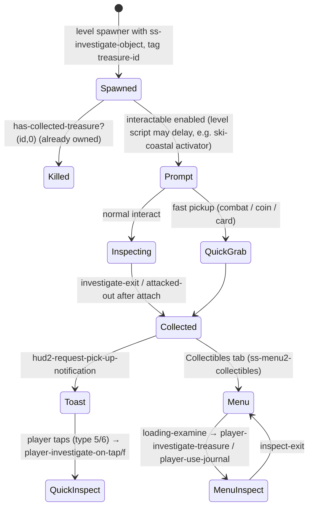
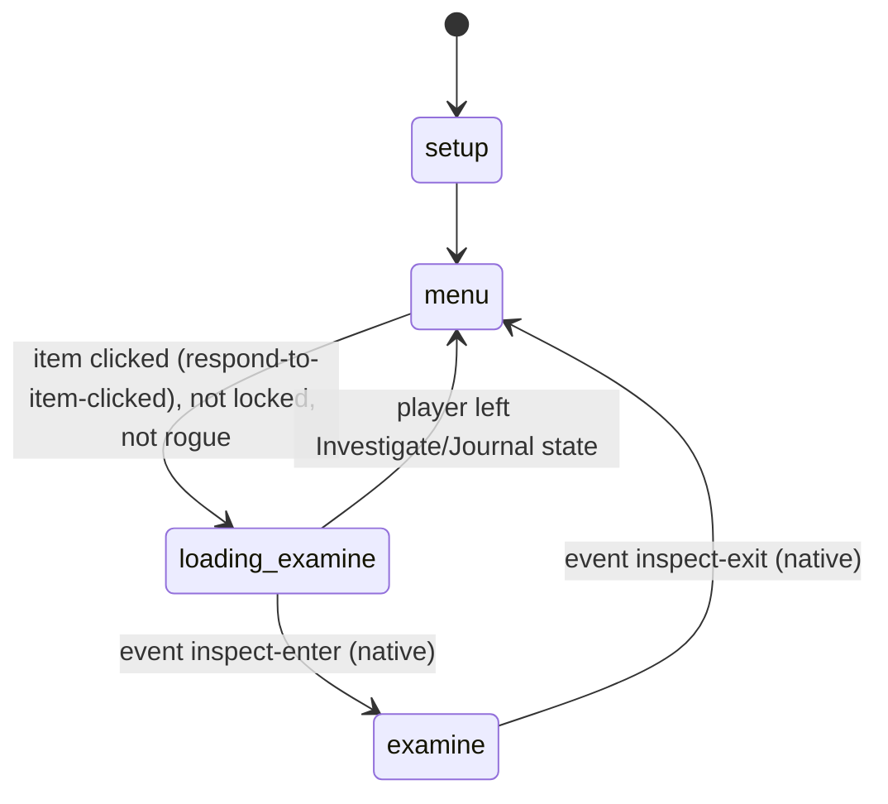
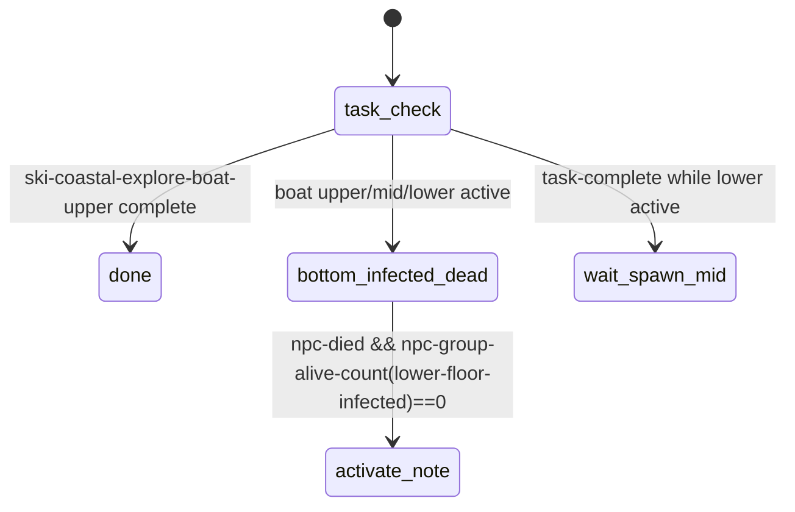

# NOTES / JOURNAL / COLLECTIBLES — from world object to persistent collection

TLOU2R PC 1.6 DC corpus. Scope: the treasure (collectible) data model (`treasures.bin`), how
world notes, cards, coins and manuals are registered (`ss-investigate-object` + native
`collect-treasure`), the pick-up notification and quick-inspect, the backpack **Collectibles** menu
(`ss-hud2/ss-menu2-collectibles`), Ellie's **journal** (`journal-info`, `anim-player/player-journal`,
journal-entry interactables), level note scripts (e.g. `level-sets/ss-ski-coastal-note-prompt-activator`),
and the end-to-end **"player picks up a book"** walk-through (§9).

Companion docs: [`../investigate/README.md`](../investigate/README.md) (hand-held inspect engine) and
[`../examine/README.md`](../examine/README.md) (camera-only examine + read page).

Labels: **CONFIRMED** · **HIGH** · **INFERRED** · **UNKNOWN/NATIVE**.

---

## 1. Overview & files

| File | Kind | Role |
|---|---|---|
| `treasures.bin` | data: `*treasures*` (273 `treasure-data` records), 17 `treasure-timeline`s, `*quick-access-treasures*` (sea-hub map, Seattle map, QZ generator note), `*hud-small-treasure-version*` | master collectible table |
| `ss/ss-investigate-object.bin` | state script | the world pickup/inspect for almost every collectible (tag `treasure-id`) |
| `ss-hud2/ss-menu2-collectibles.bin` | state script (`setup`, `menu`, `loading-examine`, `examine`, …) + 23 lambdas | backpack Collectibles tab: categories, counts, "new" dots, re-inspect, read |
| `ss-hud2/ss-hud2-notification-manager.bin` | state script | pick-up toasts, touchpad/quick-inspect from the toast |
| `gui2-script-funcs-game-impl.bin` | lambdas | `hud2-request-pick-up-notification(id, b)` → `send-event(request-pickup-notification, notification-manager, id, b)` **CONFIRMED** |
| `journal-info.bin` | data: `*ellie-journal*` (global), `*ellie-journal-pages*` (38 `journal-page-info`), `*ellie-journal-sketches*` (46 `journal-sketch-info`), `*journal-1..4*` (`journal-model-params`: page meshes + task ranges), `*journal-treasure-page-names*` (38), `*journal-dirtiness-03*` | Ellie's physical journal model, pages and sketches |
| `anim-player/player-journal.bin` | actor-state-list, 7 states | `journal-open`, `journal-idle`, `journal-close`, `journal-close-2`, `journal-turn-left`, `journal-turn-right`, `journal-prone-close-2` |
| `journal-interests.bin` | **startup-only** (`in_main_psarc: False`) `*journal-interests-hashtable*`, 5 test entries (`interest-gallery-nymph-statue` "nymph statue", "this is monad", …) | prototype "journal interests" feature. `journal-interesurgeonguild.bin` is an identical copy in the main archive. No DC code references the table. **CONFIRMED** dead |
| `journal-entries.bin` | 45 bytes, 0 entries | empty stub **CONFIRMED** |
| `interactable.bin` | `game-interactable-def`s | `interact-collectible(-tall/-close/-allow-horse…)`, `interact-collected(-progression-important)`, `interact-coin(-collected…)`, `interact-card-collected…`, `interact-manual-collected…`, `interact-journal-treasure`, `interact-journal-collected…` |
| level scripts | ~40 `ss-*-note*`, `ss-*-journal*`, `ss-*-collectibles` | per-level gating and reactions to investigate broadcasts |

Machine-readable treasure table (273 rows: id, category, ciphers, area, object, params, timeline):
[`treasures_table.json`](treasures_table.json) (generator: `tools/analysis/notes_treasures_dump.py`).

---

## 2. Treasure data model (`treasures.bin` → `*treasures*`)

| Off | Field | Evidence | Confidence |
|---|---|---|---|
| 0x000 | treasure-id (`collectible-pat-jackson-construction-note`, `journal-three-ellie-entry-2`, …) | used as `tag treasure-id` | CONFIRMED |
| 0x008 | title cipher | `ss-investigate-object` reads `treasure+8` as readable title; menu TTS reads `+8` | CONFIRMED |
| 0x010 | location cipher (`HUD_COL_SEA_QZ`, …) | read at `+16` | CONFIRMED |
| 0x018 | front text cipher (`…_TEXT`) | read at `+24`; menu disables READ when `+24 == 0` | CONFIRMED |
| 0x020 | back text cipher (`…_BACK`, `HUD_COL_COIN_FRONT` for coins) | read at `+32` on flip to back | CONFIRMED |
| 0x028 | area/chapter tag (`rogue` 31, `downtown` 25, `hillcrest`, `finding-nora`, …) | | INFERRED (map grouping) |
| 0x030/0x038 | object/art name string + sid (`pat-library-note`, `polaroid-tommy-eugene`, `joel-wrist-watch-interactive`) | | INFERRED (model loaded by `player-start-loading-treasure-object`) |
| 0x040/0x048 | menu display pose (`note-6x9-generic-press-square-flat`, `super-hero-card-base`, `coin-base`) | | INFERRED |
| 0x060 | **category**: 0 artifact (165), 1 coin (32), 2 card (48), 3 manual (8), 4 journal (20) | perfect correlation with ids; enum CONFIRMED by `get-collectible-category-title/icon` (0 ARTIFACTS / MODS in rogue, 1 COINS, 2 CARDS, 3 MANUALS, 4 JOURNAL) | HIGH |
| 0x068 | placeholder icon path (`test/money_box_01.png`, `html/missing.png`) | | CONFIRMED (value) |
| 0x078 | investigate-params for the **backpack viewer** (`*investigate-paper-backpack-params*` ×95, cards, coins, polaroid, watch…) | | INFERRED (used by native `player-investigate-treasure`) |
| 0x080/0x088/0x090 | alt params: quick (`*investigate-superhero-cards-quick-params*`), crouch (`…-card-crouch-params*`), horse (`*investigate-sea-hub-tunnels-map-horse-params*`) | | INFERRED |
| 0x098 | `treasure-timeline-array`: (chapter, start-task, end-chapter, end-task) ranges | native `is-timeline-valid-for-treasure?` | INFERRED |
| 0x0A8/0x0B0 | default stick-pan settings, non-zoom / zoom | read at `+168/+176` | CONFIRMED |
| 0x0D8/0x0E0 | override stick-pan settings. Used only if float at `+0x10 ≥ 0` (default −1 = unset) | branch at `+216/+224` | CONFIRMED |
| 0x0C8 | phys-joint list for one record (`*investigate-phys-joints-key-chain*`) | | INFERRED |

---

## 3. State machine(s)

The collectible lifecycle spans several scripts plus native state. Composite view:



`ss-menu2-collectibles` (relevant states):



`ss-ski-coastal-note-prompt-activator` (level-set script, Saving Kids):


`activate-note` → `interactable-enable(coll-note-ski-coastal-explore-boat-mid-safe-note-1)`. The
note's prompt appears only once the room is cleared. `done` is an empty state; `wait-spawn-mid` is a transition target with no state defined in this file. The `.json` of the same name in `level-sets/` is **0 bytes**. **CONFIRMED**

---

## 4. Per-state call graphs

```
ss-menu2-collectibles
 menu (focus change) → treasure-focus-changed(i)
 ├─ id = current-category-collectibles[i]; t = get-treasure-by-id(id,0)
 ├─ legend INSPECT enabled; player-start-loading-treasure-object(id)          [native: stream model]
 ├─ legend READ disabled iff t+24 == 0
 └─ rogue: gui2-set-widget-image(slot, skull--get-skull-by-note-id(t)+88)
 respond-to-item-clicked
 ├─ locked → log-event("locked-collectibles-action"); tutorial HUD_COLLECTIBLES_LOCKED_TEXT once
 └─ selected-treasure = id; play-sound(sfx-menu-examine-open); mark-list-index-treasure-examined--collectibles(1)
                                                         (→ mark-treasure-examined-by-picked-up-index(i,1),
                                                            send collectibles-branch-seen when no "new" left); go(loading-examine)
 loading-examine
 ├─ prepare-player-investigate-treasure()                                     [native]
 ├─ menu2-push-page("menu-collectibles/collect-loading-screen"); spinner until player-treasure-object-loaded?()
 ├─ t.id == journal-ellie → player-use-journal(0)                            [native journal mode]
 │   else wait loaded → player-investigate-treasure()                         [native investigate from backpack]
 ├─ on inspect-enter (native) → is-quick-read? → player-investigate-request-read(); go(examine)
 └─ update: joypad-disable-all-commands-except(journal-cancel, investigate-flip);
            if started && !player-in-state?(Investigate|Journal) → pop page; go(menu)
 examine
 └─ on inspect-exit → pop loading page; sfx-menu-examine-close; TTS(category title, t+8 title, part count); go(menu)

ss-hud2-notification-manager (pick-up toast, partial)
 ├─ type 5 or 6 (collectible) + input → player-set-quick-inspect-treasure/f(id); player-investigate-on-tap/f()
 ├─ type 7 (journal)                  → player-journal-on-tap/f()
 └─ on quick-inspect (types 1/5/6, touchpad override) → mark-treasure-examined-by-id(id,1)
```

Collection call sites (DC → native `collect-treasure`, 26 calls). Main path:
`ss-investigate-object` (quick-grab, attacked-out, investigate-exit/clear-gesture). Direct grants
without investigate: `ss-afd-abby-collectibles` (Owen drawing, Mel note), `ss-pat-library-firefly-symbol`
(pendant, after a bespoke IGC), `ss-pat-suburbs-dina-card`, `ss-pat-packing` (Joel's watch),
`ss-sea-horse-hotel-*`/`ss-qz-door-puzzle` (maps, generator note), `ss-joe-school-interrogation-cine-part-two`,
`ss-med-aquarium-mel`, rogue `ss-modifiers-manager`. `give-treasure` (1 call: upgrade manual in
`ss-pat-jackson-home-backpack`). **CONFIRMED**

---

## 5. Answers to the specific questions

| Question | Answer | Confidence |
|---|---|---|
| World object → interaction prompt | Spawner entity with `ss-investigate-object` + tags (`treasure-id`, `investigate-params`, anims…), plus an interactable def. The default prompt icon of `interact-collectible` is `hud/collectibles/artifacts-category.png` (def floats 2.0 / 4.5 at 0x008/0x030, INFERRED interact/prompt ranges). Journal entries use `interact-journal-treasure` (`journal-icon.png`, 3.0 / 7.0). The native interactable system raises `player-requested-interact`. Level scripts gate prompts with `interactable-enable/disable` (ski-coastal activator, `ss-nor-scar-intro-journal`). | CONFIRMED (defs, calls) / spawner tags in level data |
| Already-collected handling | Owned treasure → object killed at setup. With the collectible-tracking HUD → `override-interact-def` to a `*-collected` def (checkmark icon), only when the object was not killed (`dont-auto-kill-treasure`). | CONFIRMED |
| Registration native call | **`collect-treasure(treasure-id)`** (native) at put-down (`investigate-exit` clear-gesture track, after `detach-frames`), in quick-grab, or in attacked-out once attached. Then `hud2-request-pick-up-notification(id, 0/1)`. "Seen" flag: `mark-treasure-examined-by-id(id,1)` only if inspected ≥ 2 s (`mark-treasure-seen-timer?`). Manuals: `inventory-item-add-quantity(manual-id,1)` + `log-event("upgrade-manual-found")`. Separate native `collect-investigate-object(art-group)` on every inspect. | CONFIRMED |
| Journal | Two kinds. (a) Journal-entry treasures (`category 4`, ids `journal-*-ellie-entry-*`, `JOURNAL1-MUSEUM-05`…), triggered by `interact-journal-treasure` interactables such as `int-nor-journal-scars-1` or `int-wat-shambler-journal-1` (repositioned each frame onto a shambler's `back_spore_1_up` joint). The scripts only enable/disable these and react to `player-requested-interact`. Writing the entry (journal scribble) is native: `journal-scribbling?`, `journal-unlock-sketch(id, t)`, `has-collected-journal-treasure?(id)`. (b) The physical journal viewer: `player-use-journal(0)` / `player-close-journal(0)` (e.g. `ss-far-restless-igc-journal`, menu item `journal-ellie`), animated by `anim-player/player-journal` (open → idle → turn-left/right → close / close-2 / prone-close-2). Pages: `*ellie-journal-pages*` entries `{page-id, *journal-N*, chapter, task, mesh "objects/character-props/journals/…:default", blend-constant…}`. A page appears from its task onward (INFERRED). `*journal-1..4*` carry the 10 page meshes per book and a task range (`*journal-4*`: farm → epilogue). | CONFIRMED data / journal logic NATIVE |
| Journal → menu | Collectibles category 4 = JOURNAL. `adjust-journal-line--collectibles`, `get-collectible-journal-line` lay out the journal row. | CONFIRMED |
| Persistent state | All native: owned set (`has-collected-treasure?`, 116 calls; `get-num-treasures-picked-up(-in-category)`, `get-treasure-id-by-picked-up-index`), examined set (`has-treasure-been-examined(-by-picked-up-index)?`, `mark-…`), journal set, `remove-treasure` (33 calls, rogue/debug). Script-side persistence is limited to `ss-svar(used)` (accessibility) and task state. | CONFIRMED (calls) / storage NATIVE |
| Combat behaviour | With enemies alive and tension 3/4, collectibles flip to fast pickup (no inspect). Coins and cards are **always** fast pickup. Level overrides exist: `ss-med-hospital-doctor-note` toggles `allow-in-combat?` / `enable-fast-pickup` around a trap NPC; `ss-pat-library-card` sets `is-card? = 0` on the library card when the suburbs card is not owned, so the player gets the full first-time inspect. | CONFIRMED |
| Accessibility | `ss-accessibility-treasure` adds/removes a "fake pickup" to `ss-player-blind-listen-mode` in a region until `has-collected-treasure?` or interact. TTS reads category, title and part count in the menu. | CONFIRMED |

---

## 6. Engine boundary

DC: when to collect, notification requests, menu UI flow, category/title/icons, "new" dots,
level gating. Data: `*treasures*`, journal info, interactable defs, params. **Native:** the
treasure store and save data, `collect-treasure`, `give-treasure`, examined flags, timeline validity,
model streaming (`player-start-loading-treasure-object`), backpack inspect
(`prepare-player-investigate-treasure`/`player-investigate-treasure`), journal mode
(`player-use-journal`, `journal-unlock-sketch`, scribbling), read page, `inspect-enter`/`inspect-exit` events.

## 7. Events in / out

Out of the collect path: `done-with-investigate`, `exiting-investigate(-cut)` (consumed by ~40 level
scripts for VO and progression), `request-pickup-notification` → notification manager,
`collectibles-branch-seen` → tab bar, `no-map-hint` → `ss-seattle-map-materials-1`.
In: `player-requested-interact`, `inspect-enter`/`inspect-exit` (native only), `quick-inspect` (native),
`enable-/disable-fast-pickup`.

## 8. Animation / camera / UI / audio hooks

Backpack inspect uses the `--backpack` clips inside `anim-player/player-investigate` (e.g.
`ellie-inspect-paper-backpack-idle-front--backpack`) and `investigate-swap*`. Treasure stick-pan
settings drive the native inspect camera. Menu audio: `sfx-menu-examine-open/close`.
Prompt icons per category: `hud/collectibles/{artifacts,coins,cards,manuals}-category.png`.

---

## 9. End-to-end: "PLAYER PICKS UP A BOOK"

Concrete book: **Patrol / Ellie's house, `obj-pat-packing-dino-book-1`** (the real hand-held book).
It uses `ss-investigate-object` with params `*investigate-dino-book-params*` (overlay `dino-book`;
SFX `sfx-inspect-dino-pamphlet-pick-up / -open / -close / -put-down`) and the level script
`ss-patrol/ss-vox-pat-packing` (`dino-book` state). Collectible-note variant: `collectible-pat-library-eugene-drawer-note`
(Patrol library, `*investigate-paper-backpack-params*`).

> **The Patrol library "jokebook" is not a book interaction.** `ss-pat-library-jokebook-interaction`
> is a placeholder: `player-requested-interact` → `interactable-disable(int-jokebook-1)` →
> `wait-script-caption(player, "*Ellie picks up a jokebook and reads from it.*")` → `complete`.
> No investigate, animation or collectible is involved. Only the mesh `pat-ellie-book-jokebook-set-a` exists
> (material table). **CONFIRMED**

| # | Step | What happens (call → owner) | Evidence | Confidence |
|---|---|---|---|---|
| 1 | Prompt | Interactable enabled; object shimmers (`shimmerIntensity` glow track); high-contrast type 3. Native raises `player-requested-interact`. The level script marks itself (`vox-dino-book-done`) and calls `investigate-object-ignore-exit(book)` (exit locked until VO). | ss-investigate-object `wait-interact`; ss-vox-pat-packing `dino-book` | CONFIRMED |
| 2 | Fast-pickup decision | `send-event-box-result(should-fast-pickup?, self)` → false (no combat) → `enter-and-investigate`. | | CONFIRMED (answer NATIVE) |
| 3 | Analytics + params | `log-event("found-investigate-object", …)`; copies SFX from params +96..+152. | | CONFIRMED |
| 4 | Player align | `calculated-ap-loc` computed; `player-look-at-point(book, 10)`; overlays `anim-overlay-player-investigate-dino-book` / `…-object-dino-book` applied; `wait-player-move-to-entry(enter-anim…)` → holster weapon → `wait-player-scripted-move-new`. | | CONFIRMED |
| 5 | Enter-1 (reach) | `broadcast entering-investigate`; `wait-animate_(player, hero-inspect-enter→overlay)`; hand IK `player-ik-point-at(book + ik-hand-height)`; foot IK override 5; `sfx-enter-1` (pick-up) at its frame. | | CONFIRMED |
| 6 | Attach book | At `enter-anim-2-starting` + `attach-frames`: `attach(book, player, rightHand)`; `picked-up-treasure = 1`; physics joints enabled after `phys-frames`. | track attach | CONFIRMED |
| 7 | Camera transition | `pop-flashlight`; `camera-enable-animated-stick-pan(…, camera-index-inspect 1, 1000)` with a cut if no fade-in; buddies' flashlights suppressed; flashlight forced on if dark (`check-lighting-estimate-over-threshold`). | | CONFIRMED |
| 8 | Enter-2 (book opens) | `broadcast entering-investigate-cut`. The level script starts the book prop's own clip `animate_(book, pat-packing-dino-enter-2--book, {10: calculated-ap-loc of the book script})`, reading another script's variable. The overlay also maps `investigate-object-enter-2` → `pat-packing-dino-enter-2--book`. `sfx-enter-2` = `…-pamphlet-open`. | ss-vox-pat-packing `book-anims` | CONFIRMED |
| 9 | Examine mode | `broadcast entered-into-investigate`; `signal(investigate-started)`; `collect-investigate-object(art-group)`; flags 80 (base 16 + rotate-in-zoom 64; 84 if flip disabled); `setup-and-investigate-object()` → `player-investigate-make-readable(text,title,loc)` + **`player-investigate-object(...)`** → native player state `Investigate`; `player-investigate-set-camera-indices(1, 2, pan, zoom-pan)`. Handheld camera shake loop; near clip 0.01; hints paused. | | CONFIRMED (native internals UNKNOWN) |
| 10 | Rotate / tilt | Native reads the stick and writes two floats (ctx+2868/+2872). The anim graph's `investigate-front-node` blends `investigate-idle-front` with `-turn-idle-front-fw/bw/lt/rt`, remapped by the overlay to `pat-packing-dino-idle-tilt-fw/bw/lt/rt`. The prop follows via `investigate-object-idle-front-*` → `pat-packing-dino-idle--book`. Spring smoothing: `InvestigateTurnSpringAction`. | player-investigate state [4], parametric set, dino-book overlay | CONFIRMED structure / input NATIVE |
| 11 | Front/back swap | On `investigate-flip`, native fires the anim transition `flip` (`investigate-idle-front` → `investigate-idle-front^idle-back`, 0.2 s), then broadcasts `investigate-begin-flip(obj, front?)`. DC swaps the readable HUD to the back ciphers (`treasure+32`). The dino-book overlay maps no `idle-back`/turn clips, which suggests flip is disabled for this object (`allow-flip?` false → flags+4 → `joypad-disable-commands(investigate-flip)`). | | HIGH / dino-book flip INFERRED |
| 12 | Read | Native read mode from the readable HUD (`HUD_READ_MODE` prompt; `read-mode-enter`). For notes the text is `treasure+24` (front) / `+32` (back). A world *examine* instead uses `hud2-show-read-page(*examines*[id].text)`. | | HIGH |
| 13 | UI | HUD bits `0x4802` (zoom + put-back) for a non-treasure book, `0x5002` for a treasure. World-space widgets `world-widget-investigate-x-inspect` / `…-left-stick-navigate`. TTS hints. Level VO plays (`wait-say vox-igc-ell-gam-pat-packing-dino-slf-001/002`), then `investigate-object-allow-exit(book)`. | | CONFIRMED |
| 14 | Collectible / journal | Non-collectible book: nothing persistent except `collect-investigate-object` and `svar used`. For a collectible note: at put-down `collect-treasure(id)` → `hud2-request-pick-up-notification(id,1)` → toast (tap → quick-inspect) → appears in the Collectibles menu category 0 with "new" dot until `mark-treasure-examined…`. Journal entries take the separate native journal path (§5). | | CONFIRMED |
| 15 | Put down | Native sends `investigate-begin-exit(self)` on the exit button → `investigate-exit`: clear readable, `broadcast exiting-investigate` (level script plays `pat-packing-dino-exit--book` on the prop), exit-1 (`…-pamphlet-close`) under an animated camera, then `broadcast exiting-investigate-cut`, exit-2 (`…-put-down`) with stick-abort after 6 frames / 0.6 s. Clear-gesture track: after `detach-frames` (10) `send detach` + `wait-stub-object-lerp-locator(book, original-object-loc, lerp-to-origin-time)`. The book glides back to where it was; physics/collision re-enabled. | | CONFIRMED |
| 16 | Restore gameplay | Camera `wait-camera-fade-out-animated-to-remap(remap-time 1.0, remap-camera, 5 m)` or fade; IK restored (`set-character-ik-mode-override(player,1,0)`, `stop-player-script-ik`); flashlight back to its prior state; buddies' flashlights restored; `broadcast done-with-investigate`; after 1.2 s the interactable is re-enabled (reusable book) and `svar used = 1` → `wait-interact`. | | CONFIRMED |

Attacked mid-read: `player-attacked` → `attacked-out` (instant camera cut, anim stop, all exit
broadcasts). A collectible already attached is collected anyway; a plain book snaps back to its
original locator. **CONFIRMED**

### Scar intro composition (Finding Nora)
`ss-nor-scar-intro-igc-map-examine` (map = cinematic squeeze-through IGC, see examine README §9)
→ combat → `ss-nor-scar-intro-journal` enables `int-nor-journal-scars-1` on `combat-done`, highlights
`nor-scar-intro-corpse-scar-1` (high-contrast 2), and on interact disables it and completes. The
journal write itself is native. **CONFIRMED**

### Patrol library composition
* `ss-pat-library-firefly-symbol`: bespoke IGC → `send-event(investigate-object, obj-pat-library-tags-1)` to an `ss-investigate-in-igc` object with `ignore-exit?`/`ignore-flip?`/`hold-exit?` preset. The HUD is staged `player-investigate-set-hud(16386 → 16642 → 20482, 2178)` as the VO in `ss-vox-pat-library-generator` progresses. The VO script listens to `investigate-begin-flip`. The IGC forces the exit with `investigate-begin-exit`, then `kill-entity` and `collect-treasure(collectible-pat-library-eugene-firefly-pendant)`. **CONFIRMED**
* `ss-pat-library-interacts`: `note-inspect` / `photo-inspect` states only listen to `entering/exiting/done-with-investigate` and trigger VO (`vox-eugene-note`). **CONFIRMED**
* `ss-pat-library-card`: forces the full inspect for the first superhero card (see §5). **CONFIRMED**
* `ss-pat-library-jokebook-interaction`: placeholder caption (above). **CONFIRMED**

---

## 10. Shared components

Treasure API shared by investigate, menu, notification manager, keypads/safes (`player-set-quick-inspect-treasure/f`
for code notes in `ss-sea-arrival-keypad`, `ss-tumbler-safe`), rogue mode (skull images, modifiers).
Interactable defs and high-contrast mode are shared with all interactions.

## 11. Confidence table

| Claim | Label |
|---|---|
| `collect-treasure` is the registration call; timing at put-down/quick-grab/attacked-out | CONFIRMED |
| Treasure field offsets +8/+16/+24/+32/+168/+176/+216/+224 | CONFIRMED |
| Category field 0x060 and enum | HIGH (enum CONFIRMED) |
| Journal entry writing is native | HIGH |
| journal-interests is dead data | CONFIRMED |
| jokebook is a placeholder | CONFIRMED |

## 12. Open questions

1. Save format of the treasure/examined/journal sets (native).
2. How `interact-journal-treasure` objects map to a journal treasure id (spawner tag?) and what plays the scribble animation (no DC journal-write anim found).
3. Exact use of treasure 0x028/0x030/0x040 and the alt params at 0x080–0x090.
4. Whether `*hud-small-treasure-version*` selects the small-HUD variant.

## 13. Modding surface

| Change | Rating | Why |
|---|---|---|
| Edit treasure text ciphers / stick-pan overrides / backpack params | GREEN | flat data, offsets confirmed |
| Re-gate a note's prompt (activator-style level script) | GREEN | simple `interactable-enable` scripts |
| Change combat fast-pickup / coin-card rules, seen-timer (2 s) | YELLOW | one DC script, affects all collectibles |
| Add a new treasure record | ORANGE | needs ciphers, model, menu pose, save-slot implications (native store) |
| Change journal behaviour, save/collection storage | RED | native |
