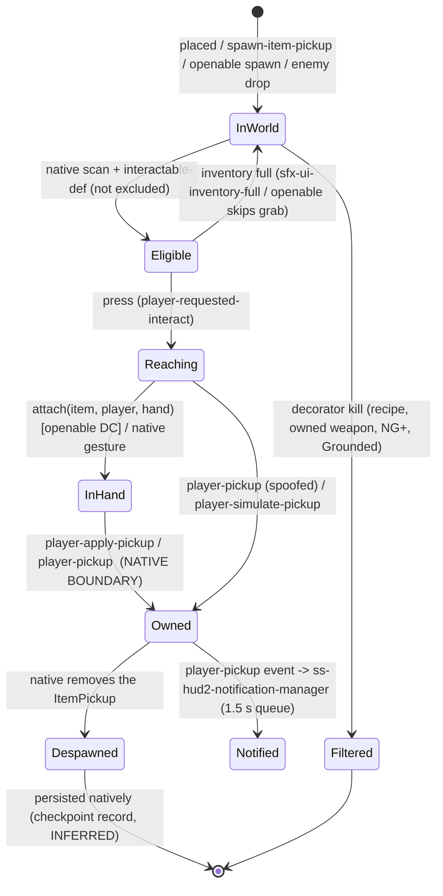
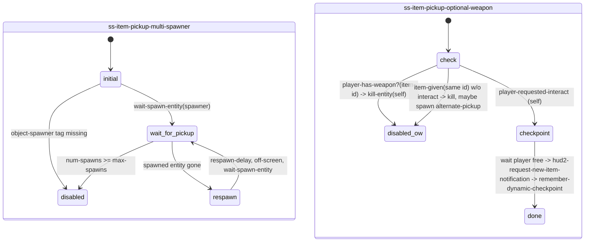

# Pickups: the reusable pickup layer (world item → hand → inventory → HUD)

This document follows a world item from its spawn to the inventory and the pickup notification. It separates the **openable layer**
(`ss-openable-drawer`, `ss-openable-cabinet`), which only *stages* a pickup, from the **pickup layer** (ItemPickup process, native
pickup APIs, pickup data and the HUD notification manager), which every pickup in the game shares.

Related: `interactions/cabinets/README.md`, `interactions/drawers/README.md`, `systems/inventory/README.md`.

Data files in this directory (generated by `tools/analysis/pickups_*.py`):

| file | content |
|---|---|
| `openable_grip_table.json` | the `openable-grip-and-scale` table from `ss-openable-grips`: 88 branches (81 unique art-groups; 7 duplicates are unreachable), grip clip + uniform scale + collect clip, the fallback, and the 32 grips that have a left-hand (mirrored) variant |
| `drawer_pickup_offsets.json` | the three maps in `drawer-pickup-offset.bin` (140 drawer translation offsets, 11 junk rotation offsets, 93 per-item rotation/translation offsets) |
| `openable_drop_tables.json` | `*cabinet-drop-table*`, `*drawer-drop-table*`, the rogue variants and `*default-drop-table*` from `item-drop.bin` |
| `generic_pickup_gestures.json` | the 178 gesture clips chosen by `player-pickup-anim` (the generic, non-openable pickup reach), grouped into 36 families |

---

## 1. Overview & files

| layer | file / symbol | kind | role |
|---|---|---|---|
| item definition | `player-inventory.bin` → `*player-inventory-t2*` (140 `inv-item-def`) | data | item id, HUD name strings, icons, **max count (+0x88)**, and an embedded `item-pickup` struct: `item-pickup-looks[]` (art-group, grip clip, pickup SFX, rumble), shimmer FX, pickup/put-away SFX. See `systems/inventory/player_inventory_items.json` |
| interaction definition | `interactable.bin` (274 `game-interactable-def`), e.g. `interact-scavenge-pickup`, `interact-pickup-item`, `interact-ammo-pickup`, `interact-dropped-pickup`, `interact-*-pickup-hold`, `auto-pickup-medium-radius`, `interact-openable-{cabinet,drawer}` | data | radii, HUD icon `pc/hud-interactable/pickup-small-pc`, **full-inventory sound `sfx-ui-inventory-full`** (only on pickup defs), hold variant `interact-hold`, accessibility SFX |
| what openables contain | `item-drop.bin` → `*cabinet-drop-table*`, `*drawer-drop-table*`, `*parts-info-*-drawer*`, `*drop-ammo-drawer*`, … | data | per-category odds (none / ammo / crafting / full-item) and item lists. No DC references, so these are consumed natively |
| where it sits in a drawer | `drawer-pickup-offset.bin` | data | per drawer-look translation, per item-art-group rotation/translation. No DC references |
| hand grip | `ss-t2/ss-openable-grips.bin` | **DC** | `openable-grip-and-scale(art-group)` sets `pickup-grip-anim`, `pickup-obj-scale`, `pickup-collect-anim`; `openable-mirrored-grip-exists?()` sets `pickup-grip-l-hand` |
| generic reach | `anim-player/player-misc.bin` → `player-pickup-anim(hand, player-loc, vel, item-loc)` | **DC lambda called by native** (0 DC callers) | chooses one of 178 pickup gestures by stance, height, angle and movement |
| reach clips | `gestures/ellie-pickup-gestures.bin` (118), `gestures/abby-pickup-gestures.bin` (83) | data | `gesture-def`s. 148 of them carry a `fact-criteria` on `scav-anim-active` |
| per-pickup decorators | `ss-t2/ss-item-pickup-{multi-spawner,optional-weapon,gated-by-recipe}`, `ss-ngp-pickup`, `ss-backpack-map-pickup`, `ss-cgumacal-item-pickup`, `ss-holster-pickup(-manager)` | DC state scripts on the pickup itself | spawn/respawn, conditional availability, notifications, checkpoints |
| global listeners | `ss-t2/ss-crafting-recipe-from-pickup`, `ss-t2/ss-grounded-pickup-despawn`, `ss-hud2/ss-hud2-notification-manager` | DC | react to the native `player-pickup` event: recipes and tutorials, Grounded despawn, HUD toasts |
| inventory API | `player-apply-pickup`, `player-pickup`, `player-pickup-is-full`, `item-pickup-*`, `spawn-item-pickup`, `player-simulate-pickup`, `player-inventory-*` | native | ownership transfer and counts |
| empty stub | `script-funcs-inventory.bin` | data | 45 bytes, 0 entries. The inventory script functions live in `script-user-funcs-impl.bin` |

Native process class: `ItemPickup` (`is-item-pickup?` = `process-is-kind-of(x, ItemPickup)`, script-user-funcs-impl). CONFIRMED.

## 2. Item / pickup data definitions

### 2a. `inv-item-def` (player-inventory.bin)

| offset | meaning | confidence |
|---|---|---|
| +0x000 / +0x008 | item id SID / name string | CONFIRMED |
| +0x010 / +0x018 | HUD pickup name (`HUD_PICKUP_AMMO_PISTOL`) / single-unit name | HIGH |
| +0x038 / +0x048 | HUD icon paths | HIGH |
| **+0x088** | **max carry count** (e.g. ammo-pistol 16, ammo-shotgun 8, rag/alcohol/blade/binding/canister/explosive 12, health-kit 3, molotov 3, parts 9999) | **CONFIRMED** (`get-inventory-item-max-count` = `lookup-inv-item-def(id)+136`). Base values only; difficulty/upgrade scaling is native (INFERRED) |
| +0x0A0 | `item-pickup` struct: `+0x010 item-pickup-looks` → array of {art-group, offsets, **grip clip** `ellie-scav-pickup-grip-r-hand--…`, pickup SFX ×2, rumble ×2}; `+0x020 *pickup-shimmer*`; `+0x038/40` pickup SFX; `+0x048 sfx-pickup-generic`; `+0x050 sfx-putaway-generic`; rumble `ammo-rumble(-soft)` | CONFIRMED data, field names INFERRED |

129 of the 140 items have an `item-pickup` block, with 335 looks in total (332 with a grip clip). The DC grip table in
`ss-openable-grips` **duplicates** this data: of 81 unique art-groups, 73 match the look's grip clip, 7 differ (e.g.
`canister-soda-bottle`, `supplement-scar-large-*`, `gun-ammo-pickup-revolver-look`, `weapon-parts-*` which have no look grip), and
1 (`super-hero-card-base`) is DC-only. INFERRED: the openables use their own DC table and native pickups use the look data.

### 2b. Openable drop tables (item-drop.bin)

`*cabinet-drop-table*` and `*drawer-drop-table*` are identical in odds. Each column sums to 1.0, so each column is a probability distribution:

| category | col0 | col1 | col2 | col3 | col4 | col5 | col6 |
|---|---|---|---|---|---|---|---|
| none | .75 | .65 | .52 | .42 | .42 | .30 | .30 |
| ammo | .10 | .15 | .20 | .20 | .20 | .25 | .25 |
| crafting | .15 | .20 | .28 | .38 | .38 | .45 | .45 |
| full-item | 0 | 0 | 0 | 0 | 0 | 0 | 0 |

The column index is UNKNOWN. It might be a resource-difficulty or player-need level. The odds of finding *something* rise from column 0 to column 6, so this
looks more like a need/scarcity scale than difficulty. INFERRED. The cabinet ammo list (11 types) adds `ammo-rifle-mpx5`, arrows,
crossbow and `ammo-revolver-joel` over the drawer list (7). The crafting list is the same: alcohol, rag, explosive, canister, blade, binding.
`*default-drop-table*` (enemy drops) has much lower `none` odds.

### 2c. Interactable definitions for pickups (interactable.bin)

| def | +0x008 (radius?) | +0x028 | icon (+0x0C8) | full sound (+0x120) | hold (+0x0F0) |
|---|---|---|---|---|---|
| `interact-scavenge-pickup` | 1.5 | 1.5 | pickup-small-pc | sfx-ui-inventory-full | – |
| `interact-scavenge-pickup-hold` | 1.5 | 1.5 | pickup-small-pc | sfx-ui-inventory-full | interact-hold |
| `interact-ammo-pickup` | 1.5 | 1.5 | pickup-small-pc | sfx-ui-inventory-full | – (acc SFX `sfx-ui-acc-pickup-sweetener-ammo`) |
| `interact-dropped-pickup` | 1.5 | 1.5 | pickup-small-pc | sfx-ui-inventory-full | – |
| `interact-pickup-item` | 2.0 | 6.0 | – | – | – |
| `auto-pickup-medium-radius` | 5.0 | 5.0 | – | – | – |
| `interact-openable-cabinet` / `-drawer` | 2.5 | 3.5 | – (joint `handle` at +0x050) | – | – |

Field meanings are INFERRED from value patterns. The SIDs themselves are CONFIRMED.

## 3. The pipeline, step by step

| # | step | how | layer | evidence | confidence |
|---|---|---|---|---|---|
| 1 | item exists in world | (a) level-placed ItemPickup; (b) `spawn-item-pickup(item-id, frame, amount, ?, ?)` from script (rogue spawners, screamer scrap, test rigs); (c) openable-spawned: native rolls `*cabinet/drawer-drop-table*` and DC fetches it with `get-openable-spawned-pickup(openable)`; (d) tagged `pre-placed-pickup` / `igc-pickup` actor on the openable; (e) enemy drops (`*…-enemy-drop-table*`) | native + data; DC for (b)/(d) | `ss-mzhuravlov-test-pickup-all`, `ss-rogue-encounter-item-spawner`, openable `scavenge-enter` | CONFIRMED API; drop-table use INFERRED |
| 2 | availability filters | decorator scripts on the pickup: `ss-item-pickup-gated-by-recipe` (kill unless `player-knows-recipe?`), `ss-item-pickup-optional-weapon` (kill if `player-has-weapon?`), `ss-ngp-pickup` (NG+ only), `item-pickup-should-spawn-grounded?` (Grounded blacklist; DC lambda with 0 DC callers → native callback), `ss-grounded-pickup-despawn` (despawn ammo if the player has > threshold on Grounded) | DC | those files | CONFIRMED |
| 3 | pickup scan | native. `interactable-set-exclude-from-pickup-scan` / `…-is-excluded-…?` (native-confirmed) remove interactables from it. Callers include accessibility (`interactable-set-accessibility-used`) and level scripts that exclude **items and cabinets** in locked rooms (`wat-tunnels-exclude-pickup-scan-in-locked-room`), so the scan covers pickups and openables alike (INFERRED: the accessibility/listen-mode item scan) | native | `accessibility-script-funcs`, `ss-wat-infected-tunnels-door-input-code` | CONFIRMED API; purpose INFERRED |
| 4 | eligible interactable + prompt | native interactable system using the `game-interactable-def` (radius, icon `pickup-small-pc`, highlight settings, shimmer `*pickup-shimmer*`). Openables only toggle it: `interactable-disable/enable(item)` (drawer), `interactable-draw-icon(item)`, `disable-drawing-interactable-icon()` | native + data | openable scripts; interactable.bin | HIGH |
| 5 | press | native sends `player-requested-interact` (arg0 = interactable) to the object's state script (openable, or the pickup's own decorator, e.g. `ss-item-pickup-optional-weapon`) | native → DC | events.json | CONFIRMED |
| 6 | full check | `player-pickup-is-full(item-pickup-get-item-id(item))` (openables). Native generic pickups use the def's `sfx-ui-inventory-full` (INFERRED). Openables then **skip the grab**, and the item stays in the world | DC call → native | cabinet `scavenge-enter/exit` | CONFIRMED |
| 7 | scripted move | openables: `wait-player-scripted-move-new` to an ap-aligned goal. Generic pickups: no scripted move; a layered **gesture** plays while walking (`player-pickup-anim`). `player-is-pickup-scripted-move?` (native-confirmed) exposes the native pickup move state and is used only by accessibility lost-control sounds | native | `ss-accessibility-lost-control-sound` | CONFIRMED |
| 8 | reach animation | openables: scav clips + hand IK (see cabinet/drawer READMEs). Generic: native calls DC `player-pickup-anim(hand, player-loc, velocity, item-loc)`, which returns a gesture: prone 10 cm; crouch floor/low/mid/high (< 0.35, 0.70, 1.15); relaxed/tense/uneasy idle low/mid/high/80 cm (0.71, 0.95, 1.21, 1.35); moving `*-move-fw/bw-part--gesture` when speed ≥ 2.0 (1.4 crouched) | DC selection, native playback | `player-misc.bin` | CONFIRMED |
| 9 | object attachment | openables: `detach-without-physicalizing(item)` → `openable-grip-and-scale(get-art-group(item))` → `set-overlay-set(player, anim-overlay-player-pickup-hand-right|left)` → optional grip clip on player layer 1 + `set-uniform-scale(item, scale)` → item's own `collect` clip → `attach(item, player, rightHand|leftHand, 0)`. Generic pickups: native, presumably using the look's grip clip (INFERRED) | DC → native primitives | cabinet/drawer `scavenge-pickup` | CONFIRMED (openables) |
| 10 | grab sound | `item-pickup-play-pickup-sound(item, r_wrist|l_wrist)` at the grab, `item-pickup-play-pickup-done-sound` at stow. The SFX SIDs come from the item's look/item-pickup data (INFERRED). `send-event(suppress-pickup-sound, item)` right before applying, so the native apply doesn't play it twice | native | `ss-cabinet-attachment` | CONFIRMED calls |
| 11 | **inventory transfer** | **`player-apply-pickup(item)`** at the stow phase (or immediately on melee-abort if already in hand), or **`player-pickup(item, a, hand, b, c)`** (native picks up and animates). Other entry points: `player-simulate-pickup(frame, …)` (script-faked pickups), `collect-treasure(id)` (collectibles), `player-inventory-add-item-quantity` (direct give) | **native** | 8/5/8/26/82 call sites | CONFIRMED boundary |
| 12 | game events | native fires `player-pickup` (arg0 = pickup object, arg1 = item id, arg2 = amount, arg3 = spawner, arg4 = bound-frame) to 39 listening states; `item-given`; `player-pickup-stow` (arg1 = item id); `player-inventory-changed`; `pick-up-treasure` | native → DC | handlers in events.json | CONFIRMED args 1/2 (notification mgr), HIGH 0/3/4 |
| 13 | HUD notification | `ss-hud2-notification-manager` `event_player-pickup` → `handle-item-recieved-event--notification-mgr(item, amount, speak?=1)`: merges with a queued entry of the same item, sets `total = hud2-pickup-notification-item-total(item)` (native); after **1.5 s** per entry → `hud2-request-item-pickup-notification(item, amount, total, speak?)` (native toast). Script path: `hud2-request-pick-up-notification` → `request-pickup-notification`. New items / recipes: `hud2-request-new-item-notification` → `new-item-recieved` | DC queue, native draw | notification manager | CONFIRMED |
| 14 | despawn | native, after transfer (the item stops existing; openables only `kill-entity` their IK proxies). DC-driven despawns: `kill-entity(self)` in decorators, Grounded despawn (`interact-with(item, 0, 1)` + `kill-entity-if-spawned`, with `clear-checkpoint-record` sent to the item) | native (+DC special cases) | `ss-grounded-pickup-despawn` | HIGH |
| 15 | persistence | native: picked state of ItemPickups and the openable flags `has-been-opened?` / `has-item?` / `item-has-been-picked?` are never written by DC. The `clear-checkpoint-record` event to an item suggests per-item checkpoint records (INFERRED). `ss-item-pickup-multi-spawner` uses spawner respawn (`wait-spawn-entity`) | native | §7 | UNKNOWN internals |

### Where inventory ownership begins

**At the native call `player-apply-pickup(item)`** (or `player-pickup(...)`, `player-simulate-pickup`, `collect-treasure`,
`player-inventory-add-item-quantity`). Everything before it is staging. Until that call the item is a world ItemPickup attached
to a hand joint. Evidence: in every openable abort path (`melee-abort`), a grabbed item is still committed with
`player-apply-pickup` so it can't be lost, and the `player-pickup` event (step 12) has no DC sender. CONFIRMED.



## 4. Per-pickup decorator scripts



```
ss-item-pickup-gated-by-recipe:initial      └─ kill-entity(self) & go(disabled) unless player-knows-recipe?!(tag item-id)
ss-ngp-pickup:check-is-new-game-plus        └─ kill-entity(self) unless is-new-game-plus?!; kill tag alternate-pickup
ss-backpack-map-pickup:initial              └─ set require-backpack-pickup? on ss-player-map-controller; on interact → "Map now available"
ss-grounded-pickup-despawn:despawn-ammo     └─ despawn-grounded-pickups-if-well-supplied(task)  (difficulty-resources == 5 only)
                                               ├─ player-total-basic-ammo() > threshold(ddict per task)
                                               └─ per pickup: send disable-weapon-ammo-pickup-spawn | clear-checkpoint-record,
                                                  interact-with!(x, 0, 1), kill-entity-if-spawned
ss-crafting-recipe-from-pickup:wait-for-pickup
 └─ event player-pickup(arg1 = item id)
     ├─ in recipes-can-unlock & unknown → player-learn-recipe-by-item-id!, log-event("player-learned-recipe", …, event-arg-bound-frame(4)),
     │                                    hud2-request-new-item-notification(id)
     ├─ first player-upgrade-supplements → tutorial HUD_MIN_SUPPLEMENTS
     ├─ first parts → tutorial HUD_MIN_WEAPON_PARTS
     └─ partial ingredient in patrol → tutorial HUD_PARTIAL_INGREDIENTS
```

## 5. Answers to the pickup questions

| question | answer | confidence |
|---|---|---|
| **How does an item become available?** | It must exist as an `ItemPickup` (placed, `spawn-item-pickup`, enemy drop, or spawned inside an openable from `item-drop.bin` odds and fetched by `get-openable-spawned-pickup`). Decorator scripts may kill it (recipe, owned weapon, NG+, Grounded). The native scan and interactable-def then make it eligible and draw the prompt. Inside openables the item only becomes interactable once the reach passes `ik-on-frame + 16` (`interactable-enable` in the drawer, `interactable-draw-icon` in both) | CONFIRMED (DC parts); native scan internals UNKNOWN |
| **How does the hand attach to the item?** | Openables: hand IK on an invisible proxy cube that follows the prop animation's hand/pickup ap-channel and is lerped onto the item. At `scav-pickup-object-phase`: `detach-without-physicalizing` → grip clip/overlay from `openable-grip-and-scale(art-group)` → `set-uniform-scale` → `attach(item, player, rightHand|leftHand)`. Generic pickups: a native gesture chosen by DC `player-pickup-anim`; the attach itself is native | CONFIRMED (openable); HIGH (generic) |
| **How does the inventory receive the item?** | Through the native `player-apply-pickup(item)` at the stow phase, or `player-pickup(...)` on the fallback path. Fullness is pre-checked with `player-pickup-is-full(item-pickup-get-item-id(item))`. Caps come from `inv-item-def +0x88` | CONFIRMED boundary; internals native |
| **How does the UI react?** | Prompt: native, from the interactable-def. During the reach the openable hides the generic icon and draws the item's icon. After the transfer, native fires `player-pickup`; `ss-hud2-notification-manager` queues (item, amount, total), merges repeats, and after 1.5 s calls the native `hud2-request-item-pickup-notification`. Recipes and first-finds add tutorials (`ss-crafting-recipe-from-pickup`). A full inventory plays `sfx-ui-inventory-full` (def data) | CONFIRMED (DC queue); HIGH (sound field) |
| **How does the game remember the item state?** | Natively. No DC code writes pickup or openable persistence (`has-been-opened?` etc. are read-only in DC). Picked items are gone after reload; the drawer restores an unpicked item via `has-item?` / `item-has-been-picked?`. The cabinet does not, and relies on the item's own native persistence. `clear-checkpoint-record` and `enable-entity-respawn` hint at per-entity checkpoint records | CONFIRMED (absence in DC); mechanism UNKNOWN / NEEDS NATIVE RESEARCH |

## 6. Openable layer vs pickup layer

| concern | openable layer (drawer/cabinet DC) | pickup layer (shared) |
|---|---|---|
| what is inside | asks `get-openable-spawned-pickup` or uses tags `pre-placed-pickup` / `igc-pickup` | native roll from `item-drop.bin`, offsets from `drawer-pickup-offset.bin` |
| when it is grabbable | gates the icon/interactable by anim frame; requires a 2nd press (`player-interacted?`) | native scan / prompt / radius from interactable-def |
| animation | bespoke scav clips + prop clips + IK + grip table (`ss-openable-grips`) | generic gestures (`player-pickup-anim` + gesture-defs) |
| commit | calls `player-apply-pickup` / `player-pickup` | owns the inventory, events, notification, despawn, persistence |
| interplay | sets fact `scav-anim-active` (1 in exit, 0 in complete after `player-is-picking-up?` or ~2 s) | 148 pickup gesture-defs have a `fact-criteria` on `scav-anim-active` (INFERRED: different or suppressed gesture right after an openable) |

`igc-pickup` = the item is an investigate/IGC object. The openable skips its own grab, enables camera-based interactable checks
(`player-check-for-interactables-during-igc-use-camera-loc`), and exits early when the player presses interact. The drawer listens
for `done-with-investigate` / `exiting-investigate-cut` from `ss-investigate-object`. `pre-placed-pickup` = a level-placed pickup used instead of the spawned
one; the drawer keeps it disabled until opened. CONFIRMED.

## 7. Engine boundary

| DC | data | native |
|---|---|---|
| openable staging, IK, grip table, `player-pickup-anim` selection, decorator filters, Grounded despawn, notification queueing, recipe tutorials, inventory wrappers (`inventory-item-add-quantity` → native, `get-inventory-item-quantity` → native, `get-inventory-item-max-count` reads def +0x88) | inv-item-def, interactable-defs, drop tables, offsets, gesture-defs, crafting recipes, treasures | ItemPickup process, scan, prompt, `player-apply-pickup`, `player-pickup`, `player-pickup-is-full`, `item-pickup-*`, `spawn-item-pickup`, `player-simulate-pickup`, `get-openable-spawned-pickup`, attach/detach, sounds, toast drawing, events `player-pickup`/`item-given`/`player-pickup-stow`, persistence |

## 8. Events in/out (pickup layer)

| event | sender | handlers | args | confidence |
|---|---|---|---|---|
| `player-pickup` | native (0 DC senders) | 39 states incl. notification mgr, crafting-recipe-from-pickup, aquarium manager, throwables managers | 0 pickup obj, 1 item id, 2 amount, 3 spawner, 4 bound-frame | 1/2 CONFIRMED; 0/3/4 HIGH |
| `player-pickup-stow` | native | notification mgr (`wait-for-stow?` entries) | 1 item id | HIGH |
| `item-given` | native | optional-weapon, holster-pickup, shiv-cabinet | 0 item id | HIGH |
| `request-pickup-notification` | DC `hud2-request-pick-up-notification` | notification mgr | symbol, bool | CONFIRMED |
| `new-item-recieved` (sic) | DC `hud2-request-new-item-notification` | notification mgr | symbol, f32 delay, bool | CONFIRMED |
| `pick-up-treasure` | native | notification mgr (specific collectibles) | treasure id | CONFIRMED handler |
| `suppress-pickup-sound` | openables, dead-drop | none in DC (native ItemPickup) | – | CONFIRMED send |
| `clear-checkpoint-record`, `disable-weapon-ammo-pickup-spawn` | grounded despawn, dead-drop manager | none in DC (native) | – | CONFIRMED send |
| `player-inventory-changed` | native | `ss-crafting-stats` | – | CONFIRMED handler |
| `item-picked-up` | none found | 2 handlers (meatshield, test) | – | CONFIRMED |

## 9. Animation / camera / UI / audio hooks

- Overlays: `anim-overlay-player-pickup-hand-right` (default), `…-left` only when `openable-mirrored-grip-exists?` lists the grip (32 grips: cards, shells, rifle mags, rags, notes, blades, parts).
- Grip clips: `ellie-scav-pickup-grip-r-hand--<object>`, played on player layer 1 with key 31 = 1 (INFERRED loop) and stopped at stow. The fallback for an unknown art-group is `…--rifle-shells` at scale 0.80.
- Item clips: `collect` (default) or `single-collect-a` (weapon parts) if `has-anim?(item, …)`.
- Sounds: `item-pickup-play-pickup-sound` / `…-done-sound` (wrist joint), `play-pickup-sound-by-item-id` (7 args), def-level `sfx-ui-inventory-full`, item-level `sfx-pickup-*` / `sfx-putaway-generic`.
- UI: toast via `hud2-request-item-pickup-notification`; `interactable-draw-icon`; `set-show-in-flashlight-flag(item, 0)` at grab (stops the flashlight glint).
- Rumble: `ammo-rumble`, `ammo-rumble-soft` per item look (data).

## 10. Confidence table

| claim | label |
|---|---|
| ownership begins at `player-apply-pickup` / `player-pickup` (native) | CONFIRMED (boundary) |
| `player-pickup` event is native-sent; arg layout | CONFIRMED (no DC sender; args 1/2 from handler) / HIGH (0/3/4) |
| notification queue and 1.5 s flush | CONFIRMED |
| `inv-item-def +0x88` = max count | CONFIRMED |
| other inv-item-def and interactable-def field meanings | INFERRED |
| drop-table column meaning | UNKNOWN |
| `player-pickup-anim` and `item-pickup-should-spawn-grounded?` are native callbacks | HIGH (DC-defined, 0 DC callers) |
| persistence of picked items | UNKNOWN / NEEDS NATIVE RESEARCH |

## 11. Open questions

1. What the `player-pickup(item, a, hand, b, c)` args mean (openables pass `0|1`, `-1|0|1`; snowball passes `1, -1, 1, 1`).
2. The drop-table column index (need level? difficulty?) and when the openable item is rolled (at load vs at open).
3. Whether native pickups read the look grip clip, and why the DC table diverges for 7 art-groups.
4. What `scav-anim-active` changes in the 148 gated gestures.
5. The per-item checkpoint record format.

## 12. Modding surface

| change | rating | why |
|---|---|---|
| grip clip / scale per art-group for openables | GREEN | DC table in `ss-openable-grips` (watch the unreachable duplicates) |
| generic pickup gesture choice / height thresholds | GREEN | DC `player-pickup-anim` |
| notification timing / merging / tutorials | GREEN | DC notification manager and `ss-crafting-recipe-from-pickup` |
| conditional pickups (recipe/weapon/NG+/respawn) | GREEN | tag-driven decorator scripts |
| max carry counts, HUD names, pickup SFX | YELLOW | data in `player-inventory.bin` (struct layout partly INFERRED) |
| what openables contain, odds | YELLOW | `item-drop.bin` tables (column meaning unknown) |
| item placement inside drawers | YELLOW | `drawer-pickup-offset.bin` (consumer native) |
| scan/prompt radius | YELLOW | interactable-def fields INFERRED |
| inventory acceptance, despawn, persistence, toast rendering | RED | native |
