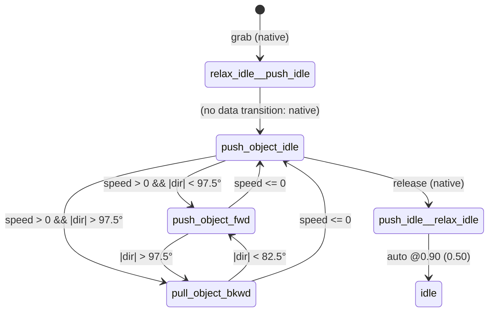
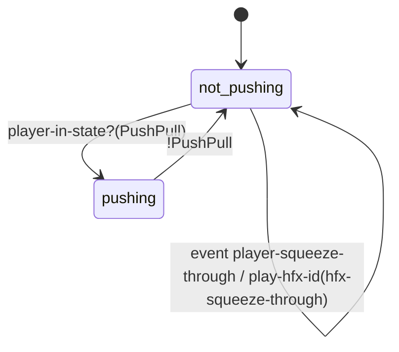
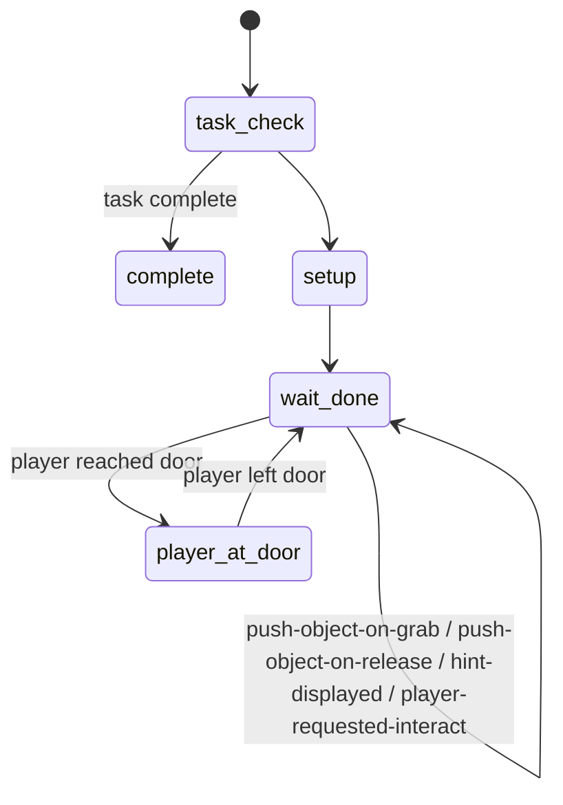
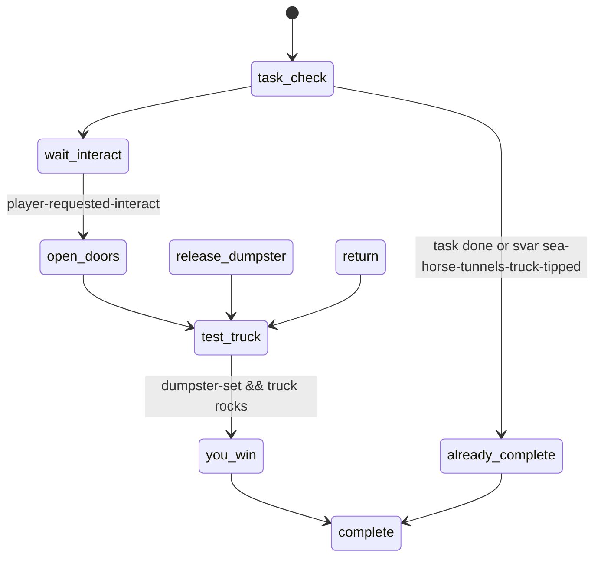

# Pushable Objects — dumpsters, carts, crates, shelves (`push-object-def`, native `PushPull`)

> Source analysed: TLOU2R PC 1.6 `dc1/` (dconstruct 2.2.0, private). `push-object.bin` defs and the push anim graphs
> extracted with `tools/analysis/traversal_asl.py` → [`push_object_defs.json`](push_object_defs.json).
> State machines from `databases/state_scripts.json` (`q.py ss`).
>
> Labels: **CONFIRMED** · **HIGH** · **INFERRED** · **UNKNOWN / NEEDS NATIVE RESEARCH**.
>
> Disambiguation (CONFIRMED by reading them): `npc-set-force-player-push` (107 calls) / `player-disable-push-by-npc` are
> about NPCs shoving the player; `ss/ss-push-follow-cam` pushes a *camera* onto the camera stack;
> `ss-t2r/ss-push-pull-blocker` is an invisible pass-through, nav-disabled proxy. None of these are pushable objects.

## 1. Overview & files

There are two ways a player "pushes" something:

1. **Systemic physics pushables (the common case).** The object carries a `push-object-def` (from `push-object.bin`),
   is grabbed through an interactable (`interact-push-generic`, `interact-push-far`, `interact-push-sniper-street`,
   `interact-puzzle-pushable`), and the **native `PushPull` player state** moves it as a physics body while the player
   plays strafe-style push/pull locomotion (`*player-push-pull-set*`). Scripts only observe (`player-in-state?(PushPull)`,
   86 queries), nudge (`push-object-apply-force/impulse`, `set-body-friction`, `set-body-max-velocity`), steer
   (`push-object-set-desired-facing-xz`), or take over (`push-object-set-game-driven`).
2. **Scripted pushes / IGCs.** A state script aligns player (and buddy) to an AP and plays paired animations on
   player + object (`ss-wat-horse-explore-crossover-push-object`, `ss-afm-brewery-push-fridge`, door-push templates).
   No physics, no `PushPull`.

| file | type | role |
|---|---|---|
| `push-object.bin` | data | 19 `push-object-def` + 1 `push-object-tremble-settings` |
| `anim-player/player-strafe-sets.bin` → `*player-push-pull-set*` | data | 8-direction push strafe set (`push-heavy-strafe-{fw-0,fw-45-l/r,fw-90-l/r,bkwd-135-l/r,bkwd-180}` + `^idle` stops, `push-idle`) |
| `anim-player/player-strafe.bin` | data | `push-strafe-idle-ap`, `push-strafe-idle^move-ap`, `push-strafe-move-ap`, `push-strafe-move^idle-ap` (bindpose placeholders filled from the set) |
| `anim-player/player-push-object.bin` | data (5 states) | older/alternate graph: `relax-idle^push-idle`, `push-object-idle`, `push-object-fwd`, `pull-object-bkwd`, `push-idle^relax-idle` |
| `anim-npc.bin` | data | NPC push states `s_push-enter/idle/idle^move/move/move^idle/exit` |
| `camera.bin` → `*camera-strafe-push-pull-default*` | data | push camera (strafe settings) |
| `interactable.bin` | data | push interact defs (below) |
| `audio-sfx/common-objects/aud-sfx-pushables.bin` | data | roll loops / impacts |
| `ss-t2/ss-dumpster-rumble` | state script | generic per-pushable haptics/rumble from the g-meter |
| level scripts | state scripts | puzzles: `ss-nor-ellie-alone-controller-puzzle-dumpster`, `ss-sea-hub-truck-rope-puzzle`, `ss-sea-horse-sanc-*`, `ss-sle-tommy-sniper-into-building-cart`, `ss-sub-grocerystore-puzzle-rope`, `ss-res-stores-runner-trap-combat`, … |

### 1.1 `push-object-def` schema (positional; CONFIRMED values, meanings INFERRED unless noted)

| offset | example (`push-object-dumpster`) | meaning |
|---|---|---|
| 0x000 | `push-object-dumpster` | def name (CONFIRMED) |
| 0x008/0x010 | 4 × `{joint, who, 1.0}` | **grab attach points**: joints `back_ap_attach`, `front_ap_attach`, `left_ap_attach`, `right_ap_attach` for `player` (CONFIRMED names; wood-large has 8: `*_ap_a/_b_attach`; cart only `front`) |
| 0x018 / 0x038 | vector (0,0,0,1) | offsets (UNKNOWN) |
| 0x020 | `push-object-tremble-settings-generic` | tremble/shake settings ref (CONFIRMED ref) |
| 0x028–0x030 | 0.20, 2.00, 0.50 | UNKNOWN (identical in all defs) |
| 0x048 | `*camera-strafe-push-pull-default*` | camera (CONFIRMED ref) |
| 0x058 / 0x060 | `"default"`/`"push-cover"`, `"push-heavy"`, `"push-super-heavy"` | weight/mode class strings — name suggests anim weight & cover behaviour |
| 0x0A0 | `push-object-interaction-probes` (2 probes, height 0.8, radii 0.1/0.4, 0.3) | grab-validity probes (INFERRED) |
| 0x0AC / 0x0B0 | 0.65, 1.80 | UNKNOWN (INFERRED: min/max grab distance or height) |
| 0x0BC–0x0CC | 15, 15, 10, **8 or 500** | 0x0CC = 500 for scaffold / cart / crate-z (likely mass or max-force; INFERRED) |
| 0x0D0 | `push-object` | kind tag |
| 0x0D8 | `sfx-push-dumpster-roll-lp`, `sfx-push-metal-utility-cart-roll-lp`, `sfx-phy-wood-rolling-box-roll`, 0 | rolling loop SFX (CONFIRMED names) |
| 0x0E0 | `root` | driven joint |
| 0x0E8 | `*player-push-pull-set*` | player strafe set (CONFIRMED ref; same for all 19) |
| 0x0F8–0x118 | `*push-object-{grab,release,move-start,move-loop,move-stop}-haptic-effect*` | haptics (CONFIRMED names) |

Defs: `push-object-{wood-large, dumpster, sea-horse-sanc-dumpster, generic-mp, heavy, scaffold, cart, dumpster-proto,
sniper-cart, auc-ball-cart, flo-arcade-cart, wood, wood-no-buoyance, crate-z, generic, flo-gate-pushcart,
wood-spot-fix-in-open-water, sle-mil-rolling-case-cart, generic-quick}`. None is referenced by DC code (only
`modules.bin`), so objects get their def from level data (INFERRED).

Interact defs (CONFIRMED values): `interact-push-generic` radius 2.00 / dist 5.00, joint `root`, 0x060 = 1.05;
`interact-push-far` 2.00 / 7.00; `interact-puzzle-pushable` 2.00 / 4.00 / 4.50; activation SFX
`sfx-ui-acc-interact-dumpster-grab`.

## 2. State machines

### 2.1 Native `PushPull` ↔ anim graph `anim-player-push-object-states` — CONFIRMED graph



Thresholds from embedded lambdas: `*(f32*)(info+672) > 0` (move speed) and `abs(*(f32*)(info+676)) < 90 ± 7.5`
(move direction relative to object) — 15° hysteresis band (CONFIRMED arithmetic; field identity INFERRED). Blend nodes
mix `push-fwd` / `push-fwd-right` / `push-fwd-left` (and `pull-bkwd[-left/-right]`) by `lerp-scale(0..±90° → 0..1)` on a
steering angle (CONFIRMED). Face overlay `face-effort`.

The strafe path (`push-strafe-*-ap`, triggers `idle^strafe`, `strafe-move`, `strafe^idle`, `strafe-idle`, exits
`idle`/`run`) is what `ss-vox-res-stores-alleys` checks (`get-object-anim-state(player) == push-strafe-idle-ap /
-move-ap`), so the shipped push locomotion is the strafe set from the def (HIGH).

### 2.2 `ss-dumpster-rumble` (generic, `options { player }`) — CONFIRMED



### 2.3 `ss-nor-ellie-alone-controller-puzzle-dumpster` (Seattle Day 1, Ellie alone) — CONFIRMED



### 2.4 `ss-sea-hub-truck-rope-puzzle` (truck see-saw + dumpster) — CONFIRMED



### 2.5 `ss-bidris-push-object-test` (prototype "kick it away") — CONFIRMED

`wait-push-away → push-away` (while `PushPull`, melee-attack → kick anim) `→ roll` (apply force 25 decaying 15/s) `→ wait-push-away` when velocity = 0.

## 3. Per-state call graph (`!` = native)

### `ss-dumpster-rumble:pushing` (update)

```
pushing
 ├─ haptics device (joypad-has-haptics?(2)!)
 │    ├─ g = |push-object-get-gmeter()!| averaged with last frame
 │    ├─ g > 4.0 → play-hfx-id(push-haptic-hard-impact) ; g > 3.0 → push-haptic-medium-impact
 │    └─ frame-rumble = lerp-scale(1.01..3.0 → 0..1) → hfx push-haptic-impact gain ×0.8, freq 0.04–0.08 ramps
 └─ rumble-only device
      ├─ g > 3.5 → rumble(lerp-scale(3.5..6.0 → 1.0..1.0))  [bump]
      └─ g > 1.5 → rumble(lerp-scale(1.5..3.5 → 0.0..0.2))  [rolling]
```

### `ss-nor-ellie-alone-controller-puzzle-dumpster`

```
wait-done
 ├─ start: if dropped-in-right-place && in rgn-…-ramp-check-1: until in ramp-check-5:
 │         set-body-friction(dumpster, 0.06)! · set-body-max-velocity(dumpster, 0.30, 0.30)!   [slow roll down the ramp]
 │         then friction 0.04, max-velocity 6.0
 ├─ update: !grabbed && dropped-in-right-place && in ramp-check-1 && !ramp-check-5
 │         → push-object-apply-impulse(dumpster, toward pos-3760, …)!                       [assist toward goal]
 ├─ event push-object-on-grab → friction 0.04, max-velocity 6.0
 ├─ event push-object-on-release → dropped-in-right-place = in ramp-check-1 ; dropped-low-on-ramp = in ramp-check-3
 │         > 2 successful drops → gui2-show-attachable-playerspace-tutorial(*ws-sprint-tutorial*)
 │         hint swap: send turn-off(hint-nor-dumpster-1) · turn-on(hint-nor-dumpster-2)
 ├─ hint track: wait-for-event(hint-displayed) → vox hint · wait-say · send activate-waypoint(hint-nor-dumpster-1)
 └─ event player-requested-interact → last-grabbed-dumpster = 0
player-at-door
 ├─ if dumpster off-screen && in ramp-check-2 && dropped right:                            [invisible cheat-assist]
 │    push-object-set-game-driven(dumpster, 0.0)! · disable-collision(body + lid_l/r + 4 wheels + 4 wheelmounts)
 │    set-object-teleport · set-object-locator(closest point on spl-nor-dumpster-test-1)! · flatten
 │    send set-physics-driven(dumpster) · push-object-apply-impulse(dumpster, pos-…-move-here-1 z, 4.35)!
 ├─ wait-boolean(player-at-door, 0)
 └─ stop-animating(dumpster) · send set-physics-driven → go(wait-done)
```

### `ss-sea-hub-truck-rope-puzzle:test-truck` (excerpt)

```
test-truck
 ├─ animate_(truck, rock) / vox lines
 └─ when player-in-state?(PushPull)! && within 1.0 m of pos-2717 && stick pressed toward goal:
      joypad-force-command(object-interact)! · joypad-force-command(interact)!              [force release]
      enable-collision-gamedriven(dumpster)! → wait-stub-object-lerp(dumpster, pos-2714 1.5 s → 2715 0.5 s → 2716 0.5 s)!
      enable-physics(dumpster, 0, 0.5)  (= send physicalize-live)                        [scripted "drop into truck"]
you-win → interactable-disable(dumpster) · set-svar(sea-horse-tunnels-truck-tipped, 1) → complete
```

### `ss-sle-tommy-sniper-into-building-cart` (excerpt)

```
move-cart-to-manny-follow-region / move-cart-to-parking-lot (update)
 └─ if player-in-state?(PushPull)! → push-object-set-desired-facing-xz(cart, orient spawner, 0.01)!   [auto-steer]
--all-- : event player-requested-interact → set-svar-as-boolean(sle-sniper-cart-ever-used, 1)
```

### `ss-wat-horse-explore-crossover-push-object` (scripted push)

```
task-check   animate-start(obj, …--object, ap, 0) ; done → animate-done(…) → complete ; active → wait-rope-thrown-over
wait-rope-thrown-over  event rope-thrown-over-gate → wait-interact
wait-interact          interactable-enable(int-…-push-object-1)! ; player-requested-interact → get-in-position
get-in-position        ellie: wait-player-move-to-entry(--ellie anim, ap, …, 0.40, apReference-camera1, apReference …)
                       dina:  wait-npc-move-to-entry-frame(dina, --dina anim, ap, …, npc-m-ambi-entry-table)!
                       both signal ready → animate_ bindpose hold → go(move-object)
move-object            animate_(object, --object, {10: ap}) · animate_(dina, --dina, {10: ap, 28: 0.5, 30: 0.5})
                       wait-animate_(player, --ellie, {10: ap, 28: 0.5, 30: 0.5}) → complete
```

## 4. Answers to the specific questions (interact → align → grab → move → turn → release)

| phase | who | evidence |
|---|---|---|
| **Interact / prompt** | native interactable system with `interact-push-*` defs; scripts gate with `interactable-enable/disable` (e.g. grocery cart disabled while rope held) | CONFIRMED |
| **Align** | native: def attach points (`*_ap_attach` joints) + interaction probes choose a side; the strafe states are `*-ap` (AP-relative) | HIGH (data) / native internals UNKNOWN |
| **Grab** | native → event `push-object-on-grab` (4 handlers, 0 senders), `player-grab-cart` (3 handlers); haptic `*push-object-grab-haptic-effect*`; anim `relaxed-idle^push-idle` | CONFIRMED events / HIGH |
| **Move** | native `PushPull` drives the rigid body (force/velocity), player plays `*player-push-pull-set*` 8-way strafe; script can tune `set-body-friction`, `set-body-max-velocity`, add `push-object-apply-force/impulse`; `push-object-get-gmeter()` exposes accelerations | CONFIRMED calls |
| **Turn** | anim blends by steering angle (±90°); push/pull switch at 97.5° / 82.5° hysteresis; scripts can force orientation with `push-object-set-desired-facing-xz(obj, locator, rate)` | CONFIRMED |
| **Release** | player input (`release-push-object` command exists, forced in `ss-sle-…-tommy-controller`) or script `joypad-force-command(interact / object-interact)`; event `push-object-on-release` (6 handlers); anim `push-idle^relaxed-idle → idle` | CONFIRMED |
| **Physics** | body is live physics; `push-object-set-game-driven(obj, blend)` hands it to animation/script, `send-event(set-physics-driven, obj)` hands it back; `wait-stub-object-lerp` + `enable-physics` for scripted moves | CONFIRMED |
| **Animation** | data graphs above; `-ap` states use bindpose placeholders filled from the strafe set | CONFIRMED / HIGH |
| **Navigation** | pushables can be nav blockers (`enable/disable-nav-blocker-object(obj-sea-horse-sanc-dumpster-1)` toggled for accessibility pathfinding); `find-closest-point-on-nav-mesh` used by rope/cart leash | CONFIRMED |
| **Camera** | `*camera-strafe-push-pull-default*` per def (data); no script camera needed | CONFIRMED |
| **Audio / haptics** | def roll-loop SFX + 5 haptic effects; `ss-dumpster-rumble` adds g-meter haptics | CONFIRMED |

## 5. Engine boundary

| behaviour | DC | data | native | confidence |
|---|---|---|---|---|
| Grab detection, side selection, alignment | – | attach points, probes | ✔ | HIGH |
| Push/pull locomotion & body driving | – | strafe set, push graph | ✔ `PushPull` | HIGH |
| Push/pull direction switching | – | ✔ lambdas in graph (97.5°/82.5°) | reads controller fields | CONFIRMED |
| Puzzle goals, hints, assists, cheats | ✔ | regions/spawners | – | CONFIRMED |
| Body tuning at runtime | ✔ calls | – | ✔ applies | CONFIRMED |
| Physics ↔ animation hand-off | ✔ calls/events | – | ✔ | CONFIRMED |
| Haptics from motion | ✔ `ss-dumpster-rumble` | haptic effect refs | `hfx-*`, g-meter | CONFIRMED |
| Scripted (IGC) pushes | ✔ entire flow | paired anims | anim engine | CONFIRMED |

## 6. Events in / out

| event | flow | count |
|---|---|---|
| `push-object-on-grab` | native → scripts | 4 handlers, 0 senders |
| `push-object-on-release` | native → scripts | 6 handlers + 1 wait, 0 senders |
| `player-grab-cart` | native/level → scripts | 3 handlers |
| `player-requested-interact` | native → scripts | used to detect re-grab |
| `set-physics-driven` | script → object | native handler |
| `physicalize-live` / `physicalize-gamedriven` / `unphysicalize` | via `enable-physics` / `enable-collision-gamedriven` / `disable-collision` wrappers | native |
| `hint-displayed`, `turn-on/off`, `activate-waypoint` | puzzle ↔ hint objects | DC↔DC |

## 7. Persistence

Puzzle completion via tasks and svars (`sea-horse-tunnels-truck-tipped`, `sle-sniper-cart-ever-used`) (CONFIRMED).
Pushable world position across checkpoints: not handled in DC (UNKNOWN / native save of dynamic objects).

## 8. Animation / camera / UI / audio hooks

- Player anims: `push-heavy-strafe-*` (set), `push-fwd[-left/-right]`, `pull-bkwd[-left/-right]`, `push-idle`,
  `relaxed-idle^push-idle`, `push-idle^relaxed-idle`; NPC `s_push-*`.
- UI: `*ws-sprint-tutorial*` after repeated correct drops; hint waypoints.
- Audio: `sfx-push-dumpster-roll-lp`, `sfx-push-metal-utility-cart-roll-lp`, `sfx-phy-wood-rolling-box-roll`;
  UI `sfx-ui-acc-interact-dumpster-grab`.
- Haptics: `push-haptic-{impact,medium-impact,hard-impact}`, `hfx-squeeze-through`.

## 9. Shared components

- Ropes: `rope-set-body-constraint(rope, cart, root, 1)` ties a rope to a pushable cart; `PushPull` gates untie.
- Ladders: `ss-basic-ladder` drops the carried ladder when `PushPull` starts.
- Physics wrappers `nd-phys-script-funcs` (enable-physics/collision) shared by all props.
- Accessibility: `set-accessibility-pathfind-goal`, nav-blocker toggles, `is-traversal-audio-cues?`.

## 10. Confidence table

| claim | label |
|---|---|
| 19 push-object-defs and their attach joints, SFX, camera, strafe set refs | CONFIRMED |
| Push/pull thresholds 97.5° / 82.5°, speed > 0 | CONFIRMED (field identity INFERRED) |
| Shipped push locomotion uses strafe set `-ap` states | HIGH |
| Grab/release events sent natively | HIGH (0 DC senders) |
| Def float field meanings (0xAC, 0xB0, 0xCC …) | INFERRED / UNKNOWN |
| Def assignment via level data | INFERRED |

## 11. Open questions

- Meaning of `push-object-def` floats (0x028–0x030, 0x0AC/0x0B0, 0x0BC–0x0CC) and `push-object-interaction-probes`.
- Role of the 5-state `anim-player-push-object-states` graph vs the strafe `-ap` states (legacy or heavy-object path?).
- How `"push-cover"` mode interacts with the cover system.

## 12. Modding surface

| target | rating | reason |
|---|---|---|
| Roll SFX / haptic refs / camera ref in `push-object-def` | GREEN | symbol swaps in data |
| `*player-push-pull-set*` anims & speeds (25.0 per direction) | GREEN | data |
| `ss-dumpster-rumble` thresholds | GREEN | small self-contained script |
| Puzzle assists (friction, max velocity, impulses, regions) | YELLOW | level-specific script constants |
| Unknown def floats (mass/force?) | ORANGE | semantics unconfirmed, global per type |
| Making a new object pushable / grab logic | RED | level data + native `PushPull` |
