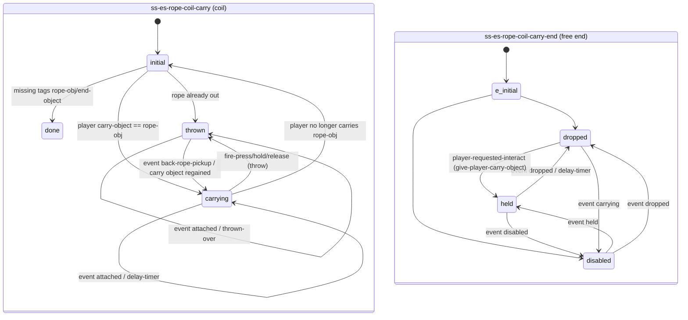
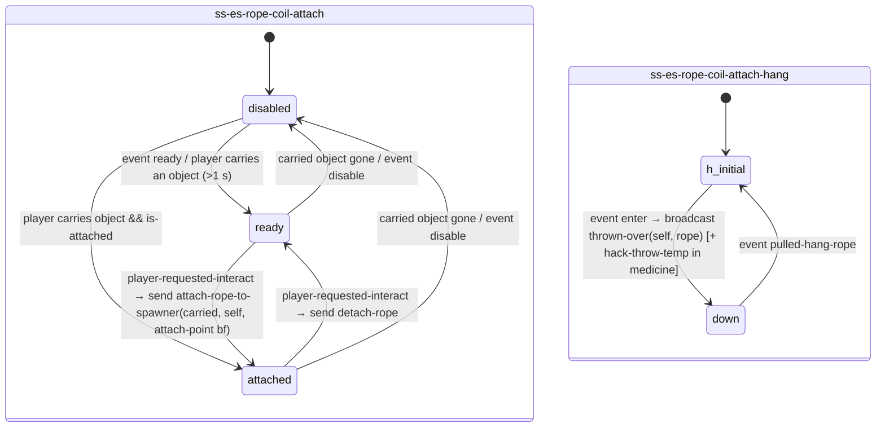
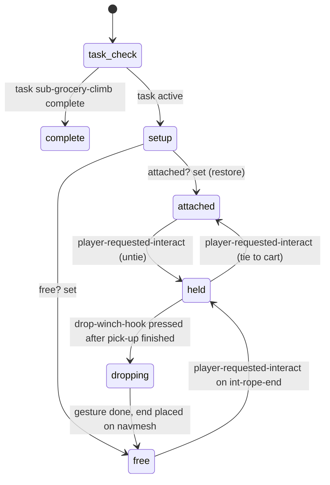
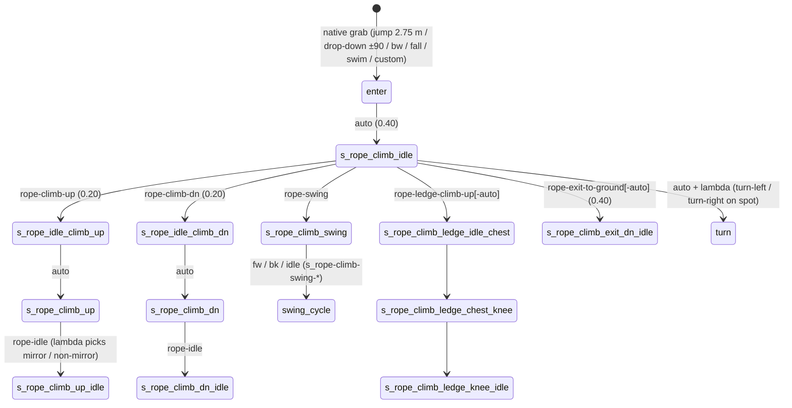

# Ropes — physics rope, carry/throw rope, rope climb/swing, rope puzzles

> Source analysed: TLOU2R PC 1.6 `dc1/` (dconstruct 2.2.0 output, private). Anim graphs extracted with
> `tools/analysis/traversal_asl.py` → [`rope_anim_graphs.json`](rope_anim_graphs.json) (5 graphs, 155 states).
> State machines from `databases/state_scripts.json` (`q.py ss`), event stats from `databases/events.json`.
>
> Labels: **CONFIRMED** · **HIGH** · **INFERRED** · **UNKNOWN / NEEDS NATIVE RESEARCH**.
>
> Decompiler caveat (CONFIRMED): for modules containing two state scripts (`ss-es-rope-coil-attach`,
> `ss-es-rope-coil-carry`) dconstruct's `.dcpl` merges both scripts' blocks into one listing. The state machines
> below come from our own parser (`state_scripts.json`), the call details from the `.dcpl`.

## 1. Overview & files

A TLOU2 rope is split across **five separable concerns**:

| concern | owner | evidence |
|---|---|---|
| **Rope simulation** (verlet/constraint rope, pins, keyframed points, query points, drape detection) | native rope object | natives `rope-pin-at-location` (21 calls), `rope-pin-at-point` (5), `rope-keyframe-point` (37), `rope-reset-to-line`, `rope-add-query-point`, `rope-get-query-point`, `rope-set-body-constraint` (7), `rope-clear-body-constraint`, `rope-get-length`, `rope-get-attached-locator`, `is-rope-draped?`, `set-rope-end-attachment`, `set-rope-secondary-owner` — all native (CONFIRMED kind) |
| **Rope tuning data** | `rope.bin`, `phys-ropes.bin`, `audio-sfx/common-objects/aud-sfx-gbl-rope-*.bin` | `rope-vars`, `rope-sound-params`, `rope-mesh-info` (CONFIRMED; not referenced by DC code → read natively, HIGH) |
| **Carry / throw rope** (player holds a coil/hose, aims, throws, drapes) | native carry-object + `carry-rope-*` natives | `get-carry-rope-rope` (25), `get-carry-rope-drape-position` (53), `-drape-length`, `-end-position` (23), `carry-rope-interactable-enable/disable`, `throw-carry-rope`, `drop-rope`, `grab-rope`, `player-pick-up-rope`, `player-drop-rope`, `character-pickup-carry-rope`, `player-rope-can-throw`, event `start-with-rope` (CONFIRMED native) |
| **Player rope locomotion** (climb, swing, wall-run, free rope, drag) | native player states `RopeClimb` (89 queries), `FreeRope` (6), `WallRope` (2), `GunMoveRope` (5) + anim data | `anim-player/player-rope.bin` (41 states), `player-free-rope.bin` (50), `player-wall-rope.bin` (46), `player-from-wall-rope.bin` (8), `player-drag-rope.bin` (10); `anim-character/character-rope.bin` is an **empty** 45-byte module (CONFIRMED) |
| **Puzzle state** (where the rope must be, what it's tied to, hints, progression) | DC level scripts | `ss-t2/ss-es-rope-coil-{carry,attach,fixed,buddy-catch}`, `ss-suburbs/ss-sub-grocerystore-puzzle-rope`, `ss-patrol/ss-pat-supermarket-rope-prompt`, `ss-watchtower/ss-wat-infected-tunnels-rope-spawner`, `ss-finding-nora/…-rope-puzzle-progression`, `ss-t2/ss-rope-swing-haptics`, `ss-t2/accessibility/ss-accessibility-{climb-rope,rope-swing,rope-jump-off,throw-rope}` |

Interaction definitions (`interactable.bin`, all `game-interactable-def`, CONFIRMED values):

| def | 0x008 (INFERRED: activate radius m) | 0x028 (INFERRED: visible/hint dist m) | 0x030 | prompt text 0x0D0 | button 0x0F0 | activation SFX 0x1E8 |
|---|---|---|---|---|---|---|
| `interact-rope-climb` | 1.50 | 8.00 | 2.50 | `gen:jump` | `jump` | `sfx-ui-acc-interact-rope-climb` |
| `interact-rope-point` | 3.00 | 7.00 | 4.50 | `gen:interact` | – | – |
| `interact-puzzle-rope-attach` | 3.00 | 7.00 | 1.00 | `gen:interact` | – | – |
| `interact-carry-rope` | 1.00 | 2.50 | 2.50 | `gen:interact`, HUD `HUD_INTERACTABLE_CARRY` | – | `sfx-ui-acc-interact-rope-pickup` |
| `interact-carry-rope-tall`, `-large-activation`, `interact-rope-elevator`, `interact-rope-climb-alt`, `flo-interact-rope-climb`, `interact-climb-up/-down[-alt]` | … | … | | | | |

`interact-puzzle-rope-attach` / `interact-rope-climb` are never named by DC code (only `gui2-game` / `modules` lists),
so they are assigned to objects in level data (INFERRED). Scripts swap rope defs with
`override-interact-def(obj, interact-carry-rope | -tall | -large-activation)` (CONFIRMED, 4 sites).

## 2. State machines

### 2.1 Generic rope coil (`ss-t2/ss-es-rope-coil-carry.bin`, 2 scripts) — CONFIRMED



### 2.2 Attach points (`ss-es-rope-coil-attach.bin`, 2 scripts) — CONFIRMED



### 2.3 `ss-es-rope-coil-fixed` — CONFIRMED

`free → pickup → hold → thrown → {pickup | hold | hung}`, `hung → hold` (events `player-requested-interact`,
`thrown-over`).

### 2.4 `ss-sub-grocerystore-puzzle-rope` (rope tied to a pushable cart) — CONFIRMED



### 2.5 `ss-pat-supermarket-rope-prompt` (Jackson patrol: throw hose over beam, Dina climbs) — CONFIRMED

`task-check → anim-start → {wait-remove-masks → wait-try-gate → try-gate-igc-intro → try-gate-igc} →
wait-pickup-rope → {ellie-rope-igc | wait-dina-pickup-rope → dina-pickup-rope → dina-rope-igc} → throw-prompt →
climb-prompt → dina-call → complete`; any of the late states → `puzzle-skipped` on event `puzzle-skipped`.

### 2.6 Rope climb anim graph `anim-player-rope-states` (41 states, `CharacterRope` subsystem) — CONFIRMED



Mirror variants (`*-mirror`) exist for every idle/climb state; `s_rope-climb-idle^free-idle-mirror` etc. bridge to the
free-rope graph.

## 3. Per-state call graph (selected; `!` = native)

### `ss-es-rope-coil-carry` (coil)

```
initial
 ├─ interactable-disable(attached-obj)! ; fact-set(player, carrying-rope-coil-obj, 0) ; fact-set(player, carrying-rope-coil, false)
 ├─ (end script) spawn-entity-at(thrown-rope, start-attach spawner)! · interactable-disable · send make-unusable
 │    rope length from art group: rope3m=3 · rope4m=4 · rope5m=5 · rope8m=8 · rope10m=10 · rope13m=13 · rope14m=14
 │    rope-add-query-point(thrown-rope, length)!                                         [CONFIRMED table]
 └─ update: get-player-carry-object-id()! == rope-obj → fact-set(carrying-rope-coil…, true) · send disabled(end-object) · go(carrying)
carrying
 ├─ kill-entity-if-spawned(thrown-rope) · interactable-disable(self)
 ├─ update: joypad-disable-commands(aim, drop-idle, drop-hold, prone-toggle)!
 ├─ update: fire-press|fire-hold|fire-release → send held(end-object) · go(thrown)            [throw = fire button]
 ├─ update: interact after 1 s → start-timer(delay-timer, 0.25)
 └─ event attached → spawn thrown-rope at r_hand_prop_attachment · send dropped(end-object) · go(dropped)
thrown
 ├─ spawn-entity-at(thrown-rope, r_hand_prop_attachment rotated 180°)! · rope-reset-to-line()! · send make-unusable
 ├─ update: rope-keyframe-point(rope, 0, r_hand_prop_attachment)!                          [hand end follows player]
 │          other end: rope-pin-at-point(rope, dist, coil pos)! | rope-keyframe-point(rope, len, hang-obj +0.25 m)!
 ├─ event thrown-over(region) → set hang-rope-reg · go(disabled)
 └─ event back-rope-pickup → send carrying(end-object) · go(carrying)
```

### `ss-es-rope-coil-carry-end` (free end)

```
held
 ├─ update: set-object-locator(self, blend toward l_hand_prop_attachment, pos 15·dt, rot 5·dt)!
 ├─ update: fire after 1 s → spawn-entity(rope-obj) · give-player-carry-object(rope-obj)! · broadcast pulled-hang-rope · go(disabled)
dropped
 ├─ update: rope-keyframe-point(thrown-rope, 0, self pos)!
 ├─ update: if manager rope-draped: rope-get-query-point(rope, len)! within 6.0 m of player →
 │          send make-usable (once) else make-unusable                                     [climbability gating]
 └─ event player-requested-interact → give-player-carry-object(rope-obj)! · send picked-up(attached-obj) · go(held|disabled)
```

### `ss-es-rope-coil-attach:ready`

```
ready
 ├─ wait 1.0 · interactable-enable(self)! · is-attached = 0
 ├─ update: player-get-carried-object()! == 0 → go(disabled)
 └─ event player-requested-interact
      └─ send-event(attach-rope-to-spawner, player-get-carried-object()!, self, spawner-locator(tag attach-point | self))
         → go(attached)                                                                 [no DC handler: native rope]
```

### `ss-sub-grocerystore-puzzle-rope`

```
free
 ├─ interactable-enable(tag int-rope-end)!
 └─ update: rope-keyframe-point(self, tag rope-length, end-position, 0, 0)!                 [end lies on ground]
held
 ├─ player: camera-enable-animated(1.3 …)! · wait-animate_(player, ellie-rope-pick-up | ellie-rope-tie, {10: ap, 28: 0.8, 30: 0.8})
 ├─ rope:   wait 20 (free) / 40 (attached) frames · [attached → rope-clear-body-constraint(self)!] · player-pick-up-rope(self)!
 ├─ update: joypad-disable-commands(crouch-*, prone-toggle)
 ├─ update: rope end follows r_palm (fake-attach) → rope-keyframe-point(self, len, r_palm, 1, 0)!
 ├─ update: nearest of sub-grocerystore-interact-points → attach-spawner
 ├─ update: if dist(start, player) > len − 1.30 → closest-nav-locator = find-closest-point-on-nav-mesh(player, 3, 5)!  [leash]
 └─ update: drop-winch-hook pressed → go(dropping)
attached
 ├─ wait-animate_(player, ellie-rope-tie) · 40 frames → player-drop-rope()!
 ├─ rope-set-body-constraint(self, obj-sub-grocerystore-cart-1, root, 1)!                   [rope now drags the cart]
 ├─ update: rope-keyframe-point(self, len, attach-spawner + 0.07 z, 1, 0)!
 └─ update: player-in-state?(PushPull)! → interactable-disable(cart attach) else enable     [can't untie while pushing]
dropping
 ├─ gesture_(player, ellie-rope-drop-gesture)! → player-drop-rope()!
 └─ end-position = closest navmesh point to player (if within leash) · interactable-enable(int-rope-end, cart)
```

### `ss-pat-supermarket-rope-prompt:throw-prompt`

```
throw-prompt
 ├─ !GunMoveRope && carrying carry-object-pat-hose-3 → hud2-play-prompt-stack-tutorial(*stack-rope-throw-tutorial*, fire-press)
 ├─ make-rope-unusable(hose)  (= send make-unusable)
 ├─ loop until drape OK: get-carry-rope-drape-length(hose)! ≥ 3.00 AND drape position in rgn-pat-rope-drape-1|2
 │    → rope-draped? = 1 · carry-rope-interactable-enable(hose)!                       [success criterion, CONFIRMED]
 ├─ success: grab-rope(dina, get-carry-rope-rope(hose)!)! · wait-animate_(dina, pat-market-dina-climbs-rope[-alt]--dina)
 │           → …-roof-jump--dina → drop-rope(dina)! · make-rope-usable(hose) · enable-action-pack(tap-accessibility-climb-rope-1)
 ├─ update: not draped for > 30 frames → carry-rope-interactable-enable (let player re-pick)
 ├─ update: accessibility pathfind goal = navmesh point near get-carry-rope-end-position(hose, 1.0)!
 └─ update: player-can-jump-to-rope?()! && dina-climbed? → go(climb-prompt)
```

### `ss-wat-infected-tunnels-rope-spawner:spawn-rope-1`

```
 ├─ spawn-entity-at(carry-object-wat-rope-1, spawner)! · interactable-disable · wait 1 · set-instance-flag-hero(get-carry-rope-rope(...))!
 ├─ tutorial: while in rgn-wat-player-on-rope-1 && !RopeClimb → wait; hud-play-tutorial(HUD_FTT_TUTORIAL_ROPE3_PC, rope-swing)…
 │            then HUD_FTT_TUTORIAL_ROPE4 (jump)
 ├─ events enable-rope / disable-rope → interactable-enable/disable(carry-object-wat-rope-1)
 └─ update: RopeClimb → enable-collision(ic-wat-rope-climb-top-collision-1) + hide rope from flashlight; else inverse
```

## 4. Answers to the specific questions

**Separation between physics, player animation, rope object, puzzle state, attachment points, prompts:**

| piece | implemented as | notes |
|---|---|---|
| Rope physics | native rope entity (art groups `rope3m…rope14m`, `rope14m`/`rope-thick-14m` mesh infos) | Scripts only *constrain* it: keyframe a point at a distance along the rope (`rope-keyframe-point(rope, dist, pos, flagA, flagB)`), pin (`rope-pin-at-point/location`), reset, or bind to a rigid body (`rope-set-body-constraint(rope, obj, joint, 1)`). |
| Rope tuning | `*rope-vars*`, `*rope-vars-limit-climb-up*` (`rope.bin`) | identical except field 0x040: 0.50 vs 6.50 (name suggests climb-up limit). 0x028 = 9.80 (gravity, HIGH). Other fields UNKNOWN. |
| Rope sound | `*chain-sound-params*`, `*carry-rope-sound-params*` (8 floats) + `aud-sfx-gbl-rope-{cable,chain,cord,hemp,hose,nylon}` | native consumer |
| Rope object ↔ usable for climbing | events `make-usable` / `make-unusable` (wrappers `make-rope-usable/unusable`, 0 DC handlers) | puzzle scripts toggle climbability, e.g. coil end makes rope usable only when player within 6 m of the draped query point |
| Carried rope | native carry object (`give-player-carry-object`, `get-player-carry-object-id`, `player-get-carried-object`) + `start-with-rope` event to player | throw is the fire button while carrying (CONFIRMED in coil script); aim/throw anims are in `player-free-rope` graph (`free-rope-aim`, `grapple-rope-aim-throw-release[-l/-r]`) |
| Attachment points | spawner locators + `attach-rope-to-spawner` / `detach-rope` / `rope-detach` / `attach-rope-to-npc` events (wrappers in `nd-phys-script-funcs`) carrying a bound-frame (spawner locator or joint locator) | 0 DC handlers → native rope (HIGH) |
| Drape detection | native `get-carry-rope-drape-position/length`, `is-rope-draped?`; scripts compare against designer regions + 3 m min length | |
| Puzzle state | DC: task checks, booleans, regions, hints | persistence via tasks / svars |
| Prompt | interactable defs (`interact-carry-rope` etc.) + `interactable-enable/disable`; the climb prompt uses `gen:jump` | `carry-rope-interactable-enable/disable` is the rope-specific toggle |
| Player animation | native `RopeClimb`/`FreeRope`/`WallRope` states + 5 data graphs | triggers below |

**Player rope anim triggers (CONFIRMED names; sent natively):**
- `player-rope` (climb): `rope-climb-up`, `rope-climb-dn`, `rope-idle`, `rope-swing`, `rope-ledge-climb-up[-auto]`,
  `rope-exit-to-ground[-auto]`. Enter variants: `s_rope-climb-2-75m` (jump to rope), `-drop-down[-left/-right/-backwards]`,
  `-start-fall`, `-start-swim`, `-start-custom`. `character-rope-climb-state-info` holds per-state phase floats
  (e.g. drop-down 0.21/0.60–0.85, start-fall 0.85/0.85 + 0.45/0.60) and a mirror flag (0x24 = 256/257) — exact
  meaning INFERRED (phase windows / hand side).
- `player-free-rope` (hanging free rope, aim, throw, reel): `climb`, `climb-down`, `swing`, `fw`, `bk`, `front`, `mid`,
  `wall-swing`, `wall-idle`, `free-rope-aim`, `free-rope-reload`, `aim`/`no-aim`, `idle-run-*` exits; states include
  `free-rope-bump*`, `free-rope-reach*`, `water-rope-*`, `swim^free-rope`, `drag^free-rope*`, `free-rope^jump-*`,
  `free-rope-idle^ledge-grab*`, `rope-unhook`, `free-rope-clasp/grip/reel`. Uses `character-weapon-tweak-state-info`
  (`anim-overlay-player-weapon-tweaks-free-rope`) for aiming on rope.
- `player-wall-rope` (run along wall on rope): `climb-up[-s]`, `climb-down[-s]`, `swing`, `kick`, `flip[-short]`,
  `slide`, `wall-rope-aim`, `wall-rope-reload`, plus the whole `ledge-climb-*` / `ledge-dyno-*` set (wall-rope ↔ edge).
  Per-state `player-rope-state-info` names a tell anim (e.g. `wall-vine-run-reach-tell`).
- `player-from-wall-rope`: `wall-rope-jump`, `-jump-land^{swing,swing-180,idle}`, `-jump-ledge-end[-perp[-wall]]`.
- `player-drag-rope`: `drag-rope-{idle,idle-aim,climb-up,climb-down,enter,bump-left/right,aim,death,idle^ledge-grab-fw}`
  (name suggests being dragged/hanging on a rope while aiming; INFERRED).

**NPC ropes.** `grab-rope(npc, rope)` / `drop-rope(npc)` / `character-pickup-carry-rope` are native; NPC climbs are
authored IGC animations (`pat-market-dina-climbs-rope--dina`) played by script while the NPC is attached (CONFIRMED).

## 5. Engine boundary

| behaviour | DC | data | native | confidence |
|---|---|---|---|---|
| Rope simulation, collision, drape | – | `rope-vars`, mesh info | ✔ | HIGH |
| Rope pin/keyframe/constraint commands | ✔ issues | – | ✔ executes | CONFIRMED |
| Attach / detach to spawner/NPC | ✔ sends events | – | ✔ handles (0 DC handlers) | HIGH |
| Usable-for-climb toggle | ✔ sends `make-usable/unusable` | – | ✔ | HIGH |
| Carry / aim / throw | ✔ gating (fire button, joypad disables) | anim graphs | ✔ carry-object + throw | HIGH |
| Climb / swing / wall-run locomotion | – | ✔ 5 graphs | ✔ `RopeClimb`/`FreeRope`/`WallRope` | HIGH |
| Puzzle success (drape length/regions, tie to cart) | ✔ | regions/spawners (level) | – | CONFIRMED |
| Rope swing haptics | ✔ `ss-rope-swing-haptics` (velocity vs camera angle → frequency 80–120, pan ±0.5) | – | `hfx-*` | CONFIRMED |
| Accessibility audio cues | ✔ `ss-accessibility-*rope*` (`player-can-jump-to-rope?()`, `get-carry-rope-end-position`) | `sfx-ui-acc-interact-rope-*` | ✔ | CONFIRMED |

## 6. Events in / out

| event | flow | handlers / senders |
|---|---|---|
| `attach-rope-to-spawner`, `attach-rope-to-npc`, `rope-detach`, `detach-rope` | script → rope object | 0 DC handlers (native) |
| `make-usable`, `make-unusable` | script → rope | 0 DC handlers |
| `start-with-rope` | script → player | 0 DC handlers (native player) |
| `drop` | script → carry rope object (wat spawner + 5 others) | 0 DC handlers (native carry object) |
| `thrown-over` | hang-region script broadcast → coil scripts | DC↔DC |
| `pulled-hang-rope` | coil-end broadcast → hang scripts | DC↔DC |
| `ready`, `held`, `dropped`, `carrying`, `disabled`, `picked-up`, `attached` | between coil / end / attach scripts | DC↔DC |
| `rope-puzzle-complete`, `player-in-rope-puzzle-area`, `rope-attached` | level → puzzle controllers | 0 DC senders (level regions / native) — `rope-attached` handled only by test `ss-es-throwable-rope` |
| `player-changed-state` | native → e.g. supermarket climb-prompt | |

## 7. Persistence

Rope puzzles re-derive state from task progress in `task-check` (`task-complete?/task-active?`) and booleans restored by
setup tracks (`attached?`/`free?` in the grocery script are pre-set by restore logic and waited on with
`wait-boolean`) (CONFIRMED). Player facts `carrying-rope-coil(-obj)` are set with `fact-set` (session facts, INFERRED
not saved). Rope physical pose persistence: UNKNOWN (native).

## 8. Animation / camera / UI / audio hooks

- Scripted player anims: `ellie-rope-pick-up`, `ellie-rope-tie`, gesture `ellie-rope-drop-gesture`, with option keys
  10 (ap-ref), 28 (blend-in, 0.8), 30 (start phase/blend, 0.8) — key meanings INFERRED (see drawer brief).
- Cameras (data only, unreferenced by DC): `*camera-strafe-rope-climb*`, `*camera-free-rope-settings-strafe*`,
  `*camera-wall-rope-settings-strafe*`, `*camera-strafe-wall-rope-climb[-close]*`, `*camera-strafe-clamber-rope*`,
  `*camera-strafe-tree-rope-harness*`; scripted: `camera-enable-animated(1.3, …)` during tie/pick-up.
- HUD: `HUD_FTT_TUTORIAL_ROPE3_PC`, `HUD_FTT_TUTORIAL_ROPE4`, `TIP_ACCESS_ROPE_SWING`, `*stack-rope-throw-tutorial*`.
- Haptics: `ss-rope-swing-haptics` while `RopeClimb`.

## 9. Shared components

- Pushables: rope ↔ cart body constraint (grocery store); `PushPull` gates the untie prompt.
- Edge/ledge graphs: `climb-edge^wall-rope-*`, `ledge-grab^wall-rope-*`.
- Carry-object system shared with planks/ladders (`give-player-carry-object`, `get-player-carry-object-id`).
- `nd-phys-script-funcs` wrappers (`enable-physics`, `enable-collision`, `physicalize-*` events) shared with all props.

## 10. Confidence table

| claim | label |
|---|---|
| 5 rope anim graphs, state names, triggers, blend times | CONFIRMED |
| Rope sim / attach / usable events handled natively | HIGH (0 DC handlers) |
| Rope length table by art group | CONFIRMED |
| Drape success = length ≥ 3 m + region | CONFIRMED (supermarket) |
| `rope-vars` field meanings (besides gravity) | UNKNOWN |
| Player-state ↔ graph mapping (RopeClimb↔player-rope, etc.) | INFERRED (names) |
| `interact-puzzle-rope-attach` assignment via level data | INFERRED |

## 11. Open questions

- Field layout of `rope-vars`, `rope-mesh-info` (14 m / 0.03 / 600 / 10), `rope-sound-params`.
- Semantics of `rope-keyframe-point` flags (args 4/5) and of `rope-pin-at-point` vs `-at-location`.
- How the native throw picks a drape target (any geometry? marked edges?).
- Who sends `rope-puzzle-complete` (level region vs native rope).

## 12. Modding surface

| target | rating | reason |
|---|---|---|
| Rope climb/swing anim blend times & exit phases | GREEN | data graphs |
| Rope cameras | GREEN | data |
| Drape success thresholds / regions in puzzle scripts | YELLOW | script constants (3.0 m, 6.0 m, len − 1.30 leash) |
| Tie-to-cart, attach-point logic | YELLOW | DC + level spawners |
| `rope-vars` physics constants | ORANGE | positional unknown fields, global effect |
| New rope types / throw behaviour / rope sim | RED | native |
