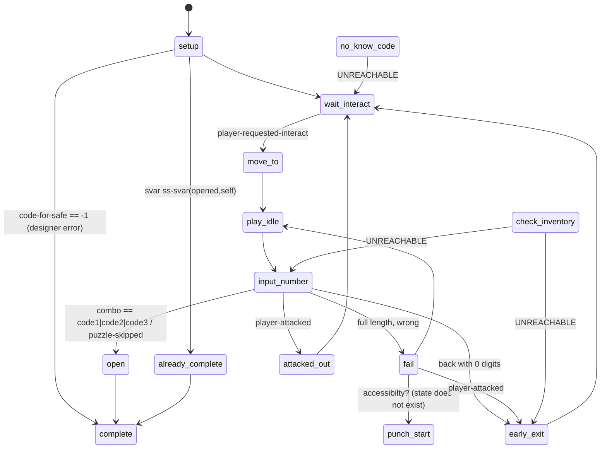
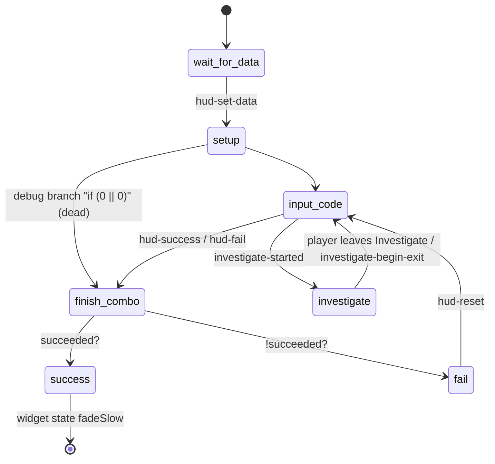
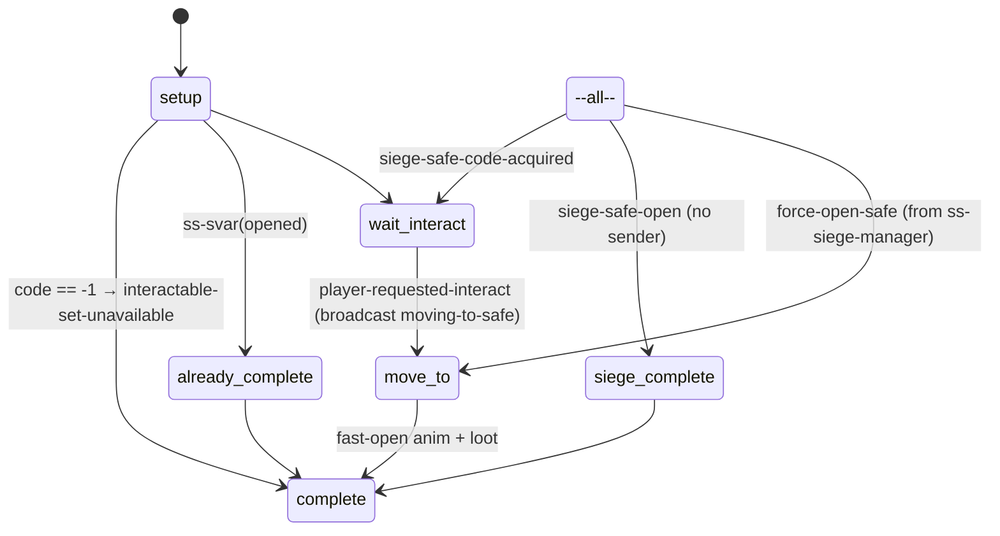
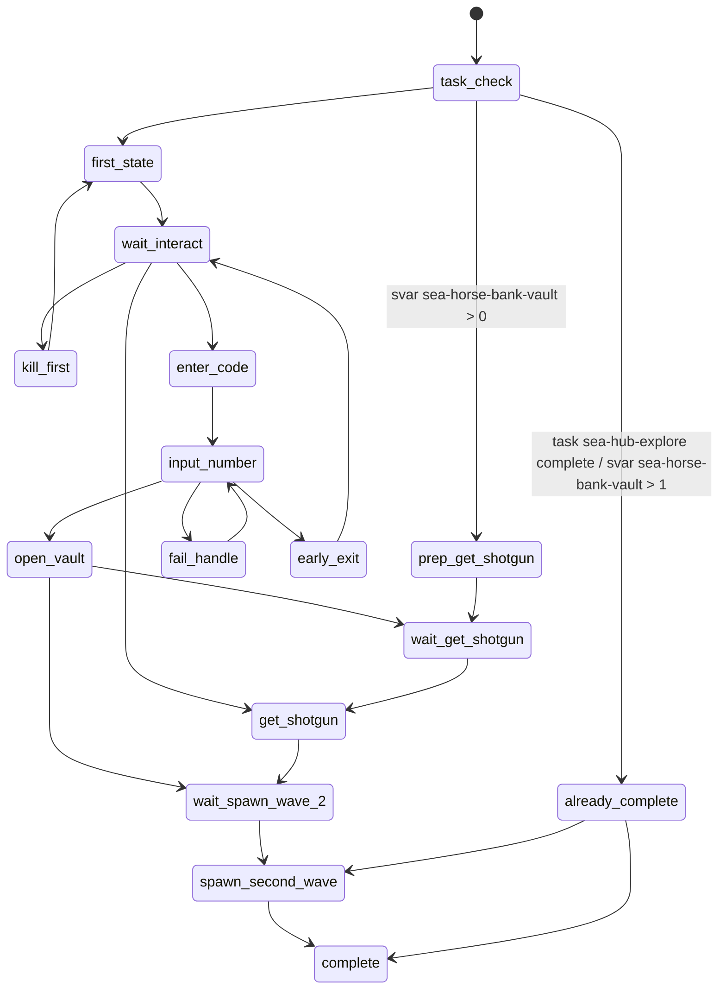
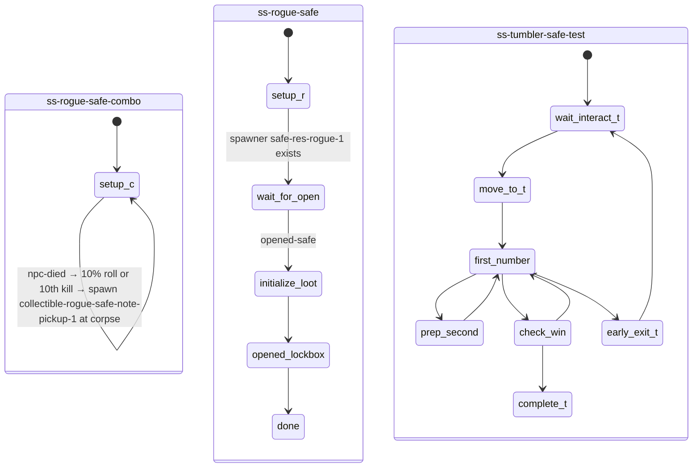
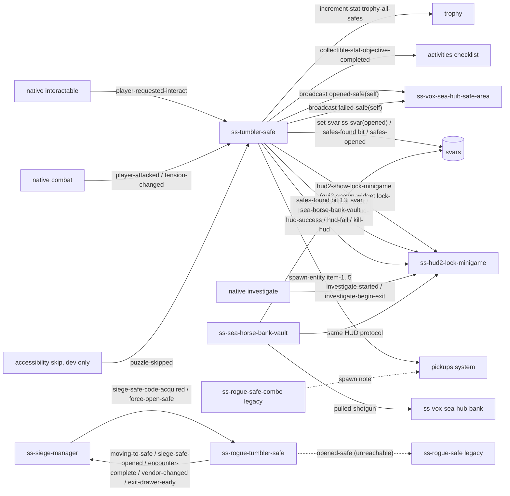

# Safes (tumbler safes) + HUD lock minigame — TLOU2R PC 1.6

Scope: `ss/ss-tumbler-safe` (all 13 systemic campaign safes), `ss-hud2/ss-hud2-lock-minigame` (the HUD widget script),
`ss-seattlearrival/ss-sea-horse-bank-vault` (the 14th safe: Seattle Day 1 bank vault, bespoke fork),
`ss-rogue/ss-rogue-tumbler-safe` (No Return siege safe), the legacy rogue pair `ss-rogue-safe` / `ss-rogue-safe-combo`,
and the prototype `ss-test/ss-test-mdavies/ss-tumbler-safe-test`. Keypads, which reuse the same HUD widget, are in
`../keypads/README.md`.

Evidence sources: `.private/dconstruct_out/dc1/<path>.bin.dcpl|.asm`, `databases/*.json`, data files `activities.bin`,
`treasures.bin`, `interactable.bin`, `gui2-script-funcs-game-impl.bin`, `audio-sfx/common-objects/aud-sfx-gbl-safe.bin`.
Helper scripts written for this pass: `tools/analysis/safes_extract_activities.py`, `tools/analysis/safes_extract_code_notes.py`.
Instance table: `safe_instances.json` (this folder).

Labels: **CONFIRMED** (seen in code or data), **HIGH**, **INFERRED**, **UNKNOWN**.

---

## 1. Overview & files

| File | Role | Size |
|---|---|---|
| `ss/ss-tumbler-safe.bin` | Generic safe actor script. One instance per safe spawner. `options { player }` | 249 fns, 2688 dcpl lines |
| `ss-hud2/ss-hud2-lock-minigame.bin` | State script of the HUD widget `hud-minigames/hud-lock/lock-root` | 65 fns |
| `gui2-script-funcs-game-impl.bin` | DC wrappers `hud2-*-lock-minigame*`, each is a one-line `send-event` to the widget | — |
| `ss-seattlearrival/ss-sea-horse-bank-vault.bin` | Fork of the tumbler logic for the bank vault (safe bit 13), hardcodes its note | — |
| `ss-rogue/ss-rogue-tumbler-safe.bin` | No Return siege safe. Fork of ss-tumbler-safe. **The dial minigame cannot be reached**: interact plays the fast-open animation | 2670 lines |
| `ss-rogue/ss-rogue-safe.bin`, `ss-rogue-safe-combo.bin` | Legacy/prototype rogue lockbox + random code-note drop (`collectible-rogue-test-note`) | small |
| `ss-test/ss-test-mdavies/ss-tumbler-safe-test.bin` | Prototype (`modules-debug`): states first-number, prep-second, check-win | 433 lines |
| `activities.bin` | Collectible checklist: 14 `safes-found` objectives with bit indices | data |
| `treasures.bin` | Code notes (`collectible-*-safe-note`, `collectible-sea-vault-code-note`, …) | data |
| `interactable.bin` | `interact-safe-tumbler` game-interactable-def (prompt `"gen:interact"`) | data |
| `aud-sfx-gbl-safe.bin` | Sound bank: `sfx-gbl-safe-*` (dial, ui, open-success, open-fail, enter/exit cloth) | data |

**Key architectural fact (CONFIRMED):** the combination never goes to the HUD and is not stored in DC. Each safe reads it from
its own **spawner tags** (`tag-int32(code-for-safe|code2-for-safe|code3-for-safe, self)`), which live in level data. Level
packages are not part of this corpus, so the actual digits per safe are **UNKNOWN** here. The note
(`tag-symbol(collectible-with-code)`) only picks voice lines. The script never checks whether you have the note, so the
right numbers always open the safe.

---

## 2. State machines

### 2.1 `ss-tumbler-safe`



`no-know-code` and `check-inventory` have **no incoming `go()`** anywhere: no in-file transition in either the .dcpl or the .asm
(CONFIRMED), and no other file references them. They are dead states left over from an earlier design where you had to own
the note. The same goes for `fail → go(punch-start)`: it only runs if the decl `accessibilty?` is true, nothing ever sets it,
and no `punch-start` state exists. The helper `punch-in-number()` is defined but never called. (CONFIRMED)

### 2.2 `ss-hud2-lock-minigame`


`--all--` handles `show-spinner-timer`, `kill-hud`, `hud-disable-prompt` and forces `hud2-hide-health-ammo/f` every frame.

### 2.3 `ss-rogue-tumbler-safe` (No Return)


`play-idle`, `input-number`, `open`, `fail`, `check-inventory`, `no-know-code`, `early-exit`, `attacked-out`,
`attacked-out-safe-close` are all still there, but nothing reaches them (`move-to` goes straight to `complete`). Also, the
rogue fork never calls `hud2-show-lock-minigame`: its `spawn-or-reset-tumbler-hud` helper was removed. (CONFIRMED)

### 2.4 `ss-sea-horse-bank-vault` (safe bit 13)



### 2.5 Legacy rogue pair and the prototype


`ss-rogue-safe-combo` has a bug: it reads `combo-spawn` but writes `combo-spawned`. In 1.6 no `opened-safe` broadcast can reach
`ss-rogue-safe`, because the rogue tumbler `open` state is unreachable. So both scripts are INFERRED legacy.

---

## 3. Per-state call graphs

### 3.1 `ss-tumbler-safe`
```
setup (track main, sequential lambdas)
 ├─ wait-for-entity-spawned(self)                                   [CONFIRMED]
 ├─ if tag-int32(code-for-safe) == -1: display/display-error("You forgot to put a code…"),
 │    interactable-disable(self), go(complete)                      [CONFIRMED]
 ├─ answer-length = digit count of code-for-safe (+1 per /10)        [CONFIRMED]
 ├─ answer-length += tag-int32(num-leading-zeros)                    [CONFIRMED]
 ├─ if answer-length odd → ++answer-length (round up to whole pairs) [CONFIRMED]
 ├─ if tag wait-for-level: loop until is-level-fully-spawned?(…)     [CONFIRMED]
 ├─ go(already-complete) when get-svar-as-boolean(ss-svar(opened,self))  [CONFIRMED]
 ├─ for i in 1..5: kill-entity(tag item-i) if spawned  (hide loot until opened) [CONFIRMED]
 └─ go(wait-interact)
wait-interact
 ├─ set player-interacting-with-safe = 0
 ├─ if npc-group-alive-count(all-enemy-npcs) > 0 && !allow-in-combat?:
 │     tension-mode-is?(3) ? interactable-disable : interactable-enable   [CONFIRMED]
 ├─ if dial-anim not playing: animate_(self, dial-anim, {40:1, 58:0.0, 56:0.0, 31:1})  (dial parked, speed 0) [CONFIRMED]
 ├─ disable-nav-blocker-object(tag nav-blocker) if specified
 ├─ set-high-contrast-mode-type(self, 2)
 ├─ on tension-changed → re-run the combat gate above
 └─ on player-requested-interact → go(move-to)
move-to
 ├─ log-event("safe-approached", 1, string-debug(self))             [CONFIRMED telemetry]
 ├─ interactable-disable(self); set-high-contrast-mode-type(self, 1)
 ├─ is-crouched? = player-is-crouched?() && intro-anim-ellie != ellie-systemic-standing-safe-enter
 ├─ wait-player-move-to-entry(intro[-crouch]-anim-ellie, spawner-locator(1) [flattened if flatten-on-1?],
 │     1,0,0.40, apReference-camera1, apReference, …, crouch?2:1, …)   [CONFIRMED, dc-script]
 ├─ camera-enable-animated(2.00, -1.00, tag camera-index, 1000, 0,0,0)  [CONFIRMED, native]
 ├─ signal(anim-start)
 ├─ if ik-to-root: animate_(tag cube, ellie-systemic-standing-safe-cw--cube, {10:locator})
 ├─ player intro: flatten-on-1? → animate_ (28:0.5, 30:0.9) + wait 0.5 + wait-animate_ (57:15, 28:0.9, 30:0)
 │                 else wait-animate_(player, intro, {10:locator, 28:0.6, 30:0})
 ├─ if force-flashlight? or (!disallow-flashlight? && check-lighting-estimate-over-threshold(self)): turn-on-flashlight
 ├─ stop-text-to-speech-track(2)
 ├─ go(play-idle)
 ├─ track shadow: after anim-start wait 0.30/0.83/0.90 → self-shadow = 1
 ├─ track ik:     after anim-start wait 0.30/0.93/1.20 → ik-to-joint(player,1,cube,root,0.70) | ik-to-joint(player,1,self,button,0.50)
 └─ update: use-esc-for-back/f, joypad-disable-all-commands, camera-override-near-clip/f(0.01),
           gui2-disable-categories/f(16777216), hud2-hide-health-ammo/f, flashlight shadow + near-clip 0.10
play-idle
 ├─ cloth-no-reboot-on-camera-cut(player, 0)
 ├─ animate_(player, idle-anim-ellie, {10:loc, 28:0, 30:0.5, 31:1, 3:1, 1:1})
 ├─ animate_(player, slo-part-ellie, {40:1, 28:0.3, 30:0.3, 56:0.0, 32:1, 58:0.5})  (additive "hand on dial" layer, speed 0) [INFERRED meaning of 40/32/58]
 ├─ accessibility-set-custom-state(ACCESSIBILITY_STATUS_SAFE, self)
 ├─ go(input-number)
 └─ update: player-ik-to-locator(inv-cube…, *player-ik-arm*, 0.20)  (inv-cube is never set → likely null)  [CONFIRMED call / INFERRED effect]
input-number
 ├─ track hud: prev-code = -1; spawn-or-reset-tumbler-hud()
 │      ├─ widget exists → hud2-reset-lock-minigame(w)          → send hud-reset
 │      └─ else w = hud2-show-lock-minigame()                     → gui2-spawn-widget(canvas.hudRoot,"hud-minigames/hud-lock/lock-root","lockMinigame",1)
 │              hud2-set-lock-minigame-data(w, self, dial, answer-length, curr-input-codes-darray, tag collectible-with-code, 1, 0)
 ├─ track input-tut: ik-to-joint(…,0.00); animate_(self, ellie-systemic-safe-idle--safe); hud-clear-tutorials(1)
 │      if !svar safe-tutorial-once: (accessibility only) hud-play-tutorial(HUD_TUT_SAFE_FIRST_NUM_ACCESS_CW)
 │        wait code-length>0 → (access.) HUD_TUT_SAFE_SECOND_NUM_ACCESS_CCW → wait code-length>2 → set-svar(safe-tutorial-once,1)
 ├─ events: player-attacked→go(attacked-out); puzzle-skipped→go(open); stop-fast-spin→ramped-up=0;
 │          access-swap-timer→really-holding=1; reset-timer→restart cw/ccw/slo partial anims
 ├─ update (every frame):
 │   ├─ joypad-disable-commands(move-forward/backward/left/right); near-clip; flashlight; gui2-disable-categories
 │   ├─ if !is-final-build?(): notify-skippable-puzzle(safe-cracking-minigame, 0)   (dev builds only)  [CONFIRMED asm]
 │   ├─ player-flashlight-force-facing(); use-esc-for-back/f()
 │   ├─ BACK (safe-access-exit | menu-back): if code-length>0 → clear all digits, submit-input(w,0,0),
 │   │        play-sound(sfx-gbl-safe-ui-remove-number); else play-sound(sfx-gbl-safe-ui-exit), go(early-exit)
 │   ├─ ROTATE: stick-Y (|y|>0.2 with intensity>0.9), d-pad/menu up/down (+hold), mouse wheel (fast-scroll <0.07 s)
 │   │        → des-safe-phase += step (step 0.01–0.02/notch; 0.6 or 0.2(TTS) when held; curve-scale ramp)
 │   │        → cw/ccw/reset partial player anims; play-sound-at-joint(sfx-gbl-safe-dial-rotate-cw|ccw, self, dial)
 │   ├─ circle-approach-target(0.70): anim-safe-phase → des-safe-phase with wrap-around, speed curve(sp-min..sp-max)
 │   │        × max-rate-adj (×0.5 when not 30 fps-locked); set-animation-phase(self, phase, 1, dial-anim)
 │   ├─ LOCK (safe-access-lock | menu-select | fire-press):
 │   │        n = floor(dial phase × 100)   (dial is 0–99)
 │   │        script-caption(player, "it's %i", code/10000)        (debug caption leaking the first pair; retail visibility UNKNOWN)
 │   │        on first pair: inputting-{first,second,third}-code = (n == codeK/10000)
 │   │        my-code = my-code×100 + n; code-length += 2; slo-part anim toggles should-cw (cosmetic only)
 │   │        hud2-lock-minigame-submit-input(w, my-code, code-length) → hud-lock-in-code
 │   │        play-sound(sfx-gbl-safe-ui-confirm-number)
 │   │        rumble-curve(0.1,0.05,0.3) if my-code == floor(code/10^(3-code-length))   (see §4.7: never true for 6-digit codes)
 │   │        if code-length == answer-length: go(open) if my-code ∈ {code, code2, code3} else go(fail)
 │   └─ TICK (on every new dial number n): hud2-set-lock-minigame-curr-input(w, n) → hud-input-changed
 │            if n == the next correct pair of code1 (and still on code1's path) [or code2/code3 if > -1]:
 │               play-sound-at-joint(sfx-gbl-safe-dial-rotate-tick-clue, self, dial)
 │               play-sound(sfx-gbl-safe-ui-select-forward-clue | …-backward-clue); play-hfx-id(safe-dial-tick-clue-haptic)
 │            else: …-tick-normal, sfx-gbl-safe-ui-select-forward|backward, safe-dial-tick-haptic
 │            TTS: speak-text-to-speech-formatted(A11Y_NUMBER_0 if n<10, then the number)
 └─ end: stop-ik-to-joint(player, 0.50) unless ik-to-root
open
 ├─ hud-clear-tutorials(0); accessibility-set-custom-state(0,0)
 ├─ for i in 1..5: spawn-entity(tag item-i)                         [CONFIRMED loot reveal]
 ├─ broadcast-event(opened-safe, boxed_symbol(self))                [CONFIRMED]
 ├─ animate_(self, flatten-on-1? ? ellie-systemic-safe-open-success-long--safe : tag succ-anim-safe)
 ├─ player: flatten → animate_ + wait 3.5 + wait-animate_(ellie-systemic-safe-open-success-long, …exit-2-y-offset…)
 │          else wait-animate_(player, tag succ-anim-ellie, …)
 ├─ camera-fade-out-auto-gen-animated(2.0,10.0) if tag auto-gen-fade-out else camera-fade-out-animated(2.0)
 ├─ enable-nav-blocker-object(tag nav-blocker)
 ├─ log-event("safe-opened", 1, string-debug(self))
 ├─ set-svar(ss-svar(opened, self), 1)                              [CONFIRMED persistence]
 ├─ if !get-svar-bit(safes-found, tag safe-index): increment-svar(safes-opened,1); set-svar-bit(safes-found, idx, 1);
 │     collectible-stat-objective-completed(safes-found, idx); if get-svar(safes-found) == 16383 → increment-stat(trophy-all-safes)
 ├─ go(complete)
 ├─ track backup: wait 0.17 → stop cw/ccw/slo partials → wait 2.0 →
 │     say(player, …has-code-success…) — has-collected-treasure?(collectible-with-code) picks the random Ellie 1–7 / Abby 1–6 lines,
 │     otherwise vox-…-has-code-success-slf-004 (Ellie) / -005 (Abby)
 ├─ track rumble: wait-rumble ×2 + do-rumble-ptr(data); track ik-stop; track shadow
 └─ track hud: hud2-win-lock-minigame(w) → hud-success
fail
 ├─ broadcast-event(failed-safe, boxed_symbol(self)); log-event("safe-failed-to-open")
 ├─ reset flags; stop partial anims; animate_(self, tag fail-anim-safe); wait-animate_(player, tag fail-anim-ellie)
 ├─ ik-to-joint(player,1,self,button,1.0); animate_(player, idle); play-sound-at-joint(sfx-gbl-safe-dial-reset, self, dial)
 ├─ ccw partial + dial-anim replay (dial spins back to 0); zero des/anim phase, my-code, code-length; reset inputting-* flags
 ├─ go(play-idle)   [→ input-number → spawn-or-reset → hud-reset]
 ├─ track backup: vox (has-code-fail vs no-code-fail sets, random gating)
 ├─ track rumble: do-rumble-ptr ×2;  track hud: hud2-fail-lock-minigame(w) → hud-fail
 └─ player-attacked → go(early-exit)
early-exit
 ├─ log-event("safe-left"); accessibility-set-custom-state(0,0); hud-clear-tutorials; signal(exit-2-start)
 ├─ flatten? camera-disable-animated + camera-enable-animated(0,-1,1,…) + exit anim pair;  else wait-animate_(exit[-crouch]-anim-ellie)
 ├─ stop-ik-to-joint; interactable-enable(self); reset all input vars; wait-for(camera-done)
 ├─ track camera: after exit-2-start +0.16 s camera-fade-out-animated(2.0)
 ├─ track hud: hud2-hide-lock-minigame(w,1) → kill-hud; w = 0
 └─ go(wait-interact)
attacked-out
 ├─ log-event("safe-attacked-out"); camera-fade-out-animated(1.0); stop-animating(player, 2, 0.5)
 ├─ hud2-hide-lock-minigame(w,1); reset vars; wait 1.0
 └─ go(wait-interact)
already-complete
 ├─ interactable-disable(self); animate_(self, door-anim, …) (door shown open); enable-nav-blocker-object
 └─ go(complete)
complete
 ├─ player-interacting-with-safe = 0; hud2-hide-lock-minigame if widget exists
 └─ set-high-contrast-mode-type(self, 1)
no-know-code   (UNREACHABLE)
 ├─ interactable-disable; once: say(player, vox-igc-{ell,abb}-gen-safe-plyr-no-code-slf-00N)
 └─ wait until has-collected-treasure?(collectible-with-code) [disable-prox-check] or player >6 m away → go(wait-interact)
check-inventory   (UNREACHABLE)
 ├─ log-event("safe-viewed-code"); camera-fade-out-animated(0.5); stop-animating ×2
 ├─ loop player-force-quick-investigate(0); wait in/out of Investigate; camera-enable-animated(0.5,…)
 ├─ update: player-set-quick-inspect-treasure/f(second-coll-with-code ?: collectible-with-code),
 │          player-start-loading-treasure-object(…), player-investigate-on-tap/f(), joypad-disable-commands(inventory-open)
 └─ go(input-number); player-attacked → go(early-exit)
```

### 3.2 `ss-hud2-lock-minigame`
```
wait-for-data
 ├─ gui2-assign-to-category(self, 1048576)
 ├─ if !svar safe-tutorial-once → set-svar-as-boolean(tumbler-spinner-prompt-seen, 1)
 ├─ gui2-go-widget-state(self, off) → (self, active)
 └─ on hud-set-data(args 0..6):
      minigame-object=arg0, minigame-joint=arg1, total-numbers=arg2 (int), is-tumbler?=arg3,
      prior-state-darray=arg4, has-note?=(arg5 != 0)  [stored, never read], hack-prompt-stack?=arg6 → go(setup)
setup
 ├─ find "attachableFader"; unless hack: w-combo = "combo", w-spinner-fader = "spinnerFader"; w-button-stack = "promptStack"
 ├─ tumbler: w-spinner-ws = gui2-show-permanent-attachable-widget(fader, "hud-minigames/hud-lock/lock-analog-static-ws",
 │            minigame-object, minigame-joint, …, *lock-minigame-spinner-attach-params*)  (offset 0.12/0.06/0.08, 2.40)  → state spin
 ├─ unless hack: setup-number-slot-child-darray (8 × "num%i" + "label0" + "polyline", 4 × "pair%i.arrows"); update-digits-selected(0)
 ├─ hud2-set-button-prompt-stack-ciphers(promptStack, …):
 │     tumbler|hack: [HUD_LOCK_MINIGAME_LOCK_IN, –, MENU_COLLECTIBLES_BACK_PROMPT] with actions "puzzle:safe-lock" / "puzzle:safe-exit"
 │     keypad:       [–, HUD_LOCK_MINIGAME_CONFIRM, HUD_LOCK_MINIGAME_RESET, MENU_COLLECTIBLES_BACK_PROMPT]   [HIGH, from asm boxed values]
 ├─ restore-lock-minigame-to-prior-state(prior-state-darray) if darray valid
 ├─ hack: hide "comboAndLine"; hide unused "pair%i" (≥ (total+1)/2); keypad spacing 9.0; keypad pivot +500 px
 └─ go(input-code)
input-code
 ├─ succeeded? = 0; un-pause show-spinner-timer; show spinner if queued or !svar tumbler-spinner-prompt-seen
 ├─ delayed-prompt-disable: replays queued hud-disable-prompt for 2 frames
 ├─ update: any-joypad-button pressed that is not in *relevent-joypad-commands--lock-minigame-tumbler*
 │          (safe-access-lock[-hold], -right[-hold], -left[-hold], move, debug-script-press-circle) → send show-spinner-timer
 ├─ hud-input-changed(n)        → update-code-text(n) (tumbler: 2 digits into slots idx, idx+1); mark-spinner-interacted
 ├─ hud-lock-in-code(code, len) → update-code-text(code); curr-number-index = len; update-digits-selected; spinning-increment=0
 ├─ hud-reset                   → curr-number-index = 0; update-digits-selected
 ├─ hud-success / hud-fail      → succeeded? = 1/0; go(finish-combo)
 └─ investigate-started         → go(investigate)
finish-combo: wait 1 frame + signal(pointer-done-animating) + 0.10 s → go(success | fail)
success: each number slot fade → "success" (0.5 s); wait 0.5 → gui2-set-widget-state(self, fadeSlow); set-svar-as-boolean(tumbler-spinner-prompt-seen,1)
fail:    wait for slot animations; slots → "error"; wait 0.4; slots → "off";  on hud-reset → clear text, go(input-code)
investigate: widget state off; return to input-code when !player-in-state?(Investigate) or on investigate-begin-exit; end: state active
--all--: show-spinner-timer (only once safe-tutorial-once) → show spinner now or queue; kill-hud → state off unless in success;
         hud-disable-prompt(i, b) → hud2-set-button-in-prompt-stack-disabled(RESET|CONFIRM) or queue
```
Spinner hint: `show-spinner--lock-minigame` shows `spinnerFader`. A 10 s idle timer re-shows it, and it hides after 25 input changes
(`spinning-increment ≥ 25` → `hide-spinner` → `set-svar-as-boolean(tumbler-spinner-prompt-seen, 1)`). (CONFIRMED)

### 3.3 `ss-rogue-tumbler-safe` (differences only)
```
--all--
 ├─ siege-safe-setup        → interactable-set-unavailable(self, 1)          (no sender found)
 ├─ siege-safe-code-acquired→ rogue-mark-always-visible-in-listen-mode(self); interactable-set-unavailable(self,0); go(wait-interact)
 ├─ siege-safe-open         → go(siege-complete)                            (no sender found)
 └─ force-open-safe         → force-open = 1; go(move-to)                   (sent by ss-siege-manager:siege-complete-success)
setup: seeds rogue PRNG categories siege-safe-reward-parts/-supp from encounter--get-master-seed-for-task(...)
wait-interact: broadcast-event(moving-to-safe) on interact
move-to
 ├─ log-event("safe-approached"); broadcast-event(siege-safe-opened)
 ├─ force-open: fade-to-black(2,1,1) → broadcast exit-drawer-early → animate-start(self/player, ellie-systemic-safe-open-fast-success[--safe])
 │   else: wait-holster-player-weapon; wait-player-move-to-entry(ellie-systemic-safe-open-fast-success, …)
 ├─ camera-enable-animated(force?0:3, -1, camera-index, …); animate_ safe + wait-animate_ player fast-success
 ├─ track hud: (force-open) hud-show-formatted-cipher-message(HUD_SAFE_REWARD_NOTIFICATION, parts, supplements, currency),
 │     inventory-item-add-quantity(parts|player-upgrade-supplements|currency); set-svar(vendor-currency,+); broadcast vendor-changed
 ├─ track spawn-items: spawn-entity(item-1..5); item-pickup-set-amount from rogue PRNG (items 1–2 supplements ×1.5 for char 0,
 │     3–4 parts, 5 currency = rogue-convert-coins-if-jesse(siege-currency-reward))
 ├─ track early-fade: force-open && !task-played-from-dev-menu? → broadcast encounter-complete
 └─ go(complete)
```

### 3.4 `ss-sea-horse-bank-vault` (highlights)
`spawn-or-reset-tumbler-hud--bank-vault` passes the hardcoded note `collectible-sea-vault-code-note`. `answer-length` is a fixed decl
of 6, and the code comes from `tag-int32(code-for-safe)` (only code1, no code2/code3). It has the same tick and clue logic and the
same `safe-tutorial-once` tutorial. `open-vault` plays `sea-hub-bank-vault-door--ellie`, sets safe bit **13** (same `safes-found`
block as §3.1), disables the nav blocker on `obj-sea-bank-vault-door-1`, and sets `svar sea-horse-bank-vault` = 1 (vault open)
or 2 (shotgun already taken). If the player has `shotgun-remington-pump` it also sends `pulled-shotgun` to `ss-vox-sea-hub-bank-1`.
`get-shotgun` calls `hud2-request-new-item-notification(shotgun-remington-pump)` + `log-event("player-found-weapon")`.
**Quirk (CONFIRMED):** a parallel `track trophy` in `open-vault` *also* runs `increment-svar(safes-opened, 1)` with no guard and
checks `safes-opened > 13` → `trophy-all-safes`. On the first opening `safes-opened` therefore goes up by 2.

---

## 4. Answers to the specific questions

### 4.1 Where does the combination come from? — CONFIRMED
* **Spawner tags** on the safe instance: `code-for-safe` (required; `-1` = unset → error text + safe disabled), optional
  `code2-for-safe` / `code3-for-safe` (accepted only when `> -1`), and `num-leading-zeros` (pads the length, so a code like 04-xx-xx
  can be stored as an int).
* Length: `answer-length` = digits(code) + leading zeros, rounded up to an even number. Every lock-in adds **2 digits** (one dial number 00–99).
* The HUD gets only the **length** (`total-numbers`), the dial object and joint, the note symbol and an input darray. It never
  gets the digits.
* The code is not in any DC data in this corpus, and the localized note text (`HUD_COL_NOTE_*_TEXT`) is not either. Per-safe
  values are therefore **UNKNOWN / need level-package data**. Hardcoded exceptions: the keypads (see keypads README).

### 4.2 How does "player knows the code" work? — CONFIRMED
* The knowledge is a **collected treasure (collectible note)**: tag `collectible-with-code` (+ optional `second-coll-with-code`),
  tested with native `has-collected-treasure?(id, 0)`.
* In 1.6 that knowledge **gates nothing**:
  * `no-know-code` (voice line + wait until the note is collected or the player walks >6 m away) and `check-inventory`
    (quick-investigate the note from inside the minigame) are both unreachable.
  * `has-collected-treasure?` only selects the voice set in `open` / `fail`: "has-code-success" vs a generic success line, and
    "has-code-fail" vs "no-code-fail".
  * `has-note?` in the HUD is stored and never read.
* It is not an svar, fact or inventory item. Treasure ownership is native state (persisted with the collectibles).
* Brute force is designed in: the **clue tick** (`sfx-gbl-safe-dial-rotate-tick-clue` + `safe-dial-tick-clue-haptic` +
  `…-select-forward/backward-clue` UI sound) plays whenever the dial sits on the next correct pair and the earlier pairs were right.
  It works without the note, so a safe can be cracked by ear (and by DualSense haptics).
* While the minigame is open the player can still bring up the note through the regular investigate flow. The HUD hides itself
  while the player is in `Investigate` (handled natively; `investigate-started` has no DC sender). (INFERRED for how the player triggers it)

### 4.3 Full chain: safe → HUD → success → open → loot → persistence — CONFIRMED
See §6 (flowchart). In order:
1. Native interactable sends `player-requested-interact`.
2. `move-to`: align, animated camera, intro animation.
3. `play-idle`: hold pose.
4. `input-number` spawns the HUD and drives it with the 3 events `hud-set-data` → `hud-input-changed` / `hud-lock-in-code`.
5. The safe script itself decides pass or fail. The HUD only *reflects* the result (`hud-success` / `hud-fail`). The HUD sends no
   event back to the safe, and **no DC script handles the `opened-safe` / `failed-safe` broadcasts** except vox
   (`ss-vox-sea-hub-safe-area`) and the legacy `ss-rogue-safe`.
6. `open`: `spawn-entity(item-1..5)` (the loot was killed in `setup`, so it is hidden until now), safe success animation,
   `ss-svar(opened,self)` set, `safes-found` bit, collectible checklist, trophy check.
7. Loot pickup is then the normal pickups system (see `interactions/pickups`).

### 4.4 Number wheel / dial model — CONFIRMED
* The dial is the safe prop's `dial-anim` played with speed 0 (`animate_ … 56:0.0`), and the number is `floor(phase × 100)`.
* Input writes `des-safe-phase`. `anim-safe-phase` eases toward it via `circle-approach-target` (shortest wrap across 0/1;
  speed = `curve-scale(sp-min, sp-max, …, anim-speed)` × 0.7 × `max-rate-adj`), and `set-animation-phase` applies it to both the
  dial and the player's partial "turn" animations.
* Turn direction is cosmetic. `should-cw` only flips each lock-in for animation, and is not checked against the answer.

### 4.5 Return value / event
`hud2-*` wrappers return the `send-event` result. Outward events from the safe:
* `broadcast-event(opened-safe, self)`
* `broadcast-event(failed-safe, self)`
* `log-event` telemetry: safe-approached, safe-viewed-code (dead), safe-opened, safe-failed-to-open, safe-left, safe-attacked-out.

### 4.6 Which levels have safes? — CONFIRMED (list), UNKNOWN (codes)
`activities.bin` lists 14 `safes-found` objectives (bits 0–13; `16383` = all) and gives the chapter for each. See
`safe_instances.json`, built with `tools/analysis/safes_extract_activities.py`. Every bit except 13 is an `ss-tumbler-safe`
instance placed in level data. No level DC script instantiates or configures a safe: the codes are entirely spawner tags.

| bit | objective id | chapter (activity) | likely note (INFERRED by name/group) |
|---|---|---|---|
| 0 | flo-flood-gate-safe | flooded-city (Ch.21) | collectible-flo-rapids-gate-safe-note |
| 1 | fob-bakery-safe | hostile-territory (Ch.28) | collectible-fob-chinatown-safe-note (spawner `fob-hostile-territory-bakery-safe-note`) |
| 2 | fob-gun-cache-safe | on-foot (Ch.25) | collectible-fob-on-foot-safe-note (spawner `fob-on-foot-gun-cache-note`) |
| 3 | med-infected-apartment-safe | sky-bridge (Ch.33) | UNKNOWN |
| 4 | med-gym-safe | descent (Ch.34) | UNKNOWN |
| 5 | nor-pharmacy-safe | finding-nora (Ch.18) | collectible-nor-pharmacy-safe-note |
| 6 | nor-ambush-apartment-safe | finding-nora (Ch.18) | collectible-nor-apt-safe-note |
| 7 | pat-supermarket-safe | patrol (Ch.4) | UNKNOWN |
| 8 | res-runner-garage-safe | hillcrest (Ch.16) | collectible-res-garage-safe-note |
| 9 | sea-courthouse-safe | downtown (Ch.9) | UNKNOWN |
| 10 | sea-west-gate-safe | downtown (Ch.9) | UNKNOWN |
| 11 | ski-ferry-safe | coast-1 (Ch.31) | collectible-ski-coastal-explore-boat-mid-safe-note |
| 12 | wat-thrift-store-safe | capitol-hill (Ch.11) | UNKNOWN |
| 13 | sea-bank-safe | downtown (Ch.9) | **collectible-sea-vault-code-note** (CONFIRMED, hardcoded in bank-vault script) |

### 4.7 Notable quirks / bugs — CONFIRMED in code
* Prefix rumble: the condition `my-code == floor(code / 10^(3 − code-length))` only works for 4-digit codes. With
  `code-length` ∈ {2,4,6} and a 6-digit code it never matches, so the "correct pair" rumble never fires. The clue *sound* uses a
  different, correct formula `(code / 10^(answer-length−2−code-length)) % 100`. (INFERRED by arithmetic)
* `script-caption(player, "it's %i", code/10000)` on every lock-in prints the code's first pair. It is a native caption; whether
  it shows in retail is UNKNOWN (HIGH that it does not, since players never report it).
* `notify-skippable-puzzle(safe-cracking-minigame)` only runs `if !is-final-build?()`, so the accessibility "skip puzzle" offer
  is not registered for safes in retail. The `puzzle-skipped` handler (→ open) stays as a dev path.
* Rogue: `ss-rogue-safe-combo` checks `combo-spawn` but sets `combo-spawned`. The bank vault double-counts `safes-opened`.

---

## 5. Engine boundary

| Layer | What |
|---|---|
| **DC script** | Every rule: state flow, dial math, answer check, sounds, animation choice, HUD event protocol, svar writes, vox selection. `hud2-*-lock-minigame*` wrappers, `wait-player-move-to-entry`, `camera-fade-out-animated`, `camera-disable-animated`, `accessibility-set-custom-state`, `notify-skippable-puzzle`, `speak-text-to-speech-formatted`, `set-svar*`/`get-svar*`/`increment-svar` are dc-script (functions.json). |
| **Data (DC)** | `activities.bin` (14 safe objectives/bits), `treasures.bin` (note defs), `interactable.bin` (`interact-safe-tumbler`: 3.00, 7.00, -0.50, 4.50, 80.00 … prompt `gen:interact`, field meanings INFERRED as ranges/angles), `aud-sfx-gbl-safe.bin`, `*lock-minigame-spinner-attach-params*`, `*relevent-joypad-commands--lock-minigame-tumbler*`. |
| **Level data (not in corpus)** | Safe spawners and every tag: codes, note id, item-1..5 loot spawners, anim set symbols (intro/idle/exit/fail/succ/cw/ccw/reset), sp-min/sp-rate/sp-max, camera-index, safe-index, flatten-on-1?, ik-to-root, cube, nav-blocker, wait-for-level, exit-2-y-offset, auto-gen-fade-out, force/disallow-flashlight?, disable-prox-check. |
| **GUI2 layout (not DC)** | `hud-minigames/hud-lock/lock-root`, `lock-analog-static-ws` widget trees and their states (pos%i, active/disabled/off, success, error, fadeSlow, spin); binding of `ss-hud2-lock-minigame` to the widget (listed in `modules.bin`/`startup.bin`). |
| **Native** | `has-collected-treasure?`, `ss-svar`, `get-treasure-by-id`, `player-set-quick-inspect-treasure/f`, `player-force-quick-investigate`, `collectible-stat-objective-completed`, `increment-stat`, `camera-enable-animated`, `animate_`, `set-animation-phase`, `ik-to-joint`, `play-sound*`, `play-hfx-id`, `rumble-curve`, `gui2-*`, `hud2-set-button-prompt-stack-ciphers`, `log-event`, `script-caption`, `is-final-build?`, interactable system (`player-requested-interact`), the investigate player state, `investigate-started` sender. |

## 6. Events in/out and event graph



Events handled by `ss-tumbler-safe`: player-requested-interact, tension-changed, player-attacked, puzzle-skipped and self-timers
(stop-fast-spin, access-swap-timer, reset-timer). Sent: `opened-safe`, `failed-safe` (broadcast), 8 hud events (via wrappers).
`ss-vox-sea-hub-safe-area` counts `vox-safe-attempts` on `failed-safe`; on the 3rd attempt Ellie says
`vox-igc-ell-gam-sea-hub-explore-hidden-safe-checkpoint-gate-slf-011`. That is a level-specific vox reaction to a systemic safe in
the Seattle hub (CONFIRMED). No other DC script reacts to the broadcasts.

## 7. Persistence

| Key | Type | Written | Read | Notes |
|---|---|---|---|---|
| `ss-svar(opened, self)` | per-instance svar (native name builder) | open | setup → already-complete | CONFIRMED |
| `safes-found` | svar bitmask, bit = tag `safe-index` (0–13) | open / bank open-vault | open (guard), activities checklist | 16383 = all → `trophy-all-safes` |
| `safes-opened` | svar counter | open (+bank ×2) | bank trophy track (`> 13`) | CONFIRMED |
| `safe-tutorial-once` | svar | input-number after 2nd lock-in | safe, bank, HUD | shared with bank vault |
| `tumbler-spinner-prompt-seen` | svar boolean | HUD wait-for-data / success / hide-spinner | HUD input-code | |
| `sea-horse-bank-vault` | svar 0/1/2 | bank open-vault / get-shotgun | bank task-check | |
| treasure ownership | native collectibles | pickup system | `has-collected-treasure?` | the "knowledge" |
| loot | level spawners `item-1..5` | killed at setup, spawned at open | pickup persistence (INFERRED) | after reload an opened safe skips the kill loop (go happens first), so un-picked loot stays (INFERRED) |
| No `fact-*` or task writes in ss-tumbler-safe. | | | | |

## 8. Animation / camera / UI / audio hooks

* **Player animation (tag-driven):** `intro-anim-ellie`, `intro-crouch-anim-ellie`, `idle-anim-ellie`, `exit-anim-ellie`,
  `exit-crouch-anim-ellie`, `fail-anim-ellie`, `succ-anim-ellie`, partial layers `slo-part-ellie`, `cw-part-ellie`,
  `ccw-part-ellie`, `resetcw-part-ellie`, `resetccw-part-ellie`. Hardcoded ones: `ellie-systemic-standing-safe-enter`,
  `ellie-systemic-safe-open-success[-long]`, `ellie-systemic-safe-idle--safe`, `ellie-systemic-standing-safe-cw--cube`,
  rogue `ellie-systemic-safe-open-fast-success[--safe]`. Abby uses the same symbols (only the vox branches on `is-player-abby?`).
* **Prop animation:** `dial-anim` (phase = number), `fail-anim-safe`, `succ-anim-safe`, `door-anim` (already-complete pose).
* **IK:** `ik-to-joint(player,1,self,button,…)` or to the proxy `cube` root when `ik-to-root`; `stop-ik-to-joint`.
* **animate_ option keys seen:** 10 ap-ref, 28 blend-in, 30 start phase, 31 loop?, 56 speed, 57 (15.0), 58 (0.5/0.6), 40, 32, 3, 1
  (INFERRED, consistent with the drawer brief).
* **Camera:** `camera-enable-animated(2.0, -1, camera-index, 1000…)` at entry; `camera-fade-out-animated` 2.0 (open, early-exit),
  1.0 (attacked-out), 0.5 (dead check-inventory); `camera-fade-out-auto-gen-animated(2.0, 10.0)`;
  `camera-override-near-clip/f(0.01)` every frame; `cloth-no-reboot-on-camera-cut`.
* **UI:** lock HUD, `gui2-disable-categories/f(16777216)`, `hud2-hide-health-ammo/f`, tutorials
  `HUD_TUT_SAFE_FIRST_NUM_ACCESS_CW` / `HUD_TUT_SAFE_SECOND_NUM_ACCESS_CCW` (only with minigame accessibility on),
  `set-high-contrast-mode-type(self, 2→1)`, `accessibility-set-custom-state(ACCESSIBILITY_STATUS_SAFE)`, TTS numbers.
* **Audio (script):** `sfx-gbl-safe-dial-rotate-cw/ccw`, `-tick-normal`, `-tick-clue`, `-dial-reset`,
  `sfx-gbl-safe-ui-select-forward/backward[-clue]`, `-ui-confirm-number`, `-ui-remove-number`, `-ui-exit`.
  **Audio (animation-driven, data):** `sfx-gbl-safe-enter/exit--cloth|r-wrist`, `-open-success--*`, `-open-fail--*`,
  `-open-fast-success--safe-2`, `sfx-gbl-standing-safe-*` (INFERRED to fire from animation sound tracks: no script call).
  Haptics `safe-dial-tick-haptic`, `safe-dial-tick-clue-haptic`; `rumble-curve`, `do-rumble-ptr`.
* **Vox:** `vox-igc-{ell,abb}-gen-[plyr-]safe-…` sets: no-code, no-code-fail, has-code-success, has-code-fail.

## 9. Shared components with other systems

* `wait-player-move-to-entry`, `apReference-camera1`, `animate_` option arrays, `ik-to-joint` (the same entry pattern as
  drawers/workbench).
* The HUD widget `lock-root` + `ss-hud2-lock-minigame` is shared with **keypads**: the Watchtower 5-button door and the Seattle QZ
  and hub keypads (hack prompt-stack mode). See `../keypads/README.md`.
* The collectibles/notes system (`has-collected-treasure?`, investigate state) and the activities checklist.
* Pickups: `spawn-entity` reveals ordinary pickup spawners.
* Accessibility: `notify-skippable-puzzle`, `accessibility-set-custom-state`, high-contrast, TTS.

## 10. Confidence table

| Claim | Label |
|---|---|
| Code comes from spawner tags `code[2|3]-for-safe`, never sent to HUD | CONFIRMED |
| Note ownership gates nothing in 1.6; `no-know-code`/`check-inventory` unreachable | CONFIRMED |
| Clue tick sound/haptic on correct next pair | CONFIRMED |
| 14 safes with bits/objectives/chapters | CONFIRMED (activities.bin) |
| Note↔safe mapping except bank | INFERRED |
| Actual combinations | UNKNOWN (level data) |
| Rogue safe skips the dial | CONFIRMED |
| HUD is a passive view (no event back) | CONFIRMED |
| Prefix rumble never fires for 6-digit codes | INFERRED (arithmetic) |
| `script-caption` debug visible in retail | UNKNOWN |
| animate_ option key meanings | INFERRED |

## 11. Open questions
1. Level package spawner tags: real codes, `safe-index`, `camera-index`, `item-1..5` and the anim symbols per safe.
2. How the GUI2 widget binds `ss-hud2-lock-minigame` (asset data), and the exact visuals of states `pos%i`/`error`/`success`.
3. Native sender of `investigate-started`, and whether the touchpad/inventory can open notes during `input-number`
   (only movement is disabled there).
4. Whether `script-caption` renders in final builds.
5. `interact-safe-tumbler` field semantics.

## 12. Modding surface

| Change | Rating | Why |
|---|---|---|
| Change sounds/haptics/vox, dial speed (sp-*), tutorial text | GREEN | Tags or symbols in DC; patch the `ss-tumbler-safe` script or the data |
| Require the note (re-enable `no-know-code` by adding `go(no-know-code)` in wait-interact when `!has-collected-treasure?`) | YELLOW | The state is still complete in DC; one added branch. Must keep the rest of the bytecode layout valid |
| Show the code in the HUD (feed `has-note?`/code into widget) | ORANGE | The HUD script has no code path; needs new DC plus GUI2 layout work |
| Change combinations / add a new safe | RED (from DC alone) | Codes, loot and placement live in level spawner tags; a level-package edit is needed |
| Enable rogue dial minigame | ORANGE | Re-route `move-to` → `play-idle` and restore the HUD spawn helper; rewards logic sits in `move-to` |
| Make skip-puzzle work for safes in retail | YELLOW | Invert or remove the `!is-final-build?()` guard around `notify-skippable-puzzle` |
