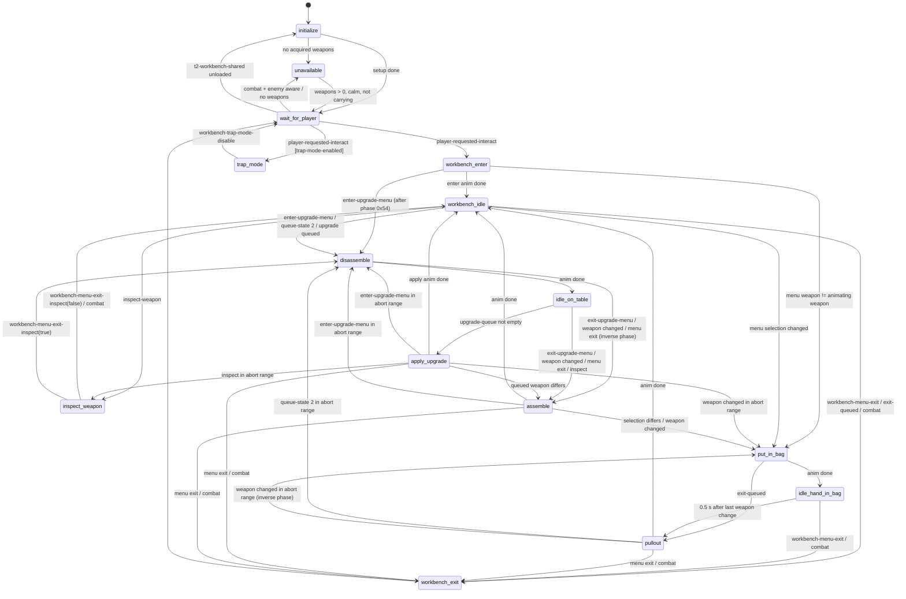
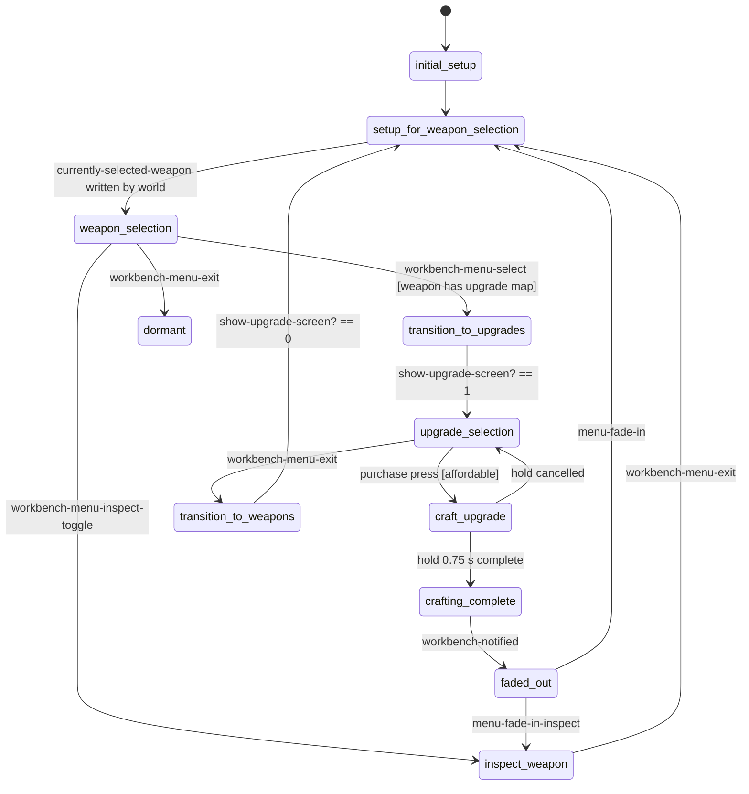
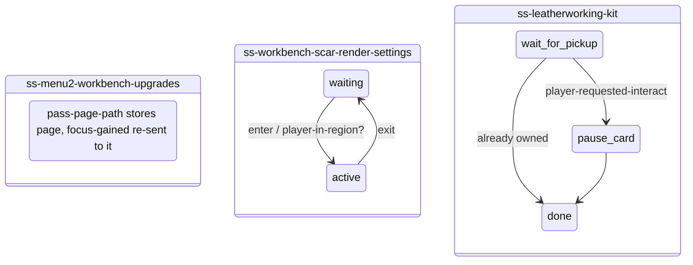

# Workbench — `ss-workbench` + `ss-menu2-workbench` (TLOU2R PC 1.6)

The workbench is the most complete "mini application" in the gameplay scripts. It has a world-side
state machine with 15 states and up to 13 parallel tracks per state. That machine drives the player, a
dummy camera and five prop actors, all locked to one animation clock. It talks to a HUD page script
that runs its own 11-state machine. The whole thing is **data-driven** by per-character
`workbench-weapon-def` records. That makes it the best reference for building new complex
interaction stations (see the last section).

Evidence sources (all private, never committed): `.private/dconstruct_out/dc1/<file>.dcpl/.asm`.
Citations use the form `file → state/block/track` or `file → function`. Confidence labels:
**CONFIRMED**, **HIGH**, **INFERRED**, **UNKNOWN**.

Companion files in this folder:

| file | content |
|---|---|
| `state_table.json` | every state of both scripts: anim-state used, camera, exits, events |
| `data_schema.json` | offset-level schema of `workbench-weapon-def`, `workbench-anim-state-def`, `workbench-anim-def`, `workbench-upgrade-def`, the upgrade-cost bundles and script globals |
| `upgrade_costs.json` | derived cost table (normal + grounded override) with resolved stat types |
| `workbench_weapon_defs.json` | derived per-weapon summary (anim names per state, phases, mesh names) for Ellie, Abby and No Return |
| `interaction_station_template.json` | reusable building blocks with the exact native/DC functions behind each |

Helper scripts (in `tools/analysis/`): `workbench_squash.py` collapses dconstruct boilerplate,
`workbench_extract_data.py` builds the JSON tables from `.asm`, `workbench_fnkinds.py` gives the
DC/native kind for function names.

---

## 1. Overview & files

| file | role | notes |
|---|---|---|
| `ss-t2/ss-workbench.bin` | **world script** on each workbench instance | 497 functions/lambdas, 18 entries. Helper functions are prefixed `ss-workbench--`. |
| `ss-hud2/ss-menu2-workbench.bin` | **HUD page script** for page `pc/workbench/bench-weapons-root-pc` | Loaded at startup (`startup.bin` module list entry 677). |
| `ss-hud2/ss-menu2-workbench-upgrades.bin` | 1-state forwarder on page `pc/workbench/bench-upgrades-root-pc` | Forwards `focus-gained` to the weapons page (`pass-page-path` gives it the target). |
| `workbench-script-funcs-impl.bin` | shared library | def lookup (`ss-workbench--get-workbench-weapon-def-based-on-current-weapon`), affordability, stat bars, cost (`get-upgrade-cost--workbench`), and **all shared module globals** (`all-weapons-acquired`, `upgrade-queue`, `spawned-weapons-by-id`, ...). |
| `workbench-settings.bin` | globals | `*curr-workbench-state*`, `*invalid-workbench-weapon*`, `*workbench-animated-stick-cam*`, `*workbench-pan-cams*`, `*ellie/abby-workbench-player-character*`, `*rs-texture-adjust-workbench*`, scar lamp flicker curve |
| `workbench-settings-ellie.bin` / `-abby.bin` | `*workbench-weapons-ellie*` / `*workbench-weapons-abby*` maps and the weapon defs | 62 embedded hook lambdas (Ellie file) |
| `t2r-workbench-settings-ellie/abby.bin` | same for No Return (rogue) | selected when `is-rogue-mode?()` |
| `weapon-upgrades.bin` | `*weapon-upgrade-bundles*` (**costs**, visual mods, labels), `*weapon-upgrades*` (stat payloads), `*holster-upgrades*`, grounded override | |
| `player-upgrade-settings.bin` | `*player-upgrades-defs-map*` | Only the holster upgrades touch the workbench (cost at +0x18 = 0). |
| `interactable.bin` | `interact-workbench`, `interact-workbench-with-wrench`, `interact-workbench-no-bench-with-wrench`, `interact-workbench-rogue-hub-theater(-with-wrench)` | The `-with-wrench` defs differ only by prompt icon `hud/crafting-2/wrench.png`. |
| `gui2-game.bin` | page sound overrides | All three workbench pages are listed in `*menu2-page-sound-overrides*`. `menu2-pages.bin` holds only options pages, so the workbench pages are not there. |
| `ss-t2/ss-workbench-scar-render-settings.bin` | region-based render override for scar benches | two states |
| `ss-t2/ss-leatherworking-kit.bin` | pickup that shows a tutorial card and clears `leatherworking-at-workbench-<char>` | not part of the bench flow |
| level sets `t2-workbench-shared/-ellie(-base)/-abby(-base/-scar)/-ellie-fluorescent` | anim actors + `parts-*` meshes + light levels | `initialize` blocks until `t2-workbench-shared` is loaded |

Variants that reuse the same design: `ss-finding-nora/ss-nor-ellie-alone-fake-workbench` (a trimmed
fork of the state list) and `ss-nor-ellie-alone-igc-workbench` (the trap-mode driver).

---

## 2. State machines

### 2.1 World script `ss-workbench`



State names were shortened for Mermaid: `put_in_bag` = `workbench-put-previous-weapon-in-bag`,
`pullout` = `workbench-pullout-weapon-from-bag`, `disassemble`/`assemble` = `workbench-(dis)assemble-weapon`,
`idle_on_table` = `workbench-idle-weapon-on-table`, `idle_hand_in_bag` = `workbench-idle-hand-in-bag`.
All transitions are **CONFIRMED** (`ss-workbench.bin.dcpl`, `go(...)` calls). Conditions are paraphrased.

Two pieces of control state are decisive:
* `anim-queue-state` (i32). 0 = nothing queued; 1 = weapon change queued while an upgrade is pending;
  2 = upgrade menu requested during a transitional animation. `--all-- → event_enter-upgrade-menu` sets it
  to 2, and `workbench-idle/start` plus `pullout/update` consume it. **HIGH** (the boolean in the `--all--`
  handler decompiles in a garbled form).
* `upgrade-queue` / `weapon-queue` (module-global d-arrays). `--all-- → event_apply-upgrade-event` appends
  to them, every work state reads index 0, and `apply-upgrade/end` removes index 0. **CONFIRMED**.

### 2.2 HUD page script `ss-menu2-workbench`



### 2.3 Small scripts



---

## 3. Per-state call graphs (world script)

Every animation-playing state follows the same **"anim-state dispatch"** skeleton. It is written once here
and referred to as `DISPATCH(<anim-state>)` below.

```
DISPATCH(S)                                   [CONFIRMED, e.g. workbench-disassemble-weapon/start/main]
 ├─ *(*curr-workbench-state*) = S              (global write; S chosen from weapon-def / upgrade-def / alt lambda)
 ├─ signal(curr-state-updated)                 → releases every parallel track's wait-for(curr-state-updated)
 ├─ camera-enable-animated-with-id(<state-id>, 0.5, -1, 1, 1000, 0,0,0)
 ├─ animate_(partsObj,  S.parts.anim,   {10:apRef, 28:blend, 30:x})   (+ S.parts.partial with {40:1})
 ├─ animate_(toolsObj,  S.tools.anim,   …)
 ├─ animate_(displayWpn,S.weapon.anim,  …)
 ├─ animate_(get-weapon-strap-process-id(displayWpn), S.strap.anim, {28,30,56:speed})
 ├─ animate_(dummyCam,  S.camera.anim,  {10:apRef, 28, 30, 85:<state-id>})
 ├─ animate_(player-get-anim-backpack(), S.backpack.anim, …)
 ├─ animate_(player, S.player.partial, {40:1, …})       (optional layer)
 └─ wait-animate_(player, S.player.anim, {10:apRef, 28, 30 [,58:startPhase]})  → then go(next)
```
`apRef` = `get-bound-frame(approach-point-loc)` = `get-spawner-locator(self, 1)`, captured in `initialize`.

```
initialize/start/main                                                     [CONFIRMED]
 ├─ wait entity-exists?(tag lights-parent); wait is-level-set-loaded?(t2-workbench-shared)
 ├─ bg-art-version? = (tag interactable-def == interact-workbench)
 ├─ approach-point-loc = get-spawner-locator(self, 1)
 ├─ lights-darray = tag light-type;  ss-workbench--turn-off-lights(1)
 ├─ set-object-locator(lights-parent, self) if > 0.10 m apart
 ├─ ss-workbench--spawn-tools()  → spawn-object(tag tools, SimpleObject, loc1, "workbench-tools")
 │     ├─ interactable-add-high-contrast-mode-target(self, tools)
 │     └─ animate-start-boundframe(tools, enterState.tools.anim, apRef)   (pre-pose)
 ├─ ss-workbench--update-list-of-weapons()
 │     └─ player-inv-selection-get-sub-slot-items-filtered(0)+(2) − excluded-weapons → all-weapons-acquired
 ├─ go(unavailable) when darray-count(all-weapons-acquired) <= 0
 ├─ turn-on-lights if a turn-on-light event arrived before init; interactable-enable if self-disabled
 ├─ interactable-set-exclude-from-pickup-scan(self,1) if get-svar-bit(accessibility-workbenches-found, idx)
 └─ go(wait-for-player)

wait-for-player
 ├─ start: override-interact-def(self, tag interactable-def); reset num-upgrades-per-visit, player-applied-upgrade
 ├─ update (every 5/15 frames):
 │   ├─ go(initialize) if t2-workbench-shared unloaded (interactable-disable first)
 │   ├─ player-can-afford-any-weapon-upgrade?(-1) → override-interact-def(…-with-wrench) / restore
 │   ├─ go(unavailable) if tension-mode-is?(3) && ss-workbench--any-enemy-aware-of-player?()
 │   ├─ start-timer(player-found-workbench-timer, 0.5) while interactive and not yet found
 │   └─ ss-workbench--flicker-oil-lamp(2.0, lantern-off-mult)
 ├─ event_player-found-workbench-timer: set-svar-bit(workbenches-found, idx, 1); increment-stat(trophy-num-workbenches); collectible-stat-objective-completed
 ├─ event_player-requested-interact: interactable-disable(self); go(trap-mode | workbench-enter)
 └─ event_turn-on/off-light: ss-workbench--turn-on/off-lights(1)

unavailable
 ├─ start: interactable-set-unavailable(self,1)
 └─ update: interactable-camera-remap-force-inactive; when calm → interactable-set-unavailable(0), …force-active, go(wait-for-player)

trap-mode
 ├─ start: update-list + spawn-all-acquired-weapons; queued = current weapon or first; fact-set(player,in-workbench,true)
 ├─ event_workbench-show-menu: hud2-push-menu-page("pc/workbench/bench-weapons-root-pc"); set-symbol(workbench-object/currently-selected-weapon, …, widget)
 ├─ event_workbench-hide-menu: menu2-pop-page-and-all-above(hudMenuStack, page); menu2-show-page-stack
 └─ event_workbench-trap-mode-disable: pop page; clear spawned weapons; interactable-enable; fact false; go(wait-for-player)

workbench-enter
 ├─ track screen-effects: set-low-health-screen-effect-fade-request(0, 5)
 ├─ track main:
 │   ├─ first visit: set-svar-bit(workbenches-found / accessibility-workbenches-found); increment-stat; collectible-stat-objective-completed  (not in rogue)
 │   ├─ log-event("workbench-entered", 1, "ellie"|"abby"); fact-set(player, in-workbench, true)
 │   ├─ broadcast-event(workbench-enter-started, self)
 │   ├─ ss-workbench--spawn-all-acquired-weapons()       (§6.2)
 │   ├─ dummy-camera-object = spawn-camera(get-object-locator(player), "workbench-camera", 1)
 │   ├─ choose queued weapon (rogue: force an upgradeable gun; else last selected gun; fallback first acquired)
 │   ├─ if weapon not in a hand: wait-holster-player-weapon / holster-player-weapon-physically; player-draw-weapon-by-name(w, 0)
 │   ├─ state = enter (0x060) or lights-off override map 0x1B8[lights-darray]; signal(curr-state-updated)
 │   ├─ player-stop-reload if silencer is involved
 │   ├─ wait-player-move-to-entry(enter.player.anim, apRef, 1, *<char>-move-to-walk-default-relaxed*, 0.40, apReference-camera1, apReference, …)
 │   ├─ silencer handling: player-show-silencer / player-try-toggle-silencer; wait player-get-silencer-anim-phase; player-set-weapon-partial-fade(0,1)
 │   ├─ camera-enable-animated-with-id(workbench-enter, 1.50, …)
 │   ├─ DISPATCH(enter) with {58: get-animation-phase(player,1,enter.player)} on every prop (phase-locked to the move-to-entry anim)
 │   ├─ broadcast-event(workbench-entered, self)
 │   └─ go(put-in-bag) if menu selection != animating weapon, else go(workbench-idle)
 ├─ track weapon-partial-fade-out: wait anim playing → loop player-set-weapon-partial-fade(0, 0.15)
 ├─ track hide-health-hud: loop hud2-hide-health-ammo/f(0,0)
 ├─ track hud: wait-until-anim-phase(player, enter, wdef.0x078) → hud2-push-menu-page("pc/workbench/bench-weapons-root-pc"); set-symbol(workbench-object, self, widget); set-symbol(currently-selected-weapon, w, widget)
 ├─ track swap-backpack: wait phase (state 0x40 or wdef 0x068) → player-swap-to-anim-backpack(0)
 ├─ track attach-weapon: wait enter.weapon.phaseA → player-set-weapon-partial-fade(0,0.25); set-visible(realWeapon,0); set-visible(displayWpn,1); attach(displayWpn, player, wdef.0x038 leftHand); holster-player-weapon(4, 1.0)
 ├─ track lights: flicker until enter.player.phaseA → ss-workbench--turn-on-lights(0) (if not already on)
 ├─ track lights-render-settings / flashlight (wait-player-fade-flashlight-off) / hide-backpack-weapons (set-visible long guns 0) / script-lambda (state hook) / backpack-detach (set-player-global-boolean anim-backpack-parenting 0)
 ├─ update: disable-interactable-system; player-disallow-reload/f; player-no-auto-reload; prioritize-texture-streaming-for(per char); camera-shake(camera-mocap-idle-small); gui2-disable-categories/f(16777216); override-render-settings(*rs-texture-adjust-workbench*, *zgame-workbench-override-settings*, tag light-render-settings); pause-all-hints; use-esc-for-back/f; joypad-disable-commands(flashlight-toggle, aim, move, weapon-cross, inventory-open, evade-start, evade-release, crouch-press, camera); combat → menu2-hide-page-stack + exit-queued
 └─ end: camera-fade-out(workbench-enter, 0.5); camera-enable-animated-stick(get-joint-locator(player, l_hand_prop), *workbench-animated-stick-cam*, 0.5, 0.5, 1, 500, …); first-use hud2-request-reminder(*resources-are-scarce*) + set-svar-as-boolean(player-used-workbench)

workbench-idle
 ├─ start: route to inspect / put-in-bag / disassemble (queues) → else DISPATCH-like replay of idle (0x0A8, or 0x0B8 when lambda 0x0B0 true), weapon-is-in-hands = 1; go(exit) if exit-queued
 ├─ update: per-frame locks (same list as enter, minus inventory/evade/crouch), flicker lamp, render overrides;
 │          poll get-symbol(currently-selected-weapon, menu-widget) != animating → go(put-in-bag)    ← UI→world via variable
 │          combat → menu2-hide-page-stack, go(exit)
 └─ events: enter-upgrade-menu → disassemble; workbench-menu-exit → hide stack, exit; inspect-weapon → inspect

workbench-idle-weapon-on-table
 ├─ start: table-idle state = owned upgrade-def 0x00 override else 0x0C0; camera-enable-animated-stick(l_hand_prop…); replay all actors
 ├─ update: go(apply-upgrade) when upgrade-queue non-empty; weapon mismatch → assemble
 └─ events: changed weapon / exit-upgrade-menu / menu-exit / inspect → go(workbench-assemble-weapon)

workbench-idle-hand-in-bag
 ├─ start: animate_(player, *<char>-workbench-player-character*.anim) (+camera)
 └─ update: 0.5 s after last change → queued = menu selection (or weapon-queue[0]) → go(pullout)

workbench-put-previous-weapon-in-bag
 ├─ main: DISPATCH(putback 0x0D0 | alt 0x0F8), {58: inverse-curve phase, 28: abort blend} when interrupted
 ├─ detach-weapon: wait putback.weapon.phaseB → set-visible(displayWpn,0); detach-without-physicalizing
 └─ end: go(pullout) if exit-queued (re-attach queued weapon) else go(idle-hand-in-bag)

workbench-pullout-weapon-from-bag
 ├─ main: animating = queued; DISPATCH(pullout 0x100 | alt 0x128); audio-gameplay-event(workbench, …)
 ├─ attach-weapon: wait pullout.weapon.phaseA → set-visible(displayWpn,1); attach(… leftHand)
 └─ update: queue-state 2 && float-in-point-curve-range?(0x108, phase) → disassemble

workbench-disassemble-weapon
 ├─ main: state = alt 0x160 if lambda 0x158, else owned upgrade-def 0x10, else 0x130; camera-fade-out-animated-stick(0.5); DISPATCH → go(idle-on-table)
 ├─ detach: wait weapon.phaseB → detach-without-physicalizing(displayWpn)
 ├─ mag: wait parts.phaseB → set-mesh-visible(parts, mag mesh, 1); wait 0.75 → enable-collision(parts…)
 ├─ bullets: wait-until-anim-fully-faded-in → set-mesh-visible(bullet_i, i < bullets-in-clip[+1]); weapon-will-lose-bullets?
 ├─ ui: wait phase 0x150 (alt 0x168) → send-event(show-upgrade-screen, menu-widget)        ← world→UI
 ├─ update: set-global-sound-variable("bullet-hidden", 0|1)
 └─ end: camera-fade-out; if a round is consumed → set-player-weapon-clip-ammo(n−1, w)

apply-upgrade
 ├─ animation: state = upgrade-def.0x18 (or combination override upgrade-def.0x50[owned].0x18) else wdef.0x198;
 │             camera-enable-animated-with-id(apply-upgrade, 0.5); DISPATCH; send-event(menu-fade-in, widget); go(workbench-idle)
 ├─ attach: wait weapon.phaseA → attach(displayWpn, player, leftHand)
 ├─ apply-upgrade: ss-workbennch--log-event-workbench-upgrade(w,u)  (sic, double n); ++num-upgrades-per-visit;
 │                 wait phase upgrade-def.0x20 → mag swap (set-mesh-visible old 0 / new 1);
 │                 weapon-upgrade-apply-bundle(displayWpn, u, 0) [+ parts object if weapon-process];
 │                 set-mesh-visible(parts, upgrade-def.0x48, 1); hook lambda upgrade-def.0x58
 ├─ mag / upgrade-mesh / bullets / weapon-strap tracks: phase-timed mesh hides + strap re-animate
 ├─ ui: wait phase upgrade-def.0x24 (default wdef 0x1A4) → send-event(menu-fade-in, widget)
 ├─ update: audio-gameplay-event(workbench, player pos, self) + standard locks
 └─ end: camera-fade-out(apply-upgrade); stick cam; hide parts; darray-remove(weapon-queue,0), darray-remove(upgrade-queue,0); player-weapon-upgrade-update-trophy-stats()

inspect-weapon
 ├─ start: log-event("workbench-inspect-weapon", art-def name); animate_ idle player+camera ({59:1}, long blend 1.0 if requested);
 │         player-investigate-object(displayWpn, params (wdef 0x040 or alt 0x058), 1,1,0.75, 76, 17410, 2178, -1);
 │         player-investigate-set-camera-indices(2, 3, *workbench-pan-cams*[wdef 0x048], 0, -1, -1, self, dummyCam)
 ├─ update: joypad-disable-commands(flashlight-toggle) only
 └─ event_workbench-menu-exit-inspect(bool): exiting-inspect? = 1; go(disassemble if arg else idle)

workbench-assemble-weapon
 ├─ main: state = owned upgrade-def 0x08 else 0x170; DISPATCH; strap {58: 1.0 or 0.0}; go(put-in-bag) if selection differs; go(idle)
 ├─ attach / mag (hide at 0.25) / bullets tracks
 ├─ ui: wait phase 0x194 → send-event(hide-upgrade-screen, widget)
 └─ events: changed weapon → wait phase 0x190 then put-in-bag; menu-exit → wait 0x190, hide parts, exit; enter-upgrade-menu in range 0x178 → disassemble (inverse)

workbench-exit
 ├─ main: menu2-pop-page-and-all-above(hudMenuStack, "pc/workbench/bench-weapons-root-pc"); menu2-show-page-stack;
 │        fact-set(player, in-workbench, false); broadcast-event(workbench-exit-started, self);
 │        camera-fade-out-animated-stick(0.5); camera-enable-animated-with-id(workbench-exit, 0.5);
 │        state = exit 0x088 or lights-on override 0x1C0[lights]; DISPATCH (player exit uses {61:i, 60:f, 71:0, 70:10});
 │        if the anim did not finish → animate_(player, exit, {40:1, 57:frame, 75:*default-upperbody-gestures*});
 │        camera-fade-out-auto-gen(workbench-exit, 2.0, 5.0, tag dist-camera-remap-name);
 │        feather-blend: re-animate displayWpn/backpack on joint spined with ap channel wdef 0x098 ({14:…, 59:1});
 │        log-event × 4 (exited, num-upgrades, resources, character); set-visible(displayWpn 0, realWeapon 1); restore silencer;
 │        clear spawned weapons; interactable-enable; exclude-from-pickup-scan;
 │        remember-dynamic-checkpoint(1, 1, safeguard-stealth-checkpoint, 0.2 | 2.5) if calm;
 │        broadcast-event(workbench-exited, self); go(wait-for-player)
 ├─ set-weapon-overlay: wait weapon.phaseB → player-instant-draw-weapon-by-name(queued, 0, 1); set-visible(real, 0)
 ├─ ammo: for every other spawned weapon → set-player-weapon-clip-ammo(get-total-ammo(w), w)
 ├─ lights (turn off at exit.player.phaseA) / flashlight on / show-backpack-weapons / disable-auto-reload / script-lambda
 └─ end: clear-low-health…(1.0); player-swap-to-cloth-backpack(0); turn-on-flashlight if it was on
```

---

## 4. Answers to the specific questions

### 4.1 Camera — CONFIRMED
* There are three camera modes, chosen by state:
  1. **Animated camera.** `spawn-camera(...)` creates a dummy camera object. Each state calls
     `camera-enable-animated-with-id(<state-symbol>, blend)` and then `animate_(dummyCam, camAnim, {85: <same symbol>})`.
     Key 85 ties the camera animation to that camera id (**HIGH**). Each state's `end` calls `camera-fade-out(<id>, 0.5)`.
     The enter blend is 1.5 s; all other states use 0.5 s.
  2. **Stick-orbit camera.** Used in idle and on-table states: `camera-enable-animated-stick(get-joint-locator(player, l_hand_prop), *workbench-animated-stick-cam*, 0.5, 0.5, 1, 500, …)`.
     The stick-camera settings are −7.5/10 and −10/15 (INFERRED: yaw and pitch limits).
     `camera-fade-out-animated-stick(0.5)` hands control back.
  3. **Investigate camera.** Used in inspect: `player-investigate-object` + `player-investigate-set-camera-indices(… *workbench-pan-cams*[bow|rifle|pistol|default], self, dummyCam)`.
* Exit: `camera-fade-out-auto-gen(workbench-exit, 2.0, 5.0, tag dist-camera-remap-name)`.
* Constant every-frame `camera-shake(camera-mocap-idle-small)` gives handheld idle motion.

### 4.2 Weapon model, attachments and mesh visibility — CONFIRMED
* The **real** player weapon is never animated on the bench. At `enter.weapon.phaseA` it is hidden
  (`set-visible(get-player-weapon-process-id-from-weapon-id(w), 0)`) and a **display copy** is shown instead.
* Display copies are spawned for *every* acquired weapon at enter (`ss-workbench--spawn-all-acquired-weapons`):
  `spawn-weapon-process(w, offset-locator(loc1, (0,−5,0)), …, "workbench-<art-name>")`, which places them 5 m under the bench.
  Each copy then gets `weapon-upgrade-apply-bundle(proc, b, 0)` for every active bundle except `excluded-upgrades`,
  plus `use-wet-mask-id`, `set-weapon-strap-gravity-offset` and `set-visible 0`.
  The copies are stored in `spawned-weapons-by-id`.
* A second actor, the **parts object** (`wdef.0x008`, e.g. `parts-pistl-beretta-look`), is spawned with
  `spawn-object(remap-weapon-look(...))`. The bow uses `spawn-weapon-process` instead (flag `0x010`).
  All its meshes start hidden. Animation tracks then toggle named meshes at set phases:
  magazine (`0x018` / upgrade-def `0x040`), bullets (`0x028` array, shown `i < ammo-in-clip`),
  and upgrade meshes (upgrade-def `0x048`).
* Attach/detach: `attach(displayWpn, player, leftHand, 0)` and `detach-without-physicalizing(displayWpn, 0)`, at the anim-def phases A and B.
* The weapon strap is a separate process (`get-weapon-strap-process-id`) with its own animation.
* Applying an upgrade **visually** = `weapon-upgrade-apply-bundle(displayWpn, upgrade, 0)` (native). The data side is
  `weapon-visual-mods` in `*weapon-upgrade-bundles*`: joint mods such as `trigger_mod=1, trigger_base=0`, plus shader blend offsets.
* Exit reverses this: `player-instant-draw-weapon-by-name(queued)` at exit phase B, then the real weapon is shown and the display copies are killed.

### 4.3 Animation and animation phase — CONFIRMED
* **One master clock.** The player animation is the timeline. Every prop starts on the same ap-ref bound
  frame (`animate_` key 10). In enter, props also get key 58 = `get-animation-phase(player, 1, enter.player)`,
  so they join mid-animation, in phase with the move-to-entry blend. Key 58 is clearly a start phase (**HIGH**).
* **Event timing.** Parallel tracks block on `wait-for(curr-state-updated)` and then on `wait-until-anim-phase(player, anim, phase, 2)`.
  All the phase constants come from data (`workbench-anim-def` 0x1C/0x20, weapon-def floats). See `data_schema.json`.
* **Interruptible animations.** A menu event can arrive mid-animation. The script then waits until
  `float-in-point-curve-range?(ranges, get-animation-phase(player, 2, anim))`, sets `use-inverse-phase`,
  and jumps to the reverse state. The reverse animation starts at `evaluate-point-curve(inverseCurve, currentPhase)`,
  with the blend time from a per-range float-array (`ss-workbench--get-float-from-float-array`, default 0.30).
  This is how disassemble→assemble and putback↔pullout reverse smoothly.
* `animate_` option keys seen here (extends the drawer table). 10 = ap-ref bound-frame (**C**). 14 = ap-ref channel sid (**H**).
  28 = blend-in (**H**). 30 = anim-def+0x10, meaning **UNKNOWN**. 40 = 1 on secondary/partial-layer anims (**I**).
  56 = speed (**H**). 57 = start frame (**H**). 58 = start phase (**H**). 59 = 1, **UNKNOWN**.
  60/61 = exit params from data (**UNKNOWN**). 70 = 10 and 71 = 0, **UNKNOWN**. 75 = gesture set (**I**).
  82 = 1 on enter only (**UNKNOWN**). 85 = camera id (**H**).

### 4.4 Inventory — CONFIRMED (except deduction)
* Weapon list: `player-inv-selection-get-sub-slot-items-filtered(0)` and `(2)` minus `excluded-weapons`
  go into `all-weapons-acquired`. INFERRED: sub-slots 0 and 2 = short and long guns.
* Resource count: `get-inventory-item-quantity(parts)`. Cap: `get-inventory-item-max-count(parts)`.
  Menu event `item-given(parts)` → refresh.
* Affordability: `player-can-afford-weapon-upgrade?` (DC) compares parts against
  `lookup-weapon-upgrade-bundle-resources(w,u)[0].counts[0]`. Holsters use `lookup-player-upgrade(u)+0x18` instead.
* **Granting the upgrade**: `ss-menu2-workbench → crafting-complete/notify-workbench` calls
  `player-weapon-upgrade-apply-bundle(player, weapon, upgrade)` (native).
* **Parts deduction is not in DC.** No remove or decrement of `parts` appears anywhere in the menu or world
  scripts (asm-level grep). It happens natively — probably inside `player-weapon-upgrade-apply-bundle` or an HUD
  native — but the same native is also used for free story grants (`ss-sea-arrival`: silencer).
  → **UNKNOWN / NEEDS NATIVE RESEARCH**.
* Ammo side effects: the disassemble end can consume one round (`set-player-weapon-clip-ammo(n−1)`).
  On exit every other spawned weapon gets `set-player-weapon-clip-ammo(get-total-ammo(w), w)`.
  INFERRED: reloads the weapons from reserve.

### 4.5 Upgrade data — where costs live — CONFIRMED
* **Costs are in `weapon-upgrades.bin → *weapon-upgrade-bundles*`**:
  weapon → `weapon-upgrade-bundles` → `0x10` bundle-array → entry `0x30 crafting-item-array` = `[{item: parts, counts: [N]}]`.
  The same entry holds the label, title/description loc ids, badge and large icons, the craft sfx, `weapon-visual-mods`,
  and a `weapon-upgrade-ref-array` of `(stat-type, index)` that points into `*weapon-upgrades*` (the real gameplay stat payloads).
* `*weapon-upgrade-bundles-grounded-override*` changes 9 costs (e.g. bow rangefinder 80→100, rem-bolt longer-barrel 100→60).
  Name suggests Grounded difficulty; the selection is native (**INFERRED**).
* `workbench-weapon-def` holds **no costs**. It only maps upgrade id → presentation: animation, phases and meshes.
* Cost table (normal), from `upgrade_costs.json`:

| weapon | upgrade : parts |
|---|---|
| pistol-beretta | increase-rate-of-fire 40 · grip 50 · compensator-recoil-reduction 30 · increase-capacity 50 |
| pistol-revolver-taurus | increase-rate-of-fire 30 · grip 50 · speed-loader 50 · new-grip-longer-barrel 70 |
| rifle-remington-bolt | stock 50 · magazine-reload 50 · scope 80 · longer-barrel 100 |
| shotgun-remington-pump | increase-rate-of-fire 40 · grip-upgrade-reduce-recoil 40 · increase-capacity 50 |
| bow-ellie | new-string 50 · grip 60 · rangefinder 80 |
| pistol-glock | increase-rate-of-fire 40 · grip 50 · compensator-recoil-reduction 30 · increase-capacity 50 |
| pistol-xcaliber | grip 50 · scope 60 · armor-penetration 80 |
| rifle-vepr | stock 50 · increase-capacity 60 · scope 80 · burst-fire-kit 80 |
| shotgun-baserri-over-under | stock 30 · bullet-loops 40 · barrel 60 |
| crossbow | grip 50 · scope 60 · quiver 80 |

### 4.6 UI: page stack and world ↔ menu protocol — CONFIRMED
* Pages used:
  * `pc/workbench/bench-weapons-root-pc`, pushed by the world script with `hud2-push-menu-page`
    (DC: `menu2-show-page-stack` + `menu2-set-focus-to-page-stack` + `menu2-push-page`).
  * `pc/workbench/bench-upgrades-root-pc`, pushed and popped by the menu script itself.
  * `workbench/null-page`, an empty page the menu pushes as a "blank / wait" layer while an animation plays.
* The world script hides the whole stack during animations (`menu2-hide-page-stack(hudMenuStack, 0)`).
  On exit it pops everything at and above the weapons page and calls `menu2-show-page-stack`.
* The page widget returned by `hud2-push-menu-page` is the **menu script instance**. The world script writes the
  menu's declared variables directly, with `set-symbol(workbench-object, self, widget)` and
  `set-symbol(currently-selected-weapon, w, widget)`, and reads `get-symbol(currently-selected-weapon, widget)` every frame.
* There are four communication channels, all CONFIRMED:
  1. **Events** (`send-event`): menu→world and world→menu (diagram below).
  2. **Cross-process script variables** (`get-symbol` / `set-symbol` on the widget).
  3. **Module globals** from `workbench-script-funcs-impl` (`all-weapons-acquired`, `upgrade-queue`/`weapon-queue`, `spawned-weapons-by-id`).
  4. **Facts** (`fact-set(player, in-workbench, …)`, read by other systems) and broadcasts.
* **No svars** are used for the world↔menu exchange.

```mermaid
sequenceDiagram
    participant P as Player/native
    participant W as ss-workbench (world)
    participant M as ss-menu2-workbench (page)
    participant U as ss-menu2-workbench-upgrades
    P->>W: player-requested-interact
    W->>W: workbench-enter (move-to-entry, DISPATCH enter)
    W->>M: hud2-push-menu-page(bench-weapons-root-pc) @ enter phase 0x078
    W->>M: set-symbol(workbench-object, self) / set-symbol(currently-selected-weapon, w)
    M->>M: setup-for-weapon-selection (waits on currently-selected-weapon)
    Note over W,M: world polls get-symbol(currently-selected-weapon, widget) each frame
    M->>W: changed-currently-selected-weapon(w2)  (focus change)
    W->>W: put-in-bag → idle-hand-in-bag → pullout(w2)
    M->>W: enter-upgrade-menu (menu-select)
    M->>M: push workbench/null-page, wait show-upgrade-screen?
    W->>W: workbench-disassemble-weapon
    W->>M: show-upgrade-screen @ phase 0x150
    M->>U: push bench-upgrades-root-pc; pass-page-path(weapons page)
    U-->>M: focus-gained (forwarded)
    M->>M: craft-upgrade (hold 0.75 s), craft-percent-thresh-passed @80%
    M->>P: player-weapon-upgrade-apply-bundle(player, w, u)
    M->>W: apply-upgrade-event(u, w)
    M-->>P: broadcast workbench-upgrade-purchased(bench, u, w)
    M->>M: faded-out (null page)
    W->>W: idle-on-table → apply-upgrade (visual bundle at phase)
    W->>M: menu-fade-in @ upgrade-def 0x24
    M->>M: setup-for-weapon-selection
    M->>W: inspect-weapon / workbench-menu-exit-inspect(bool)
    M->>W: exit-upgrade-menu → W: assemble; W->>M: hide-upgrade-screen @ 0x194
    M->>W: workbench-menu-exit (re-sent every 30 frames from dormant)
    W->>W: menu2-hide-page-stack; workbench-exit
    W->>M: menu2-pop-page-and-all-above(bench-weapons-root-pc)
    W-->>P: broadcast workbench-exit-started / workbench-exited
```

The menu also sends `stop-weapon-upgrade` (on cancel) and `craft-percent-thresh-passed`.
`ss-workbench` has no handler for either. The second one feeds the Nora trap IGC (`ss-nor-ellie-alone-igc-workbench → ambush`).
`menu-fade-in-inspect` has a handler in the menu but no sender anywhere (**UNKNOWN**: dead path or native).

### 4.7 Player input — CONFIRMED
* World script, every frame: `joypad-disable-commands(...)`. The enter list is larger: it includes
  inventory-open, evade-start/release and crouch-press. The work states disable flashlight-toggle, aim, move,
  weapon-cross and camera. Inspect disables only flashlight-toggle; exit disables flashlight-toggle, aim and camera.
  The world script also calls `disable-interactable-system()` in enter and exit, and `use-esc-for-back/f` (PC).
* Menu script: `joypad-command-active-and-enabled?(workbench-menu-select | workbench-menu-exit | workbench-menu-inspect-toggle, 2)`,
  `joypad-command-active?(inventory-slot0..3, 6)` as direct shortcuts to upgrade slots, the mouse event
  `primary-mouse-pressed` with `gui2-widget-is-currently-mouse-hovered?`, and `is-craft-on-press?()`
  (INFERRED: accessibility hold-vs-press option). It also disables `menu-left/right(-hold)` while crafting
  and uses `joypad-force-command(queued-input)` to replay input.

### 4.8 Facts / events / logging — CONFIRMED
* Fact: `fact-set(player, in-workbench, true|false)` in enter, trap-mode and exit.
* Analytics `log-event`: `workbench-entered`, `workbench-upgrade` + `workbench-<char>-upgrade` + `workbench-<char>-upgrade-<weapon>` (helper
  `ss-workbennch--log-event-workbench-upgrade`, name misspelled in the original), `workbench-inspect-weapon`, `workbench-exited`
  (upgraded / did not upgrade), `workbench-num-upgrades-per-visit`, `workbench-exited-(with|no)-upgrade-resources|character`.
* Menu TTS facts on the page: `tts-weapon-name`, `tts-upgrade-*`, `tts-available-upgrade-1..4`.

### 4.9 Ellie / Abby / No Return differences — CONFIRMED
| aspect | Ellie | Abby | evidence |
|---|---|---|---|
| def map | `*workbench-weapons-ellie*` (beretta, bow, rem-pump, rem-bolt, taurus) | `*workbench-weapons-abby*` (glock, xcaliber, vepr, crossbow, baserri) | `…get-workbench-weapon-def-based-on-current-weapon` |
| No Return | `*t2r-workbench-weapons-ellie*` | `*t2r-workbench-weapons-abby*` | same, `is-rogue-mode?` |
| default weapon | pistol-beretta | pistol-glock | enter / spawn-tools |
| hand-in-bag idle | `ellie-workbench-hand-in-bag-idle--ellie` | `abby-workbench-hand-in-bag-idle--abby` | `*<char>-workbench-player-character*` |
| walk-in settings | `*ellie-move-to-walk-default-relaxed*` | `*abby-move-to-walk-default-relaxed*` | enter |
| texture streaming | rem-bolt/beretta/taurus/rem-pump/bow-workbench parts | vepr/glock/xcaliber/baserri/crossbow parts | `ss-workbench--prioritize-texture-streaming` |
| level sets | `t2-workbench-ellie(-base/-default/-fluorescent)` | `t2-workbench-abby(-base/-scar)` | level-sets-common.json |
| default phases | apply 0.50, menu-fade-in 0.35 | apply 0.25–0.64, fade-in 0.67–0.95 | weapon defs |
| alt states | revolver "empty" disassemble | crossbow alt idle/putback/pullout + uncock-bolt disassemble; xcaliber/baserri empty disassemble | 0x0B8/0x0F8/0x128/0x160 |
| anim reuse | — | Abby vepr/baserri/crossbow enter/exit records point at `ellie-workbench-enter-lg--ellie` etc. (INFERRED: name-shared clips resolved per character set) | abby settings |
* No Return extras: force-swap to an upgradeable gun when holding rifle-tommy-abby-player, rifle-assault-firefly-ellie-player
  or shotgun-remington-pump-bill. Unavailable while an enemy is within 7 m. No save-data discovery bits.
  `interact-workbench-rogue-hub-theater(-with-wrench)` defs.
* Scar benches: tag `tools == gun-tools-scar` switches to oil-lamp logic. `flicker-oil-lamp` drives
  `set-light-process-intensity(rt-workbench-scar-d-1/a-1)` from `*workbench-scar-flicker-point-curve-d*` and adds a `fire-oil-lamp-workbench` particle.

### 4.10 Public dconstruct example mods — validation
* `.private/ext/dconstruct/mods/hub_skip_upgrade_anim` (public dconstruct example). Despite its name, the code
  **targets `ss-t2/ss-workbench.bin`** and replaces exactly one lambda, `#workbench-enter@start@screen-effects@0`.
  The new lambda calls `inventory-item-add-quantity(parts, 1000)` and keeps the original
  `set-low-health-screen-effect-fade-request(0, 5)`. It declares `set-animation-speed` and `wait-for` but does not use them.
  This validates three findings: (a) the `state@block@track@index` addressing matches this README's layout
  (the `screen-effects` track exists in `workbench-enter/start` with one lambda); (b) the currency item really is `parts`,
  and adding it is all that is needed for the menu to show it as affordable; (c) the screen-effects track is a safe,
  side-effect-free injection point that runs once per visit.
* `.private/ext/dconstruct/mods/hub_box_skip` (public dconstruct example) targets `ss-rogue/ss-hub-lockbox.bin`. It replaces
  `#spawn-lockbox@start@main@0/1` to grant rewards and jump to `spawn-empty-lockbox`. This is not workbench code,
  but it confirms that granting `parts` and rerouting a state with `go` (`=>`) works through lambda replacement.
  The same technique applies to the workbench states.

---

## 5. Engine boundary (DC vs data vs native)

| layer | what lives there |
|---|---|
| **DC script** | Both state machines, routing logic, phase waits, mesh toggles, menu population, affordability, stat bars, logging (`ss-workbench`, `ss-menu2-workbench`, `workbench-script-funcs-impl`). DC wrappers: `wait-player-move-to-entry`, `wait-until-anim-phase`, `object-anim-reached-phase?`, `hud2-push-menu-page`, `hud2-cancel-crafting-action?`, `spawn-camera`, `camera-fade-out-animated-stick`, `get-inventory-item-quantity`, `tension-mode-is?`, `get/set-svar-bit` |
| **Data** | Every animation name, phase, blend, mesh name, attach point, investigate params, pan cams (`workbench-settings*`); costs, labels, visual mods and stats (`weapon-upgrades.bin`); interact defs (`interactable.bin`); embedded hook lambdas inside data records (script-lambdas compiled into the settings files) |
| **Native** (functions.json kind ≠ dc-script) | `animate_`/`wait-animate_`, `get-animation-phase`, `evaluate-point-curve`, `script-eval-condition`, all camera primitives except the stick fade wrapper, `spawn-weapon-process`, `weapon-upgrade-apply-bundle`, `player-weapon-upgrade-apply-bundle`, `lookup-weapon-upgrade-bundle-resources`, `get-raw-weapon-upgrade-bundles`, `player-weapon-upgrade-get-active-bundles`, `player-investigate-*`, `player-swap-to-anim/cloth-backpack`, `menu2-*`, `gui2-*`, `joypad-*`, `set-mesh-visible`, `attach`, `fact-set`, `log-event`, `remember-dynamic-checkpoint`, `set-player-weapon-clip-ammo`. Internals not claimed. |

## 6. Events in / out

**In (world):** `player-requested-interact` (native), `item-removed`/`item-given` (native inventory),
timer `player-found-workbench-timer` (no sender; INFERRED a timer fires an event named after itself),
`turn-on-light`/`turn-off-light` (level scripts), `workbench-trap-mode-enable/disable`, `workbench-show/hide-menu` (IGC scripts),
`player-draw-weapon-done` (native), and the menu events `changed-currently-selected-weapon`, `enter-upgrade-menu`,
`exit-upgrade-menu`, `workbench-menu-exit`, `inspect-weapon`, `workbench-menu-exit-inspect`, `apply-upgrade-event`.

**Out:** broadcasts `workbench-enter-started`, `workbench-entered`, `workbench-exit-started`, `workbench-exited`
(args: self id), `workbench-lights-on/off`, and from the menu `workbench-upgrade-purchased(bench, upgrade, weapon)`.
Listeners include vox/dialogue scripts (`ss-vox-*`, `ss-fob-finding-isaac-workbench-convo`), `ss-reminders`,
`ss-promote-death-hints`, rogue managers (`ss-assault-manager`, `ss-hub-manager`, `ss-loadout-manager`, `ss-hud-currency-count`)
and `ss-revolver-bullet-counter`. Sends to the widget: `show-upgrade-screen`, `hide-upgrade-screen`, `menu-fade-in`.

### 6.2 Spawn/cleanup helpers
`spawn-all-acquired-weapons` fills `spawned-weapons-by-id`, `spawned-weapon-parts-by-id`,
`weapons-disassembled-this-interact` (false) and `weapons-num-bullets-in-clip` (clip ammo, or total ammo for baserri with bullet-loops).
`clear-all-spawned-weapons` kills both dictionaries' entities and clears all four.

## 7. Persistence — CONFIRMED
* `svar-bit workbenches-found[tag save-data-index]` and `accessibility-workbenches-found[idx]`. They are set in enter
  (non-rogue) or by the 0.5 s "found" timer, and feed the trophy stat `trophy-num-workbenches` and the collectible objective.
* `svar player-used-workbench` triggers a one-time `hud2-request-reminder(*resources-are-scarce*)`.
* Upgrade ownership is native, written by `player-weapon-upgrade-apply-bundle` and read by `player-has-weapon-upgrade?`
  (DC) and `player-weapon-upgrade-get-active-bundles` (native). `player-weapon-upgrade-update-trophy-stats()` runs after each apply.
* `remember-dynamic-checkpoint(1, 1, safeguard-stealth-checkpoint, 0.2 | 2.5 s)` on exit when calm. Every visit is a checkpoint opportunity.
* Per-visit state (queues, spawned dictionaries) lives in module globals and is cleared on exit.

## 8. Animation / camera / UI / audio hooks
* Audio: `audio-gameplay-event(workbench, player pos, self)` in pullout/disassemble/assemble/apply;
  `set-global-sound-variable("bullet-hidden", 0|1)`; lamp loops `sfx-workbench-light-lp` and `sfx-workbench-light-scar-lp`.
  Menu: `sfx-menu-workbench-enter/exit/error`, `-weapon-hover(-craftable)`, `-weapon-upgrade-hover(-craftable)`,
  `-weapon-upgrade-enter/exit`, `-weapon-inspect-exit`, the bundle craft loop (`0x50`), `sfx-craft-upgrade-complete`.
  Haptics: `hfx-ui-upgrading`, `hfx-ui-upgrade-complete`, `hfx-ui-error`, `hfx-ui-cycle`.
* Render: `override-render-settings(*rs-texture-adjust-workbench*, *zgame-workbench-override-settings*, tag light-render-settings)`
  every frame; the menu adds `*rs-gui2-workbench-blur*`. `prioritize-texture-streaming-for(...)` covers the 5 parts looks.
  Lights: `turn-on-light`, `set-light-process-is-workbench`, `set-table-shader-material-values-param`, `set-shader-instance-blend-offset(tools)`.
* Screen: `set-low-health-screen-effect-fade-request(0,5)` on enter (suppresses the low-health effect), `hud2-hide-health-ammo/f`.

## 9. Shared components with other systems
* `wait-player-move-to-entry` and ap-ref alignment are the same family as the drawer's `get-align-from-ap-ref` / `wait-player-scripted-move-new` (wrapper).
* `player-requested-interact`, `interactable-disable/enable`, `override-interact-def` are the common interactable pattern.
* `player-investigate-object` is the same native as the examine/investigate system.
* `player-swap-to-anim-backpack` / `player-get-anim-backpack` are shared with 30+ scripts (bag interactions).
* `fake-workbench` (Nora) duplicates the state list; `ss-efj-igc-workbench-drink` and `ss-guitar-playing` also use `hud2-push-menu-page`.

## 10. Confidence table
| claim | label |
|---|---|
| State list, transitions, tracks, events, sends | CONFIRMED |
| Offsets of `workbench-weapon-def` / anim-state / anim-def / upgrade-def used by DC | CONFIRMED (field semantics from usage = HIGH) |
| Costs in `*weapon-upgrade-bundles*` `0x30 crafting-item-array` | CONFIRMED |
| Grounded override applies on Grounded difficulty | INFERRED |
| Parts are deducted natively | UNKNOWN / NEEDS NATIVE RESEARCH |
| `animate_` keys 10/28/56/57/58/85 | HIGH; 30/59/60/61/70/71/82 UNKNOWN |
| `anim-queue-state` semantics | HIGH |
| Display-copy weapons 5 m below bench | CONFIRMED (offset vector (0,−5,0)) |
| Exit reloads other weapons from reserve | call CONFIRMED, gameplay meaning INFERRED |
| Menu page ↔ script binding (which script runs on which page) | UNKNOWN (not in DC; page assets) |

## 11. Open questions
1. Where the parts are subtracted (native `player-weapon-upgrade-apply-bundle` vs an HUD component native), and how free story grants avoid it.
2. How `lookup-weapon-upgrade-bundle-resources` chooses between the normal and grounded bundle tables.
3. Meaning of `animate_` keys 30, 59, 60, 61, 70, 71, 82, and of `workbench-anim-def` ints at 0x0C/0x14 (always 2).
4. `ss-workbench--weapon-swap-queued?` decompiles to `s == 1 && s == 2` (always false). Decompiler artefact or a real bug?
   The dconstruct timeouts `(t − t) > N` are artefacts (the start time was folded).
5. `menu-fade-in-inspect` has no sender; `weapon-def 0x080` (enter-abort anims), `0x0C8`, `0x0D8`, `0x1B0` are never read.
6. Which asset binds `ss-menu2-workbench` to page `pc/workbench/bench-weapons-root-pc` (gui2 page layout files).

## 12. Modding surface
| target | rating | reason |
|---|---|---|
| Upgrade costs / labels / icons in `*weapon-upgrade-bundles*` | **GREEN** | Pure data (uint32 counts); dconstruct `-e` struct edit. Both normal and grounded tables. |
| Phases, blends, anim names in `workbench-settings-*` | **GREEN/YELLOW** | Data only, but phases must match clip events or props pop. |
| Inject logic into a state (e.g. grant parts, log) | **GREEN** | Lambda replacement, proven by public dconstruct example `hub_skip_upgrade_anim` (`workbench-enter@start@screen-effects@0`). |
| Skipping/shortening animations | **YELLOW** | Many tracks are phase-gated. Removing `wait-animate_` without also releasing the attach/ui tracks leaves the menu hidden (`show-upgrade-screen?` never set). Prefer `set-animation-speed` or lowering phase constants. |
| Adding a new weapon to the bench | **ORANGE** | Needs a full `workbench-weapon-def`, map entry in both normal and t2r maps, animations and parts meshes in the level sets, and bundle entries. The script itself is generic. |
| Changing protocol (new menu pages / events) | **ORANGE** | The page layout assets are outside DC; the script side is doable. |
| Changing what is granted/deducted | **RED** | The native `player-weapon-upgrade-apply-bundle` and inventory deduction are not visible. |

---

## 13. Using the workbench as a template for new interaction stations

The workbench breaks down into reusable blocks. Each one names the concrete functions it relies on
(DC = defined in script, N = native). The machine-readable version is `interaction_station_template.json`.

1. **Data-driven variant record.** One record per variant, on the model of `workbench-weapon-def`. Each logical state
   gets a `workbench-anim-state-def`-like bundle: player, camera, and up to 5 prop animations; a hook lambda; event phases;
   and an "interrupt allowed" phase. Pick the record with a map lookup keyed by character and mode
   (`is-player-abby?` N, `is-rogue-mode?` N) and fall back to an `*invalid-…*` record so lookups never return null.
2. **Availability gate + prompt.** Poll every 15 frames: `tension-mode-is?` (DC), awareness (`npc-is-aware-of?` / `npc-get-awareness` N),
   `get-player-carry-object-id` (N), `is-level-set-loaded?` (N). React with `interactable-set-unavailable` (N),
   `interactable-camera-remap-force-active/inactive` (N), and `override-interact-def` (N) to switch to an icon variant.
3. **Enter + align.** `player-requested-interact` (native sender) → `interactable-disable` (N).
   Store `get-spawner-locator(self,1)` (N) as the ap-ref bound-frame, then
   `wait-player-move-to-entry(enterAnim, apRef, …)` (DC → `wait-player-scripted-move-new`). Prepare the hands with
   `wait-holster-player-weapon` / `player-draw-weapon-by-name` (N) and the `player-draw-weapon-done` event.
4. **Input lock.** Re-issue every frame in each `update` block: `joypad-disable-commands(...)` (N),
   `disable-interactable-system` (N), `player-disallow-reload/f` (N), `pause-all-hints` (N), `gui2-disable-categories/f` (N),
   `use-esc-for-back/f` (N), `hud2-hide-health-ammo/f` (N).
5. **Camera.** `spawn-camera` (DC) → `camera-enable-animated-with-id(id, blend, …)` (N) + `animate_(dummyCam, anim, {85:id})` (N).
   In between, an orbit view: `camera-enable-animated-stick(get-joint-locator(player, joint), settings, …)` (N).
   Close up with `camera-fade-out(id, 0.5)` (N), `camera-fade-out-animated-stick` (DC), and on leave `camera-fade-out-auto-gen` (N).
6. **Props and display copies.** `spawn-object` / `spawn-weapon-process` (N) hidden off-screen, then shown with
   `set-visible` / `set-mesh-visible` / `set-all-meshes-visible` (N) at phases, `attach` / `detach-without-physicalizing` (N),
   `use-wet-mask-id` (N). Hide the real item while the copy is in use; restore it on exit.
7. **Anim-phase sync.** Write the current anim-state into a global, `signal(curr-state-updated)` (N), and start every actor with the
   shared `{10: apRef, 58: get-animation-phase(master)}` (N). Run one parallel track per side effect:
   `wait-for(curr-state-updated)` (N) → `wait-until-anim-phase(master, anim, phase, 2)` (DC) → act. The master is
   `wait-animate_(player, …)` (N) on the main track, which then calls `go(next)`.
8. **Interruptible reverse transitions.** Keep data ranges of interruptible phases and an inverse curve per state.
   On a request, wait for `float-in-point-curve-range?`, then start the reverse state at
   `evaluate-point-curve(inverse, get-animation-phase(...))` (N) with the per-range blend.
9. **Menu.** `hud2-push-menu-page(path)` (DC) returns the page script instance. Hand it the station id with `set-symbol(var, id, widget)` (N)
   and read its selection with `get-symbol(var, widget)` (N). Use explicit `send-event` (N) in both directions for discrete actions.
   Gate page changes on animation phases (`show-upgrade-screen` / `hide-upgrade-screen` + menu-side `wait-boolean` (N) on a flag),
   and use a `null-page` (`menu2-push-page` / `menu2-pop-page` N) as a "waiting" layer. Hide with `menu2-hide-page-stack` (N);
   close with `menu2-pop-page-and-all-above` + `menu2-show-page-stack` (N). The menu side should re-send its exit event
   (dormant state, every 30 frames) until the world closes the page.
10. **Transaction.** Do the gameplay grant **in the menu** at confirmation (`player-weapon-upgrade-apply-bundle` N). Send the world a queued
    request (`apply-upgrade-event` → global queues) so the world can play the visual on its own clock and pop the queue in `end`.
11. **Exit and cleanup.** Reverse the hand prep (`player-instant-draw-weapon-by-name` N) and kill the spawned copies. Then
    `interactable-enable` (N), `fact-set(player, in-<station>, false)` (N), `remember-dynamic-checkpoint` (N), and broadcast
    `<station>-exited` (N) for dialogue, tutorials and other listeners. Analytics go through `log-event` (N).
12. **Persistence.** Use `get/set-svar-bit(<bitfield>, tag save-data-index)` (DC) for "discovered" flags, `increment-stat` /
    `collectible-stat-objective-completed` (N) for trophies, and a named timer for "seen for N seconds" (`start-timer`, native event).

Pitfalls when copying: `*curr-workbench-state*` is a single global, so give each station its own.
Re-issuing the input-lock and render overrides every frame is required because those `/f` calls last one frame (**INFERRED**).
Keep a fallback record so lookups never return null.
