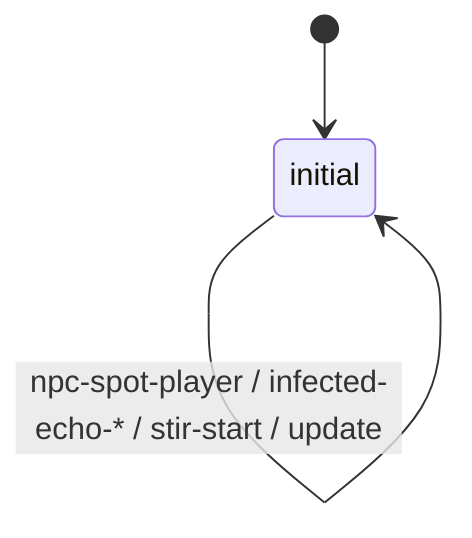
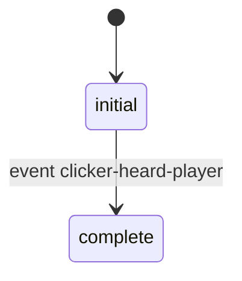
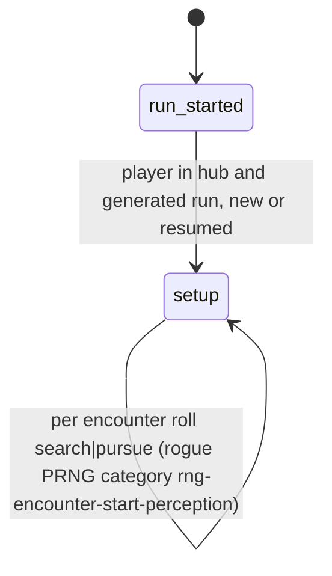

# Native AI Boundary — what DC scripts can and cannot touch

> Source: TLOU2R PC 1.6 `dc1/` (ai/, ai-archetypes, ai-action-packs, audio-gameplay, npc-*, ss-t2/infected, ss-rogue,
> ss-test prototypes). Labels: **CONFIRMED** · **HIGH** · **INFERRED** · **UNKNOWN / NEEDS NATIVE RESEARCH**.
> Helper: `tools/analysis/ai_noise_table.py` (dumps every `noise-settings-*` radius table).

## 1. Overview & files

Perception, knowledge, search, cover selection, combat decisions, navigation and behaviour selection are **native**.
DC contributes three things:

1. **Parameter tables** (pure data, read by native code): archetypes, combat/cover/search/infected params, noise
   settings, demeanors and move sets, action packs (TAPs).
2. **Script calls** that push state into the native brain: script mode, awareness, targets, zones, parameter-set swaps,
   perception multipliers. Almost all are native: of the 844 AI-ish names in `functions.json`, 290 are native and
   554 DC. The DC ones are mostly thin wrappers or level helpers.
3. **Observer / director scripts** that react to native AI events (`npc-spot-player`, `tension-changed`, `npc-died` …)
   and drive VO, hints, checkpoints, waves.

| File | Entries (CONFIRMED counts) | Role |
|---|---|---|
| `ai-archetypes.bin` | 121 `ai-archetype`, 23 `ai-melee-settings`, 14 `ai-traversal-skills`, 8 `ai-archetype-skills` | Per-enemy-type bundle: demeanor matrix, weapon anim config, performance table, **list of enabled behaviours**, traversal skills, post-selector set, `*noise-settings-…*`, listen-mode sounds, infected params |
| `ai/combat-params.bin` | 105 `combat-params` | per-NPC combat tuning (swapped by `npc-set-combat-params`) |
| `ai/ai-globals.bin` | 90 `global-combat-params`, 54 `ai-follow-settings`, 25 `point-curve`, 13 motion-type, 9 spline-network | encounter-wide tuning (`npc-set-global-combat-params`) |
| `ai/cover-params.bin` | 6 `ai-cover-params` (`thug-cover-params-{default,brave,timid,maxd}`, `enemy-dog-…`, `ellie-…`) | cover selection weights |
| `ai/search-params.bin` | 1 `*default-search-params*` = 7 floats `8.0, 2.0, 3.0, 3.0, 5.0, 0.5, 1.0` | search behaviour tuning (field meanings UNKNOWN) |
| `ai/infected-params.bin` | 25 `ai-infected-params`, 10 pustule-cloud params | infected variants incl. `*-no-knowledge-share*`, `*-short-search-*`, `*-bark-more-*`, `*-guarantee-legless-*` |
| `ai/sniper-params`, `surprise-params`, `melee-skill-settings`(50), `post-selectors`(30), `ai-lead-settings`(240), `ai-anim-configs`(75), `simple-npc`(87) | — | specialised behaviour tuning |
| `audio-gameplay.bin` | 9 `noise-settings-*` maps (54–70 noise types each) | **hearing**: per-listener-type audible radius per noise |
| `threat-detection-params.bin`, `listen-mode.bin` | 1 / 30 | player-side threat HUD and listen mode (not NPC perception) |
| `npc-demeanors.bin`, `npc-demeanor-matrix.bin` | 103 demeanor defs, 364 move sets, 25 matrices | locomotion style per demeanor (`npc-set-demeanor`) |
| `ai-action-packs.bin` | 1,034 entries (220 cine-action-packs, enter/exit/loop TAP tables) | scripted-animation hooks the AI can enter |
| `npc-cover.bin`, `npc-search-utils.bin` | 24 maps / search path criteria, look-aim modes | cover anims, search path scoring |
| `ss-t2/infected/ss-infected-perception-stats` | state script | observer: logs and hints from infected perception |
| `ss-patrol/ss-pat-supermarket-clicker-hearing` | state script | level observer: "clicker heard player" beat |
| `ss-rogue/encounter-perception-settings` + `ss-encounter-perception-controller` | 4 settings + script | No Return: starting knowledge per encounter |
| `ss-test/…/ss-proto-knowledge-spread`, `ss-proto-infected-clicker-directed-hearing`, `ss-proto-perception-speed-scale`, `ss-*-search-proto` | prototypes | script-side emulation experiments (not shipped behaviour) |

Note: `investigate.bin` (159 `investigate-params`) is the **player's** inspect-object camera tuning. It has nothing to do with
AI noise investigation, which is the native `investigate` / `infected-investigate` behaviour.

## 2. Boundary map

```
DC level script / director (ss-<level>/…)
   │  npc-set-script-mode, npc-make-aware-of, npc-force-target, npc-set-zone-region, npc-set-combat-params,
   │  npc-set-global-combat-params, npc-set-infected-params, npc-change-vision-settings, npc-set-hearing-multiplier,
   │  npc-enable/disable-perception, npc-set-deaf/blind, npc-start-search, npc-set-patrol-route, npc-use-closest-cover …
   ▼                                                              (all native, except wrappers)
DC DATA  ai-archetypes ─┬─ behaviours list ("investigate","search","pursue","flank","combat","infected-stir"…)
                        ├─ *noise-settings-<type>*  (audio-gameplay)     ◄── hearing radii
                        ├─ demeanor matrix / move sets / performance tables / TAPs
                        └─ infected / combat / cover / search params
   ▼
NATIVE AI   perception (vision cone, hearing, echolocation) → knowledge / awareness per target → faction knowledge
            sharing → behaviour selection (archetype list) → cover/post selection (post-selectors) → navigation
   │
   ▼ events back to DC: npc-spot-player, entity-awareness, npc-combat-started, tension-changed, npc-attacked,
     npc-fired-weapon, npc-died, npc-lost-player, infected-echo-start/end, infected-ambient-stir-start,
     infected-sleep-stir-start, npc-infected-bark-acquisition, distraction-sound, player-fired-weapon …   (0 DC senders)
```

## 3. State machines (observer scripts)

### 3.1 `ss-t2/infected/ss-infected-perception-stats` — CONFIRMED
A single state, `initial`. It never changes AI. It reads native perception and reports it.


```
initial
 ├─ event npc-infected-bark-acquisition → log-event("clicker-echo-acquired-player")
 ├─ event npc-spot-player → if last-sense == 3 and (clicker|shambler): log "clicker-echo-spotted"
 ├─ event infected-echo-start/end → log-event
 ├─ update
 │   ├─ if awareness rises to 2 and player crouched and last-sense == 2 and close
 │   │     → log "clicker-heard-crouched-player"; send-event(clicker-heard-crouched-player, ss-promote-death-hints)
 │   ├─ Abby crouched with 0 shivs vs clicker and pressing → send-event(tried-to-stealth-kill-without-shiv, ss-promote-death-hints)
 │   └─ cache npc-get-awareness / npc-get-acquisition / npc-get-acquisition-sense(self, player)        [all native]
 └─ event infected-{ambient|sleep}-stir-start → if on-screen clicker/shambler: hud2-request-reminder(*partial-stick-reminder*)
```
INFERRED enum readings from usage: awareness `2` = fully aware; acquisition sense `2` = hearing, `3` = echolocation.

### 3.2 `ss-patrol/ss-pat-supermarket-clicker-hearing` — CONFIRMED

```
initial
 ├─ update: when awareness → 2 by a non-echo sense, not in meat-shield → start-timer(heard-timer, 0.5)
 ├─ event heard-timer → if tension-mode-is?(3): broadcast-event(clicker-heard-player)
 └─ event clicker-heard-player → go(complete)
```

### 3.3 `ss-rogue/ss-encounter-perception-controller` — CONFIRMED

`encounter-perception-settings.bin` holds 4 presets: `Surrounded` (int 2, 10.0 s), `Certain` (2, 5.0), `Pursue` (3, 3.0),
`Search` (4, 3.0). The int matches the tension-mode numbering below (INFERRED).

### 3.4 Tension modes (CONFIRMED from `ss-dynamic-checkpoint-manager` log labels)
`tension-mode-is?(1|2)` → "stealth checkpoint", `(4)` → "search", `(3)` → "combat". `get-tension-mode()` is native.

## 4. What DC can modify vs what is native

| Can change from DC | How | Effect | Rating |
|---|---|---|---|
| hearing radii per noise per listener type | edit `audio-gameplay.bin` `noise-settings-*` | e.g. table below | **GREEN** (data) |
| which behaviours an enemy type has | edit archetype behaviour list | remove "flank"/"search"… | **YELLOW** (list order/indices may matter) |
| combat / cover / search / infected tuning | edit param structs, or swap at runtime with `npc-set-combat-params(npc, *x*)` (76), `npc-set-global-combat-params` (60), `npc-set-infected-params` (18) | aggression, cover style, knowledge sharing | **YELLOW** (fields unnamed; no RTTI for AI types) |
| per-NPC perception at runtime | `npc-set-hearing-multiplier` (25), `npc-change-vision-settings(npc, *default-vision-cone-blind*)`, `npc-set-deaf/blind`, `npc-enable/disable-perception` (45/50) | — | **GREEN** |
| force knowledge | `npc-make-aware-of(npc, player, 2, opts)` (667; opts `*npc-awareness-options-silent*`, `-no-surprise*`), `npc-force-target` (135), `npc-start-search(faction)` (24) | — | **GREEN** |
| take control | `npc-set-script-mode(npc, mode, perception)`. Wrappers: `npc-set-script-only-no-perception` = (2,1) ×760, `npc-set-script-only-with-perception` = (1,1) ×297, `npc-set-script-high-priority` = (1,0) ×422 | puppet NPCs for IGCs | **GREEN** |
| zones / patrols / cover | `npc-set-zone-region` (216), `npc-set-patrol-route` (136), `npc-use-closest-cover` (DC wrapper, 97), `npc-set-hard-point` (110) | — | **GREEN** |
| knowledge spreading | native (infected params `*-no-knowledge-share*` toggles it). `ss-proto-knowledge-spread` emulated it in DC: `alert-region-npcs-in-range` → `send-event(make-aware, npc, …)` | — | proto only |
| perception algorithm, vision cone geometry, nav, behaviour tree, cover scoring code | — | — | **RED** native |

### Hearing radius sample (first float of each `noise-data`; INFERRED = audible radius in m)

| noise | default | clicker | runner | bloater | enemy-ellie |
|---|---|---|---|---|---|
| footstep-walk | 0.5 | 7.5 | 4.0 | 7.5 | 2.0 |
| footstep-run | 8 | 12 | 12 | 20 | 6 |
| footstep-sprint | 15 | 20 | 20 | 28 | 15 |
| footstep-crouch | 0.5 | 1.4 | 0.5 | 1.4 | 0.5 |
| footstep-crouch-run | 3 | 7 | 2 | 7 | 2 |
| footstep-prone | 0.5 | 2.0 | 0.5 | 2.0 | 0.25 |
| weapon-fire / silenced | 200 / 3 | 210 / 5 | 160 / 5 | 210 / 5 | — |
| glass-break / firecracker | 40 / 100 | 40 / 100 | 40 / 100 | 40 / 100 | 40 / — |
| push-object / melee-hit / workbench | 25 / 40 / 10 | 20 / 40 / 10 | 20 / 40 / 10 | 30 / 40 / 10 | — |
| player-breathe | — | 1.2 | — | 3.0 | 1.2 |

This matches the known gameplay, where clickers hear crouch-walking that humans do not. That is why the radius reading is HIGH confidence.

## 5. Events in / out
In (native → DC, 0 DC senders): `tension-changed` (111 level scripts), `npc-died` (300), `npc-attacked`, `npc-combat-started`, `npc-spot-player`,
`entity-awareness`, `npc-fired-weapon`, `player-fired-weapon`, `player-threw-projectile`, `distraction-sound`, `npc-spawned`, `npc-lost-player`,
infected echo/stir/bark events, `player-became-hidden-in-stealth-vegetation`.
Out (DC → native AI): only calls, no events, except prototypes (`make-aware`) and DC-to-DC beats (`clicker-heard-player`).

## 6. Persistence / animation / UI / audio hooks
AI state is not saved by DC. Dead NPCs are tracked natively (`npc-is-dead-in-checkpoint?`). Checkpoint safety reads AI state
(`faction-entity-lost?`, `npc-awareness-safe-to-checkpoint?`, `is-position-future-exposed?`). Animation goes through TAPs and
cine-action-packs. UI goes through `hud2-request-reminder` and `suppress-spot-player-stinger` / `npc-suppress-threat-indicator`. Audio: VO
director scripts write **facts** (`faction-enemy restrict-search-location` ×548, `global last-search-location-called` ×408)
that pace enemy callouts. See `systems/persistence` §1 C.

## 7. Confidence table
| Claim | Label |
|---|---|
| perception, knowledge and behaviour selection are native | CONFIRMED (no DC definitions; `npc-get-awareness` etc. native) |
| archetype = data bundle with behaviour list | CONFIRMED (strings in `ai-archetypes.bin`) |
| noise table first float = radius | HIGH |
| awareness / sense enum meanings | INFERRED |
| search-params field meanings | UNKNOWN |

## 8. Open questions
Field layouts of `combat-params`, `ai-cover-params`, `ai-infected-params` (no RTTI; `dc-rtti.bin` only covers render settings).
How the archetype is picked: spawner data (level) vs `npc-get-archetype`. Whether behaviour-list edits need matching native
behaviour ids.

## 9. Modding surface
GREEN: runtime calls in level scripts, noise radii, param swaps among existing tables. YELLOW: editing param structs or
behaviour lists (unnamed fields). ORANGE: new archetypes (module export tables, spawner references). RED: any perception or
decision algorithm.
