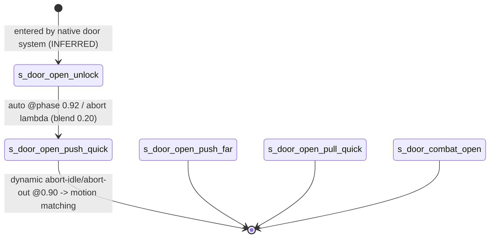
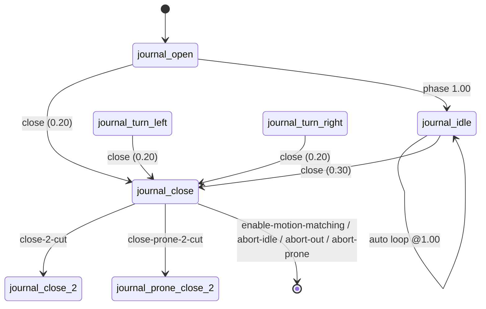
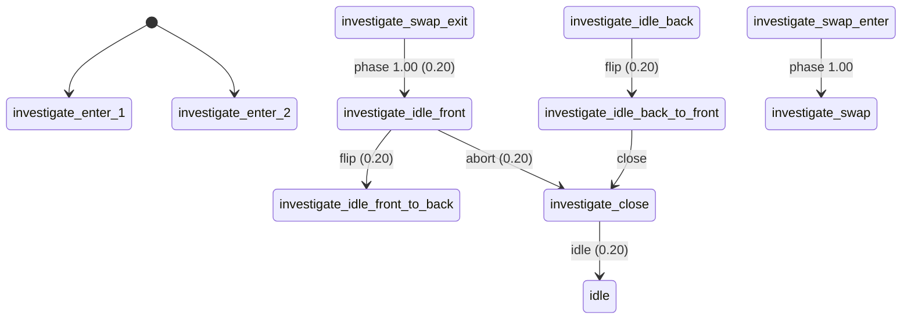

# Animation engine boundary: how interaction scripts drive animation (TLOU2R PC 1.6)

Scope: how state scripts talk to the animation system. This covers `animate_` and its option array, the
phase/frame queries, alignment and scripted moves, IK, attach/detach, holster, overlays, motion matching, and the
anim-player data modules (`anim-player/player-door`, `-investigate`, `-journal`, `-ladder`, `-climb`,
`-push-object`, `-squeeze-through`, `-rope`, plus `player-script`).
Labels: **CONFIRMED** (seen directly in code or data) · **HIGH** · **INFERRED** · **UNKNOWN / NEEDS NATIVE RESEARCH**.

## 1. Overview & files

| Artifact | What it is |
|---|---|
| `animate_option_keys.json` | Every option array passed to `animate_`/`wait-animate_` across the corpus, aggregated per key (12,150 arrays, 75 distinct keys): count, value types, top values, the variables or functions that feed each key, and a label with its confidence. |
| `anim_player_state_lists.json` | Schema and summary of the anim-player `actor-state-list` modules: states, anim-node types, native `*Action` subsystems, dynamic flags, transitions. |
| `tools/analysis/animation_optkeys.py` | Extractor: `.dcpl` → `.private/scratch/animation/optarrays.jsonl.gz` (one record per consuming call). |
| `tools/analysis/animation_keytable.py` | Aggregator and labeller → `animate_option_keys.json`. |
| `tools/analysis/animation_statelist.py` | Parser for `actor-state-list` `.asm` → JSON. |

Key source files: `script-user-funcs-impl.bin` (the DC wrappers `animate-start`, `animate-done`,
`animate-fade-out`, `simple-animate`, `stub-igc`, `wait-until-anim-frame` …), `anim-player.bin` (the
`anim-player` **anim-actor**, which lists 75 state lists), `anim-player/*.bin` (state lists),
`anim-player-state-processing.bin` (`default-anim-state-player-info`), `anim-warps.bin`, `anim-blends.bin`,
`anim-motion-match.bin`, `player-overlays.bin` (717 `anim-overlay-set`/map entries), `player-anim-settings.bin`,
and `player-transition-anims.bin` (`*transition-abort-frames*`).

## 2. State machines (animation-side)

The script side does not own animation state machines. It asks for an anim, and the **native anim actor**
(`anim-player = anim-actor`, defined in DC data) drives a data-defined state graph. **CONFIRMED**:
`anim-player.bin` → `anim-player` [0x0A0] array of 75 `anim-player-*-states` symbols. Every scripted `animate_`
on the player lands in one of the generic **script states** in `anim-player/player-script.bin`:

| State family | Variants (CONFIRMED state names) | Option key that selects it (INFERRED) |
|---|---|---|
| `s_script-full-body` | `-loop`, `-ap`, `-loop-ap`, `-no-weap`, `-gesture` and their combinations (16) | 31 loop → `-loop`; 10 ap-ref → `-ap`; 43 look-gesture → `-gesture`; weapon flag → `-no-weap` (key UNKNOWN) |
| `s_script-gesture-0..3` (+`-loop`) | 8 | 40 layer-type = 1 plus 41 = `s_script-gesture-N` (**CONFIRMED** values) |
| `s_script-gesture-add-0..3` (+`-loop`) | 8 | 41 = `s_script-gesture-add-N` (additive layer) |

NPCs use the equivalent states in `anim-npc.bin`, which adds `-collide` variants (`s_script-full-body-ap-collide`,
and others). That correlates with option key 13.







## 3. Per-state call graph (representative interaction: drawer `scavenge-enter`, `ss-t2/ss-openable-drawer`)

```
scavenge-enter
 ├─ wait while holding-no-weapon?(player) (≤4 s)                                  [CONFIRMED]
 ├─ animate_(drawer, "<enter-anim>--drawer", {56 speed 1.4|1.0, 44 mirror?, 28 fade-in 0.40, 30 fade-out 0.00})   [CONFIRMED]
 ├─ animate_(player, <enter-anim>, {56 speed, 28 fade-in 0.50, 27 curve 2, 45 0.50, 30 fade-out 0.00,
 │        13 = 3, 49 = 1, 10 ap-ref = get-bound-frame(goal), 32 = 1, 44 mirror?, 1 = 1, 3 = 1,
 │        12 camera-mode = camera-required-low? 1:0, 24 exit-mode = crouch?18:1, 87 = 1, 5 = 1})   [CONFIRMED values]
 ├─ joint-ik-characters(player, proxy, hand, root, …) / player-ik-root-adjust(…)    [CONFIRMED native]
 └─ go(next) when get-animation-phase(player, 2, anim) ≥ tuned phase                [CONFIRMED]
```

Wrapper call graph (DC, `script-user-funcs-impl.bin`), CONFIRMED:
```
animate-start(obj, anim, loc, channel)       → animate_(obj, anim, {10 loc, 59 0, 58 0.0, 56 0.0, 14 channel})   (pose at frame 0)
animate-done(obj, anim, loc, layer, ch, ex)  → animate_(obj, anim, {10, 59 0, 58 1.0, 56 0.0, 45 0.0, 40 layer, 14 ch, 24 ex})  (pose at end)
animate-fade-out(obj, anim, loc, t, curve…)  → animate_(obj, anim, {10, 28 0.0, 30 t, 27 2, 29 curve, 57 start-frame, 20 end-frame, 40, 24, 13, 32 1})
simple-animate(obj, anim, spawner, in, out)  → animate_(obj, anim, {10 get-spawner-locator, 28 in, 30 out})
```

## 4. Answers to the specific questions

### 4.1 The `animate_` option array (main deliverable). Full table in `animate_option_keys.json`.
Encoding: `#%alloc-array(single-frame, 16, N, 1)` gives N 16-byte slots. Each slot is `{i32 key @+0; value @+8}`.
The value width follows the store type (`u8`/`i32`/`f32`/`u64` symbol or pointer). dconstruct names the native
boxed type `ssAnimateParams` (`.private/ext/dconstruct/source/ast/primary_expressions/call.cpp`). **CONFIRMED.**
All 12,150 arrays in the corpus are consumed by exactly two functions: `animate_` (8,440) and `wait-animate_`
(3,710). Pairs per call: 1–16 (mode 3).
No name table for the keys exists in DC: `anim-script-funcs.bin` and `script-funcs-anim.bin` are empty, and
`dc-rtti.bin` holds only render-settings types. **UNKNOWN / NEEDS NATIVE RESEARCH** for the authoritative names.

| key | type | n | meaning | confidence | decisive evidence |
|---|---|---|---|---|---|
| 10 | u64 | 11,021 | ap-ref / align bound-frame | CONFIRMED | locator getters; `animate-start(…loc…)` |
| 14 | u64 | 340 | ap-ref channel name | CONFIRMED | `apReference-*`, `car`, `boat-AP-ref` |
| 28 | f32 | 8,641 | fade-in (blend-in) seconds | CONFIRMED | `ss-examine`: `get-float(blend-to-exit-2)`; `simple-animate` arg |
| 30 | f32 | 7,483 | fade-out (blend-out) seconds | CONFIRMED | `get-float(blend-from-exit)`, `anim-exit-fade-out` |
| 27 | u8/sym | 1,106 | fade-in curve | HIGH | `get-curve-type()`, `uniform-s`, `ease-in` |
| 29 | u8/sym | 786 | fade-out curve | HIGH | `animate-fade-out` sets it with 30; `ease-out` |
| 31 | u8 | 911 | loop | CONFIRMED | `loop-idle?`, `idle-force-loop`; `-loop` states |
| 44 | u8 | 57 | mirror | CONFIRMED | `mirror?`, `mirror-anim`, `left-side` |
| 56 | f32 | 661 | playback speed (0 = hold pose, −1 = reverse) | CONFIRMED | `animation-speed`, `speed-pct` |
| 57 | f32 | 640 | start frame | CONFIRMED | `start-frame`, `get-animation-frame(other…)` |
| 58 | f32 | 525 | start phase | CONFIRMED | `get-animation-phase`, `get-best-entry-phase`; `animate-done` = 1.0 |
| 20 | f32 | 256 | end frame | HIGH | `abort-frame`, `…-get-end-frame()` |
| 22 | f32 | 59 | end phase | HIGH | `end-phase-for-first-anim` |
| 60 | f32 | 416 | stick-abort fade seconds | CONFIRMED | `blend-from-exit-stick-abort-fade-sec` |
| 61 | i32 | 460 | stick-abort frame | CONFIRMED | `blend-from-exit-stick-abort-frame` |
| 12 | i32 | 47 | camera mode enum | HIGH | `gap-dodge-camera-mode()`, `camera-required-low?` |
| 24 | i32 | 547 | exit mode enum (1 = stand, 18 = crouch: INFERRED) | HIGH (name) | `gap-dodge-exit-mode()`, var `exit-mode` |
| 13 | i32 | 246 | collision/ground mode (0/2/3/5) | INFERRED | `collision-ground? → 2 : 0` |
| 40 | i32 | 565 | layer type (1 = partial) | HIGH | `get-layer-type()` |
| 41 | u64 | 31 | target script layer state | CONFIRMED | `s_script-gesture-0` … match `player-script` |
| 43 | u64 | 78 | look/overlay gesture | HIGH | tag `look-gesture`; `-gesture` states |
| 75 | u64 | 111 | joint/blend mask set | HIGH | `*upperbody--left-hard--right-hard--fb*` |
| 37 / 38 | u64 | 30 / 29 | left / right hand ap-ref channel | HIGH | `apReference-hand-l/-r` |
| 35 | i32 | 64 | hand-IK mode? | INFERRED | co-occurs with 37/38 (lift ≈ 90×) |
| 42 | f32 | 8 | layer/pair weight | INFERRED | `pickup-anim-pair-weight` |
| 45 | f32 | 149 | motion (root) blend time? | INFERRED | values from `get-player-speed()` / `blend-in-sec-from-gate-enter` |
| 82 | u8 | 241 | sync/continue flag | INFERRED | goes with 57 copied from another object's frame |
| 83 | u64 | 18 | horse binding | CONFIRMED | `alloc-horse-binding()` |
| 85 | u64 | 63 | animated-camera id | HIGH | workbench `85=workbench-enter`, later `camera-fade-out(workbench-enter…)` |
| 0–9, 16–19, 25, 32, 34, 36, 46–54, 59, 62–72, 74, 77–91 | mostly u8 = 1 | — | flags / enums | UNKNOWN | usage contexts in JSON |

Observation (INFERRED): the known names sort alphabetically against their key numbers. Examples: `end-frame`(20)
< `end-phase`(22) < `exit-mode`(24); `start-frame`(57) < `start-phase`(58); `stick-abort-fade-sec`(60) <
`stick-abort-frame`(61); `layer`(40) < `look-gesture`(43) < `mirror`(44) < `speed`(56). That pattern suggests the
native enum is a sorted keyword list, with 0–9 being `a…`-prefixed flags (for example `allow-*`). This is not
verified. Treat any name derived this way as a hypothesis.

### 4.2 Phase / frame queries — CONFIRMED native
`get-animation-phase(obj, mode, anim)` (720 calls) and `get-animation-frame` (2,240). Their arg-2 values are
`2` (680 / 2,048 calls), `1` (partial anims, for example the safe dial `slo-part-ellie` or the workbench layer)
and `0` (static anim-data lookups, such as a melee attack anim that is not playing). INFERRED: 2 = base or
full-body instance, 1 = layer. `stop-animating(obj, 2|1|0, fade, …)` (896) uses the same selector.
`wait-until-anim-frame` (3,006) and `wait-until-anim-phase` (200) are DC wrappers that poll these.

### 4.3 Alignment and scripted moves
`get-align-from-ap-ref(obj, anim, apRefLocator, phase, apReference)` (989 calls, native) converts an ap-ref into
the start alignment. `get-ap-ref-from-align` (223) does the inverse. `wait-player-scripted-move-new(loc, 1, 0, 7, 0, 0)`
(64) and `player-scripted-move-new` (10) are native. `wait-player-move-to-entry` (644) and `player-move-to-entry`
(42) are DC wrappers. The only `player-is-*-scripted-move?` predicates in the corpus are
`player-is-door-scripted-move?` and `player-is-pickup-scripted-move?` (native, 1 call each, in the accessibility
sound script). That suggests doors and pickups use native scripted moves that DC only queries (INFERRED).

### 4.4 IK, attach and holster
`joint-ik-characters` (28, native), `stop-joint-ik` (DC, 53), `player-ik-root-adjust` (3, native),
`stop-player-script-ik` (DC, 8), `ik-to-joint` / `stop-ik-to-joint` (15 each), `set-character-ik-mode-override` (26).
`attach(obj, parent, joint, …)` (603): `rightHand` 313, `leftHand` 235, `hat`, `targSpineProp`, `flashlightHolster`.
`detach` (77) and `detach-without-physicalizing` (73). `holster-player-weapon(mode, speed)` (219): mode 4 = 111,
2 = 83, 0 = 46 (enum meaning UNKNOWN). In data, IK lives in native subsystem actions referenced by the state lists:
`DoorHandleIkAction`, `CharacterLadder*`, `CharacterLedgeClimbUp`, `PlayerSqueezeThroughAction`, `CharacterRope`.

### 4.5 Data modules (data-only; schema in `anim_player_state_lists.json`)
Common schema (CONFIRMED from `.asm`): `actor-state-list {sid anim-player; count; array<state>}`. Each state is
`{name; anim-node tree; primary anim; tag; anim-transition-group; speed lambda; hash-table{player, door, subsystem, dynamic}}`.
The speed lambda multiplies by `player-anim-speed-mult`. Transitions are `{event | auto; conditions (type 2 = phase threshold, or a lambda calling player-animation-abort-active?); target; blend seconds}`.

| module | states | nodes | native actions | notable data |
|---|---|---|---|---|
| player-door | 8 (`s_door-open-push-quick/-far/-left/-right`, `-pull-quick`, `-locked`, `-unlock`, `s_door-combat-open`), tag `door-open` | animation + subsystem-ik | `DoorHandleIkAction`, `PlayerFeatherBlendPartialAction` | `door-state-info` names the door prop anim (`…-door`); dynamic `enable-motion-matching`, `abort-idle` @0.90, `abort-out` @0.90 |
| player-investigate | 33 (investigate, horse-investigate, photograph) | animation, parametric | `PlayerInventoryAnimAction`, `InvestigateTurnSpringAction`, `CharacterRebootCloth` | events `flip`, `abort`, `close`, `button`; backpack info |
| player-journal | 7 | animation | `PlayerInventoryAnimAction` | events `close`, `close-cut`, `close-2-cut`, `close-prone-2-cut` |
| player-ladder | 20 | animation, subsystem-ik, blend | `CharacterLadder{Enter,Move,Phase,SlideDown}` | events `ladder-up/dn(-2rung)`, `ladder-dn-slide`; dynamic `ladder-can-drop`, `ladder-can-climb-off-top/bot`, `custom-motion-fade-channel-*` |
| player-climb | 10 (clamber / ledge-grab) | animation | `CharacterLedgeClimbUp`, `CharacterUpdateApRefY` | camera dynamics `climb-up-camera-pan-*`, `climb-camera-blend-*`; IK contacts `climb-up-ik-contact-hl/hr` |
| player-push-object | 5 | animation, blend | — | tag `push-pull`; 0.75 s blends |
| player-squeeze-through | 1 | animation + subsystem-ik | `PlayerSqueezeThroughAction` | `bindpose-anim` placeholder, so the motion is native |
| player-rope | 41 | animation, blend, gesture | `CharacterRope` | events `rope-climb-up/dn`, `rope-swing`, `rope-ledge-climb-up`, `rope-exit-to-ground` |

Some transition event fields decode as raw 32-bit integers (for example `1573353348`), meaning SIDs or flags that
did not resolve.

### 4.6 Overlays, blends, warps, motion matching
`set-overlay-set(obj, anim-overlay-*)` (117) selects sets defined in `player-overlays.bin`, such as
`anim-overlay-player-investigate-object-*`. `anim-blends.bin` holds `blend-overlay-map`s (push-object wood/heavy
and others). `anim-warps.bin` defines `*anim-warps*` per ledge-contact anim (per-channel `channel-warp-params`).
`anim-motion-match.bin` is an anim-actor with `s_motion-match(-loop)` states. Motion matching is re-entered from
scripted states through the dynamic flag `enable-motion-matching`. `player-set-motion-match-*-speed-multiplier/f`
are native.

## 5. Engine boundary (DC vs data vs native)

| Behaviour | Lives in |
|---|---|
| Choosing *which* anim, entry angle/height selection, phase thresholds, option values | **DC script** (CONFIRMED) |
| Option→state mapping (`s_script-*` variants), anim-node graphs, transitions, blend times, abort phases, subsystem lists | **DC data** (`anim-player/*.bin`) (CONFIRMED) |
| Clip playback, blending curves, ap-ref alignment solve, IK solvers, `*Action` subsystems, motion matching, scripted-move locomotion | **Native** (functions are not DC-defined; `*Action` are C++ class names) |
| Sound/effect events inside clips | Anim packages (not DC); see `systems/audio` |

## 6. Events in / out
Script → anim: through function calls only. Anim → script: polling (`get-animation-phase`, `object-anim-playing?`
541 calls, `wait-for-animate-done` 33), with no anim-event callbacks visible in DC. The data-side transition
events (`close`, `flip`, `ladder-up` …) are native/anim-actor events, not script `send-event`s. INFERRED, because
none appear in `events.json` as script-sent.

## 7. Persistence
None in the animation layer. Scripts store tuned phases or anim names in state-script variables (for example
`scav-enter-animation`).

## 8. Animation / camera / UI / audio hooks
Camera: option key 12 (camera mode) and key 85 (animated-camera id); the climb dynamics flags. Audio: anim clips
carry effect events (see audio README). UI: none directly.

## 9. Shared components
`script-user-funcs-impl.bin` wrappers, which every system uses. The `anim-player` actor is shared by all player
interactions (door, ladder, investigate, rope …).

## 10. Confidence table

| Claim | Label |
|---|---|
| Option-array encoding, consumers `animate_`/`wait-animate_` only | CONFIRMED |
| Keys 10, 14, 28, 30, 31, 41, 44, 56, 57, 58, 60, 61, 83 | CONFIRMED |
| Keys 12, 20, 22, 24, 27, 29, 37, 38, 40, 43, 75, 85 | HIGH |
| Keys 13, 35, 42, 45, 82 | INFERRED |
| Remaining ~45 keys | UNKNOWN |
| Player scripted anims run in `s_script-*` states of `player-script.bin` | HIGH (data CONFIRMED, native selection INFERRED) |
| Alphabetical key enum | INFERRED (hypothesis) |

## 11. Open questions
- Authoritative key names need the native `ssAnimateParams` parser at `animate_` (native 0x141879350).
- The meaning of the u8 flags 0–9, 32, 49, 87 (drawer and cabinet set 1, 3, 5, 87).
- The enum values for exit mode (24), camera mode (12) and collision (13).
- How the native layer picks the `-no-weap` script state.

## 12. Modding surface

| Surface | Rating | Reason |
|---|---|---|
| Option values in DC scripts (fade times, speed, start phase, mirror) | GREEN | Plain scalars in the script; the effect is predictable |
| Swapping anim names in a script (`animate_(player, X)`) | YELLOW | The anim must exist in a loaded package and fit the ap-ref and IK assumptions |
| Editing `anim-player/*.bin` transitions, blend times, dynamic flags | ORANGE | Data struct with native consumers; offsets known only by observation |
| New option keys, IK solvers, `*Action` subsystems, motion matching | RED | Native |
