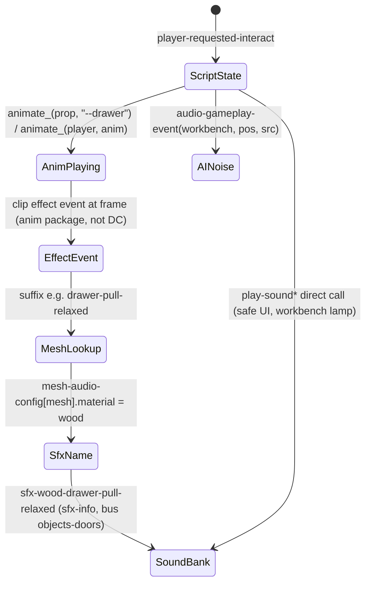

# Audio architecture: how interactions make sound (TLOU2R PC 1.6)

Labels: **CONFIRMED** · **HIGH** · **INFERRED** · **UNKNOWN / NEEDS NATIVE RESEARCH**.

## 1. Overview & files

| Artifact | Content |
|---|---|
| `audio_package_table.json` | Entry-type totals per audio group; for each of the 321 `audio-sfx/common-objects/*` packages: counts, sfx-info-light category, and the inferred trigger route of every sfx name. |
| `mesh_audio_material_table.json` | Parsed `mesh-audio-config.bin`: the suffix tables, the 488 mesh → (material, handle) rows, composition coverage checks, and the `look-audio-config` rope meshes. |
| `tools/analysis/audio_mesh_config.py`, `tools/analysis/audio_packages.py` | Generators. |

DC audio modules (CONFIRMED entry counts, corpus-wide): `sfx-info` 163,297 · `sfx-info-light` 28,073 ·
`sfx-info-full` 9,338 · `vox-info` 28,282 · `mix-snapshot-info` 248. About half of the sfx entries sit in
`aud-sfx1.bin` and `aud-sfx2.bin` (40,695 + 40,845 sfx-info). These are merged copies of the per-area
`audio-sfx/**` modules: every drawer sfx name is found in exactly one `audio-sfx/common-objects/*` file, in one
`aud-sfx{1|2}`, and in `modules.bin` (q.py `uses`). **HIGH**.

Entry schemas (CONFIRMED layout, field meanings INFERRED):
- `sfx-info {sid name; [ptr sfx-info-light]}`. The name is the sound-bank event key.
- `sfx-info-light {int flags; sid category; int; float ~2060.x (probably packed or half-float data); float; int; int}`.
  Categories: `igc-sfx` 5,674, `ambience-emitters` 3,284, `objects-physics` 1,542, `melee-weapons`, `weapons-foley`,
  `foley-*`, `objects-doors` 125, `objects-ropes` 116, `objects-pickups` 81 … They are mixer and voice buses.
- `sfx-info-full`: an extended form with mixer and DSP fields (for example `music-source`, `guitar-freeplay`).
- `vox-info {sid line; flags; sid emotion (neutral); …}` in `vox-*.bin`. `mix-snapshot-info` in `audio.bin`
  (snapshots such as `mix-tut-slowdown`, plus `commentary-info` ducks).

`audio-sfx/common-objects` tree: 297 `aud-sfx-physics-*` packages, 28 `aud-sfx-gbl-*`, 15 `aud-sfx-obj-*`, and
`doors`, `pushables`, `leather`, `wood`, `metal`, `plastic`. The `gbl` interaction packages:

| package | sfx | bus | name pattern |
|---|---|---|---|
| drawer-wood / drawer-metal | 12 / 12 | objects-doors | `sfx-{wood,wood-track,metal,metal-big}-drawer-{pull,close}-{relaxed,tense,crouch}` |
| cabinet-wood / -metal / -metal-fridge / -metal-locker | 6 / 3 / 6 / 6 | objects-doors | `sfx-<mat>-cab-{pull,close}-<stance>` |
| drawer-and-cabinet-handle | 3 | objects-doors | `sfx-{wood-knob,metal-handle,metal-big-handle}-start` |
| door-wood / -metal / -glass / -screen / -metal-gate | 20 / 36 / 4+4 / 1 / 9 | objects-doors | `sfx-<mat>-door-{push,pull}-<stance>`, `…-bits-burst-aggr-push`, `door-wall-hit` |
| door-handle-knob / -latch / -metal-bar / -pushbar | 7 / 7 / 3 / 3 | objects-doors | `sfx-{knob,latch,…}-{start,release,locked,shiv-push-start…}` |
| rope-cable / -cord / -hemp / -hose / -nylon / -chain | 40 / 17 / 18 / 18 / 17 / 6 | objects-ropes | `sfx-<mat>-rope-<action>` |
| safe | 32 | igc-sfx | `sfx-gbl-safe-<action>--<joint/part>` plus UI ticks |
| military-generator | 58 | igc-sfx | `sfx-igc-…-generator-…--<part>` |

## 2. State machines
Audio has no DC state machine. The interaction state scripts (drawer, safe, workbench …) are documented in their
own system dirs. Below is the sound-trigger chain as a state view:



## 3. Per-state call graph (script-side audio only)

```
ss-t2/ss-openable-drawer : scavenge-pickup
 ├─ item-pickup-play-pickup-sound(current-pickup-obj, l_wrist|r_wrist)       [CONFIRMED native]
 └─ item-pickup-play-pickup-done-sound(current-pickup-obj, l_wrist|r_wrist)  [CONFIRMED native]
   (no drawer-open/close sound call anywhere in the script)                     [CONFIRMED]
ss/ss-tumbler-safe
 ├─ play-sound-at-joint(sfx-gbl-safe-dial-rotate-cw|ccw|tick-normal|tick-clue|reset, self, dial, 0, 0)  [CONFIRMED]
 └─ play-sound(sfx-gbl-safe-ui-confirm-number|remove-number|exit, 0)            [CONFIRMED]
ss-t2/ss-workbench
 ├─ play-sound-at-joint(sfx-workbench-light-scar-lp, tools-obj, lantern, 0, 0) / play-sound-at-position(sfx-workbench-light-lp …) [CONFIRMED]
 └─ audio-gameplay-event(workbench, get-object-position(player), self) ×4      [CONFIRMED]
ss/ss-investigate-object
 └─ player-investigate-set-extra-sounds(tag sfx-rotate-loop, tag sfx-rotate-loop-joint | root)  [CONFIRMED]
```

## 4. Answers to the specific questions

**How do interaction scripts trigger sound?** There are five routes.

1. **Animation effect events with a mesh-material lookup.** This is the dominant route for doors, drawers,
   cabinets, handles and ropes. **HIGH** for the chain, **UNKNOWN** for the clip-side encoding.
   `mesh-audio-config.bin` defines suffix tables: `*suffixes-mesh-effect-door-material*` (32 suffixes such as
   `drawer-pull-relaxed`, `cab-close-tense`, `door-push-crouch`), `*suffixes-mesh-effect-door-handle*` (8),
   `*suffixes-mesh-effect-rope-material*` (22), `*suffixes-general-effect*`, `*suffixes-weapon-effect*` and
   `*suffixes-grab-effect*`. It also defines `*mesh-audio-config*`, a map of 1,340 meshes, where 488 door, drawer
   and cabinet meshes carry `mesh-effect-audio-config {material, handle}`. Example:
   `drawer-kitchen-cabinet-traditional-b-lower → wood / metal-handle`. Materials: wood 284, metal 150,
   metal-fence-gate 20, wood-track 11, metal-glass 6, metal-big 4, wood-screen 4, metal-locker 4, wood-glass 2,
   metal-military 2, metal-fridge 1. Handles: metal-handle 196, latch 151, knob 52, wood-knob 39, metal-bar 27,
   metal-big-handle 5.
   **Composition rule (HIGH):** `sfx-<material>-<suffix>` resolves to real `sfx-info` names for every material
   (for example wood: 29 of 32 door-material suffixes exist; knob and latch: 7 of 8 handle suffixes). The
   `relaxed/tense/crouch` stance suffixes match the three drawer animation families
   (`ellie-scav-{relaxed|tense|crouch}-drawer-*`).
2. **The same mechanism for character foley.** Top-level `mesh-audio-config` fields give a character prefix
   (`abby-`, `backpack-ellie-`, `mlb-`) and per-body-part fabric suffixes (`-cotton`, `-jeans`, `-parka`,
   `-skin-inf`). These combine with general-effect suffixes and a surface name:
   `sfx-backpack-ellie-scav-insert-item`, `sfx-runner-hand-grab-water`. **HIGH**.
3. **Joint-suffixed IGC names** (`sfx-gbl-safe-open-fail--r-wrist-2`, `--safe-handle`, `--cloth`), 748 names in
   common-objects. The `--<joint/part>` suffix matches ND's convention for an effect authored on a joint of a clip.
   No DC reference exists. **INFERRED**.
4. **Direct script calls** (counts from `functions.json`): `play-sound-at-joint` 648, `play-sound-at-position` 452,
   `play-sound` 229, `play-sound-attached` 39, `play-sound-at-bound-frame` 33, `stop-sound` 370,
   `set-local-sound-variable` 21, `item-pickup-play-pickup-sound` 4 / `…-done-sound` 8,
   `play-pickup-sound-by-item-id` 4, `player-investigate-set-extra-sounds`, and `play-music-stinger` 384.
   Mixer: `set-per-frame-mixer-override` 211, `set-mixer-override` 34. Dialogue: `wait-say` 8,184, `say` 1,962,
   `request-dialog` 887. All are native except the accessibility wrappers (`play-accessibility-*`, DC in
   `accessibility-script-funcs.bin`). Only 42 common-object sfx names are called literally from script.
5. **Item definitions.** `player-inventory.bin` `item-pickup → item-pickup-sounds {sid pickup; sid done}` plus
   rumble names, with 19 explicit (ammo) entries. `item-pickup-play-pickup-sound(item, wrist)` most likely resolves
   through this struct natively. **INFERRED**. Other item sounds: **UNKNOWN**.
6. **Physics and destruction.** 1,388 `sfx-phy-*-imp|rll` and 86 `sfx-dst-*` names (bus `objects-physics`) have no
   script or DC data reference. They are triggered natively by rigid-body contacts. **INFERRED**.

**`audio-gameplay-event` is not playback.** Its first argument (`melee-hit`, `workbench`, `molotov`, `door-closed`
…) is a key of `audio-gameplay.bin` `*noise-settings-*` maps, holding `noise-data {sid; float radius}`.
Examples: workbench 10, door-opened/closed 5, push-object 25, glass-break 40, weapon-fire 200. These events are
**AI hearing / noise** emissions. **HIGH**. The same module holds `*sound-cover-noise-type-mask-*` and
`*pat-pickup-sound-map*` (surface → pat type).

**Where are `aud-sfx-gbl-drawer-*` names referenced?** In DC, only by their own module, `aud-sfx1/2` and
`modules.bin`. **CONFIRMED** with `q.py uses` for 8 names. No anim, actor or art-group DC data references the full
names. The link is the suffix table plus `mesh-audio-config`, with the event itself inside anim clip data (pak),
which is outside the DC corpus. **NEEDS NATIVE/PAK RESEARCH** to see the clip-side event.

**Chain with confidence:**
`player-requested-interact` (native) → state script (`scavenge-enter`) → `animate_(drawer, "<anim>--drawer")`
[CONFIRMED] → clip effect event `drawer-pull-<stance>` [INFERRED] → native mesh lookup `mesh-audio-config[<drawer mesh>]`
→ material `wood` [CONFIRMED data, INFERRED use] → event `sfx-wood-drawer-pull-relaxed` [HIGH] →
`sfx-info-light` bus `objects-doors` [CONFIRMED] → sound bank [native].

## 5. Engine boundary
DC script: one-shot gameplay or UI sounds, loops with handles (`stop-sound(get-int32(snd-*-lp))`), mixer
snapshots, and AI noise events. DC data: sfx registry (names, buses), mesh→material config, suffix tables,
noise radii, item pickup sounds. Anim clip data: when an effect fires. Native: name composition, bank playback,
occlusion/DSP, physics impact sounds.

## 6. Events in / out
No script events. `audio-gameplay-event` feeds AI perception (see `systems/ai`). `suppress-pickup-sound` (an event
the drawer sends) gates the native pickup sound. **CONFIRMED** sent, consumer native.

## 7. Persistence
None. Loop handles live in script variables (`snd-door-lp` and similar) for the life of the state.

## 8. Animation / camera / UI hooks
Effect events ride on animations (route 1 and route 3). `interactable-set-accessibility-sound-*` ties sounds to
the interactable prompt for accessibility.

## 9. Shared components
`mesh-audio-config.bin` is shared by doors, drawers, cabinets, ropes and character foley. `audio-gameplay.bin` is
shared with AI. `accessibility-script-funcs.bin` provides DC sound wrappers.

## 10. Confidence table

| Claim | Label |
|---|---|
| Entry counts, schemas, buses | CONFIRMED |
| aud-sfx1/2 = merged copies of audio-sfx modules | HIGH |
| Drawer, cabinet and door sounds use no script call | CONFIRMED |
| `sfx-<material>-<suffix>` composition via mesh-audio-config | HIGH |
| Trigger = anim clip effect event | INFERRED (clip data not in DC) |
| `audio-gameplay-event` = AI noise | HIGH |
| Physics sounds native | INFERRED |

## 11. Open questions
- The effect-event format in anim packages and how a prop mesh is bound to its `mesh-audio-config` key (art-group name?).
- The `sfx-info-light` packed fields (~2060.x floats).
- How `item-pickup-play-pickup-sound` picks sounds for non-ammo items.

## 12. Modding surface

| Surface | Rating | Reason |
|---|---|---|
| Script `play-sound*` names and loops | GREEN | Plain symbol args |
| `audio-gameplay.bin` noise radii | GREEN/YELLOW | Scalar data, but changes AI balance |
| `mesh-audio-config` material per mesh (for example make a drawer `metal`) | YELLOW | Data-only swap, as long as `sfx-<mat>-<suffix>` exists |
| New suffixes or new sfx events | ORANGE | Needs a sound-bank entry outside DC |
| When sounds fire (clip events), bank content | RED | Anim package / native |
