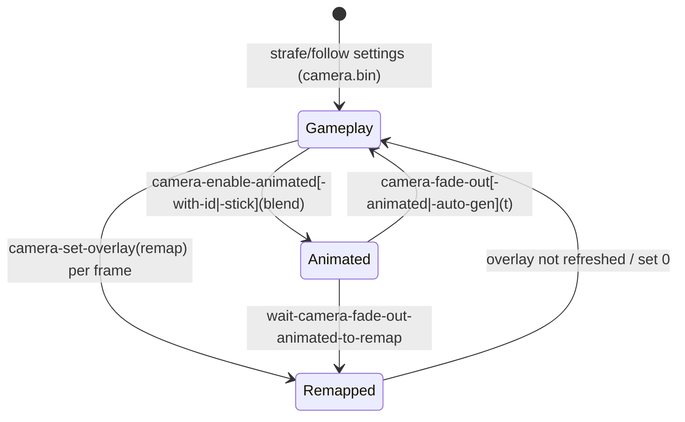

# Camera: how interactions switch and drive the camera (TLOU2R PC 1.6)

Labels: **CONFIRMED** · **HIGH** · **INFERRED** · **UNKNOWN / NEEDS NATIVE RESEARCH**.

## 1. Overview & files
`camera_calls.json` lists all 191 camera-named functions with call counts and kind, the argument surveys for
`camera-set-overlay`, `camera-enable-animated(-stick)` and `camera-fade-out`, and the data-module inventory.

Data modules (CONFIRMED entry types):
- `camera.bin`: 313 `camera-strafe-settings`, 219 maps (213 `*camera-remap-*`), 25 `camera-melee-settings`,
  12 `camera-zoom-offsets`, 10 vehicle settings, 6 look-around settings.
- `animated-camera-settings.bin`: 24 `stick-camera-settings` (examine and vehicle aim), `*default-animated-camera-settings*`,
  `*player-animated-camera-settings-by-state*`, `*player-animated-camera-prev-animation-table*`.
- `camera-focus-settings.bin`: 20 `camera-focus-settings`.
- `camera-zoom.bin`: 121 `camera-zoom-offsets`, 24 `camera-dof-settings`.
- `camera-shake.bin`: `*camera-state-shakes*`, projectile and horse-jump shake maps.
- `camera-old.bin`: 75 legacy follow settings.
- Investigate and workbench stick-pan settings live in `investigate.bin`, `workbench-settings.bin` and `treasures.bin`.

All camera primitives are **native** (`camera-enable-animated` native-confirmed). The DC wrappers are thin:
`camera-fade-out-animated(t,x) = camera-fade-out(self,t,x)` and `camera-disable-animated() = camera-disable(self)`
(`nd-script-funcs.bin`). `wait-camera-fade-out-animated-to-remap` (`script-user-funcs-impl.bin`) fades the
animated camera and re-applies a remap overlay every frame until the fade time passes. **CONFIRMED**.

## 2. Camera mechanisms used by interactions

| Mechanism | API (calls) | What it does | Confidence |
|---|---|---|---|
| Remap overlay | `camera-set-overlay(*camera-remap-X* \| 0, key, val …)` (245) | Swaps the current gameplay camera-settings symbol for another one through a remap map (for example `*camera-remap-crouch-map*` maps 11 strafe/edge settings to `*camera-strafe-crouched*`). `0` clears it. | CONFIRMED (maps) / HIGH (behaviour) |
| Animated camera (from the player anim) | `camera-enable-animated(blend, -1, cam-index, 1000, 0,0,0)` (1,099) → `camera-fade-out-animated(t,0)` (818) | Takes the camera channel of the animation the owner is playing. Index 1 in 1,195 of 1,210 calls; the safe passes tag `camera-index`. | CONFIRMED args / INFERRED meaning (channel index, priority 1000) |
| Named animated camera | `spawn-camera(loc,"workbench-camera",1)` + `animate_(cam-obj, anim, {85: id})` + `camera-enable-animated-with-id(id, blend, -1, 1, 1000, …)` + `camera-fade-out(id, t, 0)` | Lets several animated cameras be keyed by an id symbol | CONFIRMED (workbench) |
| Stick (player-pannable) animated camera | `camera-enable-animated-stick(get-channel-locator-from-ap-ref(player, anim, ap, 0, apReference-camera1, apReference), stick-camera-settings, …, maya-index, 1000, …)` (46) | The camera is placed at the anim's camera channel; `stick-camera-settings` bounds yaw/pitch (for example ±13.5° / ±15°) | CONFIRMED call / INFERRED field meanings |
| Investigate mode | `player-investigate-set-camera-indices(inspect-idx, zoom-idx, stick-pan-settings, …)` (7) + `camera-enable-animated-stick-pan` | Native investigate camera with inspect/zoom indices and pan limits from the treasure definition or `*investigate-stick-pan-settings-wide*` | CONFIRMED call / native internals |
| Additive shake | `camera-shake(name, t, amp, 1)` (449, DC), `camera-animation-enable(layer, shake, …)` (240) | For example `investigate-camera-additive` with `camera-shake-steadycam-tense-idle`; workbench `camera-mocap-idle-small` | CONFIRMED |
| Interactable remap | `interactable-camera-remap-default/force-active/force-inactive(interactable)` (22/17/…) | Remap owned by the native interactable | CONFIRMED call |
| Animation-driven camera mode | `animate_` key 12 (camera mode), anim-state dynamic flags `climb-up-camera-pan-*`, `climb-camera-blend-*` | Camera behaviour requested through the anim layer | HIGH / CONFIRMED (data) |

`camera-set-overlay` option keys (see JSON):

| key | meaning | confidence |
|---|---|---|
| 1 | blend-in seconds | HIGH (the wrapper passes the fade time) |
| 2 | blend-out seconds | INFERRED |
| 4 | remap distance | HIGH (the wrapper passes `remap-distance`) |
| 6 | priority (10 / 100 / 1000 / 10000) | INFERRED |
| 3, 5, 7 | unknown | UNKNOWN |

## 3. Per-state call graphs (camera calls only)

```
ss/ss-tumbler-safe
 move-to        ├─ camera-enable-animated(2.00, -1, tag camera-index, 1000, 0,0,0)      [CONFIRMED]
 check-inventory├─ camera-enable-animated(0.50, -1, 1, 1000, …) / camera-fade-out-animated(…)
 open           ├─ camera-fade-out-animated(…) ; camera-fade-out-auto-gen-animated(2.00, 10.00, 0)
 early-exit     └─ camera-disable-animated() → camera-enable-animated(0.00, …) → camera-fade-out-animated(…)
ss/ss-investigate-object
 (setup)              ├─ player-investigate-set-camera-indices(camera-index-inspect, -inspect-zoom, pan-settings, …)
 enter-and-investigate├─ signal-camera-cut ; camera-enable-animated ; camera-enable-animated-stick-pan
                      ├─ camera-animation-enable(investigate-camera-additive, camera-shake-steadycam-tense-idle, …)
                      └─ loop: camera-set-overlay(*camera-remap-medium-shot-crouch*, 1, 2.00, 6, 1000[, 2, 0.70]) each frame
 investigate-exit     └─ camera-fade-out-animated(exit-camera-1-fade-out | remap-time) → wait-camera-fade-out-animated-to-remap(remap-time, remap-camera, remap-distance, …)
ss/ss-examine
 examine-enter-blend/cut ├─ camera-enable-animated-stick(channel-locator(apReference-camera1), lookup(camera-settings, stick-camera-settings), …)
 examine-exit-blend/cut  └─ camera-fade-out-(auto-gen-)animated-stick(stick-camera-fade-out-sec[, distance])
ss-t2/ss-workbench
 workbench-enter ├─ spawn-camera(player loc, "workbench-camera", 1) ; animate_(dummy-camera-object, anim, {85 workbench-enter, …})
                 ├─ camera-enable-animated-with-id(workbench-enter, 1.50, -1, 1, 1000, …) ; camera-enable-animated-stick(…)
                 └─ camera-shake(camera-mocap-idle-small, 1, 1, 1)
 apply-upgrade / (dis)assemble / pullout ├─ same pattern with ids apply-upgrade, workbench-*-weapon …
 workbench-exit  └─ camera-fade-out-auto-gen(workbench-exit, 2.00, 5.00, …) ; camera-fade-out-animated-stick(0.50)
 unavailable     └─ interactable-camera-remap-force-active / -inactive(self)
ss-t2/ss-openable-drawer / -cabinet
 scavenge-enter  └─ animate_(player, anim, {12: camera-required-low? 1:0, …})            [CONFIRMED]
 (helper camera-adjustment-drawer() → camera-set-overlay(*camera-remap-crouch-map*, 1, 1.00, 2, 1.00, 6, 100) is defined but never called anywhere in the corpus) [CONFIRMED]
```



## 4. Answers to the specific questions
- **Investigate** uses a native investigate camera configured by indices and pan settings, plus an additive
  steadycam shake and a per-frame crouch remap. Exit fades into a remap. **CONFIRMED** calls.
- **Examine** uses a stick-pannable animated camera anchored to the enter/idle anim's `apReference-camera1`
  channel, bounded by `stick-camera-settings` (24 presets). **CONFIRMED**.
- **Workbench** uses a spawned camera object animated with its own clip. Each phase gets an id
  (`workbench-enter`, `apply-upgrade`, …) set through `animate_` key 85 and `camera-enable-animated-with-id`,
  then cross-fades by id. **CONFIRMED**.
- **Safe** uses the animated camera from the player's safe anim, with a tag-selectable camera index and fades
  per state. **CONFIRMED**.
- **Drawer and cabinet** use no explicit camera call. They request a low camera through the anim option (key 12).
  **CONFIRMED** values, INFERRED meaning.
- **camera-focus-settings and camera-zoom** are aim/DOF data consumed natively. Scripts touch them only through
  `force-camera-dof-focus(loc, *zoom-camera-dof-settings*, 30, 1, 1)` (42). **CONFIRMED**.

## 5. Engine boundary
DC script picks the mechanism, blend times, ids and remap symbols. DC data holds every settings struct and remap
map. Native code does the camera solve, collision, blending, channel extraction from clips, investigate camera
and DOF.

## 6. Events in / out
None script-visible. `signal-camera-cut` (8) is a native notification used, for example, so cloth does not reboot
(`cloth-no-reboot-on-camera-cut`).

## 7. Persistence
None.

## 8. Animation / UI / audio hooks
Animated cameras are channels of animation clips (`apReference-camera1`, camera index). Anim states carry camera
dynamics flags (climb). `animate_` keys 12 and 85 are the animation-side hooks.

## 9. Shared components
`camera-fade-out-animated` is used in 680 files. The remap maps are shared by melee, cover, crouch and interactions.

## 10. Confidence table

| Claim | Label |
|---|---|
| API signatures and call sites per interaction | CONFIRMED |
| Remap map semantics (settings → settings) | CONFIRMED (data) |
| Overlay must be re-applied per frame | INFERRED |
| `camera-set-overlay` keys 1 and 4 | HIGH; 2 and 6 INFERRED; others UNKNOWN |
| `camera-enable-animated` arg 3 = camera channel index, arg 4 = priority | INFERRED |
| `stick-camera-settings` fields = yaw/pitch limits | INFERRED |

## 11. Open questions
- The exact `camera-enable-animated` argument semantics (args 2, 5–7).
- How the native layer chooses the animated-camera owner when several objects animate.
- The meaning of overlay keys 3, 5 and 7.

## 12. Modding surface

| Surface | Rating | Reason |
|---|---|---|
| Blend times, remap symbol, camera index in scripts | GREEN | Scalar or symbol args |
| `camera.bin` remap maps, `stick-camera-settings` limits, zoom/DOF offsets | YELLOW | Data-only, but shared across many contexts |
| New animated cameras | ORANGE | Needs a clip with a camera channel in a loaded package |
| Camera solver, investigate camera, collision | RED | Native |
