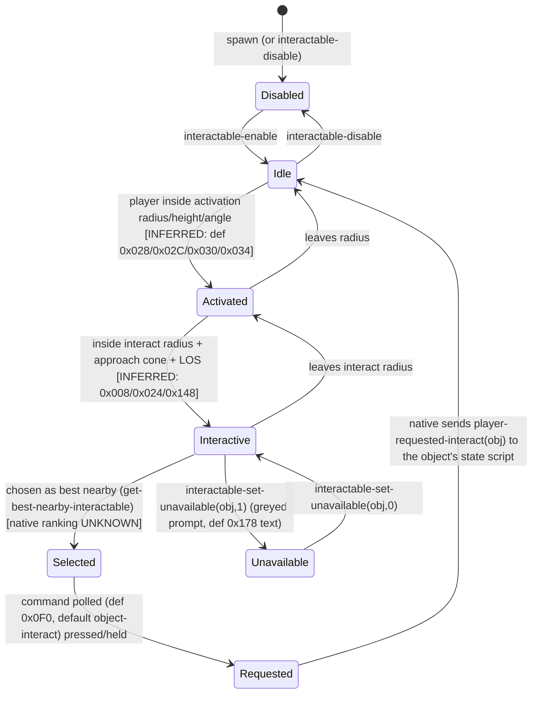
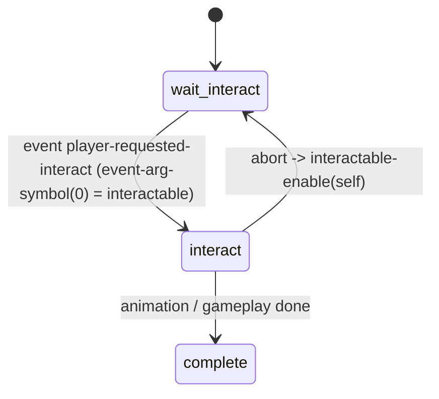

# Interactable system (generic) — TLOU Part II Remastered PC 1.6

Scope: the engine-wide "interactable" layer every world object goes through before its own
state script runs: detection, the two-radius activation / interaction model, the per-object
**interaction definition** (`game-interactable-def`), selection, prompt hand-off, enable/disable,
overrides and per-frame suppression. The prompt/HUD widgets are covered in
[`systems/ui/README.md`](../ui/README.md); the definition database is
[`databases/interaction_definitions.json`](../../databases/interaction_definitions.json) (+ `.csv`),
built by [`tools/analysis/ui_parse_interact_defs.py`](../../tools/analysis/ui_parse_interact_defs.py).

Labels: **CONFIRMED** (seen in code/data) · **HIGH** · **INFERRED** · **UNKNOWN / NEEDS NATIVE RESEARCH**.

---

## 1. Overview & files

| File | What it holds | Evidence |
|---|---|---|
| `interactable.bin` | **All 273 `game-interactable-def` entries** (0x200-byte structs) + `*interact-command-list*` (15 joypad commands). No code. | CONFIRMED: `file_manifest.json` entry_types → only this file has the type (273). |
| `modules.bin` → module `interactable` | Export list of the 274 symbols; depends on `script-user-externs`, `interactable-defines`, `game-interactable-defines`, `gui2-defines`, `game-types`. | CONFIRMED (modules.bin entry 912). The `*-defines` modules (field names!) are not in the shipped corpus → field names are lost. |
| `script-funcs-interactables.bin` | 2 DC helpers: `interactable-adopt-settings(a,b)` = `interactable-use-def-from-other` + `interactable-use-dist-camera-remap-from-other`; `interactable-clear-adopted-settings(a)`. | CONFIRMED (dcpl). |
| `gui2-game.bin` → `*hud-photo-mode*` field 0x5E0 | `string-array` of **120** interact-def names (the "~111 interact-* definitions" in the task brief). Not definitions — a whitelist inside the photo-mode settings. All 120 are real defs. Purpose: name suggests photo mode treats these interactions specially (they cover doors, drawers, traversal, conversations, workbench, mash/stick prompts; they exclude every pickup/collectible/inspectable). | CONFIRMED list; purpose INFERRED. |
| `joypad.bin` | `*action-map*` (input actions like `gen:interact`) and `*joypad-default*` commands (`object-interact`, `interact-hold`...). | CONFIRMED. |
| Level data (not in DC corpus) | Each placed object's tag **`interactable-def`** (and `used-interact-def`, etc.) naming its def. | CONFIRMED that scripts read `tag-symbol(interactable-def, obj)` (`ss-t2/ss-workbench`, `ss-t2/ss-player-blind-listen-mode`, `ss-t2/accessibility/ss-accessibility-pathfind`, `ss-finding-nora/ss-nor-ellie-alone-fake-workbench`). |

## 2. State machine(s)

There is **no DC state script for the interactable system itself** — it is native. The lifecycle
below is reconstructed from the predicates scripts can query (`interactable-enabled?`,
`interactable-is-activated?`, `interactable-is-interactive?`, `interactable-selected?`,
`interactable-scripted-unavailable?`) and from DC helpers that combine them
(`near-active-but-not-interactable-interact?` = activated **and not** interactive — CONFIRMED in
`ss-farm/ss-far-explore-controller-baby-gestures`).



Typical object-side script pattern (e.g. `ss-t2/ss-openable-drawer`, `ss-abby-fights-militia/ss-afm-brewery-push-fridge`):



## 3. Per-state call graph (object-side pattern, drawer as the worked example)

```
wait-interact (ss-t2/ss-openable-drawer)
 ├─ interactable-disable(tag-symbol(igc-pickup|pre-placed-pickup))     [CONFIRMED]  hide the loot's own prompt
 ├─ (persisted) has-been-opened? → interactable-enable(spawned pickup) [CONFIRMED]
 └─ on player-requested-interact
     ├─ set-symbol(current-interactable-scav, event-arg-symbol(0))     [CONFIRMED]
     ├─ handle height = get-joint-position(obj, handle).y − player.y    [CONFIRMED]
     └─ go(interact)                                                    [CONFIRMED]
interact … scavenge-* (see interactions/drawers/README.md)
 ├─ fn drawer-atachments (per frame)
 │   ├─ disable-drawing-interactable-icon()   while pickup not yet stowable   [CONFIRMED]
 │   ├─ interactable-enable(pickup) + interactable-draw-icon(pickup)          [CONFIRMED]
 │   └─ player-check-for-interactables-during-igc-use-camera-loc() on exit    [CONFIRMED]
 └─ scavenge-early-exit: disable-interactable-interaction() (update block)    [CONFIRMED]
```

Def-swap pattern (`ss-t2/ss-workbench`, state `wait-for-player`, every 15th frame):
```
wait-for-player
 ├─ var_1 = player-can-afford-any-weapon-upgrade?(-1)                    [CONFIRMED]
 ├─ if interactable-is-activated?(self) || interactable-is-interactive?(self)
 │   ├─ affordable → override-interact-def(self, interact-workbench[-no-bench|-rogue-hub-theater]-with-wrench)
 │   └─ not affordable → override-interact-def(self, tag-symbol(interactable-def, self))
 └─ interactable-set-exclude-from-pickup-scan(self, interactable-is-excluded-from-pickup-scan?(self))  [CONFIRMED]
       (re-applies the flag the override would otherwise reset — INFERRED)
```

## 4. Answers to the specific questions

### 4.1 PLAYER APPROACHES DRAWER → detection, prompt, definition selection

1. **Which definition?** The drawer object carries the level-data tag `interactable-def`
   (CONFIRMED mechanism; the concrete tag value lives in level data — INFERRED to be
   `interact-openable-drawer` because that def's anchor joint is `handle`, the same joint the drawer
   script measures, and `interact-openable-drawer-fake` swaps it to `root`). `ss-openable-drawer`
   never names a def itself (CONFIRMED: no def SID in the file). Scripts can replace the def at
   runtime with `override-interact-def(obj, def)` (52 calls, 20 files with literal defs),
   `interactable-use-def-from-other(npc, int-obj)` (fob conversations), or
   `get-collected-interactable-def-id(def, important?)` (`ss/ss-investigate-object`) — all native.
2. **Detection (native).** Each frame the engine evaluates enabled interactables against the
   player using the def's tuning (`interact-openable-drawer`, CONFIRMED values, meanings HIGH/INFERRED):
   activation radius **3.5 m**, activation height −0.5…2.5 m, activation cone 80°;
   interact radius **2.5 m**, interact height min **0.0** (object at/above feet), object-relative
   approach cone **110°**, anchor joint `handle`, LOS probe on layers `Interactive`/`Background`.
   Distance/angle math is native (UNKNOWN exact formula). DC only sees results:
   `interactable-is-activated?`, `interactable-is-interactive?`, `get-best-nearby-interactable()`,
   `get-closest-enabled-interactable(2.5, -1.0, 3.0)` (used by `near-interactive-interactable?`).
3. **Why the Triangle / E prompt.** The def's command slot 0x0F0 is empty → native default
   command `object-interact` (INFERRED: first entry of `*interact-command-list*`), which in
   `*joypad-default*` is input type 8 (press) on action **`gen:interact`** (CONFIRMED). The def's
   button-icon slot 0x0D0 = `"gen:interact"` (CONFIRMED read as icon by HUD scripts:
   `dc:format("%s@large", def+208)`). `gen:interact`'s `action-def` has label `INPUT_GEN_INTERACT`,
   key code **101 = ASCII 'e'** and glyph alias `"nx:triangle"` (CONFIRMED values; E/Triangle mapping
   INFERRED from them). Prompt layout `interact` (0x198), no custom text (0x168 empty), highlight
   `*select-highlight-settings*` / `*interact-highlight-settings*` (0x108/0x110).
4. **Priority / selection.** When several are interactive, the native picks one — exposed as
   `get-best-nearby-interactable()` and `interactable-selected?(obj)`; it also emits
   `interact-highlighted` / `interact-selected` events (handled in `ss-vox-san-streets-resort-fence`,
   never sent by script → native, CONFIRMED). Ranking weights: UNKNOWN / NEEDS NATIVE RESEARCH.
5. **Press.** The native sends **`player-requested-interact`** to the object's state script with
   the interactable in `event-arg-symbol(0)` (1,808 handler states; only 8 script senders, all
   IGC replays). From here the drawer script owns everything (alignment, anims, loot).

### 4.2 Distance / orientation / eligibility / player state

* Two tiers: **activated** (icon visible, accessibility distant ping 0x1B0) vs **interactive**
  (pressable, ping 0x1E0). CONFIRMED distinct predicates; radius mapping HIGH: names
  `interact-door-large-activation-radius` / `interact-door-activation-radius` differ from
  `interact-door` only at 0x028 (3.0 / 1.75 vs 1.5); scripts set
  `interactable-set-activation-radius(mel,16)` and `interactable-set-interact-radius(mel,12)` /
  `(yara,1.8)` = default 0x008.
* Runtime tuning (native setters): `interactable-set-interact-radius`, `-activation-radius`,
  `-interaction-height(obj,min,max)`, `-activation-height(obj,min,max)` (e.g. dina −1000…1000),
  `-interaction-region(obj,rgn)`, `-activation-region(obj,rgn)`, `-ignore-probes`, `-trigger-only`.
* Eligibility: `interactable-enable/disable` (1,023 / 1,469 calls), `interactable-set-unavailable`
  (greyed + text 0x178 `HUD_INTERACT_LOCKED/NEEDS_POWER/...`), horse rule (byte 0x1AB, CONFIRMED read
  in `sonar-goal-requires-systemic-dismount?`).
* Player-state gates (per-frame "this frame" calls, used in `update` blocks — INFERRED one-frame):
  `disable-interactable-system()` (27/38 in update; also `player-conversation-mode`),
  `disable-drawing-interactable-icon()`, `disable-interactable-interaction()`,
  `all-interactables-become-unavailable()`, `interactables-suppress-secondarys()`,
  `player-suppress-look-at-interact()`. During IGCs scanning is off unless
  `player-check-for-interactables-during-igc[-use-camera-loc]()` is called (drawer exit uses the
  camera-loc variant). `interactable-disable-single-interactable[-interaction]/f(obj)` targets one.
* **Object reservation:** no DC-level lock; the owning script simply stops re-enabling / calls
  `interactable-disable` / `disable-interactable-interaction`. Native exclusivity UNKNOWN.
* **Pickup scan** = the accessibility listen-mode "scan for pickups" (`listen:pickup-scan`,
  `ss-player-blind-listen-mode` → `find-interactables-within-radii(pathfind-pickup, center, r0, r1)`).
  `interactable-set-exclude-from-pickup-scan` / `-is-excluded-from-pickup-scan?` toggle membership;
  `interactable-set-accessibility-used(obj)` = exclude + mute all 5 accessibility sounds (CONFIRMED).

### 4.3 Interaction-definition structure (field map)
Full per-offset map with confidence is in the JSON `meta.field_map`. Highlights:

| Off | Meaning | Conf. |
|---|---|---|
| 0x008 / 0x028 | interact radius / activation radius (m) | HIGH |
| 0x00C-0x010 / 0x02C-0x030 | interaction / activation height window | INFERRED |
| 0x014,0x018,0x020,0x024,0x034 | angle limits (−1 = none; 0x034 activation cone 80/180/360; 0x024 approach cone drawer 110, workbench 72.5, lockpick 80) | INFERRED |
| 0x050 | anchor joint (`handle`,`neck`,`lock`,`root`,…) | HIGH |
| 0x05C-0x064 | interaction point offset from object locator | CONFIRMED (blind-listen-mode reads +92/+96/+100) |
| 0x0C8 / 0x0D0 / 0x0D8 / 0x0E0 | widget override / button icon / side image / overlay (wrench) | HIGH / CONFIRMED / HIGH / HIGH |
| 0x0F0 | joypad command | CONFIRMED (+240 read by HUD) |
| 0x138/0x140, 0x148, 0x049 | probe layers `Interactive`,`Background`; LOS-probe on; no-probe | INFERRED |
| 0x168 / 0x178 | prompt text id / unavailable text id | HIGH |
| 0x198 | prompt style `interact`/`double-dynamic`/`simple`/`double` | HIGH |
| 0x1AB | allowed on horse | CONFIRMED (+427) |
| 0x1B0-0x1F0 | accessibility cues (distant, above@2.0, below@−0.25, interact, sweetener, error) | HIGH |
| 0x1F9 / 0x1FA / 0x1FB | no-ping / special item / mash-hold hybrid | HIGH / CONFIRMED (+506) / CONFIRMED (+507) |

Variant pairs prove several fields: `-los` sets 0x148 or clears 0x049; `-used` clears all accessibility
sounds and sets 0x1F9; `-with-ping` clears 0x1F9; `-with-wrench` only adds 0x0E0; `-tall` only
raises offset_y +0.25; `-hold` only sets 0x0F0 = `interact-hold`; `-unavailable` moves the text id.
`interact-rotate-*-stick-*` and `interact-left/right-stick-updown/leftright` are byte-identical to
`interact-default` except the name → their behaviour is entirely script/native-side (and they
have 0 code references).

## 5. Engine boundary (DC vs data vs native)

| Kind | Items |
|---|---|
| **Data** | 273 defs (`interactable.bin`), `*interact-command-list*`, joypad actions/commands (`joypad.bin`), photo-mode def list (`gui2-game.bin`), per-object `interactable-def` tags (level data, not in corpus). |
| **DC-script helpers** (functions.json kind `dc-script`) | `draw-interactable-hud`, `hud-draw-interactable-on-object`, `draw-shake-interactable-hud`, `hud2-show-interactable-hold[-on-object]`, `hud2-signal-interactable-hold-success`, `interactable-disabled?` (= `!interactable-enabled?`), `near-activated-interactable?`, `near-interactive-interactable?`, `near-interactable-*` (farm), `conversation-interactable-enable/disable`, `set-interact-to-door-handle`, `interactable-adopt-settings`, `interactable-clear-adopted-settings`, `interactable-set-accessibility-used`, `play-accessibility-interact[-hold]-sound-at-position`. |
| **Native-confirmed** (address known) | `get-closest-enabled-interactable` 0x140ACAFA0, `get-best-nearby-interactable` 0x140ACAF60, `override-interact-def` 0x141BB6500, `disable-interactable-system` 0x140ACAEE0, `interactable-disable` 0x141BB48B0, `interactable-set-exclude-from-pickup-scan` 0x14087DAD0, `interactable-is-excluded-from-pickup-scan?` 0x14087D3C0, `interactable-add-high-contrast-mode-target`, `button-mashes-are-holds?`. |
| **Native-or-builtin** (no DC body) | `interactable-enable`, `-set-unavailable`, `-is-activated?`, `-is-interactive?`, `-selected?`, `-draw-icon`, `disable-drawing-interactable-icon`, `disable-interactable-interaction`, `player-check-for-interactables-during-igc[-use-camera-loc]`, `lookup-interactable-def`, `interactable-get-def-id`, `get-nearby-interactables`, `find-interactables-within-radii`, all `interactable-set-*` radius/height/region/probe setters, camera-remap family, `interact-with`, `gui2-show-interactable-hud`, `draw-interactable-hud-aux`. Internals: UNKNOWN / NEEDS NATIVE RESEARCH. |

## 6. Events in / out

| Event | Direction | Notes |
|---|---|---|
| `player-requested-interact` | native → object script | 1,808 handlers; arg0 = interactable. CONFIRMED. |
| `interact-highlighted`, `interact-selected` | native → object script | handlers only (resort-fence vox). CONFIRMED native-sent. |
| `player-interact-hold-start`, `player-interact-hold-end` | native → script | hold-start handled by `ss-dead-drop-deposit`; hold-end waited by resort fence. |
| `disable-interact-one-frame` | melee scripts → ? | sent by `melee/npc-standing/*`, no DC handler (native consumer, INFERRED). |
| `suppress-become-interactable` | script → ? | 4 senders, no handler (native, INFERRED). |
| `set-interactable-id`, `set-progress`, `force-success` | DC helper → HUD widget scripts | see UI README. |

## 7. Persistence
* Enabled/override state is **re-derived on load** by scripts in `start` blocks (workbench re-applies
  `tag-symbol(interactable-def)`; `ss-efu-find-papers` re-applies `used-interact-def` when saved svar
  `used` is set; `ss-investigate-object` re-applies collected variants from `has-collected-treasure?`)
  → INFERRED that override/enable state is not itself saved. Native save behaviour UNKNOWN.

## 8. Animation / camera / UI / audio hooks
* Camera: `interactable-camera-remap-default/-force-active/-force-inactive`, `interact-dist-camera-remap-only[-no-scan]` defs (0 radii) and `interactable-use-dist-camera-remap-from-other` — distance-based camera remap tied to interactables (INFERRED).
* IGC: `interactable-set-igc-anim(obj, anim)` (dino hats), `interact-igc-object` / `auto-interact-igc-object` defs.
* UI: prompt drawing (native for normal prompts; DC helpers for script-driven ones) — see UI README.
* Audio: accessibility cue fields 0x1B0–0x1F0, `sfx-ui-inventory-full` (0x120, 60 pickup defs), conversation select sfx (0x160).

## 9. Shared components with other systems
Pickups/inventory (pickup defs, inventory-full sound, pickup scan), doors (17 locked/needs-power defs),
workbench (wrench def swap), safes (`interact-safe-tumbler`, `t2r-interact-safe-locked`), conversations
(`double-dynamic` style, `neck` anchor), accessibility (listen-mode scan, pathfind, audio cues), photo mode.

## 10. Confidence table

| Claim | Label |
|---|---|
| All 273 defs live in `interactable.bin`, struct 0x200 | CONFIRMED |
| Object → def via `interactable-def` tag; runtime swap via `override-interact-def` | CONFIRMED |
| 0x0D0 icon, 0x0F0 command, 0x05C offset, 0x1AB horse, 0x1FA special, 0x1FB mash-hybrid | CONFIRMED (read by DC code) |
| 0x008 interact radius / 0x028 activation radius | HIGH |
| Height windows, angle fields, LOS fields | INFERRED |
| Native emits `player-requested-interact` on press of the def's command | HIGH (pattern + 8 script senders only) |
| Selection ranking, LOS probe implementation, reservation | UNKNOWN / NEEDS NATIVE RESEARCH |

## 11. Open questions
1. Exact semantics of 0x014/0x018/0x020/0x024 (player-facing vs object-facing) — needs native read of `lookup-interactable-def` consumers.
2. Purpose of `*hud-photo-mode*` 0x5E0 list.
3. Where `interact-rotate-*-stick-*` behaviour lives (identical bytes to `interact-default`).
4. Selection score (distance vs angle vs priority) inside `get-best-nearby-interactable`.
5. The ~40 UNKNOWN byte flags (see field_map).

## 12. Modding surface

| Surface | Rating | Reason |
|---|---|---|
| Edit def values (radii, angles, icons, text ids, sounds) in `interactable.bin` | **GREEN** | Pure data, fixed 0x200 layout, no pointers except 5 string slots; affects every object using the def. |
| Add a new def | **YELLOW** | Must also add to `modules.bin` export list and keep SID/relocation table consistent. |
| Swap an object's def from a state script (`override-interact-def`, `interactable-set-*-radius`) | **GREEN** | Supported runtime API used by shipped scripts. |
| Change which def a placed object uses | **ORANGE** | Lives in level data tags, outside the DC corpus. |
| Change detection/selection/LOS algorithms | **RED** | Native code. |
