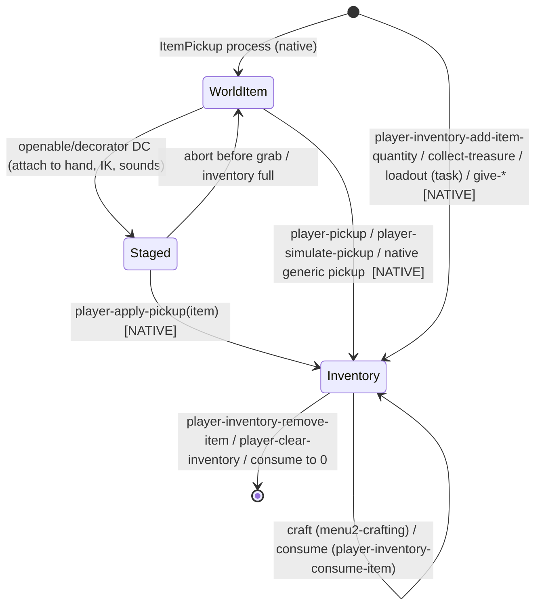

# Inventory: the boundary between script and engine

Scope: where player inventory state lives, what DC (DC script) can and cannot do to it, which data files define items,
recipes, collectibles and loadouts, and exactly where a world pickup becomes inventory. The world-side flow
(scan → reach → attach → commit → HUD) is in `interactions/pickups/README.md`. The openables that feed it are in
`interactions/cabinets/README.md` and `interactions/drawers/README.md`.

Data files in this directory:

| file | content | generator |
|---|---|---|
| `player_inventory_items.json` | all 140 `inv-item-def` entries of `*player-inventory-t2*`: id, HUD strings, icons, max count (+0x88), pickup looks (art-group, grip clip, SFX, rumble), shimmer, put-away SFX | `tools/analysis/pickups_inventory_table.py` |
| `crafting_recipes.json` | the 14 `*player-recipes*`, output item, ingredients (raw amount arrays), `*item-id-to-recipe-id-map*` | inline extraction (uses `tools/analysis/pickups_asm_struct.py`) |

---

## 1. Overview & files

| file | kind | contents | confidence |
|---|---|---|---|
| `player-inventory.bin` | data | `*player-inventory-t2*` map (140 item ids → `inv-item-def`) plus 6 `item-pickup-look` globals (notes, coin, super-hero card) | CONFIRMED |
| `crafting-system.bin` | data | `*player-recipes*` (14), `*item-id-to-recipe-id-map*`, `*recipe-id-to-item-id-map*`, `*crafting-menu-ingredients*`, `*player-recipes-ingre*` | CONFIRMED |
| `treasures.bin` | data | `*treasures*` (273 collectibles: id, HUD title/category/text, investigate look/params, timeline gating), 8 `treasure-timeline`s, `*quick-access-treasures*`, `*progression-important-treasures*` | CONFIRMED |
| `weapon-loadouts.bin` / `weapon-loadouts-difficulty.bin` | data | 147 `loadout-set`s (weapons + per-difficulty ammo ranges) / 221 difficulty variants and `loadout-set-difficulty-settings`. Referenced from task data (e.g. `test-tasks.bin`), not from DC code | CONFIRMED data; applied natively (HIGH) |
| `item-drop.bin` | data | 144 entries: enemy/openable drop class tables, type tables, parts info, `*item-drop-difficulty-settings(-ngplus)*`, plus the DC lambda `item-pickup-should-spawn-grounded?` | CONFIRMED |
| `script-user-funcs-impl.bin` | DC | the inventory wrapper functions (§3) | CONFIRMED |
| `script-funcs-inventory.bin` | data | **empty** (45 bytes, 0 entries). The name is misleading | CONFIRMED |
| `anim-player/player-inventory2.bin` | data | `anim-player-inventory2-states` (actor-state-list for the backpack open/close animations, e.g. `inventory-outro`, `horse-inventory-outro`). Animation only, no item storage | CONFIRMED |
| `ss-hud2/ss-hud2-notification-manager.bin`, `ss-hud2/ss-menu2-crafting.bin`, `ss-hud2/ss-menu2-collectibles.bin` | DC | UI over inventory (read-only use of `lookup-inv-item-def`, counts) | CONFIRMED |

## 2. Ownership model

**Inventory ownership begins inside a native function.** For world items that function is `player-apply-pickup(item)` or
`player-pickup(item, …)`. For scripted grants it is `player-inventory-add-item-quantity(id, n)` (82 call sites, 30 files) or
`collect-treasure(id)` (26 sites) for collectibles. DC never holds an inventory container: there is no DC array or ddict of
items, and every read goes through native getters. CONFIRMED (no DC definition of any `player-inventory-*` function; all are
native-confirmed or native-or-builtin in `functions.json`).

## 3. API boundary table

| function | kind | what DC sees | notes |
|---|---|---|---|
| `inventory-item-add-quantity(id, n)` | DC (script-user-funcs-impl) | → `player-inventory-add-item-quantity!(id, n)` | thin wrapper, 51 calls |
| `get-inventory-item-quantity(id)` | DC | → `player-inventory-get-item-quantity!(id)` (native-confirmed 0x142C68B48) | 258 calls, 72 files |
| `inventory-item-consume(id, n)` | DC | → `player-inventory-consume-item!(id, n)` | 18 calls |
| `get-inventory-item-max-count(id)` | DC | `*(i32*)(lookup-inv-item-def!(id) + 136)` | **reads the data struct directly**: +0x88 = max count (CONFIRMED) |
| `get-ammo-count-from-inventory-and-weapon-clip(ammo, weapon)` | DC | clip (if current ammo matches) + inventory quantity | |
| `player-give-key-item(id)` | DC | `player-inventory-add-item-quantity!(id, 1)` + `hud2-mark-health-ammo-dirty!(1)` | |
| `set-inventory(id, n)` (ss-san-wilds-beach-inventory-setup) | DC | consume all → add n | pattern for forcing a count |
| `joypad-disable-all-inventory-actions()` | DC | `joypad-disable-commands!(inventory-open, weapon-cross)` | input gating only |
| `give-all-inventory-and-upgrades()` | DC (debug) | manuals, recipes, upgrades, holsters, weapons | |
| `player-inventory-get-max-capacity`, `player-inventory-is-item-full?`, `player-inventory-is-item-weapon?`, `player-inventory-get-num-items`, `player-inventory-get-item-at-index`, `player-inventory-remove-item`, `player-clear-inventory`, `disable-inventory` | native | opaque | the first two are native-confirmed |
| `player-pickup-is-full(item-id)` | native | bool | used by openables before the grab |
| `player-apply-pickup(item)`, `player-pickup(item, a, hand, b, c)`, `player-simulate-pickup(frame, …)` | native | commit | see pickups README §3 |
| `item-pickup-get-item-id`, `item-pickup-get-amount`, `item-pickup-set-amount` | native | per-pickup id/amount (amount is settable before commit, e.g. rogue safes) | |
| `lookup-inv-item-def(id)` | native-confirmed (0x14041AA70) | raw pointer to the data struct | used by HUD, crafting menu, recipe logging (`+8` = name string) |
| `item-id-to-recipe-id`, `player-learn-recipe-by-item-id`, `player-knows-recipe?`, `player-forget-recipe-by-item-id`, `checkpoint-query-recipe?` | native | recipe knowledge | |
| `collect-treasure`, `has-collected-treasure?` (native-confirmed 0x140415B30), `get-treasure-by-id`, `remove-treasure`, `mark-treasure-examined-by-id` | native | collectibles | the notification mgr reads `get-treasure-by-id(id)+96` (category; 3 = no speech) |
| `item-is-ammo?` (native-confirmed), `item-is-ingredient?` | native | item classification | |
| `item-is-supplement?`, `item-is-upgrade-manual?` | DC (player-upgrade-script-funcs-impl) | classification by id | |

## 4. Data definitions

### 4a. Items (`*player-inventory-t2*`)

140 items: ammo (pistol 16, revolver 12, rifle 9, shotgun 8, arrows 6, mpx5 60, flamethrower 100, …), crafting
ingredients (alcohol, rag, blade, binding, canister, explosive: 12 each), throwables/crafted (molotov 3, pipe-bomb 4, smoke/stun/trap
bomb 3, shiv 4), health (health-kit 3, health-small 20), currencies (parts 9999, player-upgrade-supplements 9999,
vendor-currency 1000), key items (`key-*`, `backpack-map`, holsters, `silencer`, `bayonet`), collectible buckets and rogue manuals.
Max counts are **base** values at +0x88 (CONFIRMED). Upgrade or difficulty scaling is applied natively (INFERRED: `player-inventory-get-max-capacity`).

### 4b. Recipes (`*player-recipes*`)

| recipe | output (raw n) | ingredients |
|---|---|---|
| health-kit | health-kit (1) | alcohol, rag |
| molotov | molotov (1) | alcohol, rag |
| pipe-bomb | pipe-bomb (2) | alcohol, canister, explosive |
| smoke-bomb / stun-bomb / trap-bomb | (1) | canister, explosive |
| ammo-arrow | ammo-arrow (2) | binding, blade |
| ammo-arrow-explosive | (1) | explosive, binding |
| shiv / melee-upgrade | (2) / (1) | binding, blade |
| silencer | (1) | rag, canister |
| ammo-xcaliber | (2) | explosive, blade |
| ammo-shotgun-dragons-breath | (2) | alcohol, explosive |
| ammo-rifle-vepr | (5) | explosive, blade |

Each ingredient's raw `uint32-array` dumps as `4`, and dconstruct shows a stray string after it. The unit (whole vs partial ingredients,
per-difficulty) is UNKNOWN. The output counts in parentheses are the first array value (INFERRED as the yield).

### 4c. Where pickup-related data lives

| question | file → symbol |
|---|---|
| what a pickup *is* (item id, look, grip, sounds, cap) | `player-inventory.bin` → `*player-inventory-t2*` |
| how it is interacted with (radius, prompt icon, full sound, hold) | `interactable.bin` → `interact-*-pickup*` |
| what an openable/enemy drops | `item-drop.bin` → `*cabinet-drop-table*`, `*drawer-drop-table*`, `*…-enemy-drop-table*` |
| where it sits in a drawer | `drawer-pickup-offset.bin` |
| grip/scale for openables | `ss-t2/ss-openable-grips.bin` (DC) |
| starting inventory per chapter | `weapon-loadouts*.bin` |
| crafting | `crafting-system.bin` |
| collectibles | `treasures.bin` |

## 5. Answers

| question | answer | confidence |
|---|---|---|
| Where exactly does inventory ownership begin? | In native `player-apply-pickup` / `player-pickup` (world items) or `player-inventory-add-item-quantity` / `collect-treasure` (grants). DC can only stage, query and request | CONFIRMED |
| Can DC read inventory? | Yes, quantities (`get-inventory-item-quantity`), caps (by reading `inv-item-def+0x88`), full checks, recipe knowledge, treasures | CONFIRMED |
| Can DC write inventory? | Only through native mutators (add/consume/remove/clear/learn-recipe). The shiv cabinet is a DC example of consuming an item to open something (`player-inventory-consume-item`) | CONFIRMED |
| How does the UI learn about changes? | Native events `player-pickup`, `player-pickup-stow`, `player-inventory-changed`, `item-given` → DC HUD scripts. `hud2-mark-health-ammo-dirty` / `hud2-mark-weapon-cross-item-dirty` force refreshes | CONFIRMED |
| How is it saved? | Natively. There is no DC serializer, and `checkpoint-query-recipe?` / `checkpoint-query-upgrade?` show the checkpoint keeps the inventory and progression state | HIGH (existence) / UNKNOWN (format) |

## 6. Engine boundary

| DC | data | native |
|---|---|---|
| wrappers, UI queueing, crafting menu logic, tutorials, conditional grants and loadout overrides per encounter | item defs, recipes, treasures, loadouts, drop tables | the inventory container, caps scaling, commit, consumption, recipe knowledge store, save/restore |

## 7. Events in/out

| event | direction | notes |
|---|---|---|
| `player-pickup` (obj, item-id, amount, spawner, frame) | native → 39 DC states | the main signal that the inventory changed after a pickup |
| `player-pickup-stow` (…, item-id) | native → notification mgr | stow animation finished |
| `item-given` (item-id) | native → decorators | any grant path |
| `player-inventory-changed` | native → `ss-crafting-stats` | |
| `inventory-snapshot`, `player-completed-inventory`, `vox-inventory-open` | exist in events.json | not traced here |

## 8. Persistence

No DC code writes the inventory or the picked state of items. Save and restore are native checkpoint features (UNKNOWN / NEEDS NATIVE RESEARCH).
Script-side checkpoint hooks that touch items: `remember-dynamic-checkpoint` after optional-weapon / holster pickups, and
`clear-checkpoint-record` sent to items being force-despawned on Grounded.

## 9. Shared components

- `lookup-inv-item-def` is shared by the HUD notification manager, the crafting menu and the recipe logger.
- `ss-hud2-notification-manager` is shared by all pickups, treasures, recipes and map updates.
- The openables share only `player-pickup-is-full`, `player-apply-pickup` and `player-pickup` with this layer.

## 10. Confidence table

| claim | label |
|---|---|
| all `player-inventory-*` are native; DC wrappers are 1-line pass-throughs | CONFIRMED |
| `inv-item-def +0x88` = max count | CONFIRMED |
| loadouts applied by tasks natively | HIGH |
| recipe amount units | UNKNOWN |
| save format | UNKNOWN / NEEDS NATIVE RESEARCH |

## 11. Open questions

1. How the max count is scaled (upgrades such as holster/backpack, difficulty) between `+0x88` and `player-inventory-get-max-capacity`.
2. The recipe amount encoding (the dumps show `4` for every ingredient).
3. Whether `player-inventory-is-item-full?` (23 calls, 1 file, no sample caller recorded) differs from `player-pickup-is-full`.

## 12. Modding surface

| change | rating | why |
|---|---|---|
| give/take items at script points | GREEN | `inventory-item-add-quantity` / `inventory-item-consume` / `set-inventory` pattern |
| UI notification behaviour | GREEN | DC notification manager |
| base caps, HUD names, icons, pickup SFX | YELLOW | `player-inventory.bin` data (partly INFERRED layout) |
| recipes | YELLOW | `crafting-system.bin` (amount encoding unknown) |
| starting loadouts | YELLOW | `weapon-loadouts*.bin` (applied by native task system) |
| inventory container, cap scaling, persistence | RED | native |
