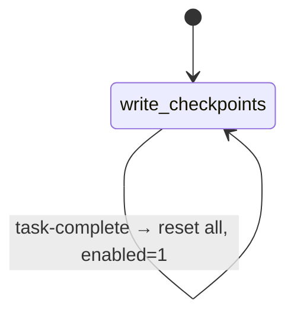

# Persistence / World State — how TLOU2R remembers things

> Source: TLOU2R PC 1.6 `bin.psarc` + `startup-dc-files.psarc`, `dc1/` DC modules, dconstruct pseudo-code (private).
> Labels: **CONFIRMED** (read in code/data) · **HIGH** · **INFERRED** · **UNKNOWN / NEEDS NATIVE RESEARCH**.
> Helper scripts: `tools/analysis/persistence_svar_table.py` (svar table + who writes/reads it),
> `tools/analysis/level_design_stats.py` (how many level scripts use each persistence idiom).

## 1. Overview & files

The game has **no single "save object" API in DC**. Script code reaches five different stores. All of them are
implemented natively; DC only reads and writes them through named calls.

| # | Store | DC access | Scope / lifetime | Key files |
|---|---|---|---|---|
| A | **Task graph** (story progress: node › subnode › *continue*) | `task-active?` 7,362 calls, `task-complete?` 4,892, `task-continue-active?` 2,469, `task-range-active?` 1,749, `task-complete!` 939, `task-complete-if-active!` 119, `task-set-active-continue!` 192 | Saved with the game (save slot / checkpoint). Chronological mode has its own completion table | `tasks.bin` (`*task-graph*`), `chronological-tasks.bin` (startup-only), `nd-script-funcs.bin` (wrappers) |
| B | **svars = player stats** | `set-svar` 1,595, `get-svar` 831, `get-svar-as-boolean` 1,344, `set-svar-as-boolean` 1,093, `set-svar-bit` 139 / `get-svar-bit` 143, `increment-svar` 134 | Named integer slots declared in `player-stat.bin` (1,354 rows). Saved. Flags say which are bitfields, trophy stats, and so on | `script-funcs.bin`, `player-stat.bin` |
| B′ | **per-instance svars** `ss-svar(var, obj)` | 79 call sites, 22 files | One stat slot per *(state-script variable, object)* pair | `ss/ss-investigate-object`, `ss/ss-examine`, `ss/ss-tumbler-safe`, satchels |
| C | **Facts** (dictionaries of key→boxed value) | `fact-set` 5,008 (87 % in `vox-dialog*`), `fact-exists?` 551, `fact-get-bool-safe` … | Scopes `global`, `faction-enemy`, `faction-player`, `player`, per-NPC. Used to choose dialog lines. Not known to be saved | `vox-dialog/`, `vox-dialog-rl/`, `script-user-funcs-impl.bin` |
| D | **State-script variables** (`declarations {}`) | `set-boolean` 10,634 / `get-boolean` 10,869 and friends | Belong to one script instance. Can be read from another object: `get-boolean(var, other-obj)` | every `ss-*` |
| E | **Native subsystem saves** (treasures/collectibles, NPC dead/alive, doors, openables, inventory) | `collect-treasure`, `has-collected-treasure?` (116), `npc-is-dead-in-checkpoint?`, `door-reset-save-state`, `get-openable-spawned-pickup` … | Owned by native code. DC only queries | `treasures.bin`, `journal-*.bin` |

Checkpoints sit on top of (A). A **continue** is a respawn record inside a task subnode, and the native
code commits it to the checkpoint. `ss-t2/ss-dynamic-checkpoint-manager` decides *when* to ask for one.

## 2. State machines

### 2.1 `ss-dynamic-checkpoint-manager` (ss-t2) — CONFIRMED

A single state, `write-checkpoints`, with 15 event blocks. Declarations: `enabled, active-task, active-subtask,
active-continue, active-region, last-checkpoint-time, last-checkpoint-pos, kills-since-checkpoint,
last-checkpoint-in-grass, upgrade-since-checkpoint, temp-*`, plus timers `checkpoint-timer, new-wave-timer,
pursue-end-timer, debug-draw-timer`.



```
write-checkpoints
 ├─ start: start-timer(checkpoint-timer, 6.0); last-checkpoint-time = now; last-checkpoint-pos = player locator   [CONFIRMED]
 ├─ event set-active-continue(task, subtask, continue, region, record-now?)                                      [CONFIRMED]
 │    └─ if task-active?(task, subtask): store the 4 symbols; if record-now? → send-event(record-active-continue, self)
 ├─ event checkpoint-timer
 │    └─ re-arm (0.5 s / time-until-next-checkpoint / 2 s); if in-active-checkpoint-task?() and (new-wave | pursue-end |
 │       last-enemy-killed | enough-time-for-checkpoint? | enough-kills-for-combat-checkpoint? | upgrade-since-checkpoint)
 │       → send-event(record-active-continue, self)
 ├─ event npc-died → ++kills-since-checkpoint if killer == player
 ├─ event record-active-continue
 │    └─ if is-safe-to-checkpoint?(…): task-set-active-continue!(active-continue, 1, record-player-pos?,
 │         safeguard-checkpoint-func(), safeguard-checkpoint-time(), 0, 0)                                          [CONFIRMED]
 │       stash temp-checkpoint-time/pos/kills/in-grass; log-event("dynamic-checkpoint-requested-{normal|stealth|search|combat}")
 ├─ event checkpoint-committed (sent by NO script → native)   → copy temp-* into last-*, stop pursue/new-wave timers
 ├─ event checkpoint-lambda-failed (native)                    → log "dynamic-checkpoint-failed-exposure" if position future-exposed
 └─ event task-complete → if task-complete?(active-task, active-subtask): clear everything, enabled = 1
```

`is-safe-to-checkpoint?` is a long gate. It requires: `enabled`, more than 1 s in state, `!is-waiting-for-checkpoint-commit?()`
(native), an active continue, `player-in-safe-state-to-checkpoint?`, no cinematic, not inside a
`disallow-checkpoint-regions` region, and the weapon not fired recently. Then one of these must hold: tension mode 1 or 2
(unaware), not combat/search, a pursue-end window, enough kills, all enemy factions `faction-entity-lost?`, or
stealth grass that is not `is-position-future-exposed?`. Thresholds come from `get-difficulty-detail-player()`
(+104 = minimum seconds, +108/+112 = kill counts; offsets CONFIRMED, meanings INFERRED). The
"safeguard" lambda (`safeguard-stealth|unaware|combat-checkpoint`) is handed to native code. The name
suggests native re-checks it before it commits (INFERRED).

### 2.2 The world-state *rebuild* shell (used by 3,395 of 3,812 level scripts)

A level script does not save its own state. Each time it spawns (fresh load, checkpoint restore, chapter select)
it **rebuilds** its state from the task graph.

```mermaid
stateDiagram-v2
    [*] --> task_check
    task_check --> already_complete: task-complete?(story, subnode)  (or svar / ss-svar says done)
    task_check --> wait_interact: task-active?(story, subnode)
    task_check --> task_check: event task-complete → re-test
    wait_interact --> perform: player-requested-interact
    perform --> complete: task-complete!(…) / set-svar(…) / auto-save-game()
    already_complete --> complete: animate-done(prop, anim, ap) — snap props to end pose; interactable-disable
```

Example: `ss-watchtower/ss-wat-horse-explore-checkpoint-vertical-gate` (CONFIRMED). On a reload after the gate was
cranked, `already-complete` calls `animate-done(obj-…-crank-1, …--crank, ap…, 0, 0, 2)` and
`animate-done(obj-…-side-gate-1, …)`. So the **door/gate state is recomputed, not stored**. See
`level_design/examples/watchtower-vertical-gate.md`.

### 2.3 Per-object persistence with `ss-svar` — `ss/ss-tumbler-safe` (CONFIRMED)

```
setup (start)
 ├─ wait is-level-fully-spawned?(tag wait-for-level)
 └─ if get-svar-as-boolean(ss-svar(opened, self)) → go(already-complete)              [CONFIRMED]
open (on success)
 ├─ kill item-1..5 placeholders, enable-nav-blocker-object(tag nav-blocker)
 ├─ set-svar(ss-svar(opened, self), 1)                                                 [per-instance flag]
 ├─ if !get-svar-bit(safes-found, tag-int32(safe-index)):
 │    increment-svar(safes-opened, 1); set-svar-bit(safes-found, safe-index, 1)        [global bitfield]
 │    collectible-stat-objective-completed(safes-found, safe-index)                    [native]
 │    if get-svar(safes-found) == 16383 → increment-stat(trophy-all-safes, 1)          [14 bits → trophy]
 └─ go(complete)
```

## 3. Answers to the specific questions

| Thing remembered | Mechanism | Label |
|---|---|---|
| **Drawer / cabinet opened** | `ss-openable-drawer` / `ss-openable-cabinet` declare `has-been-opened?`, `has-item?`, `item-has-been-picked?` and **read** them at the start of `wait-interact` (go `spawned-open` or `complete`). No DC module in the corpus writes them: no `set-boolean(has-been-opened?…)` exists in any `.dcpl` or `.asm`. 7 level scripts also read the drawer's variable from outside, e.g. `ss-sea-horse-find-map` → `wait-interact` busy-waits `while !get-boolean(has-been-opened?, my-drawer)`; `ss-sea-qz-find-note`, `ss-sea-arrival-keypad`, `ss-pat-supermarket-medkit-tutorial`. Shipping logic waits on that flag, so something must set it **at runtime**, and that something is native. The drawer `broadcast-event(scav-obj-been-opened)` at the enter-phase exit has **0 DC handlers**. That makes it a likely native hook (INFERRED). `has-item?` matches native `get-openable-spawned-pickup(self)`. The name suggests native openable-pickup spawning sets it (INFERRED). | never set by DC: **CONFIRMED** · set natively: **HIGH** · trigger and save path: **UNKNOWN** |
| **Safe unlocked** | `ss-svar(opened, self)` per-safe flag + global `safes-found` bitfield / `safes-opened` counter + `trophy-all-safes` (above). The level copy `ss-rogue/ss-rogue-tumbler-safe` uses the same `ss-svar(opened, self)` | CONFIRMED |
| **Item collected (pickup)** | Native inventory: `player-apply-pickup`, `player-pickup`. Picked-up level pickups are not re-tracked by DC. `save-data-has-item-from-checkpoint-HACK?` / `is-player-upgrade-unlocked-from-checkpoint-HACK?` (native, `gui2-menu-game`) query the checkpoint inventory | native: HIGH; details UNKNOWN |
| **Collectible / note / artifact collected** | `ss-investigate-object`: tag `treasure-id` → `get-treasure-by-id` (`treasures.bin`) → on exit `collect-treasure(id)` + `hud2-request-pick-up-notification` + `mark-treasure-examined-by-id`. At spawn: `if has-collected-treasure?(id) → kill-entity(self)` (unless tag `dont-auto-kill-treasure`). The collectible-tracking HUD swaps the interact def via `get-collected-interactable-def-id` → `override-interact-def` | CONFIRMED (DC side), store native |
| **Door state** | Usually rebuilt from tasks (`task-check` → `already-complete` → `animate-done`). The native door system has its own save state: `door-reset-save-state(0)` is called only by `ss-aquarium-door-manager → aqu-relock-all-doors` | rebuild: CONFIRMED; native door save: HIGH |
| **Puzzle complete** | `task-complete!` on the puzzle subnode, plus often `auto-save-game()` (84 calls). Example: `puzzle-skipped` handlers in `ss-nor-ellie-alone-controller-*-progression` and `ss-flo-boat-explore-monorail-*` | CONFIRMED |
| **Story interaction complete** (look-at, examine, IGC) | Most interactions are **not persisted at all**. They are available while `task-active?` and gone when `task-complete?` (e.g. `ss-pat-library-globe-interact` never calls `task-complete!`, so after a reload mid-task you can spin the globe again). Persisted ones use a global svar (`faq-owen-dog-tags-collected?`), an `ss-svar` (`opened`, `used`, `played-drums`, `found-tab`, `interacted`) or complete a subnode | CONFIRMED |
| **NPC killed** | Native checkpoint: `npc-is-dead-in-checkpoint?` / `npc-alive-in-checkpoint?` are used by `wait-spawn-npc-group-async` & co. to skip dead NPCs on reload | CONFIRMED (DC usage) |
| **Tutorials / reminders seen** | svars, e.g. `dodge-reminder-seen-count` (reset by `hud2-force-reset-dodge-tutorial`), `safe-tutorial-once`, `tut-assault-lockbox` | CONFIRMED |
| **Lockbox (Rogue / No Return)** | `is-rogue-lockbox-unopened?` = spawned and `get-boolean(lockbox-unopened, ss-assault-lockbox-1)` (a script variable read from outside, like drawers). The run state is in svars (`dead-drop-deposited`, `dead-drop-reward-weapon-index`, `hub-reward-wait-collect`, `encounter-index`). `save-item-to-checkpoint(obj)` = `send-event(save-to-checkpoint, obj)`. It has **0 callers**, and the event has 0 DC handlers (native receiver) | CONFIRMED |

### 3.1 Per-level checkpoint state vs global save

| Lives in a checkpoint (restored by "Restart Encounter") | Lives in the save game / profile |
|---|---|
| active **continue** (`task-set-active-continue!`, player position, loadout via the continue's `*weapon-loadout-…*`) | task-graph completion (`task-complete?`) — also per chronological mode (`chronological-task-complete?`) |
| NPC dead/alive + positions (`set-npc-loc-in-checkpoint`) | svars (`player-stat.bin`), including bitfields and trophy stats |
| script-variable state? — **UNKNOWN**: 100 level scripts handle the native event `on-set-active-continue` and 14 handle `checkpoint-committed` to **re-derive** state, which suggests script variables are *not* restored | collected treasures / journal entries (`has-collected-treasure?`) |
| `static-checkpoint-record-levels` = `[aqu-const-gameplay, ski-coastal-shared-script]` — two script levels singled out for a "static checkpoint record". The name suggests their object state is recorded (INFERRED). `ss-faq-investigate-satchel` declares `options { aqu-const-gameplay }` | unlocks (`mark-tutorial-unlocked-by-cipher-id`, skins, `game-has-main-story-been-completed-any-difficulty?`) |

svar flag word (`player-stat.bin` +0x10, 1,354 rows). The values are CONFIRMED; the bit meanings are INFERRED:
`0x8000` on 331 designer svars (e.g. `wat-explore-load-cleaners`, `aef-bridge-loaded`); `0x4000` on bitfield svars
(`safes-found` 0x8C000, `sea-horse-load-levels` 0xC000, both read with `get-bit`); `0x80000` on trophy and collectible
counters (`trophy-*`, `pick-up-treasure` 0x80080); `0x80` on counted gameplay stats (`kill-total`); `0x200000` on
415 + 348 svars (Rogue run counters, `pat-load-supermarket`, `buddy-dina`). 49 svar names written by DC (of 1,027 distinct; decompiler tokens excluded) are
**not** in the table (e.g. `hun-has-done-jokebook`, `san-streets-resort-key-found`). Writes to them are presumably
ignored or created on demand: **UNKNOWN**.

### 3.2 Startup-only chronological files

`chronological-tasks.bin`, `-chapters.bin`, `-encounters.bin`, `chronological/ss-chronological.bin` and
`level-sets/level-sets-abby-flashback-dad-chronological.bin` exist only in `startup-dc-files.psarc`. Each is
**byte-identical** to a `timeshuffle1logical-*` file in the main archive. `modules.bin` names only the
`chronological*` spelling, so the startup copies are the ones the module loader can resolve. See `systems/resources`.
Content: `*task-order-chronological*` (880 subnode ids), `-ellie` / `-abby` orders and start/end ids;
`*chronological-chapter-list*` (47 chapters → first subnode, image, area). `ss-chronological` handles native
`task-active` and holds a black fade until `cinematic-started` for 3 cut-ins. Persistence-wise, `task-complete?` branches on
`is-chronological-mode?()` → native `chronological-task-complete?` (`nd-script-funcs.bin`, CONFIRMED). Chronological
progress is therefore kept separately from the normal task graph (HIGH).

## 4. Engine boundary

| Layer | What it is | Examples |
|---|---|---|
| DC wrappers (editable) | thin wrappers | `set-svar`→`set-svar-value` (native 0x141C5B800), `get-svar`→`stat-value?` (native 0x141C5B850), `increment-svar`→`increment-stat`, `task-complete?`→`task-find`+`task-subnode-complete?`, `set-combat-checkpoint`→event to the manager |
| DC data (editable) | tables | `player-stat.bin`, `tasks.bin` (subnodes, continues, loadouts, music), `chronological-*.bin`, `static-checkpoint-record-levels.bin`, `treasures.bin` |
| Native | stores and serialisation | task graph runtime, stat storage, checkpoint commit (`checkpoint-committed`, `is-waiting-for-checkpoint-commit?`), `auto-save-game`, treasure store, NPC checkpoint records, openable/door save state |

## 5. Events in / out

In from native (0 DC senders): `task-complete` (3,430 level handlers), `task-active`, `checkpoint-committed`, `checkpoint-lambda-failed`,
`on-set-active-continue` (100), `player-died`, `npc-died`.
Script → native sinks (0 DC handlers): `scav-obj-been-opened`, `save-to-checkpoint`, `allow-save-collapsed-to-check-point` (20 senders),
`clear-checkpoint-record` (2 senders).
Script ↔ script: `set-active-continue` / `clear-active-continue` / `record-active-continue` / `enable|disable-combat-checkpoints` / `new-wave-checkpoint` → `ss-dynamic-checkpoint-manager`.

## 6. Persistence hooks used by other systems
Animation: `animate-done` (708 calls, 368 files) is *the* "restore end pose" primitive. UI: `hud2-request-pick-up-notification`,
`collectible-stat-objective-completed`. Audio/music: continues carry music playlists (`tasks.bin`). Streaming: svars and task
predicates decide level loading (`systems/resources` §3.3).

## 7. Shared components
`ss-investigate-object` / `ss-examine` (`ss-svar(used, self)`), `ss-tumbler-safe`, openables, satchel wrappers, `ss-holster-pickup(-manager)`
(`ss-svar(found)` + `remember-dynamic-checkpoint(1, 1, safeguard-stealth-checkpoint, 2.5)`).

## 8. Confidence table

| Claim | Label |
|---|---|
| svars are player stats (`stat-value?`/`set-svar-value`) defined in `player-stat.bin` | CONFIRMED |
| level scripts rebuild state from task graph each spawn | CONFIRMED (3,395/3,812 have `task-check`) |
| drawer flags never written by DC | CONFIRMED |
| drawer flags written by native at runtime | HIGH |
| state-script variables not restored by checkpoint | INFERRED |
| svar flag bit meanings | INFERRED |
| facts are not saved | INFERRED (used as dialog memory; no save API seen) |

## 9. Open questions
1. Which native routine writes `has-been-opened?` / `has-item?` / `item-has-been-picked?`? Is it the `scav-obj-been-opened` listener? Is the value serialised per spawner?
2. What exactly is the `ss-svar(var, obj)` key: the hash of the variable name + object name? Is it in the 1,354-row table? (No: it is dynamic.)
3. Are state-script variables of `static-checkpoint-record-levels` serialised?
4. What happens on writes to svars missing from `player-stat.bin`?

## 10. Modding surface

| Change | Rating | Why |
|---|---|---|
| Make a new interaction persistent | **GREEN** | copy the `ss-svar(opened, self)` or task pattern; pure DC |
| Add a new svar | **YELLOW** | needs a new row in `player-stat.bin` (data edit). Existing saves won't have it |
| Change checkpoint frequency | **YELLOW** | `ss-dynamic-checkpoint-manager` thresholds and difficulty-detail offsets |
| Add task subnodes / continues | **ORANGE** | `tasks.bin` is 14 MB of cross-referenced structs; saves key on task ids |
| Change the drawer persistence mechanism | **RED** | native-owned |
