# Resources / Streaming — how a level pulls in actors, animations, sounds, scripts and render data

> Source: TLOU2R PC 1.6 `bin.psarc` (`dc1/`, 8,004 entries) + `startup-dc-files.psarc` (1,714 files), `modules.bin`,
> `startup.bin`, `tasks.bin`, `level-sets/*.bin` + the 44 extracted `level-sets/*.json`, `part-module/`, `render-settings/`.
> Labels: **CONFIRMED** · **HIGH** · **INFERRED** · **UNKNOWN / NEEDS NATIVE RESEARCH**.
> This document covers **runtime resource streaming** only. Gameplay persistence (what is remembered) is in
> `systems/persistence`. The two meet in one place: svars and task state feed level-set predicates (§3.3).

## 1. Overview & files

| Layer | File(s) | What it holds (CONFIRMED) |
|---|---|---|
| DC module registry | `modules.bin` (`*modules*`, 7,096 `module-info` records; 7,095 distinct names) | per module: name string, SID, file size (matches the `.bin` size), **imports** (other modules and compile-time `*-defines`), **exports** (entry symbols) |
| Startup set | `startup.bin` | `*module-array*` (879 modules), `*module-array-sp*` (23), `*module-array-debug*` (50), `*audio-module-array*` (1), `*all-vox-igc-levels*` (35), `*namespace-capacities*` |
| Startup archive | `startup-dc-files.psarc` (1,714 files) | the import closure of `startup.bin` arrays: 1,657 of the 1,658-module closure, plus 57 menus/debug. **All 1,714 are byte-identical** to the main-archive copies at the same path |
| Story → content | `tasks.bin` `*task-graph*` | every `game-task-subnode` has a **continue**: `{level-set, player spawner, flashlight settings, camera, weapon loadout, buddy spawners, horse spawners, …}` e.g. `pat-library-horses-inside` → `tsk-pat-library`, `cp-ellie-pat-library-1`, `*flashlight-pat*`, `cc-camera-pat-library-1`, `*weapon-loadout-difficulty-ellie-jackson-patrol-molotov*`, `c-dina-pat-library-1`, `ch-horse-pat-library-1`. Also `*locked-actors*` (28 always-resident actors: `invisible-cube`, `dummy-camera-object`, `rope14m`, `pistol-base` …) and `*world-levels*` (`world-suburbs`) |
| Level sets | `level-sets/level-sets-<area>.bin` (+ extracted `.json`) | 2,236 named sets (3,348 JSON records). Each record: `levels`, `looks`, `level-sets` (nested), `actors`, and **PC-only** `levels-pc`, `level-sets-pc`, `actors-pc`. The `.bin` adds **757 `level-scripted-set`s**, i.e. conditional sub-sets guarded by a DC lambda |
| Particles | `part-module/*.bin` (982) | `particle-effect-desc` entries (e.g. `nav-arrow-to-goal/arrived_at_goal` → `art/particles/geometry/nav-arrow-to-goal.ma`). 156 of the 158 `part-*` names in level-sets have a module |
| Render | `render-settings/<area>.bin` (71) | `render-settings-map` entries (`pat.bin` has 475, e.g. `*pat-rs-pat-library-fog-color*`). Applied by `override-render-settings` (4,316 calls, native). `dc-rtti.bin` holds the render-settings field RTTI |
| Audio data | `audio-sfx/**`, `aud-sfx1/2.bin`, `audio-gameplay.bin`, `vox-*` | sfx definitions, noise tables, VO ids |
| Engine packages | `.pak` level/actor packages | **not in this dataset** (only `bin.psarc` was extracted). Level / actor names in level-sets are package names: INFERRED |

## 2. Reference chain for one level (Patrol library, CONFIRMED except where noted)

```
tasks.bin  subnode patrol / pat-library-horses-inside
   └─ continue.level-set = tsk-pat-library ─────────────── level-sets-patrol
         levels:   sp-all, sky-act1-patrol, pat-const, pat-jackson-library, pat-jackson-library-path-lost,
                   pat-const-audio, pat-patrol-audio, pat-patrol-emitters-audio, pat-patrol-blizzard-audio, pat-patrol-library-audio,
                   pat-const-fx, pat-const-render, pat-const-texture-adjust,
                   part-patrol, part-squibs-snow, part-level-pat-jackson-library(-path)   ← DC part-module/*
                   pat-const-script, pat-library-script                                  ← script levels (spawners for ss-* scripts)
                   pat-accessibility, pat-jackson-library-probes-off, lev-cin-pat-grow-building-{hang,jesse}
         levels-pc: pat-growroom-detail, pat-jackson-library-probes-on, tra-* horde preloads, audio-barefoot-*, tra-outpost-script …
         level-sets: lvlset-pat-ellie (→ ellie-player-ambient-early, -combat-early …), ellie-player-horse-all,
                     npc-buddy-dina-ambient/-combat, t2-workbench-ellie-base, pat-interaction-character-interior, t2-journal-03
         actors:   anim-pat-library, anim-pat-inspects, anim-pat-hoodie, anim-npc-f-ambi-explore-caps, anim-dina-ambi-caps,
                   anim-npc-m-uneasy, anim-ellie-inspect-paper, rope14m      actors-pc: pat-dead-weed, anim-runner-horde …
         recursive expansion: 61 levels, 271 actors
   └─ continue.spawners  cp-ellie-pat-library-1, c-dina-pat-library-1, ch-horse-pat-library-1   (objects inside the loaded levels)
DC script ss-patrol/ss-pat-library-globe-interact      options { player, pat-library-script }
   └─ references by name: obj-pat-library-globe-1, int-pat-globe-1, ap-pat-library-globe-1 (spawners in pat-library-script / geometry levels)
      animations pat-library-ellie-spins-globe--{ellie,globe} (in anim actor packages, e.g. anim-pat-library: INFERRED)
      render override names in render-settings/pat.bin; VO ids vox-igc-ell-igc-pat-library-* (vox data)
```

Mapping of reference kinds:

| Asset kind | How a level references it | Label |
|---|---|---|
| geometry / spawners / props | `levels` entries (`pat-jackson-library`) | HIGH |
| scripts | DC modules (`ss-<area>/…`), instantiated by spawners in `*-script` levels (325 script-level names). A state script's `options {}` lists dependencies: 2,622 scripts list non-player options; 2,842 of 4,035 option values are level names (`sp-all` ×211, `efm-script` ×61, `aqu-const-gameplay` ×45), the rest are characters (`manny`, `lev`, `dina` …) | options-are-deps: HIGH |
| animations | `actors: anim-*` (7,543 of the actor references start with `anim`) + streaming anims (`start-for-streaming-anim`, `igc-stream-*` names) | HIGH |
| characters / looks | nested level-sets `npc-*`, `ellie-player-*`; `looks` (only 3 records use it, e.g. `tsk-far-barn` → `ellie-astro-no-helmet-no-backpack`) | CONFIRMED data |
| sound | `*-audio` levels (198 names) + `audio-sfx` DC modules + VO via `say`/`wait-say` (`vox-igc-…` ids) | HIGH |
| particles | `part-*` levels ↔ `part-module/*.bin` | CONFIRMED (156/158) |
| render settings | `*-render` / `*-texture-adjust` levels + `render-settings/<prefix>.bin`; runtime `override-render-settings`, `change-render-setting-value-float` (94) | HIGH |
| textures | streamed natively; scripts hint with `prioritize-texture-streaming-for(actor…)` (168) / `deprioritize-…` (2) | CONFIRMED (calls) |
| sound banks, IR packs | no DC API found (`bank`, `ir-pack` absent from function names) | UNKNOWN / native |

## 3. State machines and runtime control

### 3.1 Native task streaming (no DC state machine)
On `task-play` or a checkpoint restore, the engine loads the continue's level-set. DC can only *query* it:
`task-want-load-levels-fully-spawned?` (native) → `wait-for-want-load-levels-fully-spawned` (DC), `is-level-loaded?` (65),
`is-level-fully-spawned?` (52), `is-level-set-loaded?` (5). Explicit `load-level` / `unload-level` appear **only** in
`ss-tool/ss-tool-actor-viewer` and `ss-tool-character-viewer`.

### 3.2 `ss-rogue/ss-wave-manager-level-set-loader` — CONFIRMED

```mermaid
stateDiagram-v2
    [*] --> wait_for_task: --all-- update sees new task-get-current-symbol / on-set-active-continue
    wait_for_task --> tasked_in: current-task set
    tasked_in --> tasked_in: is-level-set-loaded?(t2r-lvl-wave-manager-enemy-npcs) gate; choose wave faction
```

```
--script-- start: set-svar(rogue-wave-faction, -1)
--all--   update / on-set-active-continue → record last/current task → go(wait-for-task)
wait-for-task → (replay faction if same task re-entered) → go(tasked-in)
tasked-in → get-wave-manager-task-config(task) …; is-level-set-loaded?(t2r-lvl-wave-manager-enemy-npcs)
```

### 3.3 Conditional level sets (persistence → streaming bridge) — CONFIRMED
`level-scripted-set = { script-lambda predicate, level-set-arrays }`. The 757 predicates use:
`stat-value?` 157 · `task-active?` 80 · `sea-hub-load-level?` 58 (= `get-bit(stat-value?(sea-horse-load-levels), n)`) ·
`is-chronological-mode-enabled?` 57 · `task-complete?` 38 · `task-not-complete?` 31 · `player-in-region?` 9 ·
`object-anim-reached-frame?` 7 · `cinematic-get-current-frame` 6 · `rogue-get-player-character-look` (Rogue skins).
Most-read svars: `sea-horse-court-load` 18, `sea-horse-code-found` 7, `flo-boat-explore-load-levels` 6, `sea-arrival-forest-trees` 6,
`wat-explore-load-checkpoint` 5, `nor-alone-load-upper-interiors` 5.

Example: `ss-abby-ellie-fight/ss-aef-drop-through-floor` sets `aef-bridge-loaded` / `aef-basement-loaded` in `task-check`,
`drop-through-floor-bite` and `struggle-on-floor`. A level-set lambda `stat-value?(aef-bridge-loaded) > 0` then decides which half of
the theatre streams. `tasks.bin` lambdas set `wat-explore-load-{cleaners,halloween,gas-station,…}` the same way (483 `set-svar`
calls in `tasks.bin`).

**JSON caveat (CONFIRMED):** the extracted `.json` flattens each scripted subset into an extra record with the *same* `name`
and **drops the predicate** (e.g. `tsk-sea-hub-hotel` appears as 4+ records). Use the `.bin` / `.dcpl` for conditions.

## 4. startup-dc-files.psarc and the 63 "unique" files — answer

All 63 startup-only files (`.private/startup_only_files.json`) are **byte-identical twins** of a main-archive file stored under a
**word-filtered name** (CONFIRMED by hashing):

| original (startup psarc + `modules.bin`) | main `bin.psarc` spelling |
|---|---|
| `chronological-{tasks,chapters,encounters}.bin`, `chronological/ss-chronological.bin`, `level-sets-abby-flashback-dad-chronological.bin` | `timeshuffle1logical-*` (chrono → timeshuffle1) |
| `melee/player-standing/player-fists*.bin`, `melee/melee-lists.bin`, `buddy-melee-fists.bin`, `podcasts.bin`, `journal-interests.bin` | `…fisurgeonguild…`, `melee-lisurgeonguild`, `podcasurgeonguild`, `journal-interesurgeonguild` ("sts" → "surgeonguild") |
| `npc-infected-superstalker.bin` | `npc-infected-old-racecar.bin` |
| `render-settings/ps5-optimize.bin` | `render-settings/console3-optimize.bin` |
| real weapon / vehicle brands: `pistol-glock`, `beretta`, `rifle-galil`, `remington`, `ss-pistol-xcaliber-manager`, `jeep-4x4`, `aud-sfx-…-canteen`, `-shopvac` … | generic: `pistol-military`, `pistol-a-semi-auto`, `rifle-autorifle2`, `rembrandt`, `ss-pistol-velazquez-manager`, `miltruck2-4x4`, `-steelflask`, `-vacuum` |

`modules.bin` and `startup.bin` list **only the original names** (e.g. `"chronological-tasks"`, `"melee/player-standing/player-fists"`,
`"podcasts"`). The filtered-name SIDs (`timeshuffle1logical-tasks`, `player-fisurgeonguild`) have **0 data references**. So the
copies in the startup archive are the ones the module loader can resolve by name (HIGH). 30 more `modules.bin` names have **no**
file under either spelling (e.g. `ss-forwardbase/ss-fob-optional-xcaliber`, `part-module/part-actor-sony-psvita`,
`ss-abby-flashback-dad/ss-afd-*-chronological`). They exist only under filtered names (`…-timeshuffle1logical`), and whether
they still load on PC is **UNKNOWN** (needs a runtime test or native loader research). Of the 8,021 `.bin` files, 956 are not
in `modules.bin` (846 `ss-test`, sanitized twins, `ss-t2r-test`).

## 5. Engine boundary
DC owns the **lists** (module registry, startup arrays, level-sets, task continues, particle and render tables) and the
**predicates**. Native owns package I/O, streaming priority, actor residency, texture streaming, sound-bank loading and level
spawning. Script hooks: the `is-level-*` queries, `prioritize-texture-streaming-for`, `override-render-settings`,
`set-level-visible` (56), `assert-package-loading-pause` (2).

## 6. Events in / out
No streaming events reach DC directly. Scripts poll (`while !is-level-fully-spawned?(x) wait-one-frame` in `ss-tumbler-safe` via
tag `wait-for-level`). `on-set-active-continue` (native, 100 level scripts) is the restore hook.

## 7. Persistence / animation / UI / audio hooks
Persistence: §3.3 only. Animation: actor anim packages + `*locked-actors*`. UI: chapter images `streaming/menus/chapters/<n>.png`
(`chronological-chapters`). Audio: `*-audio` levels and `*audio-module-array*`.

## 8. Confidence table
| Claim | Label |
|---|---|
| continue → level-set → levels/actors chain | CONFIRMED (data) |
| level / actor names are package names | INFERRED |
| startup psarc = startup module closure, 63 = original-name twins | CONFIRMED (hash + module lists) |
| loader resolves by original module name | HIGH |
| `options {}` = spawn dependencies | HIGH |
| `-pc` lists are PC-port additions | INFERRED (e.g. `…-probes-on` only in `levels-pc`) |

## 9. Open questions
How are the 30 filtered-only modules resolved on PC? What are the `level-entry` ints (`3`, `7`) next to each level name in
scripted sets? How are `.pak` packages named and laid out (not extracted)? Do `levels-pc` entries replace or add to `levels`?

## 10. Modding surface
| Change | Rating | Why |
|---|---|---|
| Add an existing actor/level to a task's level-set | **GREEN/YELLOW** | data-only list edit in `level-sets-<area>.bin` (memory budget risk) |
| New conditional streaming via svar | **YELLOW** | needs a lambda in the level-set module + a `set-svar` in a script |
| New DC module | **ORANGE** | must be registered in `modules.bin` (imports/exports) and, if needed at boot, in `startup.bin` + `startup-dc-files.psarc` |
| Rename / replace a startup-only module | **ORANGE** | edit both archives; keep original names |
| New packages / textures / banks | **RED** | native package format, not DC |
