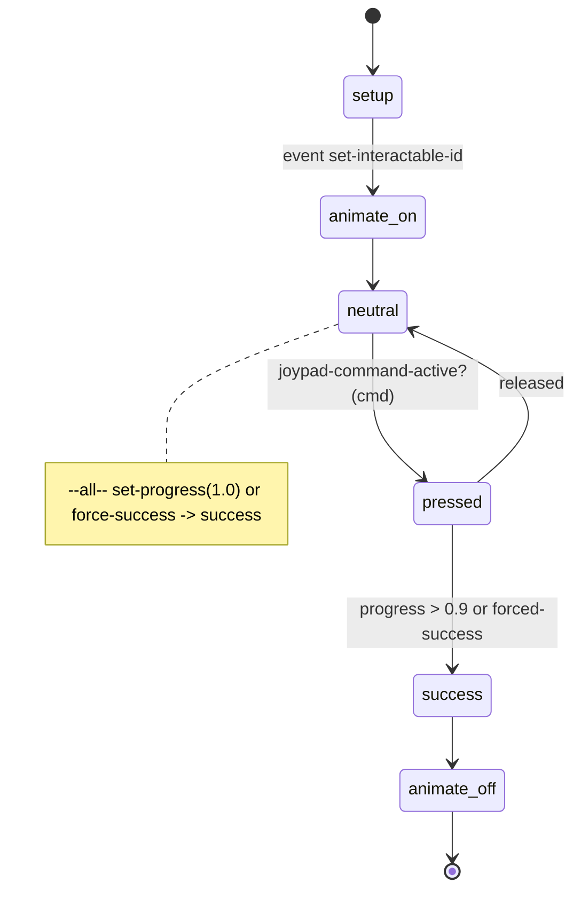
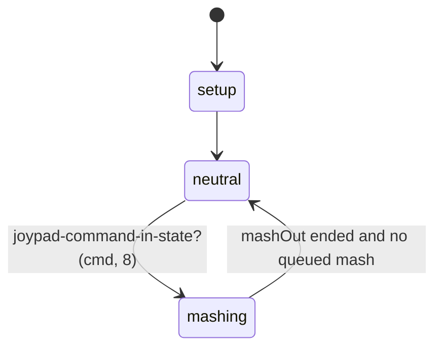
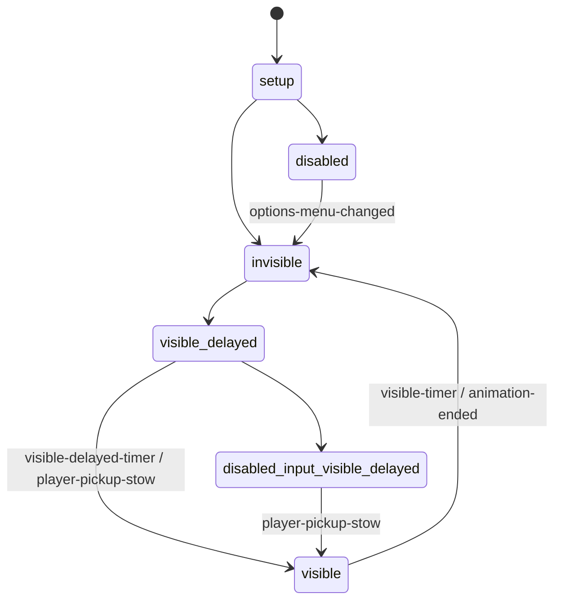

# Interaction prompt UI layer — TLOU Part II Remastered PC 1.6

Scope: how interaction prompts, hold/mash widgets and HUD notifications are produced, and how
world-object state scripts talk to HUD scripts. The data side (the 273 interaction definitions that
feed every prompt) is in [`databases/interaction_definitions.json`](../../databases/interaction_definitions.json)
/ `.csv`; detection/selection is in [`systems/interactable/README.md`](../interactable/README.md).

Labels: **CONFIRMED** · **HIGH** · **INFERRED** · **UNKNOWN / NEEDS NATIVE RESEARCH**.

---

## 1. Overview & files

| File | Role |
|---|---|
| `interactable.bin` | Prompt assets per def: button glyph id (0x0D0 `gen:interact`, `gen:attack`, `gen:jump`, `menu:inspect`, `html/analog-*.png`, `pc/html/<pad>/controller-shake_medium.svg`), widget override (0x0C8 `pc/hud-interactable/pickup-small-pc`, `hud-interactable/interact-dialogue.widget`, `pc/button-prompt/button-mash-hold-hybrid-pc.widget`, `pc/hud-interactable/interact-boost-pc.widget`), side image (0x0D8 `hud/interactions/investigate.png`, `dialogue[-right].png`, collectible icons), overlay (0x0E0 `hud/crafting-2/wrench.png`), text ids (0x168 / 0x178), style (0x198). |
| `script-funcs.bin` | `draw-interactable-hud(def, locator, arg)` (DC). |
| `script-funcs-hud.bin` | `hud-draw-interactable-on-object(def, obj, joint, ...)`, `draw-shake-interactable-hud`, `hud-tutorial-active?` (DC). |
| `gui2-script-funcs-game-impl.bin` | All `hud2-*` helpers: `hud2-show-interactable-hold[-on-object]`, `hud2-signal-interactable-hold-success`, notifications, reminders, arrow prompt, button-prompt stack, titlecard, widget registry (`gui2-register-widget-path` / `gui2-get-widget-path`). |
| `gui2-script-funcs.bin` | Generic widget math (pivot/scale/rotation), `menu2-pop-all-pages`, TTS. |
| `ss-hud2/ss-hud2.bin` | Player-attached registry script `ss-hud2` (option `#player`) declaring `w-arrow-status`, `w-notification-manager`, `w-button-hold`. Runtime instance addressed as `ss-hud2-1`. |
| `ss-hud2/ss-hud2-button-mash-hold.bin` | Widget script `ss-hud2-button-mash-hold-hybrid`. |
| `ss-hud2/ss-hud2-proto-button-mash.bin` | Widget script `ss-hud2-proto-button-hold` (the hold ring). |
| `ss-hud2/ss-hud2-notification-manager.bin`, `-reminder-manager`, `-reminder`, `-top-center-message`, `-hint-region`, `-arrow-status-prompt`, `-lock-minigame`, `-world-annotation`, … (40 binaries in `ss-hud2/`) | HUD subsystems. |
| `menu2-pages.bin` | `*menu2-pages*` hash (32 option pages). Prompt options: `MENU_INTERACT_PROMPTS`, `MENU_PICK_UP_PROMPTS`, `MENU_DODGE_PROMPTS`, `MENU_GRAPPLE_PROMPTS` (options page), `MENU_BUTTON_MASH`, `MENU_HOLD_PRESSES`, `MENU_TRAVERSAL_AUDIO_CUES` (accessibility pages). |
| `gui2-game.bin` | HUD tuning data (damage indicator, dodge reminder attach params, `*gui2-icon-to-tts-table*`, `*hud-photo-mode*` incl. the 120-name interact-def list at 0x5E0). |

## 2. Prompt production — three paths

1. **Native automatic prompt (most objects; e.g. drawer).** The native interactable system draws
   the button prompt for the selected interactable using the def's icon/widget/style/text and
   the highlight settings. No DC code is involved (HIGH: drawers, doors, pickups never call a draw
   helper; `interactable-draw-icon(obj)` / `disable-drawing-interactable-icon()` exist only to force
   or suppress it).
2. **Script-driven prompt (struggles, pushes, IGC holds).** The object script draws a prompt every
   frame in an `update` block and polls input itself:
   `hud2-show-interactable-hold(interact-default-hold, locator, progress, 1)` +
   `joypad-command-active?(interact-hold, 6)` (CONFIRMED in `ss-afm-brewery-push-fridge` idle /
   struggle-forward / struggle-reverse, progress = player animation phase), then
   `hud2-signal-interactable-hold-success()` on success. Tap prompts use
   `draw-interactable-hud(def, locator, 0)` / `hud-draw-interactable-on-object(...)`.
   Use counts: `hud2-show-interactable-hold` 129, `draw-interactable-hud` 105,
   `hud-draw-interactable-on-object` 66 calls.
3. **Special widgets.** Arrow pull-out (`hud2-show-worldspace-arrow-prompt`), button-prompt stack
   (`hud2-show-button-prompt-stack` → spawns `button-prompt/button-prompts-corner`), look-at prompt
   (native `hud2-show-look-at-prompt`), lock minigame (`ss-hud2-lock-minigame`).

### DC dispatch logic (CONFIRMED, paraphrased)
```
draw-interactable-hud(def, loc, a)
 ├─ d = lookup-interactable-def(def)                         [native]
 ├─ if d && byte(d+0x1FB) && button-mashes-are-holds?()      [accessibility "button mash → hold"]
 │    └─ hud2-show-interactable-hold(def, loc, 0.50, 1)       [DC]
 └─ else draw-interactable-hud-aux(def, loc, a)              [native]
hud2-show-interactable-hold(def, loc, progress, sound?)
 ├─ w = gui2-show-permanent-attachable-widget-at(attachableWidgets,
 │        net? "hud-mp/to1/button-prompts/button-hold-radial-to1" : "pc/button-prompt/button-hold-pc",
 │        loc, "button-hold", 6|1, 0)                       [native]
 ├─ request-shiv-prompt(def, loc, ...)                       [native]
 ├─ send-event(set-interactable-id, w, def)                  [→ widget script]
 ├─ send-event(set-progress, w, progress)
 └─ if sound? && def == interact-default-hold → play-accessibility-interact-hold-sound-at-position
draw-shake-interactable-hud(cmd, loc, def, a)
 └─ pad without remap/gyro/steam → interact-left|right-stick-move (by joypad-sticks-swapped?) else def
```

## 3. State machines

### 3.1 `ss-hud2-proto-button-hold` (hold ring; registers as `w-button-hold`)

```
setup
 ├─ set-symbol(w-button-hold, self, ss-hud2-1)               [CONFIRMED]
 └─ on set-interactable-id: d = lookup-interactable-def(id); icon "%s@large" of d+0xD0; joypad-command = d+0xF0; go(animate-on)
animate-on   → gui2-set-widget-state(self, off→active); go(neutral)
neutral      (update) seek-rotation / seek-progress / update-progress-widgets; pressed when command active
pressed      (update) progress seek; go(neutral) on release; success when internal-percent > 0.9
success      0.4 s fill tween of progress bars; go(animate-off)
animate-off  gui2-set-widget-state(self, active→off)
--all--      set-progress → internal-percent (==1.0 → success); force-success → forced-success?=1; options-menu-changed → refresh
--script-- end → set-symbol(w-button-hold, 0, ss-hud2-1)
```

### 3.2 `ss-hud2-button-mash-hold-hybrid` (`pc/button-prompt/button-mash-hold-hybrid-pc.widget`, INFERRED binding)

```
setup
 ├─ gui2-assign-to-category(self, 512); find buttonPrompt/pulses/outlines         [CONFIRMED]
 └─ id = hud2-attachable-button-get-interactable-id(self) → def+0xF0 command, def+0xD0 icon
neutral   update: press (state 8) → frame-last-pressed; go(mashing)
mashing   start play-mash-anim(1) (mashIn, pulse ≤5 per 0.45 s); update queues mash on new press
--all--   set-interactable-id (re-read def), options-menu-changed/update → update-player-setting-hud:
          keyboard icon mode hides circle; long keys (Enter/Shift/Ctrl/Space/F10-12…) use rect outline;
          "toggleGroup" visible iff is-interact-prompts-enabled?()
```

### 3.3 `ss-hud2-notification-manager` (widget at `canvas.hudRoot.rootFullscreen.notifications`)

```
setup        gui2-register-widget-path(w-notification-manager, self)   [CONFIRMED caller list]
--all--      events: request-pickup-notification, new-item-recieved, pick-up-treasure, player-pickup,
             clear-notifications, player-menu-closed, crafting-menu-opened, options-menu-changed
             └─ builds ddict(hud2-icon = "hud/notification/notifications_icons/*.png") → hud2-request-item-pickup-notification
visible      broadcast new-item-notification-ended on exit                  [CONFIRMED]
```
Other HUD managers (summary, CONFIRMED from `q.py ss`): `ss-hud2-reminder-manager`
(no-reminders → send-new-reminder → reminder-active on `request-reminder`),
`ss-hud2-top-center-message` (dormant/showing/active/hiding on `show-message[-text]`/`hide-message`),
`ss-hud2-hint-region` (enter/inside/exit → `hud2-request-reminder`).

## 4. How world scripts talk to HUD scripts

| Mechanism | Example | Evidence |
|---|---|---|
| **Direct DC helper call** that spawns/refreshes an attachable widget, then **`send-event` to the widget instance** | `hud2-show-interactable-hold` → `set-interactable-id`, `set-progress`; `hud2-signal-interactable-hold-success` → `force-success` | CONFIRMED |
| **Widget registry global** on the player-attached `ss-hud2-1` (`set-symbol/get-symbol` of `w-button-hold`, `w-notification-manager`, `w-arrow-status`) | hold-success looks up `w-button-hold` in `ss-hud2-1` | CONFIRMED |
| **Fixed canvas paths** | `canvas.hudRoot.rootFullscreen.notifications`, `...attachableWidgets` | CONFIRMED |
| **Events to player** with boxed result | `hud2-request-reminder` → `send-event-box-result(request-reminder, player, id, bool)` | CONFIRMED |
| **Spawned singleton scripts** | `hud2-show-titlecard` → `spawn-script("ss-hud2-titlecard")` then `send-event(show-titlecard, …)` | CONFIRMED |
| **Native broadcasts** | `player-pickup` (39 handlers), `options-menu-changed` (81), `player-arrow-stuck`, `pick-up-treasure` — no script senders | CONFIRMED native |
| **Def data** | the prompt reads icon/command from the def (`lookup-interactable-def` +0xD0/+0xF0) | CONFIRMED |

## 5. Engine boundary
* **DC**: the helpers above (functions.json `dc-script`: `draw-interactable-hud`, `hud-draw-interactable-on-object`, `draw-shake-interactable-hud`, `hud2-show-interactable-hold[-on-object]`, `hud2-signal-interactable-hold-success`, `hud2-request-*-notification`, `hud2-request-reminder`, `hud2-show-button-prompt-stack`, `hud2-show-worldspace-arrow-prompt`, `hud2-set-arrow-prompt-progress`, `gui2-register-widget-path`, …) and the `ss-hud2/*` widget scripts.
* **Native**: widget creation (`gui2-show-permanent-attachable-widget[-at]`, `gui2-show-attachable-widget/f`, `gui2-spawn-widget`), automatic prompt drawing (`draw-interactable-hud-aux`, `hud-draw-interactable-on-object-aux`, `gui2-show-interactable-hud`), `lookup-interactable-def`, `hud2-attachable-button-get-interactable-id`, options queries (`is-interact-prompts-enabled?`, `button-mashes-are-holds?`, `is-traversal-audio-cues?`), look-at prompts, `request-shiv-prompt`.
* **Data**: `.widget` layout files (not in the DC corpus — UNKNOWN content), defs, `menu2-pages`, `gui2-game`.

## 6. Events in / out
In to widgets: `set-interactable-id`, `set-progress`, `force-success`, `set-progress-percent`, `set-play-icon-sounds`, `hud-set-data`, `hud-disable-prompt`, `kill-hud`, `request-pickup-notification`, `new-item-recieved`, `clear-notifications`, `request-reminder`, `show-message`, `show-titlecard`, `options-menu-changed`.
Out: `new-item-notification-ended` (broadcast), `manager-requests-kill`, `stop-current-reminder`, `arrow-impalement-damage`.

## 7. Persistence
HUD state is transient. Notification "seen/new" marks go through native `hud2-mark-recipe-new`,
`hud2-mark-weapon-cross-slot-new`, `hud2-mark-health-ammo-interacted` (persistence UNKNOWN).

## 8. Animation / camera / UI / audio hooks
Widget states `off/active/squeezeIn/squeezeOut/mashIn/mashOut/pulse`; accessibility prompt sounds
`sfx-ui-acc-prompt-[distant-]triangle-button[-above|-below]` via `play-accessibility-sound-at-position`
gated by `is-traversal-audio-cues?` and player-fact cooldowns (`accessibility-cue`,
`accessibility-triangle-cue`, `accessibility-triangle-distant-cue`) — CONFIRMED in
`accessibility-script-funcs`.

## 9. Shared components
Interactable defs (icon/command/text), accessibility (button-mash→hold, audio cues, TTS
`*gui2-icon-to-tts-table*`), inventory/pickups (notifications), melee (`melee-struggle-hud-placement`
uses `draw-interactable-hud` with `interact-attack-mash*`), MP (`hud-mp/to1/...` radial).

## 10. Confidence table
| Claim | Label |
|---|---|
| Hold/mash widgets read def +0xD0 icon and +0xF0 command | CONFIRMED |
| `draw-interactable-hud` switches to hold widget when def byte 0x1FB set and mashes-are-holds | CONFIRMED |
| Normal prompts are drawn natively without DC involvement | HIGH |
| Widget file ↔ widget script binding (`button-mash-hold-hybrid-pc.widget` ↔ `ss-hud2-button-mash-hold-hybrid`) | INFERRED |
| `gui2-show-permanent-attachable-widget-at` reuses one widget per attach id when called every frame | INFERRED |

## 11. Open questions
1. `.widget` files (layouts, script bindings) are not in the DC corpus.
2. How the native prompt picks text when 0x168 is empty (likely a default "interact" label keyed by style).
3. What `request-shiv-prompt` does with non-shiv defs.

## 12. Modding surface
| Surface | Rating | Reason |
|---|---|---|
| Change a def's icon/widget/text/sound | **GREEN** | data fields in `interactable.bin`. |
| Draw a custom prompt from a mod state script (`draw-interactable-hud`, `hud2-show-interactable-hold`) | **GREEN** | public DC helpers. |
| Edit `ss-hud2/*` widget scripts (pulse rate, success threshold 0.9, long-key list) | **YELLOW** | DC code, but tied to unseen `.widget` layouts. |
| New widget layouts | **ORANGE** | widget files outside DC corpus. |
| Native prompt renderer / option queries | **RED** | native. |
